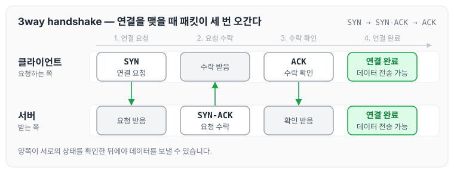
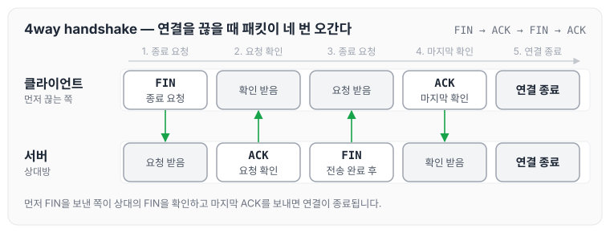
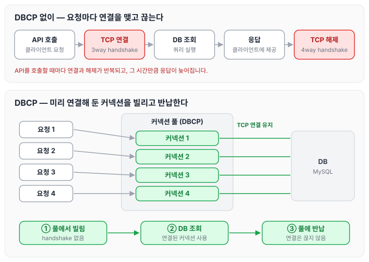
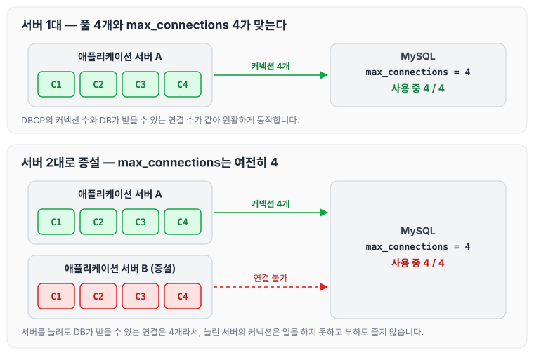
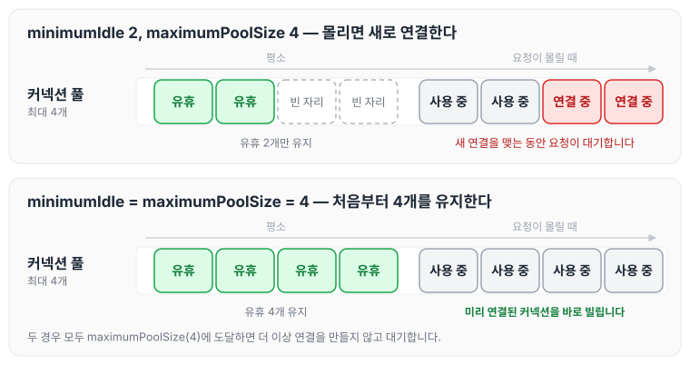
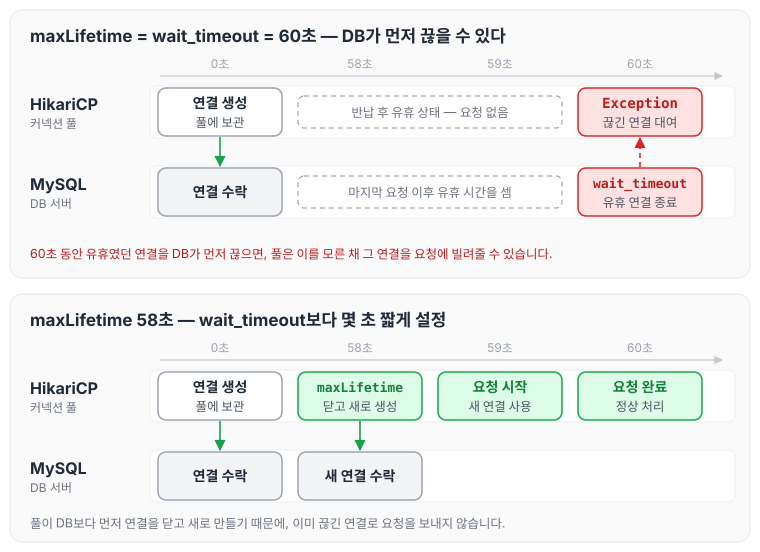

이전에 [커넥션 풀과 데이터소스 이해하기](../spring-db-connection-pool/)에 대해 작성하였습니다. 그 글에서는 커넥션을 매번 새로 맺을 때의 문제와 커넥션 풀, DataSource가 이를 어떻게 해결하는지 정리하였습니다. 오늘은 DBCP에 대해 정리하도록 하겠습니다.

DBCP는 DataBase Connection Pool의 약자로, 클라이언트의 요청이 왔을 때 Database와의 연결을 효율적으로 관리하기 위해 사용하는 기술입니다. DBCP가 없을 때 어떤 과정을 거치는지 먼저 살펴보고, DBCP가 이를 어떻게 줄이는지, 그리고 DBCP를 사용할 때 개발자가 알고 있어야 하는 설정을 순서대로 정리하겠습니다.

## DBCP 없이 Database에 조회하는 경우

DBCP가 없으면 API를 한 번 호출할 때마다 아래 과정을 거칩니다.

1. 클라이언트가 API를 호출합니다.
2. 애플리케이션이 DB에 접근하기 위해 TCP 통신으로 연결합니다.
    - TCP는 연결을 맺을 때 3way handshake 방식을 사용합니다.
3. TCP 통신으로 애플리케이션과 DB가 연결되면, DB를 조회한 뒤 클라이언트에게 정보를 제공합니다.
4. 4way handshake 방식으로 TCP 연결을 해제합니다.

연결을 맺는 과정과 끊는 과정을 차례로 보겠습니다.

### TCP 연결의 3way handshake

- 클라이언트가 서버에게 연결 요청(`SYN`)을 보냅니다.
- 서버가 이 요청을 받고, 요청을 수락(`SYN-ACK`)합니다.
- 클라이언트가 서버에게 연결 수락 확인(`ACK`)을 보냅니다.

클라이언트와 서버 사이에 오가는 패킷을 순서대로 그리면 다음과 같습니다.

이 과정을 통해 양쪽 호스트는 데이터를 전송하기 전에 서로의 상태를 확인하고, 안정적인 연결을 설정할 수 있습니다. 그림처럼 데이터를 보내기 전에 패킷이 세 번 오가야 합니다.

### TCP 해제의 4way handshake

- 한쪽(클라이언트 또는 서버)에서 연결을 종료하겠다는 `FIN` 패킷을 보냅니다.
- 상대방은 이 요청을 확인하고, `ACK` 패킷으로 응답합니다.
- 상대방도 자신의 데이터 전송이 완료되면 `FIN` 패킷을 보내 연결 종료를 요청합니다.
- 첫 번째로 `FIN` 요청을 보낸 쪽이 이 `FIN`을 확인하고, 마지막 `ACK` 패킷을 보내면서 연결이 종료됩니다.

먼저 끊는 쪽을 클라이언트로 두고 그리면 다음과 같습니다.

연결을 끊을 때도 패킷이 네 번 오갑니다. 이처럼 API를 한 번 호출할 때마다 TCP 연결을 맺고 끊는 데 많은 시간이 소요되고, 사용자는 느린 응답을 기다리게 됩니다. 이를 해결하기 위해 나온 것이 DBCP입니다.

## DBCP 연결 풀

DBCP는 데이터베이스 연결 객체들을 미리 생성해서 풀 안에 보관하고, 애플리케이션이 데이터베이스와 상호작용할 때마다 풀에서 Connection을 빌려 재사용합니다. 이 방식으로 요청마다 3way handshake와 4way handshake를 거치는 번거로움을 없앴고, 사용자는 더 빠르게 정보를 제공받을 수 있습니다.

DBCP가 없을 때와 있을 때 요청이 거치는 과정을 비교하면 다음과 같습니다.

위쪽은 요청마다 연결과 해제를 반복하고, 아래쪽은 DB와 미리 연결해 둔 커넥션을 빌렸다가 반납하기 때문에 요청을 처리하는 과정에 handshake가 들어가지 않습니다.

그렇다면 이렇게 커넥션을 미리 만들어 두는 DBCP에서 개발자는 무엇을 신경 써야 하는지, DB 서버 설정과 DBCP 설정으로 나누어 정리하겠습니다.

## DB 서버 설정

### 1. max_connections

현재 MySQL의 `max_connections` 수가 4이고 DBCP에 설정된 커넥션 수가 4개라면 원활하게 동작할 수 있습니다. 그러나 유저 유입이 늘어 클라이언트 요청이 많아지면, 애플리케이션 서버를 증설하더라도 `max_connections`가 4로 제한되어 있기 때문에 부하가 줄어들지 않습니다. 따라서 개발자는 `max_connections` 수를 적절히 설정하고, 안정적인 운영을 위해 이를 어떻게 관리할지 알고 있어야 합니다.

애플리케이션 서버를 한 대에서 두 대로 늘렸을 때를 그리면 다음과 같습니다.

증설한 서버 B의 커넥션은 `max_connections`를 넘기 때문에 DB와 연결되지 못하고, 서버를 늘린 만큼 처리량이 늘지 않습니다.

### 2. wait_timeout

애플리케이션과 MySQL이 정상적으로 연결되어 데이터를 주고받다가, 특정 문제로 애플리케이션이 종료 신호를 보내지 못하면 데이터베이스는 해당 연결이 여전히 사용 중이라고 인식해 점유 상태로 유지합니다. 이런 연결이 하나라면 큰 문제가 없지만, 여러 개가 생기면 시스템 성능에 심각한 영향을 줄 수 있습니다.

이를 방지하기 위해 `wait_timeout`을 설정합니다. `wait_timeout`은 데이터베이스에서 유휴 상태로 있는 연결이 일정 시간 동안 아무런 활동이 없으면, 해당 연결을 자동으로 종료해 그 연결이 쓰던 자원을 회수합니다. 이를 통해 불필요한 연결이 오래 점유되는 것을 막고 시스템의 안정성을 유지할 수 있습니다.

## DBCP 설정

DBCP 설정은 HikariCP를 기준으로 정리하겠습니다.

### 1. minimumIdle

- HikariCP가 데이터베이스에 대해 항상 유지하려고 하는 최소한의 유휴 연결 수
- 현재 풀의 유휴 연결 수가 `minimumIdle`보다 적으면, HikariCP는 비동기적으로 새로운 연결을 생성해 유휴 연결 수를 유지합니다. 이렇게 해서 데이터베이스 요청이 발생했을 때 대기 시간을 최소화할 수 있습니다.

### 2. maximumPoolSize

- HikariCP가 동시에 열 수 있는 연결의 최대 수

개발자가 알아 두어야 할 점은 `minimumIdle`과 `maximumPoolSize`의 상관관계입니다.

- `minimumIdle`은 항상 유지해야 하는 최소 유휴 연결 수를 설정합니다.
- `maximumPoolSize`에 도달하면 HikariCP는 더 이상 연결을 생성하지 않고 대기하게 됩니다.

따라서 두 값을 적절히 설정해서 시스템의 성능과 안정성을 유지하는 것이 중요합니다.

또한 HikariCP는 `minimumIdle`과 `maximumPoolSize`를 동일하게 사용하도록 권장하고 있습니다. 급작스럽게 클라이언트 요청이 몰릴 때 `minimumIdle` 수를 맞추기 위해 TCP 연결을 새로 맺다 보면 트래픽을 전부 처리할 수 없기 때문입니다.

`maximumPoolSize`가 4일 때 `minimumIdle`을 2로 둔 경우와 4로 같게 둔 경우를 비교하면 다음과 같습니다.

`minimumIdle`이 작으면 요청이 몰리는 순간에 부족한 커넥션을 TCP 연결로 새로 맺어야 하고, 두 값을 같게 두면 처음부터 연결된 커넥션을 바로 빌려 쓸 수 있습니다.

> **Idle**
>
> 커넥션이 연결되어 있지만, 어떠한 작업도 하지 않고 대기 중인 Connection

### 3. maxLifetime

- `maxLifetime`을 설정하면 각 연결은 지정된 시간 동안만 유효하며, 이 시간이 지나면 HikariCP는 연결을 닫고 새 연결을 생성합니다.
- active, 즉 connection이 사용 중인 상태라면 pool로 반환된 뒤에 제거됩니다.
- DB의 `wait_timeout` 설정보다 몇 초 짧게 설정해야 합니다.

`wait_timeout`은 연결이 아무 요청 없이 유휴 상태로 있던 시간을 기준으로 동작합니다. 풀에 반납된 연결이 `wait_timeout`보다 오래 유휴 상태로 남아 있으면 데이터베이스는 해당 연결을 강제로 종료하지만, HikariCP는 이 사실을 모른 채 그 연결을 다음 요청에 빌려줄 수 있습니다. 이때 클라이언트에서 요청이 들어오면, 이미 종료된 연결 때문에 예외(Exception)가 발생할 수 있습니다.

DB의 `wait_timeout`과 `maxLifetime`을 똑같이 60초로 설정했을 때는 다음과 같은 상황이 발생할 수 있습니다.

- 풀에 반납된 연결이 60초 동안 요청을 받지 않고 유휴 상태로 있으면, 데이터베이스는 `wait_timeout`에 따라 이 연결을 종료합니다.
- 두 값이 같으면 풀이 `maxLifetime`으로 연결을 정리하기 전에 데이터베이스가 먼저 끊을 수 있고, 풀은 이미 끊긴 연결을 요청에 빌려줄 수 있습니다. 이 경우 요청이 처리되지 않고 예외(Exception)가 발생합니다.

두 값을 똑같이 둔 경우와 `maxLifetime`을 몇 초 짧게(예: 58초) 둔 경우를 시간 순서로 그리면 다음과 같습니다.

아래쪽처럼 `maxLifetime`이 먼저 끝나면 풀이 연결을 닫고 새로 만들기 때문에, DB가 이미 끊은 연결을 빌려주지 않게 됩니다.

따라서 `wait_timeout`과 `maxLifetime`을 동일하게 설정하는 것은 권장되지 않으며, 두 값을 적절히 조정해서 이러한 문제를 예방해야 합니다.

### 4. connectionTimeout

- pool에서 connection을 받기 위한 대기 시간
- Idle 상태인 커넥션이 없고 모두 사용 중일 때 무한정 기다릴 수는 없으므로, 적절한 `connectionTimeout`을 설정해야 합니다.

무한히 기다리지 않도록 타임아웃을 두는 방식은 [데드락의 네 가지 조건과 해결 전략](../deadlock/)에서 다룬 `tryLock`의 타임아웃과 같은 역할을 합니다.

## 정리

결론적으로 데이터베이스(DB)의 부하와 애플리케이션의 부하 상태를 면밀히 모니터링해서, DB 설정과 DBCP 설정이 조화롭게 적용되고 있는지 확인해야 합니다.

1. 부하가 발생하는 경우
    - DB와 애플리케이션의 설정이 잘 맞춰져 있다면, 장비를 증설해서 부하 문제를 해결할 수 있습니다.
2. 설정이 맞지 않는 경우
    - DB와 DBCP의 설정이 적절하게 조정되어 있지 않다면, 아래와 같이 설정을 다시 조정해서 문제를 해결해야 합니다.
        - 설정 최적화: `maximumPoolSize`, `minimumIdle`, `maxLifetime`, `wait_timeout` 등의 값을 적절히 조정해서 최적의 성능을 이끌어낼 수 있습니다.

오늘은 DBCP가 TCP 연결 비용을 줄이는 방식과, DB 서버 및 HikariCP에서 함께 맞춰야 하는 설정에 대해 정리하였습니다. 이러한 점들을 숙지하고 DB와 DBCP의 설정을 함께 살펴본다면, 부하가 생겼을 때도 시스템의 안정성과 성능을 유지하는 데 도움이 될 것 같습니다.
