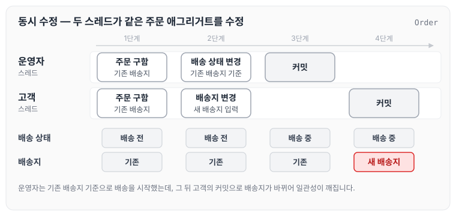
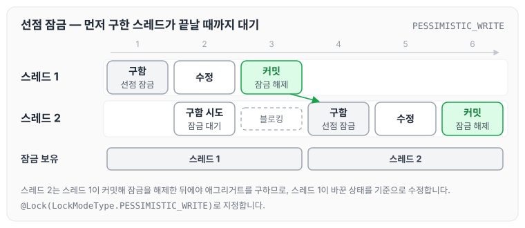
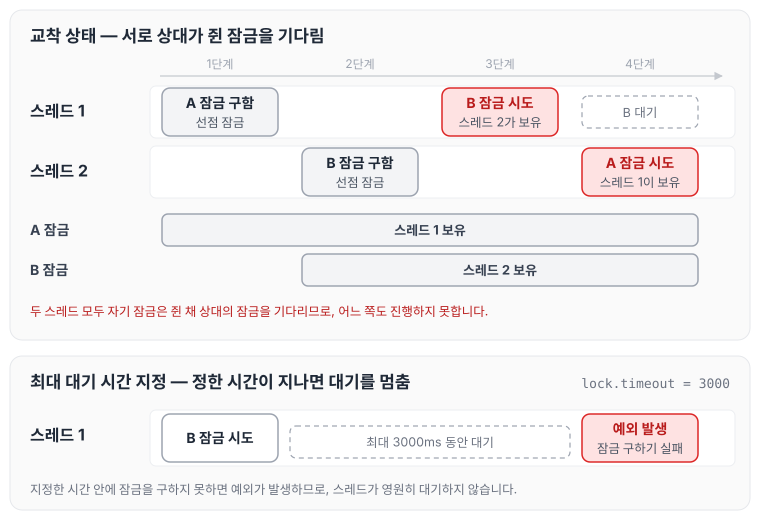
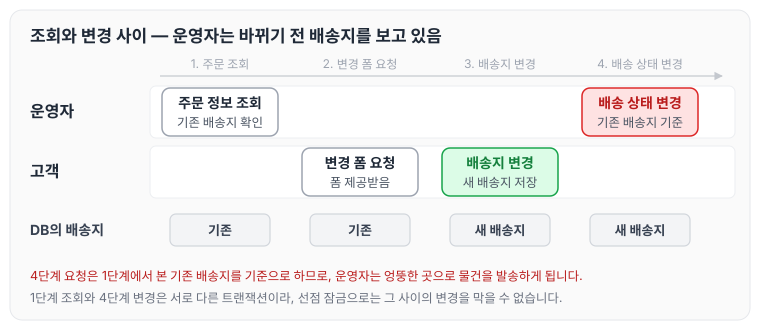
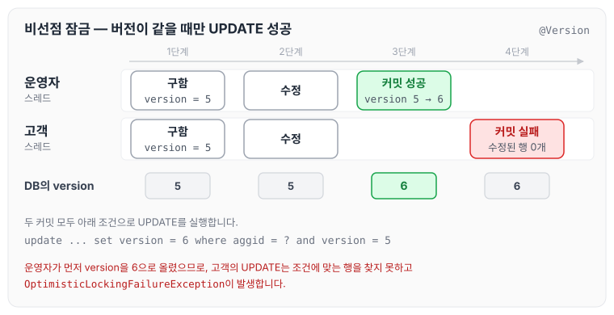
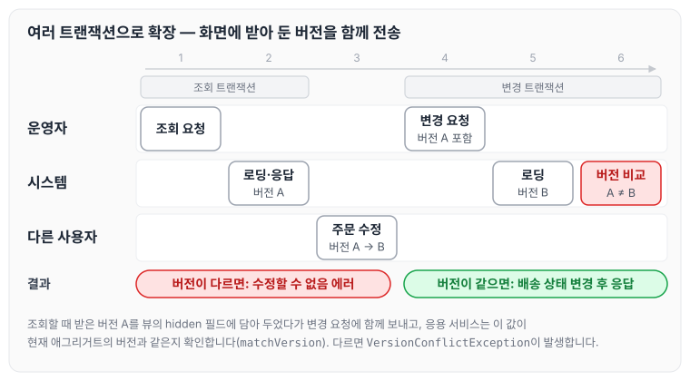
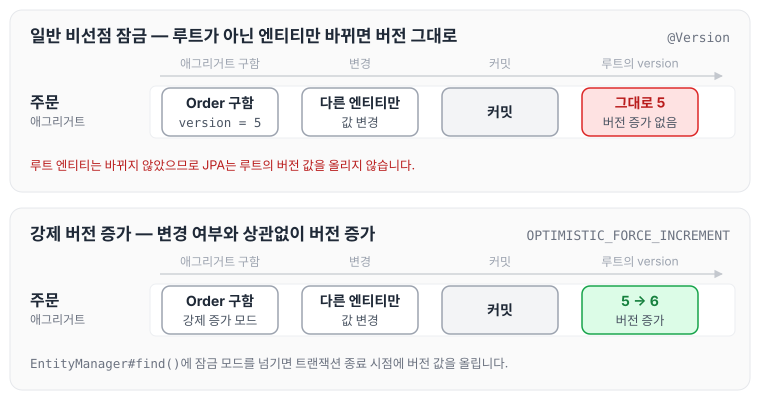
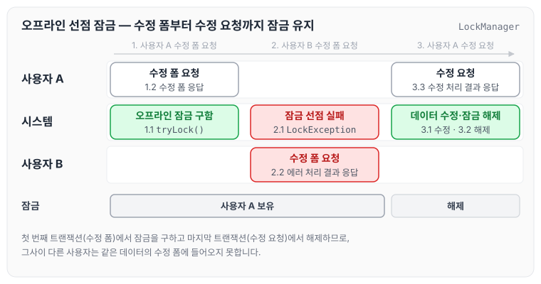
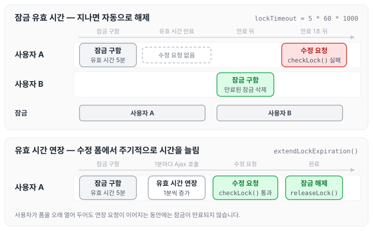

이전에 [도메인 서비스](../ddd-domain-service/)에 대해 작성하였습니다. 이번 글에서는 운영자와 고객처럼 서로 다른 스레드가 같은 애그리거트를 동시에 수정할 때 생기는 일관성 문제와, 이를 막기 위한 선점 잠금, 비선점 잠금, 오프라인 선점 잠금에 대해 정리하도록 하겠습니다.

## 애그리거트와 트랜잭션

운영자와 고객이 같은 주문 애그리거트를 동시에 다루는 상황을 예로 들어 보겠습니다.

- 운영자는 기존 배송지 정보를 이용해서 배송 상태를 변경합니다.
- 고객은 배송지 정보를 변경합니다.

두 스레드가 각자 주문 애그리거트를 구해 수정하고 커밋하는 흐름은 아래와 같습니다.



운영자는 기존 배송지를 기준으로 배송 상태를 변경했는데, 그 뒤에 고객의 변경이 커밋되면서 배송지가 바뀝니다. 이렇게 두 스레드가 같은 애그리거트를 동시에 수정하면 일관성이 깨지는 문제가 발생합니다.

이 문제를 막는 방법은 아래 두 가지입니다.

- 운영자가 배송지 정보를 조회하고 상태를 변경하는 동안, 고객이 애그리거트를 수정하지 못하게 합니다.
- 운영자가 배송지 정보를 조회한 이후에 고객이 정보를 변경하면, 운영자가 애그리거트를 다시 조회한 뒤 수정하도록 합니다.

> 💡 이 두 가지가 애그리거트에서 대표적으로 사용하는 트랜잭션 처리 방식인 `선점(Pessimistic) 잠금`과 `비선점(Optimistic) 잠금`입니다.

## 선점 잠금

선점 잠금은 먼저 애그리거트를 구한 스레드가 애그리거트 사용이 끝날 때까지 다른 스레드가 해당 애그리거트를 수정하지 못하게 막는 방식입니다.



스레드 2는 스레드 1이 트랜잭션을 커밋해 잠금을 해제할 때까지 블로킹되고, 잠금이 풀린 뒤에야 애그리거트를 구해 수정합니다. 선점 잠금은 흔히 비관적 락이라고 부르며, DB에서 실제로 행이 어떻게 잠기는지(`SELECT ... FOR UPDATE`, X-Lock)는 [DB 비관적 락](../pessimistic-lock/)에서 따로 정리하였습니다.

### 선점 잠금과 교착 상태

선점 잠금을 사용할 때는 잠금 순서에 따라 교착 상태가 발생할 수 있습니다.

1. 스레드 1 : A 애그리거트에 대한 선점 잠금을 구함
2. 스레드 2 : B 애그리거트에 대한 선점 잠금을 구함
3. 스레드 1 : B 애그리거트에 대한 선점 잠금 시도
4. 스레드 2 : A 애그리거트에 대한 선점 잠금 시도

이 순서대로 실행되면 스레드 1은 B 애그리거트에 대한 선점 잠금을 영원히 구할 수 없고, 스레드 2도 A 애그리거트의 잠금을 구할 수 없어 `교착 상태`에 빠지게 됩니다.

이 문제를 해결하려면 잠금을 구할 때 최대 대기 시간을 지정합니다. 스프링 데이터 JPA에서는 `@QueryHints`에 `@QueryHint(name = "javax.persistence.lock.timeout", value = "3000")`을 지정합니다.

```java
public interface MemberRepository extends Repository<Member, MemberId> {
    Optional<Member> findById(MemberId memberId);

    @Lock(LockModeType.PESSIMISTIC_WRITE)
    @QueryHints({
            @QueryHint(name = "javax.persistence.lock.timeout", value = "3000")
    })
    @Query("select m from Member m where m.id = :id")
    Optional<Member> findByIdForUpdate(@Param("id") MemberId memberId);
}
```

네 단계와 대기 시간을 지정했을 때의 흐름을 그리면 아래와 같습니다.



두 스레드 모두 자기가 쥔 잠금은 놓지 않은 채 상대의 잠금을 기다리기 때문에 어느 쪽도 진행하지 못합니다. 최대 대기 시간을 지정하면 그 시간 안에 잠금을 구하지 못했을 때 예외가 발생하므로, 스레드가 무한정 대기하지 않습니다. 교착 상태가 생기는 조건은 [데드락의 네 가지 조건과 해결 전략](../deadlock/)에서 따로 정리하였습니다.

## 비선점 잠금

선점 잠금으로 해결할 수 없는 경우도 있습니다. 아래 순서를 보겠습니다.

1. 운영자는 배송을 위해 주문 정보를 조회합니다. 시스템은 정보를 제공합니다.
2. 고객이 배송지 변경을 위해 변경 폼을 요청합니다. 시스템은 변경 폼을 제공합니다.
3. 고객이 새로운 배송지를 입력하고 폼을 전송하여 배송지를 변경합니다.
4. 운영자가 1번에서 조회한 주문 정보를 기준으로 배송지를 정하고 배송 상태를 변경 요청합니다.



운영자가 배송 상태를 변경하기 전에 배송지를 한 번 더 확인하지 않으면, 운영자는 다른 배송지로 물건을 발송하게 되고 고객은 배송지를 변경했음에도 엉뚱한 곳에서 주문한 물건을 받게 됩니다.

이 문제는 `선점 잠금` 방식으로는 해결할 수 없습니다. 1번의 조회와 4번의 변경이 서로 다른 트랜잭션이기 때문에, 조회 트랜잭션에서 잡은 잠금은 4번 전에 이미 풀려 있습니다. 이때 사용하는 것이 비선점 잠금입니다.

비선점 잠금은 동시에 접근하는 것을 막는 대신, 변경한 데이터를 실제 DBMS에 반영하는 시점에 변경 가능 여부를 확인하는 방식입니다. 비선점 잠금을 구현하려면 애그리거트에 버전으로 사용할 숫자 타입 프로퍼티를 추가해야 하며, 수정할 때는 아래와 같이 현재 버전을 조건으로 UPDATE를 실행합니다.

```sql
UPDATE aggtable SET version = version + 1, colx = ?, coly = ?
WHERE aggid = ? and version = 현재버전
```

운영자 스레드와 고객 스레드가 같은 버전의 애그리거트를 구해 수정하면 아래와 같이 먼저 커밋한 쪽만 성공합니다.



운영자가 먼저 커밋하면서 버전이 5에서 6으로 바뀌었기 때문에, 고객의 UPDATE는 `version = 5` 조건에 맞는 행을 찾지 못하고 실패합니다. 낙관적 락의 버전 확인 과정은 [DB 낙관적 락](../optimistic-lock/)에서도 테스트 코드와 함께 정리하였습니다.

### JPA @Version으로 구현하기

JPA는 버전을 이용한 비선점 잠금 기능을 지원합니다. 엔티티의 버전 필드에 `@Version` 애너테이션을 붙이고, 매핑되는 테이블에 버전을 저장할 컬럼을 추가합니다.

```java
@Entity
@Table(name = "purchase_order")
@Access(AccessType.FIELD)
public class Order {
    @EmbeddedId
    private OrderNo number;

    @Version
    private long version;

...
```

JPA는 엔티티가 변경되어 UPDATE 쿼리를 실행할 때 `@Version`에 명시한 필드를 이용해 비선점 잠금 쿼리를 실행합니다. 기능 실행 과정에서 애그리거트 데이터가 변경되면 JPA가 트랜잭션 종료 시점에 비선점 잠금을 위한 쿼리를 실행하므로, 응용 서비스는 버전에 대해 알 필요가 없습니다.

```java
@Service
public class ChangeShippingService {

    @Transactional
    public void changeShipping(ChangeShippingRequest changeReq) {
        Optional<Order> orderOpt = orderRepository.findById(new OrderNo(changeReq.getNumber()));
				checkNoOrder(order);
        order.changeShippingInfo(changeReq.getShippingInfo());
    }
}
```

쿼리 실행 결과로 수정된 행의 개수가 0이면 이미 누군가 앞서 데이터를 수정한 것이므로 트랜잭션 충돌이 일어난 것이고, 이때 `OptimisticLockingFailureException`이 발생합니다. 표현 영역에서는 이 예외를 잡아 사용자에게 충돌 사실을 알려 줍니다.

```java
@Controller
public class OrderController {
		private ChangeShippingService changeShippingService;

		@PostMapping("/changeShipping")
		public String changeShipping(ChangeShippingRequest changeReq) {
				try {
						changeShippingService.changeShipping(changeReq);
						return "changeShippingSuccess";
				} catch (OptimisticLockingFailureException ex) {
					// 누군가 먼저 같은 주문 애그리거트를 수정했으므로
					// 트랜잭션이 충돌했다는 메시지를 보여준다.
					return "changeShippingFailct";		
				}
		}
}
```

### 여러 트랜잭션으로 확장하기

앞의 배송지 변경 예처럼 조회와 변경이 서로 다른 트랜잭션에서 일어날 때도 비선점 잠금을 적용할 수 있습니다. 흐름은 아래와 같습니다.



비선점 잠금 방식을 여러 트랜잭션으로 확장하려면, 애그리거트 정보를 뷰로 보여 줄 때 버전 값도 함께 전달합니다.

```html
<!-- 애그리거트 정보를 보여줄 때 뷰 코드는 버전 값을 함께 전송한다. -->
<input type="hidden" name = "version" th:value = "${orderDto.version}"/>
```

응용 서비스가 전달받는 데이터에는 다음과 같이 주문번호와 함께 버전이 포함됩니다.

```java
public class StartShippingRequest {

		private String orderNumber;
		private long version;
}
```

응용 서비스는 전달받은 버전 값이 현재 애그리거트의 버전과 일치하는지 확인합니다.

```java
public void startShipping(StartShippingRequest req) {
        Optional<Order> orderOpt = orderRepository.findById(new OrderNo(req.getOrderNumber()));
        Order order = orderOpt.orElseThrow(() -> new NoOrderException());
        if (!order.matchVersion(req.getVersion())) {
            throw new VersionConflictException();
        }
        order.startShipping();
    }
```

표현 계층은 버전 충돌 예외가 발생하면 이를 사용자에게 알려 줍니다.

```java
@Controller
public class OrderAdminController {
		private StartShippingService startShippingService;

		@PostMapping("/startShipping")
		public String startShipping(StartShippingRequest startReq) {
				try {
						startShippingService.startShipping(startReq);
						return "shippingStarted";
				} catch (OptimisticLockingFailureException | VersionConflictException ex) {
					// 트랜잭션 충돌
					return "startShippingTxConflict";		
				}
		}
}
```

### 강제 버전 증가

애그리거트에 루트 외에 다른 엔티티가 있을 때, 기능 실행 도중 루트가 아닌 다른 엔티티의 값만 변경되는 경우가 있습니다. 이때 JPA는 루트 엔티티의 버전 값을 증가시키지 않습니다. 애그리거트 관점에서는 구성 요소가 바뀌었으니 애그리거트 전체가 바뀐 것인데, 버전이 그대로라 비선점 잠금이 충돌을 잡지 못하게 됩니다.

JPA는 이런 문제를 처리할 수 있도록 `EntityManager#find()` 메서드로 엔티티를 구할 때 강제로 버전 값을 증가시키는 잠금 모드를 지원합니다.

```java
@Repository
public class JpaOrderRepository implements OrderRepository {
		@PersistenceContext
		private EntityManager entityManager;

		@Override
		public Order findByIdOptimisticLockMode(OrderNo id) {
			return entityManager.find(Order.class, id, LockModeType.OPTIMISTIC_FORCE_INCREMENT);
		}
}
```

`LockModeType.OPTIMISTIC_FORCE_INCREMENT`를 사용하면 해당 엔티티의 상태가 변경되었는지와 상관없이 트랜잭션 종료 시점에 버전 값을 증가시킵니다.



스프링 데이터 JPA를 사용하면 앞서 살펴본 `@Lock` 애너테이션에 이 잠금 모드를 지정하면 됩니다.

## 오프라인 선점 잠금

오프라인 선점 잠금은 여러 트랜잭션에 걸쳐 동시 변경을 막는 방식입니다.

- 첫 번째 트랜잭션을 시작할 때 오프라인 잠금을 선점하고, 마지막 트랜잭션에서 잠금을 해제합니다.
- 잠금을 해제하기 전까지 다른 사용자는 잠금을 구할 수 없습니다.

수정 폼 요청부터 수정 요청까지 잠금을 유지하는 흐름은 아래와 같습니다.



사용자 A가 수정 폼을 받는 시점에 잠금을 구했기 때문에, 그사이 사용자 B의 수정 폼 요청은 잠금 선점에 실패하고 에러 응답을 받습니다.

### 잠금 유효 시간

오프라인 선점 잠금에는 아래와 같은 문제가 있습니다.

- 사용자 A가 과정 3의 수정 요청을 수행하지 않고 프로그램을 종료하면, 잠금이 해제되지 않으므로 다른 사용자는 영원히 잠금을 구할 수 없게 됩니다.
- 이를 막기 위해 잠금에 유효 시간을 두면, 사용자 A가 잠금 유효 시간이 지나고 1초 뒤에 3번 과정을 수행했을 때 이미 잠금이 해제되었으므로 수정에 실패합니다.

그래서 아래 두 가지가 함께 필요합니다.

- 잠금 유효 시간을 두고, 유효 시간이 지나면 자동으로 잠금을 해제합니다.
- 일정 주기로 유효 시간을 증가시킵니다. 예를 들어 수정 폼에서 1분 단위로 Ajax 호출을 해서 유효 시간을 1분씩 늘립니다.



### LockManager 인터페이스와 관련 클래스

오프라인 선점 잠금은 아래 `LockManager` 인터페이스로 잠금 선점, 확인, 해제, 유효 시간 연장 기능을 제공합니다.

```java
public interface LockManager {
    LockId tryLock(String type, String id) throws LockException;

    void checkLock(LockId lockId) throws LockException;

    void releaseLock(LockId lockId) throws LockException;

    void extendLockExpiration(LockId lockId, long inc) throws LockException;
}
```

1. LockId 클래스입니다.

```java
package com.myshop.lock;

public class LockId {
    private String value;

    public LockId(String value) {
        this.value = value;
    }

    public String getValue() {
        return value;
    }
}
```

2. 컨트롤러가 오프라인 선점 잠금 기능을 이용해서 데이터 수정 폼에 동시에 접근하는 것을 제어하는 코드의 예입니다.

```java
public class DataService {
// 서비스 : 서비스는 잠금 ID를 리턴한다.
		public DataAndLockId getDataWithLock(Long id) {
				// 1. 오프라인 선점 잠금 시도
				LockId lockId = lockManager.tryLock("data", id);
				// 2. 기능 실행
				Data data = someDao.select(id);
				return new DataAndLockId(data, lockId);
		}
}
```

```java

// 서비스가 리턴한 잠금ID를 모델로 뷰에 전달한다.
@RequestMapping("/some/edit/{id}")
public String editForm(@PathVariable("id") Long id, ModelMap model) {
		DataAndLockId dl = dataService.getDataWithLock(id);
		model.addAttribute("data", dl.getData());
		// 잠금 해제에 사용할 LockId를 모델에 추가.
		model.addAttribute("lockId", dl.getLockId());
		return "editForm";
}
```

3. 잠금을 선점하는 데 실패하면 `LockException`이 발생합니다. 이때는 다른 사용자가 데이터를 수정 중이니 나중에 다시 시도하라는 안내 화면을 보여 줍니다.

4. 수정 폼은 LockId를 다시 전송합니다.

```html
<form th:action = "@{/some/edit/{id}(id=${data.id})}" method = "post">
		...
		<input type = "hidden" name = "lid" th:value = "${lockId.value}">
		...
</form>
```

5. 잠금을 해제하는 코드입니다.

```java
// 서비스 : 잠금을 해제한다.
public void edit(EditRequest editReq, LockId lockId) {
		// 1. 잠금 선점 확인
		lockManager.checkLock(lockId);
		// 2. 기능 실행
		..
		// 3. 잠금 해제
		lockManager.releaseLock(lockId);
}
```

```java
@RequestMapping(value = "/some/edit/{id}", method = RequestMethod.POST)
public String edit(@PathVariable("id") Long id
			, @ModelAttribute("editReq") EditRequest editReq
			, @RequestParam("lid") String lockIdValue) {
		editReq.setId(id);
		someEditService.edit(editReq, new LockId(lockIdValue));
		model.addAttribute("data", data);
		return "editSuccess";
}
```

서비스에서는 `LockManager#checkLock()` 메서드를 가장 먼저 실행해, 주어진 LockId가 유효한지 반드시 확인합니다.

- 잠금 유효 시간이 지났다면 이미 다른 사용자가 잠금을 선점했을 수 있습니다.
- 잠금을 선점하지 않은 사용자가 기능을 실행했다면 기능 실행을 막습니다.

### DB를 이용한 LockManager 구현

MySQL 기준으로 잠금 정보를 저장할 테이블은 아래와 같습니다.

```sql
create table locks (
		`type` varchar(255),
		id varchar(255),
		lockId varchar(255),
		expiration_time dateTime,
		primary key (`type`, id)
) character set utf8;

create unique index locks_idx ON locks (lockId);
```

- type과 id 컬럼을 주요키로 지정해, 두 사용자가 동시에 특정 타입 데이터에 대한 잠금을 구하는 것을 방지합니다.
- lockId 필드를 유니크 인덱스로 설정합니다.
- 유효 시간을 보관하기 위해 expiration_time 컬럼을 사용합니다.

locks 테이블의 데이터를 담을 `LockData` 클래스입니다.

```java
package com.myshop.lock;

public class LockData {
    private String type;
    private String id;
    private String lockId;
    private long timestamp;

    public LockData(String type, String id, String lockId, long timestamp) {
        this.type = type;
        this.id = id;
        this.lockId = lockId;
        this.timestamp = timestamp;
    }

    public String getType() {
        return type;
    }

    public String getId() {
        return id;
    }

    public String getLockId() {
        return lockId;
    }

    public long getTimestamp() {
        return timestamp;
    }

    public boolean isExpired() {
        return timestamp < System.currentTimeMillis();
    }
}
```

`isExpired()` 메서드는 유효 시간이 지났는지 확인합니다.

locks 테이블을 이용해 `LockManager`를 구현한 코드는 아래와 같습니다.

```java
package com.myshop.lock;

import org.springframework.dao.DuplicateKeyException;
import org.springframework.jdbc.core.JdbcTemplate;
import org.springframework.jdbc.core.RowMapper;
import org.springframework.stereotype.Component;
import org.springframework.transaction.annotation.Propagation;
import org.springframework.transaction.annotation.Transactional;

import java.sql.Timestamp;
import java.util.List;
import java.util.Optional;
import java.util.UUID;

@Component
public class SpringLockManager implements LockManager {
    private int lockTimeout = 5 * 60 * 1000;
    private JdbcTemplate jdbcTemplate;

    private RowMapper<LockData> lockDataRowMapper = (rs, rowNum) ->
            new LockData(rs.getString(1), rs.getString(2),
                    rs.getString(3), rs.getTimestamp(4).getTime());

    public SpringLockManager(JdbcTemplate jdbcTemplate) {
        this.jdbcTemplate = jdbcTemplate;
    }

    @Transactional(propagation = Propagation.REQUIRES_NEW)
    @Override
    public LockId tryLock(String type, String id) throws LockException {
        checkAlreadyLocked(type, id);
        LockId lockId = new LockId(UUID.randomUUID().toString());
        locking(type, id, lockId);
        return lockId;
    }

    private void checkAlreadyLocked(String type, String id) {
        List<LockData> locks = jdbcTemplate.query(
                "select * from locks where type = ? and id = ?",
                lockDataRowMapper, type, id);
        Optional<LockData> lockData = handleExpiration(locks);
        if (lockData.isPresent()) throw new AlreadyLockedException();
    }

    private Optional<LockData> handleExpiration(List<LockData> locks) {
        if (locks.isEmpty()) return Optional.empty();
        LockData lockData = locks.get(0);
        if (lockData.isExpired()) {
            jdbcTemplate.update(
                    "delete from locks where type = ? and id = ?",
                    lockData.getType(), lockData.getId());
            return Optional.empty();
        } else {
            return Optional.of(lockData);
        }
    }

    private void locking(String type, String id, LockId lockId) {
        try {
            int updatedCount = jdbcTemplate.update(
                    "insert into locks values (?, ?, ?, ?)",
                    type, id, lockId.getValue(), new Timestamp(getExpirationTime()));
            if (updatedCount == 0) throw new LockingFailException();
        } catch (DuplicateKeyException e) {
            throw new LockingFailException(e);
        }
    }

    private long getExpirationTime() {
        return System.currentTimeMillis() + lockTimeout;
    }

    @Transactional(propagation = Propagation.REQUIRES_NEW)
    @Override
    public void checkLock(LockId lockId) throws LockException {
        Optional<LockData> lockData = getLockData(lockId);
        if (!lockData.isPresent()) throw new NoLockException();
    }

    private Optional<LockData> getLockData(LockId lockId) {
        List<LockData> locks = jdbcTemplate.query(
                "select * from locks where lockid = ?",
                lockDataRowMapper, lockId.getValue());
        return handleExpiration(locks);
    }

    @Transactional(propagation = Propagation.REQUIRES_NEW)
    @Override
    public void extendLockExpiration(LockId lockId, long inc) throws LockException {
        Optional<LockData> lockDataOpt = getLockData(lockId);
        LockData lockData =
                lockDataOpt.orElseThrow(() -> new NoLockException());
        jdbcTemplate.update(
                "update locks set expiration_time = ? where type = ? AND id = ?",
                new Timestamp(lockData.getTimestamp() + inc),
                lockData.getType(), lockData.getId());
    }

    @Transactional(propagation = Propagation.REQUIRES_NEW)
    @Override
    public void releaseLock(LockId lockId) throws LockException {
        jdbcTemplate.update("delete from locks where lockid = ?", lockId.getValue());
    }

    public void setLockTimeout(int lockTimeout) {
        this.lockTimeout = lockTimeout;
    }
}
```

`tryLock()`은 이미 잠금이 있는지 확인한 뒤(만료된 잠금은 삭제) 새 LockId로 잠금을 저장하고, `checkLock()`은 LockId에 해당하는 잠금이 유효한지 확인합니다. `extendLockExpiration()`은 유효 시간을 늘리고, `releaseLock()`은 잠금을 삭제합니다.

## 마무리

오늘은 애그리거트를 여러 스레드가 동시에 수정할 때 일관성을 지키기 위한 선점 잠금, 비선점 잠금, 오프라인 선점 잠금에 대해 정리하였습니다. 조회와 변경이 다른 트랜잭션으로 나뉘는 화면에서는 선점 잠금만으로 막을 수 없다는 점과, 버전 값을 화면까지 전달해 비교하는 방식이 기억에 남았습니다. 다음 글에서는 [이벤트](../ddd-event/)에 대해 정리하도록 하겠습니다.

참조 : [도메인 주도 개발 시작하기 - 예스24](https://www.yes24.com/Product/Goods/108431347?pid=123487&cosemkid=go16481149689793107&gclid=Cj0KCQjwgNanBhDUARIsAAeIcAvU1218EfnAWaB7jwT88mKqCJ9UJbgjm5qk12G3_kgbQFKtHnPTQaUaArR8EALw_wcB)
