이전에 [아키텍처 개요](../ddd-architecture-overview/)에 대해 작성하였습니다. 그 글에서 도메인 영역의 구성요소 중 하나로 애그리거트를 짧게 다뤘는데, 이번 글에서는 애그리거트로 모델을 묶는 기준과 애그리거트 루트의 역할, 트랜잭션 범위, 그리고 ID를 이용해 다른 애그리거트를 참조하는 방법에 대해 정리하도록 하겠습니다.

## 애그리거트

### 상위 수준 모델과 개별 객체 모델

아래와 같이 상위 수준 개념으로 전체 모델을 정리하면 도메인 사이의 관계를 이해하는 데 도움이 됩니다.

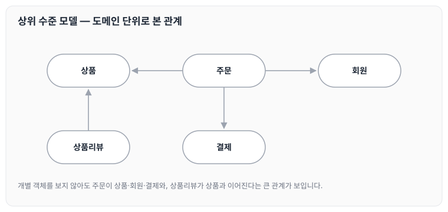

같은 모델을 개별 객체 단위로 다시 그리면 아래와 같습니다.

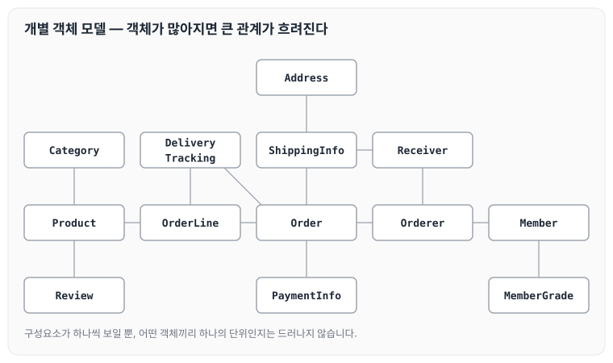

백 개 이상의 테이블을 한 장의 ERD에 모두 표시하면 개별 테이블 간의 관계를 파악하느라 큰 틀에서 데이터 구조를 이해하기 어려워집니다. 도메인 객체 모델도 마찬가지로, 모델이 복잡해지면 개별 구성요소 위주로 모델을 보게 되고 전반적인 구조나 도메인 간의 관계를 파악하기 어려워집니다.

### 애그리거트로 묶어서 표현하기

아래 그림은 같은 모델을 애그리거트 단위로 묶어서 다시 표현한 것입니다. 모델은 동일하지만, 애그리거트를 사용하면 모델 간의 관계를 개별 모델 수준과 상위 수준에서 모두 이해할 수 있습니다.

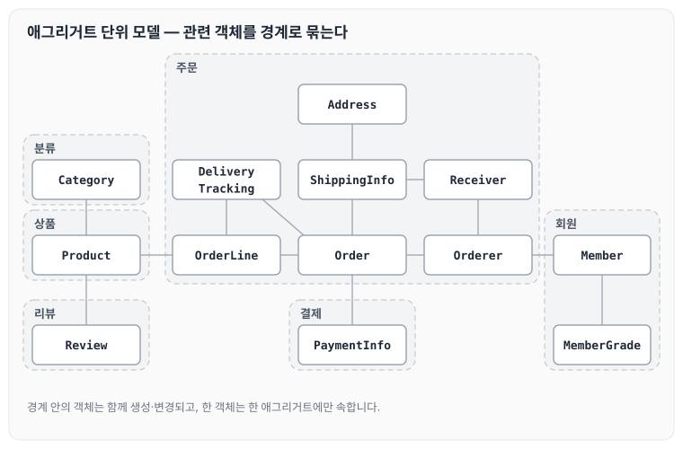

그림에서 Product와 OrderLine처럼 경계를 넘는 선은 애그리거트끼리의 관계이고, 경계 안의 선은 한 애그리거트 내부의 관계입니다. 애그리거트의 특징을 정리하면 아래와 같습니다.

- 애그리거트는 모델을 이해하는 데 도움을 줍니다.
- 일관성을 관리하는 기준이 됩니다.
- 복잡한 도메인을 단순한 구조로 만들어 줍니다.
- 관련된 모델을 하나로 모았기 때문에 애그리거트에 속한 객체는 유사하거나 동일한 라이프 사이클을 갖습니다.
- 애그리거트는 경계를 갖습니다. 한 애그리거트에 속한 객체는 다른 애그리거트에 속하지 않습니다.
    - 경계를 설정할 때 기본이 되는 것은 도메인 규칙과 요구사항입니다.
    - 예를 들어 주문할 상품 개수, 배송지 정보, 주문자 정보는 주문 시점에 함께 생성되므로 한 애그리거트에 속합니다.
- 'A가 B를 갖는다'로 설계할 수 있는 요구사항이 있으면 A와 B를 한 애그리거트로 묶어서 생각하기 쉽습니다. 하지만 이것이 반드시 A와 B가 한 애그리거트에 속한다는 의미는 아닙니다.

### 한 애그리거트로 묶지 않는 경우

Product와 Review가 그런 예입니다. 상품 정보를 바꾸는 흐름과 리뷰 내용을 수정하는 흐름은 아래와 같이 서로 다른 객체를 변경합니다.

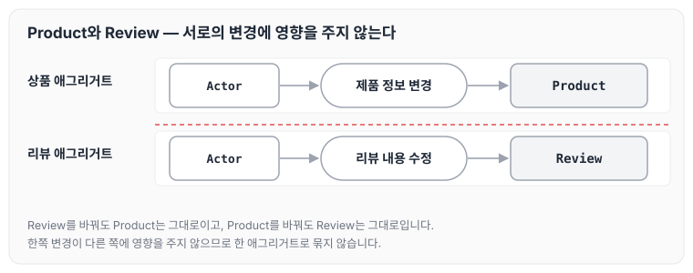

Review의 변경이 Product에 영향을 주지 않고, 반대로 Product의 변경도 Review에 영향을 주지 않습니다. 이 때문에 둘은 한 애그리거트에 속하기보다는 그림처럼 서로 다른 애그리거트에 속합니다.

도메인에 대한 경험이 생기고 도메인 규칙을 제대로 이해할수록 애그리거트의 실제 크기는 줄어듭니다.

## 애그리거트 루트

주문 애그리거트는 다음을 포함합니다.

- 총 금액인 totalAmounts를 갖고 있는 Order 엔티티
- 개별 구매 상품의 개수인 quantity와 금액인 price를 갖고 있는 OrderLine 밸류

구매할 상품의 개수를 변경하면 해당 OrderLine의 quantity를 변경하고, 더불어 Order의 totalAmounts도 변경해야 합니다. 그렇지 않으면 도메인 규칙을 어기고 데이터 일관성이 깨집니다. 애그리거트는 여러 객체로 구성되기 때문에 **한 객체만 상태가 정상이어서는 안 됩니다.**

애그리거트에 속한 모든 객체가 일관된 상태를 유지하려면 애그리거트 전체를 관리할 주체가 필요한데, 이 역할을 하는 것이 애그리거트의 루트 엔티티입니다. 주문 애그리거트에서는 Order가 루트 엔티티입니다.

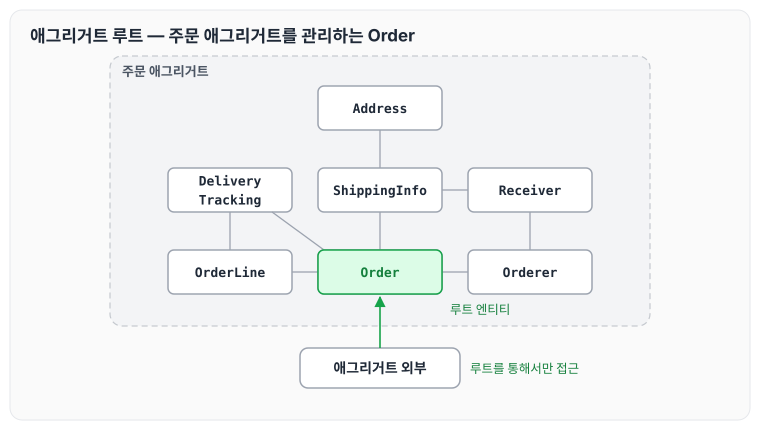

### 도메인 규칙과 일관성

애그리거트 루트는 도메인 규칙을 구현한 기능을 제공합니다. 아래는 배송지를 변경하기 전에 아직 출고 전인지 확인하는 예입니다.

```java
public class Order {

	// 에그리거트 루트는 도메인 규칙을 구현한 기능을 제공한다.
	public void changeShippingInfo(ShippingInfo newShippingInfo) {
		verifyNotYetShipped();
		setShippingInfo(newShippingInfo);
	}
	
	private void verifyNotYetShipped() {
		...
	}
}
```

애그리거트 외부에서 애그리거트에 속한 객체를 직접 변경하면 안 됩니다. 애그리거트 루트가 강제하는 규칙을 적용할 수 없어 모델의 일관성을 깨는 원인이 되기 때문입니다.

```java
ShippingInfo si = order.getShippingInfo();
si.setAddress(newAddress);
```

이 코드는 애그리거트 루트인 Order에서 ShippingInfo를 가져와 직접 정보를 변경합니다. 주문 상태와 상관없이 배송지 주소를 변경하므로, 업무 규칙을 무시하고 DB 테이블의 데이터를 직접 수정하는 것과 같은 결과가 됩니다. 즉 논리적인 데이터 일관성이 깨지게 됩니다.

루트를 통해서만 도메인 로직을 구현하려면 도메인 모델에 다음 두 가지를 습관적으로 적용해야 합니다.

- 단순히 필드를 변경하는 set 메서드를 공개(public) 범위로 만들지 않습니다.
- 밸류 타입은 불변으로 구현합니다.

공개 set 메서드는 도메인의 의미나 의도를 표현하지 못하고, 도메인 로직을 도메인 객체가 아닌 응용 영역이나 표현 영역으로 분산시킵니다.

밸류를 불변 타입으로 구현하면 밸류 객체의 값을 변경할 수 없습니다. 애그리거트 루트에서 밸류 객체를 구하더라도 애그리거트 외부에서 그 상태를 바꿀 수 없게 됩니다.

```java
ShippingInfo si = order.getShippingInfo();
si.setAddress(newAddress); // ShippingInfo가 불변이면, 이 코드는 컴파일 에러!.
```

따라서 아래와 같이 애그리거트 루트가 제공하는 메서드에 새로운 밸류 객체를 전달해서 값을 변경하는 방법밖에 없습니다.

```java
public class Order {
      private ShippingInfo shippingInfo;
      
      public void changeShippingInfo(ShippingInfo newShippingInfo) {
          verifyNotYetShipped();
          setShippingInfo(newShippingInfo);
      }
      
      // set 메서드의 접근 허용 범위는 private이다.
      private void setShippingInfo(ShippingInfo newShippingInfo) {
          // 밸류가 불변이면 새로운 객체를 할당해서 값을 변경해야 한다.
          // 불변이므로 this.shipping.set()함수를 사용 할 수 없다.
          this.shippingInfo = newShippingInfo;
      }
}
```

두 방식을 흐름으로 비교하면 아래와 같습니다.

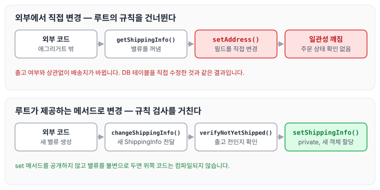

위쪽은 출고 여부를 확인하지 않고 배송지가 바뀌고, 아래쪽은 루트의 메서드를 거치면서 `verifyNotYetShipped()`가 반드시 실행됩니다.

### 애그리거트 루트의 기능 구현

애그리거트 루트는 기능 실행을 내부 객체에 위임하기도 합니다. 예를 들어 구현 기술의 제약이나 내부 모델링 규칙 때문에 OrderLine 목록을 별도 클래스로 분리했다고 해보겠습니다.

```java
public class OrderLines{
	private List<OrderLine> lines;
	
	public Money getTotalAmounts() {... 구현 ...}
	public void changeOrderLines(List<OrderLine> newLines) {
		this.lines = newLines;
	}
}
```

#### getOrderLines()를 제공했을 때의 문제

OrderLines는 `changeOrderLines()`와 `getTotalAmounts()` 같은 기능을 제공합니다. 만약 Order가 `getOrderLines()`처럼 OrderLines를 구할 수 있는 메서드를 제공하면, 애그리거트 외부에서 OrderLines의 기능을 실행할 수 있게 됩니다.

```java
OrderLines lines  = order.getOrderLines();

//외부에서 에그리거트 내부 상태 변경!
// order의 totalAmounts가 값이 OrderLines가 일치하지 않게 됨
lines.changeOrderLines(newOrderLines);
```

이 코드는 주문의 OrderLine 목록은 바뀌는데 총합은 다시 계산하지 않는 버그를 만듭니다.

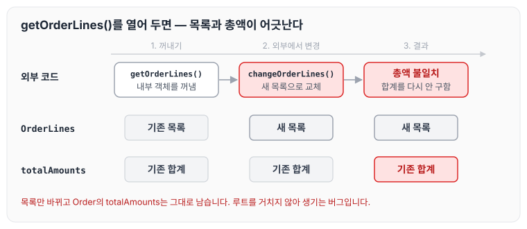

이러한 버그가 생기지 않도록 OrderLines를 미리 불변으로 구현하면 됩니다. 또한 보통 한 애그리거트에 속하는 모델은 한 패키지에 속하기 때문에, 변경 기능을 패키지 범위나 protected 범위로 한정하면 애그리거트 외부에서 상태 변경 기능을 실행하는 것을 막을 수 있습니다.

### 트랜잭션 범위

트랜잭션 범위는 작을수록 좋습니다. 한 트랜잭션이 한 개의 테이블을 수정하는 것과 세 개의 테이블을 수정하는 것을 비교하면 성능에서 차이가 발생합니다.

한 개 테이블을 수정하면 트랜잭션 충돌을 막기 위해 잠그는 대상이 한 개 테이블의 한 행으로 한정되지만, 세 개의 테이블을 수정하면 잠금 대상이 더 많아집니다.

#### 한 트랜잭션에서는 한 개의 애그리거트만 수정

같은 이유로 **한 트랜잭션에서는 한 개의 애그리거트만 수정해야 합니다.** 한 트랜잭션에서 두 개 이상의 애그리거트를 수정하면 트랜잭션 충돌이 발생할 가능성이 더 높아집니다.

```java
public class Order {
	private Orderer orderer;
	public void shipTo(ShippingInfo newShippingInfo, 
				boolean useNewShippingAddrAsMemberAddr ) {

		verifyNotYetShipped();
		if (useNewShippingAddrAsMemberAddr) {
			// 다른 애그리거트의 상태를 변경하면 안 됨!.
			orderer.getMember().changeAddress(newShippingInfo.getAddress());
		}
	}
}
...
```

위 코드는 Order 애그리거트가 자신의 책임 범위를 넘어 Member 애그리거트의 상태까지 관리하는 구조입니다. 애그리거트는 최대한 서로 독립적이어야 하는데, 한 애그리거트가 다른 애그리거트의 기능에 의존하기 시작하면 애그리거트 간 결합도가 높아집니다. 결합도가 높아지면 수정 비용이 증가하므로 유지보수가 어려워집니다.

#### 두 개 이상의 애그리거트를 수정해야 할 때

부득이하게 한 트랜잭션으로 두 개 이상의 애그리거트를 수정해야 한다면, 애그리거트에서 다른 애그리거트를 직접 수정하지 말고 응용 서비스에서 두 애그리거트를 수정하도록 합니다.

```java
public class changeOrderService {
	// 두 개 이상의 애그리거트를 변경해야 한다면
	// 응용 서비스에서 각 애그리거트의 상태를 변경한다.
	@Transactional
	public void changeShippingInfo(OrderId id, ShippingInfo newShippingInfo,
		 boolean useNewShippingAddrAsMemberAddr) {
		Order order = orderRepository.findById(id);
		if (order == null) throw new OrderNotFoundException();
		order.shipTo(newShippingInfo);
		if (useNewShippingAddrAsMemberAddr) {
			Member member = findMember(order.getOrderer());
			member.changeAddress(newShippingInfo.getAddress());
		}
	}
}
```

두 구조를 비교하면 아래와 같습니다.

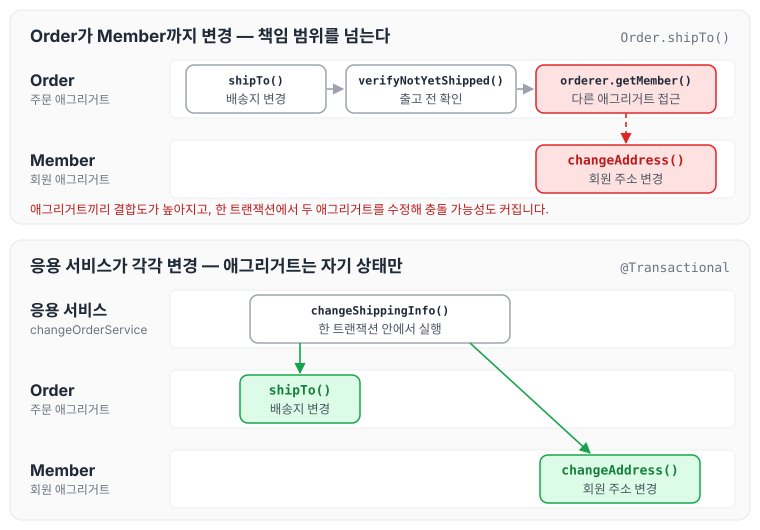

아래쪽 구조에서는 Order와 Member가 각자 자기 상태만 변경하고, 두 애그리거트를 함께 바꾸는 판단은 응용 서비스가 맡습니다.

## 리포지터리와 애그리거트

애그리거트는 개념상 완전한 한 개의 도메인 모델을 표현하므로, 객체의 영속성을 처리하는 리포지터리는 애그리거트 단위로 존재합니다. 예를 들어 Order 애그리거트와 관련된 테이블이 세 개라면, Order 애그리거트를 저장할 때 애그리거트 루트와 매핑되는 테이블뿐만 아니라 애그리거트에 속한 모든 구성요소에 매핑된 테이블에도 데이터를 저장해야 합니다.

```java
// 리포지터리에 애그리거트를 저장하면 애그리거트 전체를 영속화해야 한다.
orderRepository.save(order);
```

조회할 때도 마찬가지로 리포지터리는 완전한 애그리거트를 제공해야 합니다.

```java
// 리포지터리는 완전한 order를 제공해야 한다.
Order order = orderRepository.findById(orderId);

// order가 온전한 애그리거트가 아니면
// 기능 실행 도중 NullPointException 과 같은 문제가 발생한다.
order.cancel();
```

## ID를 이용한 애그리거트 참조

한 객체가 다른 객체를 참조하는 것처럼 애그리거트도 다른 애그리거트를 참조합니다. 아래는 Order 애그리거트의 Orderer가 필드로 Member를 직접 참조하는 구조입니다.

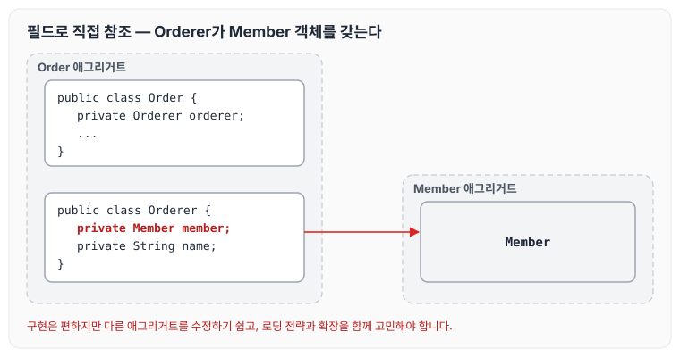

필드를 이용해서 다른 애그리거트를 직접 참조하면 아래처럼 쉽게 탐색할 수 있어 구현이 편리합니다.

```java
order.getOrderer().getMember().getId();
```

하지만 필드를 이용한 애그리거트 참조는 다음과 같은 문제를 일으킬 수 있습니다.

- 편한 탐색 오용
- 성능에 대한 고민
- 확장 어려움

### 편한 탐색 오용

애그리거트 내부에서 다른 애그리거트 객체에 접근할 수 있으면, 구현이 편하다는 이유로 아래 코드처럼 다른 애그리거트를 수정하고 싶어지기 쉽습니다.

```java

public class changeOrderService {
	private Orderer orderer;

	public void changeShippingInfo(OrderId id, ShippingInfo newShippingInfo,
		 boolean useNewShippingAddrAsMemberAddr) {
		... 
		if (useNewShippingAddrAsMemberAddr) {
			// 한 애그리거트 내부에서 다른 애그리거트에 접근할 수 있으면
			// 구현이 쉬워진다는 것 때문에 다른 애그리거트의 상태를 변경하는
			// 유혹에 빠지기 쉽다.
			orderer.getMember().changeAddress(newShippingInfo.getAddress());
		}
	}
}
```

한 애그리거트에서 다른 애그리거트의 상태를 변경하면 애그리거트 간의 결합도가 높아져, 결과적으로 애그리거트를 변경하기 어려워집니다.

### 성능에 대한 고민

애그리거트를 직접 참조하면 성능과 관련된 여러 가지를 고민해야 합니다. JPA를 사용하면 참조한 객체를 지연 로딩과 즉시 로딩 두 가지 방식으로 로딩할 수 있습니다.

### 확장 어려움

초기에는 단일 서버에 단일 DBMS로 서비스를 제공할 수 있습니다. 문제는 사용자가 몰리기 시작하면서 발생합니다. 트래픽이 몰리면 부하를 분산하기 위해 도메인별로 시스템을 분리하게 되고, 서로 다른 DBMS를 사용할 때도 있습니다. 이렇게 되면 다른 애그리거트 루트를 참조하기 위해 더 이상 JPA와 같은 단일 기술을 사용할 수 없습니다.

### ID로 참조하기

위 세 가지 문제를 완화할 때 사용할 수 있는 것이 **ID를 이용해서 다른 애그리거트를 참조**하는 방식입니다. Orderer가 Member 객체 대신 MemberId만 갖도록 바꾸면 아래와 같습니다.

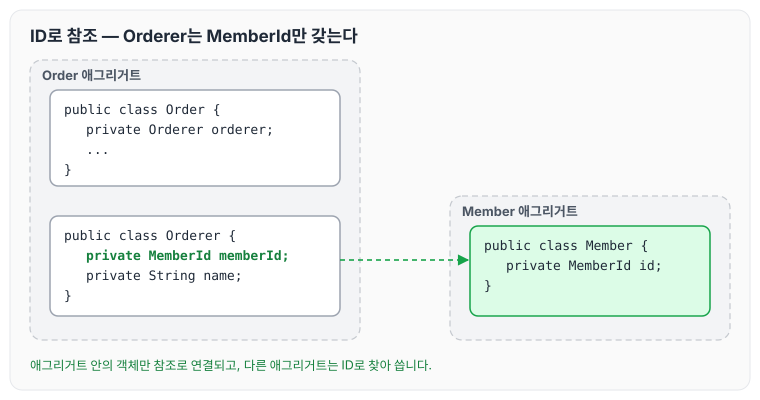

ID 참조를 사용하면 모든 객체가 참조로 연결되지 않고, 한 애그리거트에 속한 객체들만 참조로 연결됩니다. 다른 애그리거트가 필요하면 응용 서비스에서 ID로 리포지터리를 조회합니다.

```java
public class changeOrderService {
	// 두 개 이상의 애그리거트를 변경해야 한다면
	// 응용 서비스에서 각 애그리거트의 상태를 변경한다.
	@Transactional
	public void changeShippingInfo(OrderId id, ShippingInfo newShippingInfo,
		 boolean useNewShippingAddrAsMemberAddr) {
		Order order = orderRepository.findById(id);
		if (order == null) throw new OrderNotFoundException();
		order.shipTo(newShippingInfo);
		if (useNewShippingAddrAsMemberAddr) {
			// ID를 이용해서 참조로하는 애그리거트를 구한다.
			
			Member member = memberRepository.findById(order.getOrderer().getMemberId());
			member.changeAddress(newShippingInfo.getAddress());
		}
	}
}
```

ID를 이용한 참조 방식을 사용하면 복잡도가 낮아지고, 한 애그리거트에서 다른 애그리거트를 수정하는 문제를 근원적으로 방지할 수 있습니다.

또한 애그리거트별로 다른 구현 기술을 사용하는 것도 가능해집니다. 아래는 Order 애그리거트는 JPA로 오라클에, Product 애그리거트는 Mongo 구현으로 몽고 DB에 저장하는 예입니다.

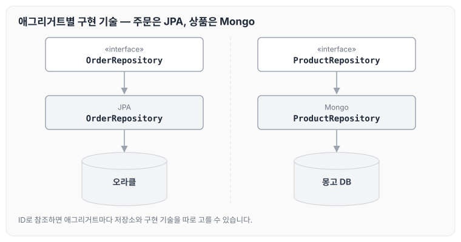

## 마무리

오늘은 도메인 주도 개발 시작하기 3장의 내용인 애그리거트로 모델을 묶는 기준과 애그리거트 루트의 역할, 트랜잭션 범위, 리포지터리와 애그리거트의 관계, 그리고 ID를 이용한 애그리거트 참조에 대해 정리하였습니다. 다음 글에서는 4장의 [리포지터리와 모델 구현](../ddd-repository-model/)을 정리하겠습니다.

참조 : [도메인 주도 개발 시작하기 - 예스24](https://www.yes24.com/Product/Goods/108431347?pid=123487&cosemkid=go16481149689793107&gclid=Cj0KCQjwgNanBhDUARIsAAeIcAvU1218EfnAWaB7jwT88mKqCJ9UJbgjm5qk12G3_kgbQFKtHnPTQaUaArR8EALw_wcB)
