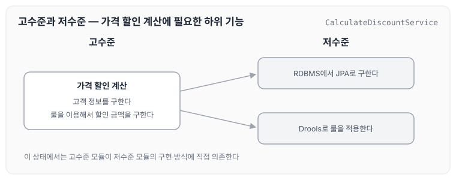
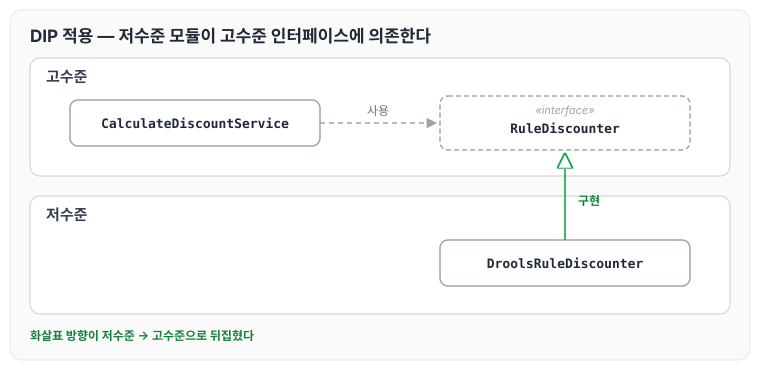
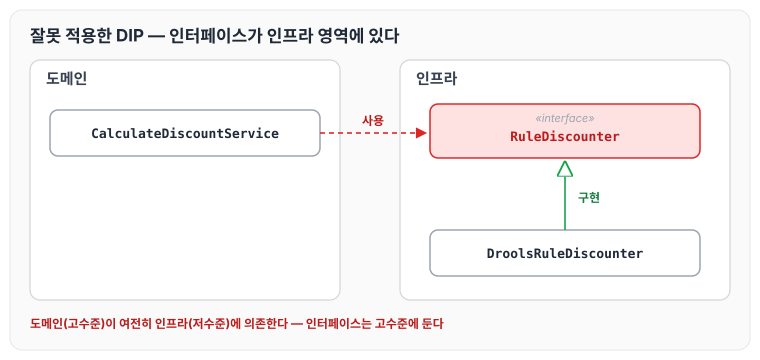
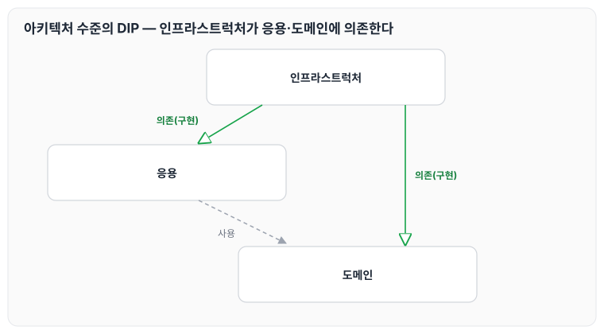
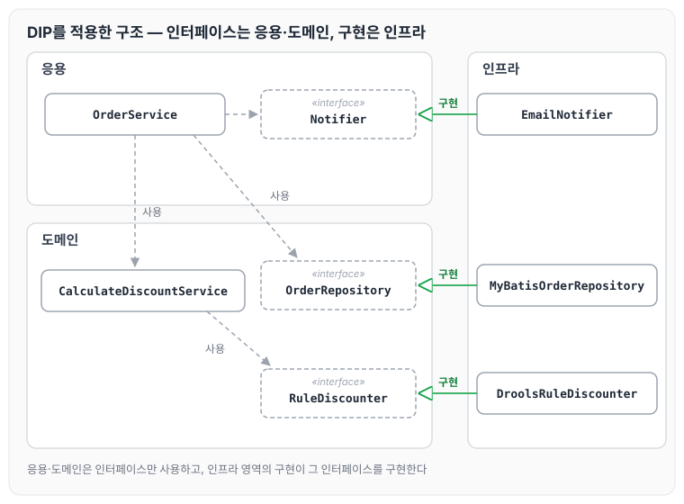
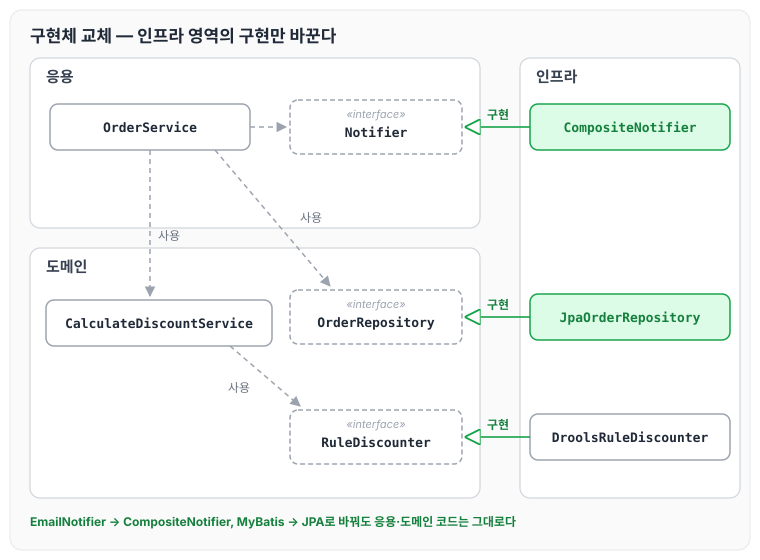
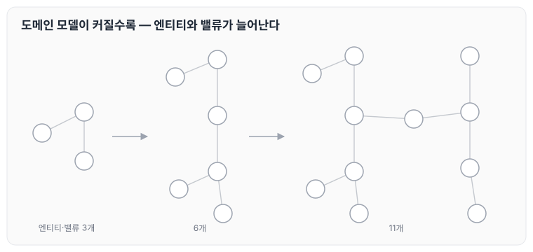
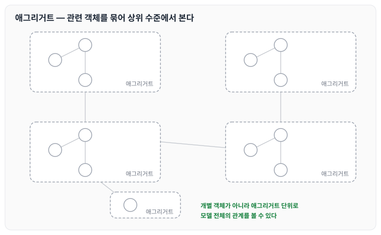
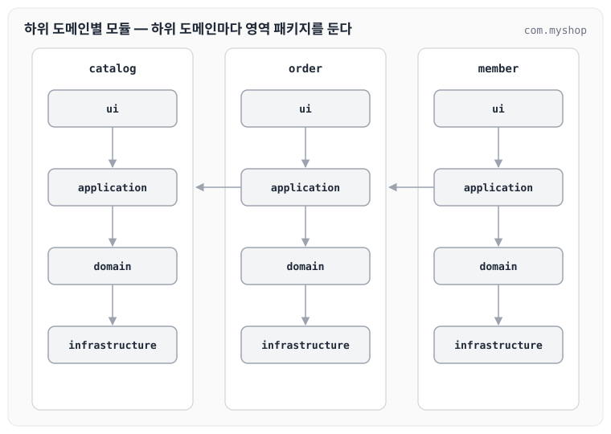
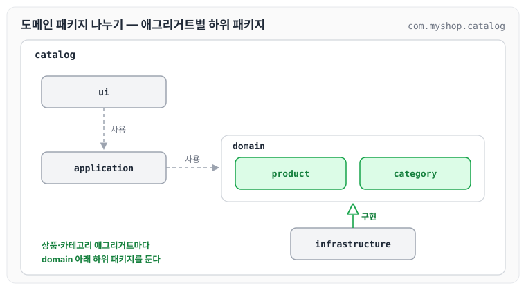

이전에 [도메인 전문가와 개발자 간 지식공유](../ddd-knowledge-sharing/)에 대해 작성하였습니다. 이번 글에서는 2장 아키텍처 개요에서 다루는 DIP와 아키텍처, 도메인 영역의 주요 구성요소, 애그리거트, 모듈 구성에 대해 정리하도록 하겠습니다.

## DIP

가격 할인 계산 기능을 예로 들면, 이 기능을 구현하려면 아래와 같은 하위 기능이 필요합니다.



CalculateDiscountService는 고수준 모듈입니다. 고수준 모듈은 의미 있는 단일 기능을 제공하는 모듈로, CalculateDiscountService는 가격 할인 계산이라는 기능을 구현합니다. 고수준의 기능을 구현하려면 여러 하위 기능이 필요합니다. 그림에서는 고객 정보를 구하는 기능과 룰을 이용해 할인 금액을 구하는 기능이 필요하고, 이를 실제로 구현하는 RDBMS의 JPA, Drools가 저수준 모듈입니다.

이때 CalculateDiscountService 입장에서는 룰을 Drools로 구현했는지 자바로 직접 구현했는지가 중요하지 않습니다. 그래서 룰을 이용한 할인 금액 계산을 RuleDiscounter 인터페이스로 추상화하고, CalculateDiscountService는 이 인터페이스만 사용하도록 구현합니다.

```java
public interface RuleDiscounter {
	...
}
```

```java
public class CalculateDiscountService {
	private RuleDiscounter ruleDiscounter;

	public CalculateDiscountService (RuleDiscounter ruleDiscounter) {
		this.ruleDiscounter = ruleDiscounter;
	}

	public Money calculateDiscount(List<OrderLine> orderLine, String customerId) {
		Customer customer = findCustomer(customerId);
		return ruleDiscounter.applyRules(customer, orderLine);
	}
}
```

이렇게 구성하면 아래 그림과 같이 저수준 모듈인 DroolsRuleDiscounter가 고수준 모듈의 RuleDiscounter 인터페이스를 구현하게 됩니다.



DIP를 적용하면 그림과 같이 저수준 모듈이 고수준 모듈에 의존하게 됩니다. 고수준 모듈이 저수준 모듈에 의존하던 방향이 뒤집히기 때문에 DIP(Dependency Inversion Principle, 의존 역전 원칙)라고 부릅니다.

### DIP 적용 시 주의사항

DIP를 잘못 생각하면 단순히 인터페이스와 구현 클래스를 분리하는 정도로 받아들일 수 있습니다. 아래 그림은 인터페이스와 구현을 나누었지만 잘못된 구조입니다.



이 구조에서 도메인 영역은 구현 기술을 다루는 인프라 영역에 의존하고 있습니다. 여전히 고수준 모듈이 저수준 모듈에 의존하고 있는 것입니다. 즉, '할인 금액 계산'을 추상화한 인터페이스는 저수준 모듈이 아닌 고수준 모듈에 위치해야 합니다.

## DIP와 아키텍처

아키텍처 수준에서 DIP를 적용하면 아래와 같이 인프라스트럭처 영역이 응용 영역과 도메인 영역에 의존하는 구조가 됩니다.



### DIP를 적용한 구조

응용 영역과 도메인 영역의 클래스까지 펼쳐 보면 아래와 같습니다. 응용 영역의 OrderService는 Notifier 인터페이스와 도메인 영역의 CalculateDiscountService, OrderRepository를 사용하고, 인프라 영역의 클래스들이 각 인터페이스를 구현합니다.



이 구조에서는 **구현체를 변경하는 것만으로** 동작 방식을 자유롭게 바꿀 수 있습니다. 예를 들어 아래 그림처럼 EmailNotifier를 CompositeNotifier로, MyBatisOrderRepository를 JpaOrderRepository로 바꾸어도 응용 영역과 도메인 영역의 코드는 그대로 둘 수 있습니다.



## 도메인 영역의 주요 구성요소

도메인 영역의 주요 구성요소는 아래와 같습니다.

| 요소 | 설명 |
| --- | --- |
| 엔티티 | 고유 식별자를 갖는 객체로 자신의 라이프 사이클을 갖습니다. |
| 밸류 | 고유 식별자를 갖지 않는 객체로 주로 개념적으로 하나인 값을 표현할 때 사용합니다. |
| 애그리거트 | 연관된 엔티티와 밸류 객체를 개념적으로 하나로 묶은 것입니다. (예: 주문) |
| 리포지토리 | 도메인 모델의 영속성을 처리합니다. |
| 도메인 서비스 | 도메인 로직이 여러 엔티티와 밸류를 필요로 하면 도메인 서비스에 로직을 구현합니다. |

### 애그리거트

도메인이 커질수록 개발할 도메인 모델도 커지면서 많은 엔티티와 밸류가 출현합니다. 엔티티와 밸류 개수가 많아질수록 모델은 아래와 같이 점점 더 복잡해집니다.



이때 주의할 점이 있습니다. 도메인 모델이 복잡해지면 개발자가 전체 구조가 아닌 한 개 엔티티와 밸류에만 집중하는 상황이 발생합니다. 상위 수준에서 모델을 관리하지 않고 개별 요소에만 초점을 맞추면, **전체적인 수준에서 모델을 이해하지 못해** 큰 틀에서 모델을 관리할 수 없는 상황에 빠질 수 있습니다.

도메인 모델에서 전체 구조를 이해하는 데 도움이 되는 것이 애그리거트입니다. 아래 그림처럼 관련된 객체를 애그리거트로 묶으면 개별 객체가 아닌 애그리거트 단위로 모델을 볼 수 있습니다.



## 모듈 구성

도메인이 크면 하위 도메인별로 모듈을 나눕니다. 아래는 catalog, order, member 하위 도메인마다 ui, application, domain, infrastructure 패키지를 둔 구성입니다.



카탈로그 하위 도메인이 상품 애그리거트와 카테고리 애그리거트로 구성될 경우, 아래 그림과 같이 도메인 패키지를 product와 category 두 개의 하위 패키지로 구성할 수 있습니다.



## 마무리

오늘은 도메인 주도 개발 시작하기 2장에서 DIP와 아키텍처, 도메인 영역의 주요 구성요소, 애그리거트, 모듈 구성에 대해 정리하였습니다. 인터페이스와 구현을 나누는 것만으로는 부족하고, 인터페이스를 어느 영역에 두느냐에 따라 의존 방향이 정해진다는 점을 기억해 두면 좋을 것 같습니다. 다음 글에서는 3장 [애그리거트](../ddd-aggregate/)에서 다루는 애그리거트에 대해 좀 더 자세히 정리하도록 하겠습니다.

참조 : [도메인 주도 개발 시작하기 - 예스24](https://www.yes24.com/Product/Goods/108431347?pid=123487&cosemkid=go16481149689793107&gclid=Cj0KCQjwgNanBhDUARIsAAeIcAvU1218EfnAWaB7jwT88mKqCJ9UJbgjm5qk12G3_kgbQFKtHnPTQaUaArR8EALw_wcB)
