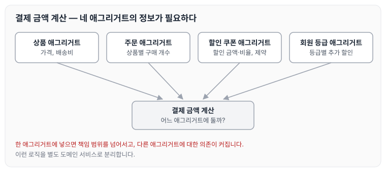
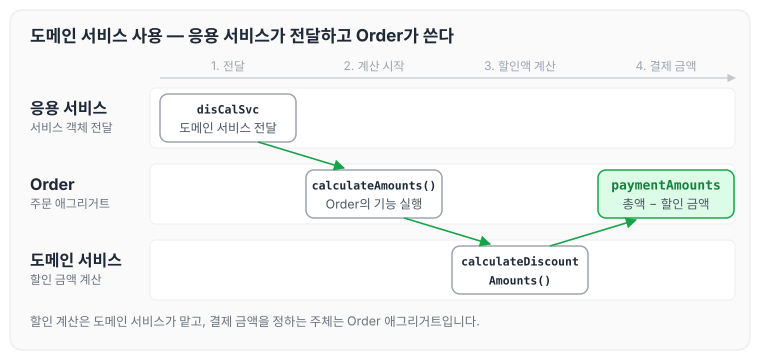
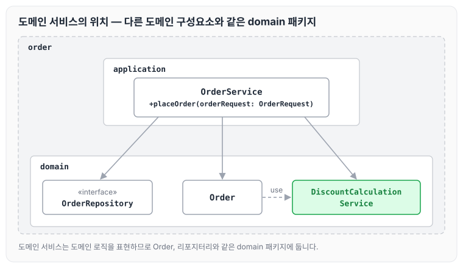
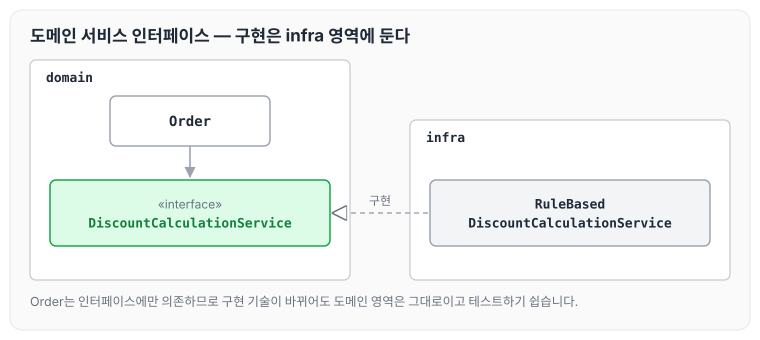

이전에 [표현 영역과 응용 영역](../ddd-presentation-application/)에 대해 작성하였습니다. 그 글에서는 응용 서비스에 도메인 로직을 넣지 않아야 하는 이유를 다뤘는데, 도메인 로직 중에는 한 애그리거트에 넣기 어려운 것도 있습니다. 오늘은 도메인 주도 개발 시작하기 7장의 내용인 도메인 서비스에 대해 정리하도록 하겠습니다.

## 여러 애그리거트가 필요한 기능

한 애그리거트로 기능을 구현할 수 없을 때가 있습니다. 대표적인 예가 결제 금액 계산으로, 실제 결제 금액을 계산하려면 아래 애그리거트의 정보가 모두 필요합니다.

- 상품 애그리거트: 구매하는 상품의 가격이 필요합니다. 또한 상품에 따라 배송비가 추가되기도 합니다.
- 주문 애그리거트: 상품별로 구매 개수가 필요합니다.
- 할인 쿠폰 애그리거트: 쿠폰별로 지정한 할인 금액이나 비율에 따라 주문 총 금액을 할인합니다. 할인 쿠폰을 조건에 따라 중복 사용할 수 있다거나 지정한 카테고리의 상품에만 적용할 수 있다는 제약 조건이 있다면 할인 계산이 복잡해집니다.
- 회원 등급 애그리거트: 회원 등급에 따라 추가 할인이 가능합니다.



이 계산을 주문 애그리거트에 넣으면 아래와 같은 코드가 됩니다.

```java
public class Order {
		...
		private Orderer orderer;
		private List<OrderLine> orderLines;
		private List<Coupon> usedCoupons;

		private Money calculatePayAmounts() {
			Money totalAmounts = calculatetotalAmounts();
			Money discount = 
						usedCoupons.stream()
											 .map(coupon -> calculateDiscount(coupon))
										   .reduce(new Money(0), (v1,v2) -> v1.add(v2));
			// 회원에 따른 추가 할인을 구한다.
			Money membershipDiscount = 
					calculateDiscount(orderer.getMember().getGrade());
			return totalAmounts.minus(discount).minus(membershipDiscount);
		}
		
		private Money calculateDiscount(Coupon coupon) {
				// orderLines의 각 상품에 대해 쿠폰을 적용해서 할인 금액 계산하는 로직
		}

		private Money calculateDiscount(MemberGrade grade) {
			  // ..

		}

}
```

### 주문 애그리거트에 넣었을 때의 문제

예를 들어 특별 감사 세일로 전 품목에 2% 추가 할인을 하기로 했다면, 이 할인 로직을 주문 애그리거트가 갖고 있는 것이 맞는지 고민하게 됩니다. 이렇게 한 애그리거트에 여러 애그리거트의 로직을 넣으면 아래와 같은 단점이 있습니다.

- 애그리거트가 자신의 책임 범위를 넘어서는 기능을 구현하게 되면 코드가 길어지고 외부에 대한 의존이 높아집니다.
- 복잡도가 올라갑니다.
- 애그리거트의 범위를 넘어서는 도메인 개념이 애그리거트 안에 숨겨져 명시적으로 드러나지 않게 됩니다.

이 문제를 해결하는 방법은 **도메인 기능을 별도 서비스로 구현하는 것**입니다.

## 도메인 서비스

도메인 서비스는 도메인 영역에 위치한 도메인 로직을 표현할 때 사용합니다.

### 계산 로직과 도메인 서비스

할인 금액 계산 로직을 위한 도메인 서비스는 아래와 같이 도메인의 의미가 드러나는 용어를 타입과 메서드 이름으로 갖습니다.

```java
public class DiscountCalculationService {
		
		public Money calculateDiscountAmounts (List<OrderLine> orderLines
																					 , List<Coupon> coupons
																					 , MemberGrade grade) {
			
					Money totalAmounts = calculatetotalAmounts();
					Money discount = 
									coupons.stream()
														 .map(coupon -> calculateDiscount(coupon))
													   .reduce(new Money(0), (v1,v2) -> v1.add(v2));
					// 회원에 따른 추가 할인을 구한다.
					Money membershipDiscount = 
								calculateDiscount(grade);
					return totalAmounts.minus(discount).minus(membershipDiscount);
		}

		private Money calculateDiscount(Coupon coupon) {
				// orderLines의 각 상품에 대해 쿠폰을 적용해서 할인 금액 계산하는 로직
		}

		private Money calculateDiscount(MemberGrade grade) {
			  // ..

		}
}
```

이 도메인 서비스를 애그리거트의 결제 금액 계산 기능에 전달하면, 도메인 서비스를 사용하는 주체는 애그리거트가 됩니다.

```java
public class Order {

		public void calculateAmounts(DiscountCalculationService disCalSvc, MemberGrade grade) {
			Money totalAmounts  = getTotalAmounts();
			Money discountAmounts = 
					disCalSvc.calculateDiscountAmounts(this.orderLines, this.coupons, grade);
			this.paymentAmounts = totalAmounts.minus(discountAmounts);
		}

}
```

이때 애그리거트에 도메인 서비스 객체를 전달하는 것은 응용 서비스의 책임입니다. 호출 흐름을 그리면 아래와 같습니다.



할인 금액 계산은 도메인 서비스가 맡고, 그 결과로 결제 금액을 정하는 것은 Order 애그리거트입니다.

> 특정 기능이 응용 서비스인지 도메인 서비스인지 감을 잡기 어려울 때는 해당 로직이 애그리거트의 상태를 변경하거나, 애그리거트의 상태 값을 계산하는지 검사해 보면 됩니다. **한 애그리거트에 넣기에 적합하지 않으면** 도메인 서비스로 구현하게 됩니다.

### 도메인 서비스의 패키지 위치

도메인 서비스는 도메인 로직을 표현하므로, 아래와 같이 Order나 OrderRepository 같은 다른 도메인 구성요소와 같은 domain 패키지에 위치합니다.



### 도메인 서비스의 인터페이스와 클래스

도메인 로직을 외부 시스템이나 별도 엔진을 이용해서 구현할 때는 인터페이스와 클래스를 분리하게 됩니다.



위와 같이 도메인 서비스의 구현이 특정 구현 기술에 의존하거나 외부 시스템의 API를 실행한다면, 도메인 영역의 도메인 서비스는 인터페이스로 추상화해야 합니다. 이를 통해 도메인 영역이 특정 구현에 종속되는 것을 방지할 수 있고, 도메인 영역에 대한 테스트도 쉬워집니다.

## 마무리

오늘은 도메인 주도 개발 시작하기 7장의 내용인 도메인 서비스에 대해 정리하였습니다. 한 애그리거트에 넣기 어려운 할인 금액 계산 같은 로직을 도메인 서비스로 분리하는 방법과, 도메인 서비스의 패키지 위치, 인터페이스로 구현 기술을 분리하는 방법을 다뤘습니다. 다음 글에서는 8장의 [애그리거트 트랜잭션 관리](../ddd-aggregate-transaction/)를 정리하겠습니다.

참조 : [도메인 주도 개발 시작하기 - 예스24](https://www.yes24.com/Product/Goods/108431347?pid=123487&cosemkid=go16481149689793107&gclid=Cj0KCQjwgNanBhDUARIsAAeIcAvU1218EfnAWaB7jwT88mKqCJ9UJbgjm5qk12G3_kgbQFKtHnPTQaUaArR8EALw_wcB)
