이전에 [애그리거트 트랜잭션 관리](../ddd-aggregate-transaction/)에 대해 작성하였습니다. 이번에는 도메인 주도 개발 시작하기의 이벤트 내용을 읽고, 도메인 객체에 다른 도메인 로직이 섞이는 문제를 이벤트로 분리하는 방법과 동기·비동기 이벤트 처리, 이벤트 저장소 구현, 이벤트 처리와 트랜잭션을 함께 고려하는 방법에 대해 정리하도록 하겠습니다.

## 시스템 간 강결합 문제

주문을 취소하면서 환불까지 처리하는 코드는 아래와 같이 작성할 수 있습니다. 첫 번째는 도메인 객체가 환불 서비스를 파라미터로 받는 방식이고, 두 번째는 응용 서비스에서 환불을 처리하는 방식입니다.

```java
public class Order {
		...
		// 외부 서비스를 실행하기 위해 도메인 서비스를 파라미터로 전달받음
	public void cancel(RefundService refundService) {
			verifyNotYetShipped();
			this.state = OrderState.CANCELED;

			this.refundStatus = State.REFUND_STARTED;
			try {
				refundService.refund(getPaymentId());
				this.refundStatus = State.REFUND_COMPLETED;
			} catch (Exception ex) {
				???
			}
	}
}
```

```java
public class CancelOrderService {
		private RefundService refundService;

		@Transactional
		public void cancel(OrderNo orderNo) {
				Order order = findOrder(orderNo);
				order.cancel();

				order.refundStarted();
				try {
					refundService.refund(order.getPaymentId()); // 외부 서비스 성능에 직접 영향을 받는다.
					order.refundCompleted();
				} catch {
						???
				}
		}
}
```

보통 결제 시스템은 외부에 존재하므로 `RefundService`는 외부에 있는 결제 시스템이 제공합니다. 이 구조에서는 아래와 같은 문제가 발생합니다.

- 외부 서비스가 정상이 아닐 경우 트랜잭션 처리를 어떻게 할지 애매해집니다.
- 환불을 처리하는 외부 시스템의 응답 시간이 길어지면 그만큼 대기 시간도 길어집니다.
- 주문을 취소한 뒤에 환불뿐만 아니라 취소했다는 내용을 통지해야 한다면, 통지 서비스도 파라미터로 받도록 구현하게 되어 로직이 더 섞입니다.

정리하면 도메인 객체에 서로 다른 도메인 로직이 섞이는 것이 문제입니다(주문 로직과 결제 로직이 섞임). Order는 주문을 표현하는 도메인 객체인데 결제 도메인의 환불 관련 로직이 섞이게 되고, 이는 환불 기능이 바뀌면 Order도 영향을 받는다는 것을 의미합니다.

통지 기능까지 더하면 아래와 같이 파라미터가 늘어납니다.

```java
public class Order {
		// 기능을 추가할 때마다 파라미터가 함께 추가되면
		// 다른 로직이 더 많이 섞이고, 트랜잭션 처리가 더 복잡해진다.
	public void cancel(RefundService refundService, NotiService notiSvc) {
			verifyNotYetShipped();
			this.state = OrderState.CANCELED;

			...  
			// 주문 + 결제 + 통지 로직이 섞임
			// refundService는 성공하고, notiSvc는 실패하면?
			// refundService와 notiSvc 중 무엇을 먼저 처리하냐?
	}
}
```

주문 취소 메서드 안에 섞인 로직을 그림으로 보면 아래와 같습니다.

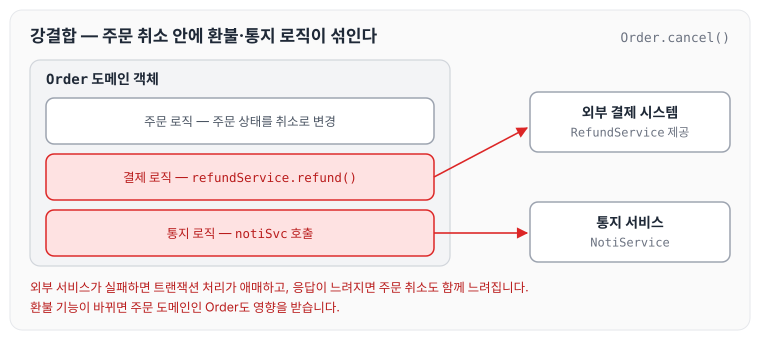

주문 상태를 바꾸는 로직 외에 외부 결제 시스템과 통지 서비스를 직접 호출하는 로직이 Order 안에 들어 있습니다. 이런 강한 결합을 없애는 방법으로 **이벤트**를 사용할 수 있습니다.

## 이벤트 개요

이벤트는 '과거에 벌어진 어떤 것'을 의미합니다.

### 이벤트 관련 구성 요소

이벤트를 사용하려면 이벤트 생성 주체, 이벤트 디스패처, 이벤트 핸들러가 필요합니다. 세 구성 요소의 관계는 아래와 같습니다.

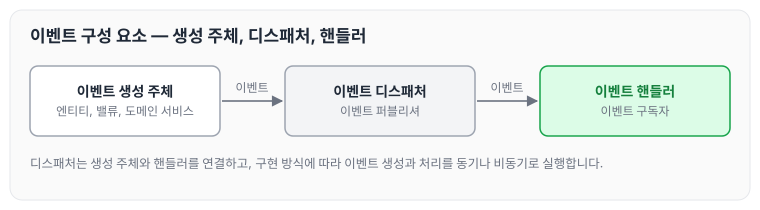

- 이벤트 생성 주체 : 엔티티, 밸류, 도메인 서비스와 같은 도메인 객체입니다.
- 이벤트 핸들러 : 생성 주체가 발생시킨 이벤트를 전달받아 이벤트에 담긴 데이터를 이용해서 원하는 기능을 실행합니다.
- 이벤트 디스패처 : 이벤트 생성 주체와 이벤트 핸들러를 연결해 주는 역할을 하며, 디스패처의 구현 방식에 따라 이벤트 생성과 처리를 동기나 비동기로 실행합니다.

### 이벤트의 구성

이벤트는 아래 정보를 담습니다.

- 이벤트 종류 : 클래스 이름으로 이벤트 종류를 표현
- 이벤트 발생 시간
- 추가 데이터 : 주문번호, 신규 배송지 정보 등 이벤트와 관련된 정보

배송지 변경 이벤트는 다음과 같이 표현할 수 있습니다.

```java
public class ShippingInfoChangedEvent {
		private String orderNumber;
		private long timestamp;
		private ShippingInfo newShippingInfo;

		// 생성자, getter
}
```

- 이벤트는 현재 기준으로 과거에 벌어진 것을 표현하기 때문에 이름에 과거 시제를 사용합니다.
- 이 이벤트를 발생시키는 주체는 Order 애그리거트입니다.

```java
public class Order {
		...
		public void changeShippingInfo(ShippingInfo newShippingInfo) {
        verifyNotYetShipped();
        setShippingInfo(newShippingInfo);
        Events.raise(new ShippingInfoChangedEvent(number, newShippingInfo));
    }
		...
}
```

이벤트를 처리하는 핸들러는 아래와 같습니다.

```java
public class ShippingInfoChangedHandler {
		
		@EventListener(ShippingInfoChangedEvent.class)
		public void handle(ShippingInfoChangedEvent evt) {
				// 이벤트가 필요한 데이터를 담고 있지 않으면,
				// 이벤트 핸들러는 리포지터리, 조회 API, 직접 DB 접근 등의
				// 방식을 통해 필요한 데이터를 조회해야 한다.
				shippingInfoSynchronizer.sync(
						evt.getOrderNumber(),
						evt.getShippingInfo());
		}
		...
}
```

### 이벤트 용도

이벤트는 크게 두 가지 용도로 사용합니다.

1. 트리거 : 도메인 상태가 바뀔 때 다른 후처리가 필요하면, 후처리를 실행하기 위한 트리거로 사용합니다. 예를 들어 주문을 취소하면 환불을 처리해야 하는데, 이때 환불 처리를 위한 트리거로 주문 취소 이벤트를 사용합니다.
2. 서로 다른 시스템 간의 데이터 동기화 : 배송지를 변경하면 외부 배송 서비스에 바뀐 배송지 정보를 전송해야 합니다. 현재 제가 맡고 있는 시스템에도 동기화와 관련된 외부 API 작업이 많은데, 적용하면 좋을 것으로 생각합니다.

주문 취소 이벤트를 트리거로 사용하는 흐름은 아래와 같습니다.

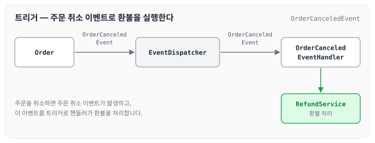

Order는 주문 취소 이벤트만 발생시키고, 환불은 이벤트를 받은 핸들러가 RefundService를 통해 처리합니다.

### 이벤트 장점

이벤트를 사용하면 서로 다른 도메인 로직이 섞이는 것을 방지할 수 있습니다. 앞에서 본 환불 처리 코드를 이벤트로 바꾸면 아래와 같습니다.

[AS-IS]

```java
public class CancelOrderService {
		private RefundService refundService;

		@Transactional
		public void cancel(OrderNo orderNo) {
				Order order = findOrder(orderNo);
				order.cancel();

				order.refundStarted();
				try {
					refundService.refund(order.getPaymentId()); // 외부 서비스 성능에 직접 영향을 받는다.
					order.refundCompleted();
				} catch {
						???
				}
		}
}
```

[TO-BE]

```java
public class Order {
		...
		public void cancel() {
        verifyNotYetShipped();
				this.state = OrderState.CANCELED;
        Events.raise(new OrderCanceledEvent(number.getNumber()));
    }
		...
}
```

구매 취소 코드에 더 이상 환불 로직이 없습니다. 또한 이벤트 핸들러를 사용하면 기능 확장도 쉬워집니다. 구매 취소 시 환불과 함께 이메일로 취소 내용을 보내고 싶다면, 이메일 발송을 처리하는 핸들러를 구현하면 됩니다.

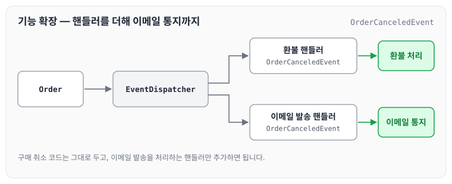

핸들러가 늘어나도 이벤트를 발생시키는 Order의 코드는 바뀌지 않습니다.

## 이벤트, 핸들러, 디스패처 구현

이벤트와 관련된 코드는 아래와 같이 구성합니다.

- 이벤트 클래스 : 이벤트를 표현합니다.
- 디스패처 : 스프링이 제공하는 ApplicationEventPublisher를 이용합니다.
- Events : 이벤트를 발생시킵니다. 이벤트 발생을 위해 ApplicationEventPublisher를 사용합니다.
- 이벤트 핸들러 : 이벤트를 수신해서 처리합니다.

### 이벤트 클래스

```java
public class OrderCanceledEvent {
		// 이벤트는 핸들러에서 이벤트를 처리하는데 필요한 데이터를 포함한다.
		private String orderNumber;
		
		public OrderCanceledEvent(String number) {
			this.orderNumber = number;
		}
		
		public String getOrderNumber() {return orderNumber;}
}
```

모든 이벤트가 공통으로 갖는 프로퍼티가 있다면 관련 상위 클래스를 만들 수 있습니다.

```java
public abstract class Event {
		private long timestamp;

		public Event() {
				this.timestamp = System.currentTimeMillis();
		}

		public long getTimestamp() {
				return this.timestamp;
		}
}
```

### Events 클래스와 ApplicationEventPublisher

이벤트 발생과 발행을 위해 `ApplicationEventPublisher`를 사용합니다. Events 클래스는 아래와 같습니다.

```java
public class Events {
		private static ApplicationEventPublisher publisher;

		static void setPublisher(ApplicationEventPublisher publisher) {
				Events.publisher = publisher;
		}

		public static void raise(Object event) {
				if (publisher != null) {
						publisher.publishEvent(event);
				}
		}
}
```

`Events#setPublisher()` 메서드에 이벤트 퍼블리셔를 전달하기 위해 스프링 설정 클래스를 작성합니다.

```java
@Configuration
public class EventsConfiguration {
		@Autowired
		private ApplicationContext applicationContext;

		@Bean
		public InitializingBean eventsInitializer() {
				return () -> Events.setPublisher(applicationContext);
		}
}
```

- `eventsInitializer()`는 `InitializingBean` 타입 객체를 빈으로 설정합니다. `InitializingBean`은 스프링 빈 객체를 초기화할 때 사용하는 인터페이스입니다.

### 이벤트 발생과 이벤트 핸들러

이벤트는 `Events.raise()`로 발생시킵니다.

```java
public class Order { 
		
		public void cancel() {
				verifyNotYetShipped();
				this.state = OrderState.CANCELED;
				Events.raise(new OrderCanceledEvent(number.getNumber()));
		}
}
```

이벤트를 처리할 핸들러는 `@EventListener` 애너테이션을 사용해서 구현합니다.

```java

@Service
public class OrderCanceledEventHandler {
		private RefundService refundService;

		public OrderCanceledEventHandler(RefundService refundService) {
				this.refundService = refundService;
		}

		@EventListener(OrderCanceledEvent.class)
		public void handle(OrderCanceledEvent event) {
				refundService.refund(event.getOrderNumber());
		}
}
```

### 흐름 처리

이벤트가 발생해서 핸들러가 실행되기까지의 흐름은 아래와 같습니다.

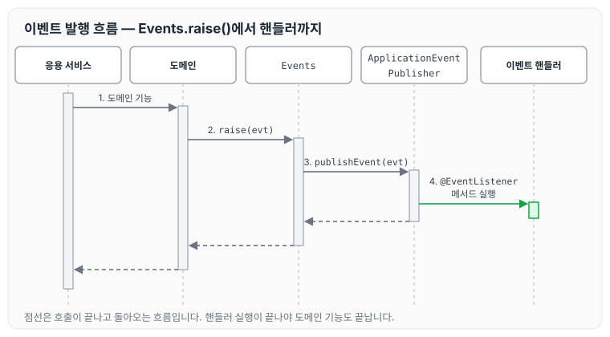

1. 도메인 기능을 실행합니다.
2. 도메인 기능은 `Events.raise()`를 이용해서 이벤트를 발생시킵니다.
3. `Events.raise()`는 스프링이 제공하는 ApplicationEventPublisher를 이용해서 이벤트를 발행합니다.
4. ApplicationEventPublisher는 `@EventListener` 애너테이션이 붙은 메서드를 찾아 실행합니다.

그림에서 볼 수 있듯이 핸들러 실행이 끝나야 도메인 기능과 응용 서비스도 끝납니다. 이 점이 다음에 볼 동기 이벤트 처리 문제로 이어집니다.

## 동기 이벤트 처리 문제

이벤트를 사용해서 강결합 문제는 해소했지만, 외부 서비스에 영향을 받는 문제는 아직 해소하지 못했습니다.

```java
// 1. 응용 서비스 코드
@Transactional // 외부 연동 과정에서 익셉션이 발생하면 트랜잭션 처리는?
public void cancel(OrderNo orderNo) {
		Order order = findOrder(orderNo);
		order.cancel(); // order.cancel()에서 OrderCanceledEvent 발생
}

// 2. 이벤트를 처리하는 코드
@Service
public class OrderCanceledEventHandler {
		...
			
		@EventListener(OrderCanceledEvent.class)
		public void handle(OrderCanceledEvent event) {
			// refundService.refund()가 느려지거나 익셉션이 발생한다면?
				refundService.refund(event.getOrderNumber());
		}
}
```

- `refund()`가 느려지면 `cancel()` 메서드도 함께 느려집니다.
- `refundService.refund()`에서 익셉션이 발생하면 `cancel()`을 롤백해야 하는지 판단해야 합니다.

외부 환불 서비스가 실패했다고 해서 반드시 트랜잭션을 롤백해야 하는 것은 아닙니다. 일단 구매 취소 자체는 처리하고, 환불만 재처리하거나 수동으로 처리할 수도 있습니다.

외부 시스템과의 연동을 동기로 처리할 때 발생하는 성능과 트랜잭션 범위 문제는 다음 두 가지 방법으로 해소할 수 있습니다.

1. 이벤트를 비동기로 처리
2. 이벤트와 트랜잭션을 연계

## 비동기 이벤트 처리

회원 가입 신청을 하면 검증을 위해 이메일을 보내는 서비스가 많습니다. 이때 회원 가입 신청을 하자마자 바로 메일함에 검증 이메일이 도착할 필요는 없고, 몇 초 뒤에 도착해도 문제가 되지 않습니다.

'A 하면 이어서 B 하라'는 내용을 담은 요구사항은 실제로 'A 하면 최대 언제까지 B 하라'인 경우가 많습니다. 여기서 'A 하면'은 이벤트로 볼 수 있으므로, 'A 하면 최대 언제까지 B 하라'로 바꿀 수 있는 요구사항은 이벤트를 비동기로 처리하는 방식으로 구현할 수 있습니다.

이벤트를 비동기로 처리하는 방법은 아래와 같습니다.

1. 로컬 핸들러를 비동기로 실행하기
2. 메시지 큐를 사용하기
3. 이벤트 저장소와 이벤트 포워더 사용하기
4. 이벤트 저장소와 이벤트 제공 API를 사용하기

### 로컬 핸들러 비동기 실행

이벤트 핸들러를 별도 스레드로 실행하는 방법입니다.

- `@EnableAsync` 애너테이션을 사용해서 비동기 기능을 활성화합니다.
- 이벤트 핸들러 메서드에 `@Async` 애너테이션을 붙입니다.

```java
@SpringBootApplication
@EnableAsync
public class ShopApplication {

		public static void main(String [] args) {
				SpringApplication.run(ShopApplication.class, args);
		}
}
```

비동기로 실행할 이벤트 핸들러 메서드에는 `@Async` 애너테이션을 붙입니다.

```java
@Service
public class OrderCancelEventHandler {

		@Async
		@EventListener(OrderCanceledEvent.class)
		public void handle(OrderCanceledEvent event) {
			refundService.refund(event.getOrderNumber());
		}
}
```

`@Async`를 붙인 핸들러가 실행되는 흐름은 아래와 같습니다.

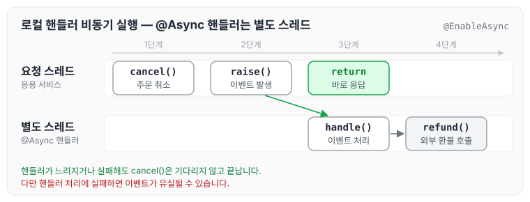

요청 스레드는 핸들러의 처리 결과를 기다리지 않고 끝나므로, 외부 환불 서비스가 느려져도 주문 취소 응답에는 영향이 없습니다. 다만 뒤의 이벤트 적용 시 추가 고려 사항에서 정리한 것처럼, 로컬 핸들러를 비동기로 실행하면 이벤트 처리에 실패했을 때 이벤트가 유실됩니다.

### 메시징 시스템을 이용한 비동기 구현

비동기 이벤트를 처리할 때 사용하는 또 다른 방법은 카프카나 래빗MQ와 같은 메시징 시스템을 사용하는 것입니다.

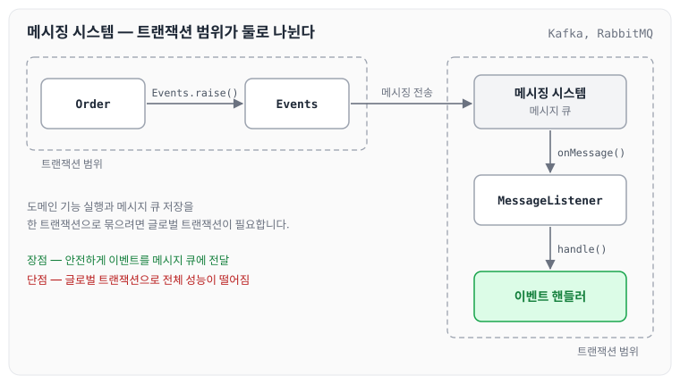

필요하다면 이벤트를 발생시키는 도메인 기능과 메시지 큐에 이벤트를 저장하는 절차를 한 트랜잭션으로 묶어야 합니다. 이렇게 하려면 글로벌 트랜잭션이 필요합니다.

글로벌 트랜잭션의 장단점은 아래와 같습니다.

- 장점 : 안전하게 이벤트를 메시지 큐에 전달할 수 있습니다.
- 단점 : 글로벌 트랜잭션으로 인해 전체 성능이 떨어집니다.

### 이벤트 저장소를 이용한 비동기 처리

이벤트를 DB에 저장한 뒤에 별도 프로그램을 이용해서 이벤트 핸들러에 전달하는 방법입니다.

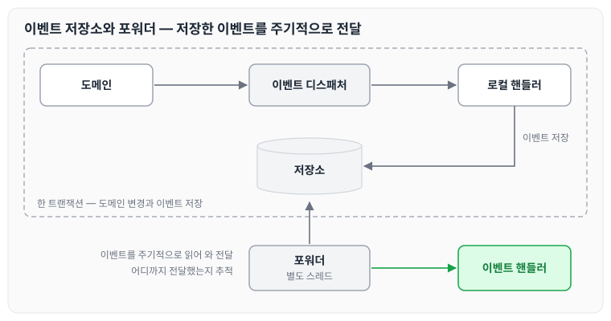

1. 이벤트가 발생합니다.
2. 핸들러가 스토리지에 이벤트를 저장합니다.
3. 포워더는 주기적으로 이벤트 저장소에서 이벤트를 가져옵니다.
4. 포워더는 별도 스레드를 사용하므로 이벤트가 비동기로 처리됩니다.

### API를 이용해서 이벤트를 외부에 제공하는 방식

포워더 대신 API로 이벤트를 외부에 제공할 수도 있습니다. 저장소에 이벤트를 저장하는 과정은 같고, 외부 핸들러가 API를 통해 이벤트를 읽어 가서 처리합니다.

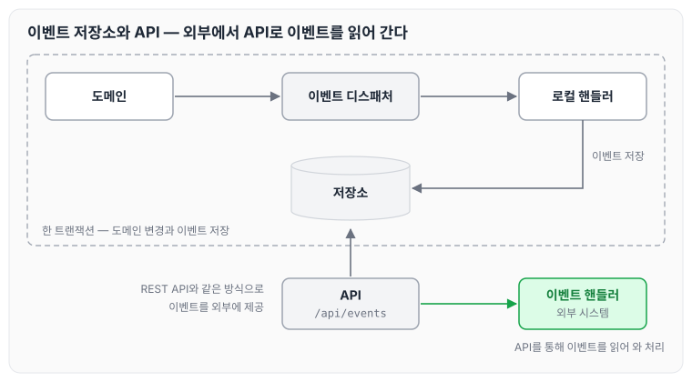

## 이벤트 저장소 구현

이벤트 저장소를 구성하는 클래스는 아래와 같습니다.

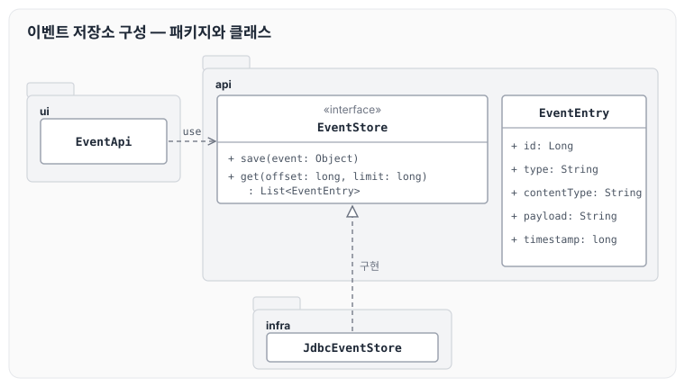

- EventEntry : 이벤트 저장소에 보관할 데이터
- EventStore : 이벤트를 저장하고 조회하는 인터페이스
- JdbcEventStore : JDBC를 이용한 EventStore 구현 클래스
- EventApi : REST API를 이용해서 이벤트 목록을 제공하는 컨트롤러

### EventEntry

```java

public class EventEntry {
    private Long id;
    private String type;
    private String contentType;
    private String payload;
    private long timestamp;

    public EventEntry(String type, String contentType, String payload) {
        this.type = type;
        this.contentType = contentType;
        this.payload = payload;
        this.timestamp = System.currentTimeMillis();
    }

    public EventEntry(Long id, String type, String contentType, String payload,
                      long timestamp) {
        this.id = id;
        this.type = type;
        this.contentType = contentType;
        this.payload = payload;
        this.timestamp = timestamp;
    }

    public Long getId() {
        return id;
    }

    public String getType() {
        return type;
    }

    public String getContentType() {
        return contentType;
    }

    public String getPayload() {
        return payload;
    }

    public long getTimestamp() {
        return timestamp;
    }
}
```

- EventStore는 이벤트 객체를 직렬화해서 payload에 저장합니다. 이때 JSON으로 직렬화했다면 contentType 값으로 'application/json'을 갖습니다.

### EventStore

```java
public interface EventStore {
    void save(Object event);

    List<EventEntry> get(long offset, long limit);
}
```

- 이벤트는 과거에 벌어진 사건이므로 데이터가 변경되지 않습니다. 그래서 인터페이스에는 추가와 조회 기능만 있습니다.

### JdbcEventStore

```java
@Component
public class JdbcEventStore implements EventStore {
    private ObjectMapper objectMapper;
    private JdbcTemplate jdbcTemplate;

    public JdbcEventStore(ObjectMapper objectMapper, JdbcTemplate jdbcTemplate) {
        this.objectMapper = objectMapper;
        this.jdbcTemplate = jdbcTemplate;
    }

    @Override
    public void save(Object event) {
        EventEntry entry = new EventEntry(event.getClass().getName(),
                "application/json", toJson(event));
        jdbcTemplate.update(
                "insert into evententry " +
                        "(type, content_type, payload, timestamp) " +
                        "values (?, ?, ?, ?)",
                ps -> {
                    ps.setString(1, entry.getType());
                    ps.setString(2, entry.getContentType());
                    ps.setString(3, entry.getPayload());
                    ps.setTimestamp(4, new Timestamp(entry.getTimestamp()));
                });
    }

    private String toJson(Object event) {
        try {
            return objectMapper.writeValueAsString(event);
        } catch (JsonProcessingException e) {
            throw new PayloadConvertException(e);
        }
    }

    @Override
    public List<EventEntry> get(long offset, long limit) {
        return jdbcTemplate.query(
                "select * from evententry order by id asc limit ?, ?",
                ps -> {
                    ps.setLong(1, offset);
                    ps.setLong(2, limit);
                },
                (rs, rowNum) -> {
                    return new EventEntry(
                            rs.getLong("id"),
                            rs.getString("type"),
                            rs.getString("content_type"),
                            rs.getString("payload"),
                            rs.getTimestamp("timestamp").getTime());
                });
    }
}
```

이벤트를 저장할 테이블의 DDL은 아래와 같습니다.

```sql
create table evententry (
  id int not null AUTO_INCREMENT PRIMARY KEY,
  `type` varchar(255),
  `content_type` varchar(255),
  payload MEDIUMTEXT,
  `timestamp` datetime
) character set utf8mb4;
```

### 이벤트 저장을 위한 이벤트 핸들러 구현

```java
@Component
public class EventStoreHandler {
    private EventStore eventStore;

    public EventStoreHandler(EventStore eventStore) {
        this.eventStore = eventStore;
    }

    @EventListener(Event.class)
    public void handle(Event event) {
        eventStore.save(event);
    }
}
```

EventStoreHandler의 `handle()` 메서드는 `eventStore.save()` 메서드를 이용해서 이벤트 객체를 저장합니다.

### REST API 구현

```java
@RestController
public class EventApi {
    private EventStore eventStore;

    public EventApi(EventStore eventStore) {
        this.eventStore = eventStore;
    }

    @RequestMapping(value = "/api/events", method = RequestMethod.GET)
    public List<EventEntry> list(
            @RequestParam("offset") Long offset,
            @RequestParam("limit") Long limit) {
        return eventStore.get(offset, limit);
    }
}
```

API를 사용하는 클라이언트는 일정 간격으로 다음 과정을 실행합니다.

1. 가장 마지막에 처리한 데이터의 offset인 lastOffset을 구합니다. 저장한 lastOffset이 없으면 0을 사용합니다.
2. 마지막에 처리한 lastOffset을 offset으로 사용해서 API를 실행합니다.
3. API 결과로 받은 데이터를 처리합니다.
4. offset + 데이터 개수를 lastOffset으로 저장합니다.

### 포워더 구현

포워더는 EventForwarder, OffsetStore, EventSender로 구현합니다. 먼저 EventForwarder입니다.

```java
@Component
public class EventForwarder {
    private static final int DEFAULT_LIMIT_SIZE = 100;

    private EventStore eventStore;
    private OffsetStore offsetStore;
    private EventSender eventSender;
    private int limitSize = DEFAULT_LIMIT_SIZE;

    public EventForwarder(EventStore eventStore,
                          OffsetStore offsetStore,
                          EventSender eventSender) {
        this.eventStore = eventStore;
        this.offsetStore = offsetStore;
        this.eventSender = eventSender;
    }

    @Scheduled(initialDelay = 1000L, fixedDelay = 1000L)
    public void getAndSend() {
        long nextOffset = getNextOffset();
        List<EventEntry> events = eventStore.get(nextOffset, limitSize);
        if (!events.isEmpty()) {
            int processedCount = sendEvent(events);
            if (processedCount > 0) {
                saveNextOffset(nextOffset + processedCount);
            }
        }
    }

    private long getNextOffset() {
        return offsetStore.get();
    }

    private int sendEvent(List<EventEntry> events) {
        int processedCount = 0;
        try {
            for (EventEntry entry : events) {
                eventSender.send(entry);
                processedCount++;
            }
        } catch(Exception ex) {
            // 로깅 처리
        }
        return processedCount;
    }

    private void saveNextOffset(long nextOffset) {
        offsetStore.update(nextOffset);
    }

}
```

- `getNextOffset()` : 읽어 올 이벤트의 다음 offset을 구합니다.
- `eventStore.get(nextOffset, limitSize)` : 이벤트 저장소에서 offset부터 limitSize만큼 이벤트를 구합니다.
- 구한 이벤트가 있으면 `sendEvent(events)` 메서드를 이용해서 이벤트를 전송합니다. `sendEvent(events)`는 처리한 이벤트 개수를 리턴합니다.
- `saveNextOffset(nextOffset + processedCount)` : 처리한 이벤트 개수가 0보다 크면 다음에 읽어 올 offset을 저장합니다.

`getAndSend()` 메서드를 주기적으로 실행하기 위해 스프링의 `@Scheduled` 애너테이션을 사용합니다. 한 번 실행될 때의 흐름을 그리면 아래와 같습니다.

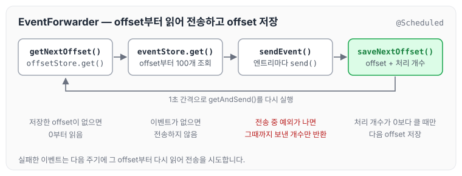

전송 중 예외가 발생하면 그때까지 전송한 개수만큼만 offset이 늘어나므로, 다음 주기에는 실패한 이벤트부터 다시 읽어 전송합니다.

OffsetStore는 아래와 같습니다.

```java
public interface OffsetStore {
    long get();
    void update(long nextOffset);
}
```

- OffsetStore를 구현한 클래스는 offset 값을 DB 테이블에 저장하거나 로컬 파일에 보관해서, 마지막 offset 값을 물리적 저장소에 보관하면 됩니다.

EventSender는 아래와 같습니다.

```java
public interface EventSender {
    void send(EventEntry event);
}
```

## 이벤트 적용 시 추가 고려 사항

1. 이벤트 소스를 EventEntry에 추가할지 여부입니다. 앞서 구현한 EventEntry는 이벤트 발생 주체에 대한 정보를 갖지 않기 때문에, 'Order가 발생시킨 이벤트만 조회하기'처럼 특정 주체가 발생시킨 이벤트만 조회하는 기능을 구현할 수 없습니다.
2. 포워더에서 전송 실패를 얼마나 허용할지입니다. 이벤트 전송에 실패하면 실패한 이벤트부터 다시 읽어 와 전송을 시도하는데, 계속 실패하면 그 뒤의 이벤트도 전송되지 않는 문제가 생깁니다. 따라서 포워더를 구현할 때는 실패한 이벤트의 재전송 횟수에 제한을 두어야 합니다.
3. 이벤트 손실입니다. 이벤트 저장소를 사용하는 방식은 이벤트 발생과 이벤트 저장을 한 트랜잭션으로 처리하기 때문에, 트랜잭션에 성공하면 이벤트가 저장소에 보관된다는 것을 보장할 수 있습니다. 반면 로컬 핸들러를 이용해서 이벤트를 비동기로 처리할 경우 이벤트 처리에 실패하면 이벤트가 유실됩니다.
4. 이벤트 순서입니다. 이벤트 발생 순서대로 외부 시스템에 전달해야 할 경우에는 이벤트 저장소를 사용하는 것이 좋습니다. 메시징 시스템은 사용 기술에 따라 이벤트 발생 순서와 메시지 전달 순서가 다를 수 있습니다.
5. 이벤트 재처리입니다. 동일한 이벤트를 다시 처리해야 할 때 어떻게 할지 결정해야 합니다. 가장 쉬운 방법은 마지막으로 처리한 이벤트의 순번을 기억해 두었다가, 이미 처리한 순번의 이벤트가 도착하면 처리하지 않고 무시하는 것입니다. 예를 들어 회원 가입 신청 이벤트가 처음 도착하면 이메일을 발송하고, 동일한 순번의 이벤트가 다시 들어오면 이메일을 발송하지 않는 방식으로 구현합니다.

## 이벤트 처리와 DB 트랜잭션 고려

주문 취소 기능을 예로 들면 처리 과정은 아래와 같습니다.

- 주문 취소 기능은 주문 취소 이벤트를 발생시킵니다.
- 주문 취소 이벤트 핸들러는 환불 서비스에 환불 처리를 요청합니다.
- 환불 서비스는 외부 API를 호출해서 결제를 취소합니다.

### 동기로 처리하는 실행 흐름

이벤트를 동기로 처리하면 아래 순서로 실행됩니다.

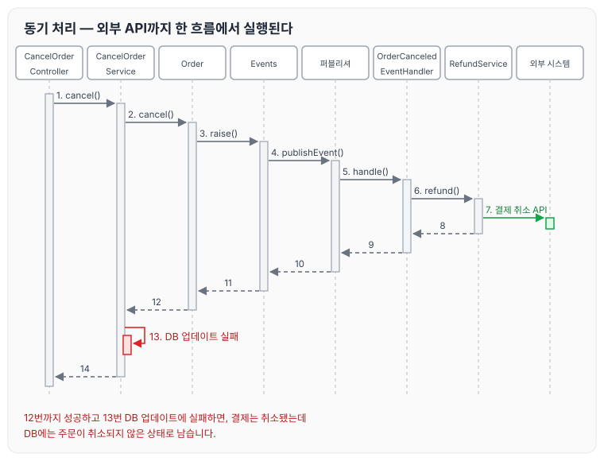

12번 과정까지 모두 성공하고 13번 과정에서 DB 업데이트에 실패하면, 결제는 취소됐는데 DB에는 주문이 취소되지 않은 상태로 남게 됩니다.

### 비동기로 처리하는 실행 흐름

이벤트를 비동기로 처리하면 아래 순서로 실행됩니다.

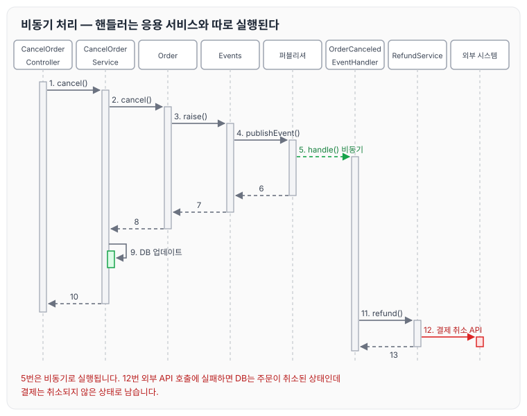

이벤트 핸들러를 호출하는 5번 과정은 비동기로 실행됩니다. 이때 12번 과정에서 외부 API 호출에 실패하면, DB에는 주문이 취소된 상태로 데이터가 바뀌었는데 결제는 취소되지 않은 상태로 남게 됩니다.

### 트랜잭션이 성공할 때만 핸들러 실행

이벤트 처리를 동기로 하든 비동기로 하든 이벤트 처리 실패와 트랜잭션 실패를 함께 고려해야 합니다. 두 가지 실패를 모두 고려하면 복잡해지므로 경우의 수를 줄이는 것이 도움이 되는데, 그 방법이 트랜잭션이 성공할 때만 이벤트 핸들러를 실행하는 것입니다.

`@TransactionalEventListener` 애너테이션은 스프링 트랜잭션 상태에 따라 이벤트 핸들러를 실행할 수 있게 합니다.

```java
@TransactionalEventListener(
		classes = OrderCanceledEvent.class,
		phase = TransactionPhase.AFTER_COMMIT
)
public void handle(OrderCanceledEvent event) {
		refundService.refund(event.getOrderNumber());
}
```

`TransactionPhase.AFTER_COMMIT`은 스프링 트랜잭션 커밋에 성공한 뒤에 핸들러 메서드를 실행합니다. 커밋에 성공한 경우와 롤백된 경우를 비교하면 아래와 같습니다.

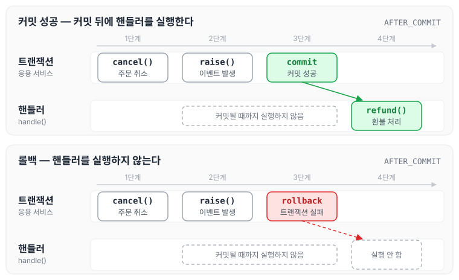

트랜잭션이 롤백되면 핸들러가 실행되지 않으므로, DB에는 주문이 취소되지 않았는데 결제만 취소되는 경우는 생기지 않습니다.

## 마무리

오늘은 도메인 객체에 다른 도메인 로직이 섞이는 문제를 이벤트로 분리하는 방법과 스프링 이벤트 구현, 비동기 이벤트 처리 방식, 이벤트 저장소와 포워더 구현, 그리고 이벤트 처리와 트랜잭션을 함께 고려하는 방법에 대해 정리하였습니다. 동기화 관련 외부 API 작업이 많은 시스템에서는 이벤트 저장소와 `AFTER_COMMIT`을 함께 적용해 보면 좋을 것 같습니다. 다음 글에서는 [CQRS](../ddd-cqrs/)에 대해 정리하도록 하겠습니다.

참조 : [도메인 주도 개발 시작하기 - 예스24](https://www.yes24.com/Product/Goods/108431347?pid=123487&cosemkid=go16481149689793107&gclid=Cj0KCQjwgNanBhDUARIsAAeIcAvU1218EfnAWaB7jwT88mKqCJ9UJbgjm5qk12G3_kgbQFKtHnPTQaUaArR8EALw_wcB)
