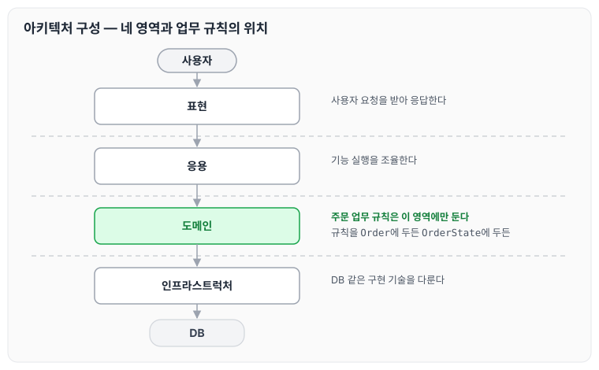
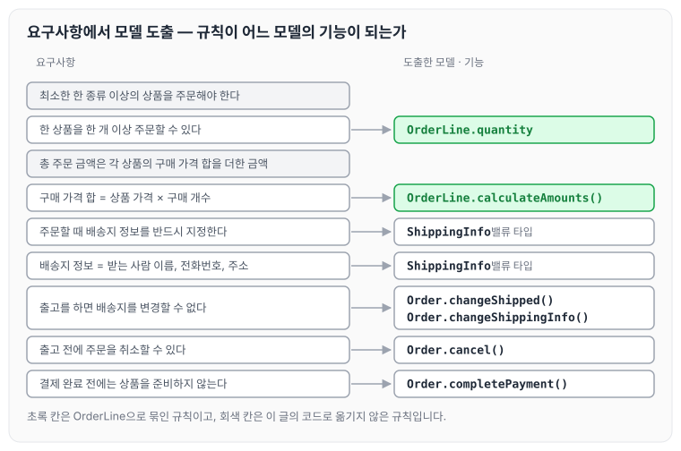
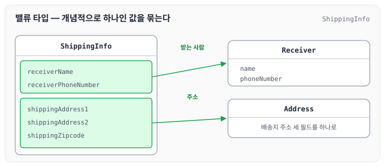
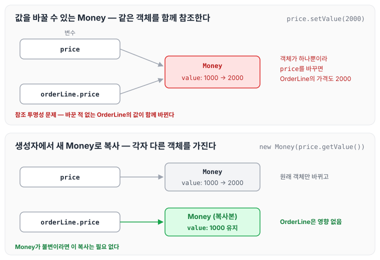

이전에 트랜잭션과 관련해서 질문을 한 적이 있는데, 아래와 같은 답변을 받고 이 책을 읽게 되었습니다.

> 서비스에서 서비스를 호출하는 구조는 피하고 도메인 레이어에 도메인 서비스를 둬서 처리하는 것을 최범균님이 쓴 '도메인 주도 개발 시작하기(DDD Start)'에서 본 적이 있습니다.

질문했던 내용은 [@Transactional 롤백 안 되는 원인 [프록시]](../transaction-rollback-proxy/)에 정리해 두었습니다.

이제 책을 읽기 시작하였고, 앞으로 챕터별로 정리하려고 합니다. 오늘은 1장에서 다루는 도메인 전문가와 개발자 간 지식 공유, 도메인 모델 도출, 밸류 타입에 대해 정리하도록 하겠습니다.

## 도메인 전문가와 개발자 간 지식 공유

코딩에 앞서 요구사항을 올바르게 이해하는 것이 중요합니다. 요구사항을 제대로 이해하지 않으면 쓸모없거나 유용함이 떨어지는 시스템을 만들게 되기 때문입니다.

따라서 개발을 시작하기 전에 사용자나 기획자와 직접 이야기하는 시간을 가지고 도메인에 대한 이해도를 높여야 좋은 결과물이 나옵니다.

## 도메인 모델 패턴

일반적인 애플리케이션은 아래와 같이 표현, 응용, 도메인, 인프라스트럭처 영역으로 구성됩니다. 사용자의 요청은 표현 영역에서 받아 응용, 도메인 영역을 거치고, 인프라스트럭처 영역이 DB와 연동합니다.



주문 기능을 구현할 때 주문과 관련된 중요 업무 규칙은 주문 도메인 모델인 Order에 두어도 되고 OrderState에 두어도 됩니다. 중요한 점은 주문과 관련된 중요 업무 규칙을 구현한 코드가 도메인 모델에만 위치해야 한다는 것입니다. 그림에서 도메인 영역만 표시한 것도 이 때문입니다.

## 도메인 모델 도출

도메인 모델을 도출할 때는 요구사항에서 핵심 구성요소, 규칙, 기능을 찾습니다. 주문 도메인의 요구사항을 예로 들면 아래와 같습니다.

- 최소한 한 종류 이상의 상품을 주문해야 합니다.
- 한 상품을 한 개 이상 주문할 수 있습니다.
- 총 주문 금액은 각 상품의 구매 가격 합을 모두 더한 금액입니다.
- 각 상품의 구매 가격 합은 상품 가격에 구매 개수를 곱한 값입니다.
- 주문할 때 배송지 정보를 반드시 지정해야 합니다.
- 배송지 정보는 받는 사람 이름, 전화번호, 주소로 구성합니다.
- 출고를 하면 배송지를 변경할 수 없습니다.
- 출고 전에 주문을 취소할 수 있습니다.
- 고객이 결제를 완료하기 전에는 상품을 준비하지 않습니다.

요구사항을 잘 파악했다면 Order에 어떤 기능이 들어가야 할지 유추할 수 있습니다. 출고 상태 변경, 배송지 정보 변경, 주문 취소, 결제 완료 기능을 Order에 두면 아래와 같습니다.

```java
public class Order {
	public void changeShipped() {...}
	public void changeShippingInfo(ShippingInfo shippingInfo) {...}
	public void cancel() {...}
	public void completePayment() {...}
}
```

요구사항 중 아래 두 가지는 주문 항목 하나에 대한 규칙입니다.

- 한 상품을 한 개 이상 주문할 수 있습니다.
- 각 상품의 구매 가격 합은 상품 가격에 구매 개수를 곱한 값입니다.

이를 토대로 OrderLine을 구성하면 아래와 같습니다.

```java
public class OrderLine{
	private Product product;
	private int price;
	private int quantity;
	private int amounts;
	
	public OrderLine(Product product, int price, int quantity) {
		this.product = product;
		this.price = price;
		this.quantity = quantity;
		this.amounts = calculateAmounts();
	}

	private int calculateAmounts() {
		return price * quantity;
	}

	public int getAmounts() {....} 

}
```

요구사항 하나하나가 어떤 모델의 기능으로 이어지는지 정리하면 다음과 같습니다.



그림에서 수량과 구매 가격 합에 대한 규칙은 OrderLine으로, 출고·취소·결제에 대한 규칙은 Order의 기능으로, 배송지에 대한 규칙은 뒤에서 다룰 ShippingInfo 밸류로 이어집니다.

이처럼 기획자, 사용자와 의사소통하면서 도메인 모델을 어떻게 구현할지 고민한 뒤 코드를 작성하면 좀 더 원활하게 구현할 수 있다는 점이 이 장에서 중요한 부분인 것 같습니다.

또한 이렇게 만든 모델은 요구사항을 정련하기 위해 도메인 전문가나 다른 개발자와 논의하는 과정에서 공유하기도 합니다.

## 밸류 타입

배송지 정보를 담는 ShippingInfo는 아래와 같이 구성할 수 있습니다.

```java
public class ShippingInfo {
	private String receiverName;
	private String receiverPhoneNumber;

	private String shippingAddress1;
	private String shippingAddress2;
	private String shippingZipcode;
}
```

밸류 타입은 개념적으로 완전한 하나를 표현할 때 사용합니다. 위 코드에서 receiverName, receiverPhoneNumber는 받는 사람 정보이므로 아래와 같이 Receiver로 묶을 수 있습니다.

```java
public class Receiver {
	private String name;
	private String phoneNumber;

	public Receiver(String name, String phoneNumber ) {
		this.name = name;
		this.phoneNumber = phoneNumber;
	}
	...
}
```

같은 방법으로 shippingAddress1, shippingAddress2, shippingZipcode도 Address로 묶을 수 있습니다. 묶은 결과를 그림으로 보면 아래와 같습니다.



### 밸류 객체는 새로 만들어서 바꾼다

책에서는 밸류 객체를 변경할 때 아래와 같은 방식을 권합니다.

> 밸류 객체의 데이터를 변경할 때는 기존 데이터를 변경하기보다는 변경한 데이터를 갖는 새로운 밸류 객체를 생성하는 방식을 선호한다.

Money를 예로 들면 아래와 같습니다. 값을 더할 때 자신의 value를 바꾸지 않고 새 Money를 만들어 돌려주며, value를 변경하는 메서드는 두지 않습니다.

```java
public class Money{
	private int value;

	public Money add(Money money) {
		return new Money(this.value + money.value);
	}

	// value를 변경 할 수 있는 메서드 없음 
}
```

만약 Money가 setValue()처럼 값을 바꾸는 메서드를 제공한다면 아래와 같이 참조 투명성과 관련된 문제가 발생합니다.

```java
Money price = new Money(1000);
OrderLine orderLine = new OrderLine(product, price, 2);
price.setValue(2000);
```

price와 OrderLine이 같은 Money 객체를 참조하기 때문에, `price`의 `value`를 변경하는 순간 `OrderLine`의 가격도 함께 변경됩니다.

이 문제를 해결하려면 아래와 같이 OrderLine 생성자에서 전달받은 Money를 그대로 쓰지 않고 새 Money 객체로 복사해 둡니다.

```java
public class OrderLine {
	...
	public OrderLine(Product product, Money price, int quantity) {
		this.price = new Money(price.getValue());
	}
}
```

두 경우를 비교하면 다음과 같습니다.



위쪽은 객체가 하나뿐이라 price를 바꾸면 OrderLine의 가격도 2000이 되고, 아래쪽은 OrderLine이 복사본을 가지고 있어 1000을 유지합니다. Money가 불변이라면 위와 같은 복사 코드는 필요 없겠지만, 변경할 수 있다면 안전하지 않기 때문에 이처럼 사용합니다.

## 마무리

오늘은 도메인 주도 개발 시작하기 1장에서 도메인 전문가와의 지식 공유, 요구사항에서 도메인 모델을 도출하는 과정, 밸류 타입에 대해 정리하였습니다. 다음 글에서는 2장 [아키텍처 개요](../ddd-architecture-overview/)에서 다루는 DIP와 도메인 영역의 구성요소에 대해 정리하도록 하겠습니다.

참조 : [도메인 주도 개발 시작하기 - 예스24](https://www.yes24.com/Product/Goods/108431347?pid=123487&cosemkid=go16481149689793107&gclid=Cj0KCQjwgNanBhDUARIsAAeIcAvU1218EfnAWaB7jwT88mKqCJ9UJbgjm5qk12G3_kgbQFKtHnPTQaUaArR8EALw_wcB)
