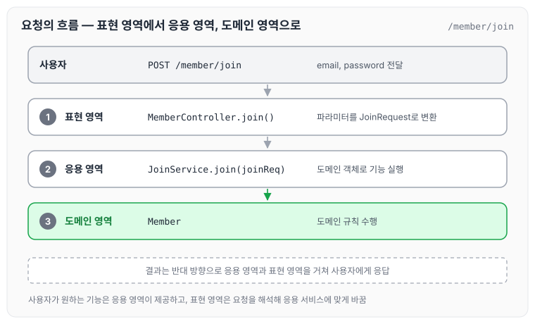
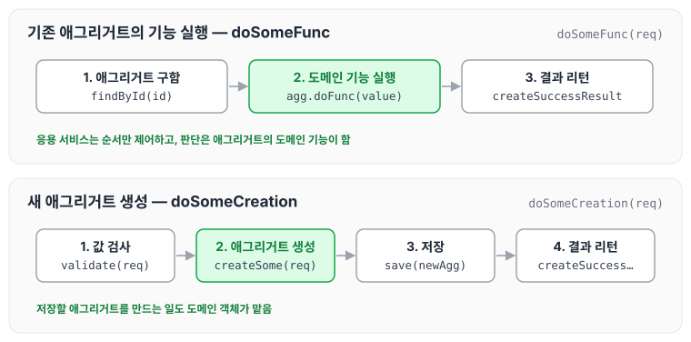
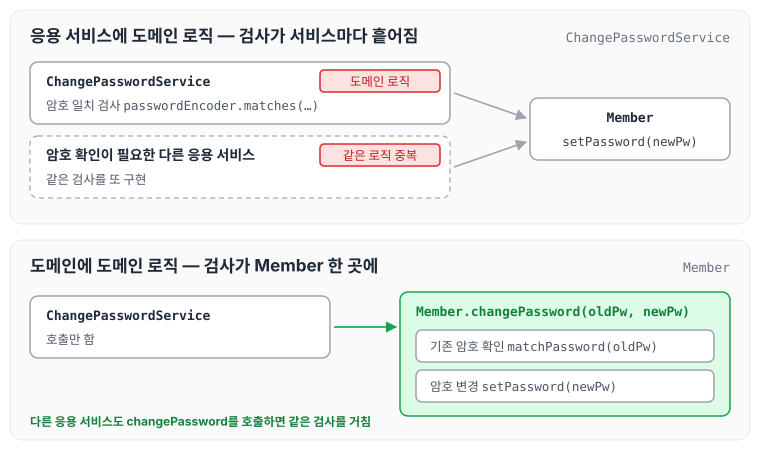
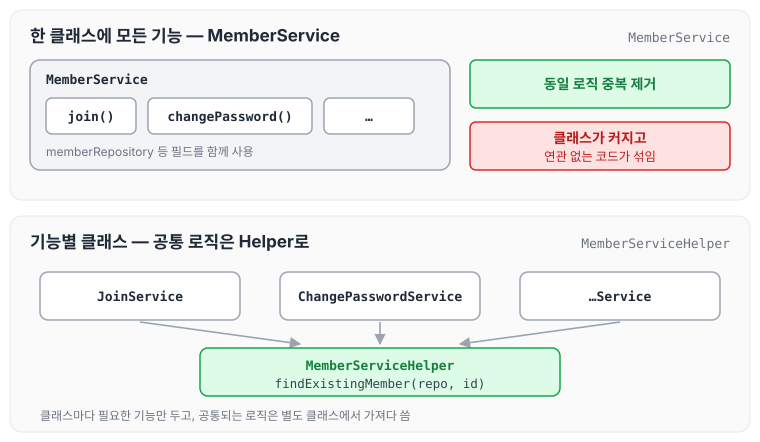
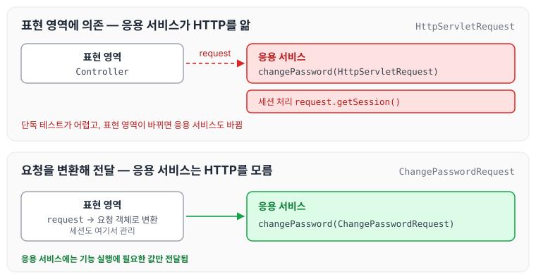
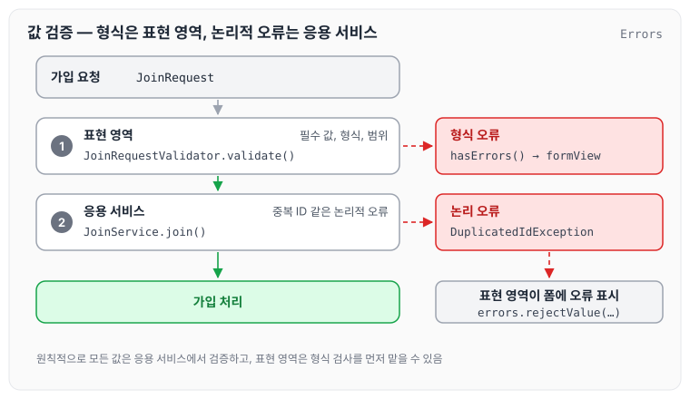
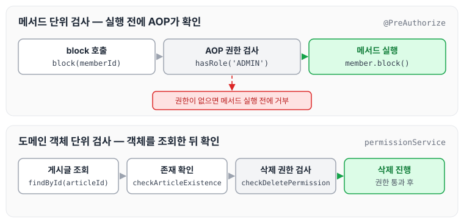

이전에 [스프링 데이터 JPA를 이용한 조회 기능](../ddd-spring-data-jpa-query/)에 대해 작성하였습니다. 그 글에서는 스펙을 이용한 검색과 정렬·페이징, 조회 전용 모델을 구현하는 방법을 정리하였습니다. 오늘은 도메인 주도 개발 시작하기 6장의 내용인 표현 영역과 응용 영역에 대해 정리하도록 하겠습니다.

## 표현 영역과 응용 영역

도메인이 제 기능을 하려면 사용자와 도메인을 연결해 주는 매개체가 필요합니다. 이 역할을 표현 영역과 응용 영역이 맡습니다.

- 표현 영역은 사용자의 요청을 해석합니다.
- 실제 사용자가 원하는 기능은 응용 영역에서 제공합니다.

사용자의 요청이 각 영역을 거쳐 가는 흐름은 아래와 같습니다.



표현 영역은 요청 파라미터를 응용 서비스가 요구하는 형식으로 변환한 뒤 응용 서비스를 실행합니다. 아래 코드는 회원 가입 요청을 처리하는 컨트롤러입니다.

```java
@PostMapping("/member/join")
public ModelAndView join(HttpServletRequest request) {
		String email = request.getParameter("email");
		String password = request.getParameter("password");
		//사용자 요청을 응용 서비스에 맞게 변환
		JoinRequest joinReq = new JoinRequest(email, password);
		// 변환한 객체(데이터)를 이용해서 응용 서비스 실행
		joinService.join(joinReq);
		... 
}
```

## 응용 서비스의 역할

응용 서비스의 역할은 아래와 같습니다.

- 사용자(클라이언트)가 요청한 기능을 실행합니다.
- 도메인 객체를 사용해서 사용자의 요청을 처리합니다.
- 주로 도메인 객체 간의 흐름을 제어하기 때문에 아래와 같은 형태로 구현합니다.

```java
public Result doSomeFunc(SomeReq req) {
		// 1. 리포지터리에서 애그리거트를 구한다.
		SomeAgg agg = someAggRepository.findById(req.getId());
		checkNull(agg);

		// 2. 애그리거트의 도메인 기능을 실행한다.
		agg.doFunc(req.getValue());

		// 3. 결과를 리턴한다.
		return createSuccessResult(agg);
}
```

새로운 애그리거트를 생성하는 응용 서비스도 비슷한 흐름을 가집니다.

```java
public Result doSomeCreation(CreateSomeReq req) {
		// 1. 데이터 중복 등 데이이터가 유효한지 검사한다.
		validate(req);

		// 2. 에그리거트를 생성한다.
		SomeAgg newAgg = createSome(req);

		// 3. 리포지터리에 에그리거트를 저장한다.
		someAggRepository.save(newAgg);

		// 4. 결과를 리턴한다.
		return createSuccessResult(newAgg);
}
```

두 코드의 흐름을 나란히 놓으면 아래와 같습니다.



두 흐름 모두 응용 서비스는 순서를 제어할 뿐이고, 실제 판단은 애그리거트의 도메인 기능이 합니다. 응용 서비스가 복잡하다면 응용 서비스에서 도메인 로직의 일부를 구현하고 있을 가능성이 높습니다.

### 트랜잭션 처리

응용 서비스는 트랜잭션 처리도 담당합니다. 아래는 여러 회원을 한 번에 차단하는 코드입니다.

```java
public void blockMembers(String[] blockingIds) {
		if (blockingIds == null || blockingIds.length == 0) return;
		List<Member> members = memberRepostiory.findByIdIn(blockingIds);
		for (Member member : members) {
				member.block();
		}
}
```

blockMembers() 메서드가 트랜잭션 범위에서 실행되지 않으면, 반영 도중 문제가 생겼을 때 일부 Member만 차단 상태가 되어 데이터 일관성이 깨지게 됩니다. 이 때문에 이런 메서드는 응용 서비스의 트랜잭션 범위에서 실행해야 합니다.

### 도메인 로직 넣지 않기

도메인 로직은 도메인 영역에 위치하고, 응용 서비스는 도메인 로직을 구현하지 않습니다. 암호 변경 기능을 예로 들면 응용 서비스는 아래와 같이 Member 애그리거트의 기능을 호출하기만 합니다.

```java
public class changePasswordService {
		public void changePassword(String memberId, String oldPw, String newPw) {
			Member member = memberRepository.findById(memberId);
			checkMemberExists(member);
			member.changePassword(oldPw, newPw);
		}
...
}
```

Member 애그리거트는 암호를 변경하기 전에 기존 암호를 올바르게 입력했는지 확인하는 로직을 구현합니다.

```java
public class Member {
		public void changePassword(String oldPw, String newPw) {
			if (!matchPassword(oldPw)) throw new BadPasswordException();
			setPassword(newPw);
		}

		// 현재 암호와 일치하는지 검사하는 도메인 로직
		public boolean matchPassword(String pwd) {
			return passwordEncoder.matches(pwd);
		}

		private void setPassword(String newPw) {
				if (isEmpty(newPw)) throw new IllegalArgumentException("no new password");
				this.password = newPw;
		}
}
```

기존 암호를 올바르게 입력했는지 확인하는 것은 도메인의 핵심 기능이기 때문에 응용 서비스에 구현하면 안 됩니다. 아래는 이 검사를 응용 서비스에 구현한 잘못된 예입니다.

```java
public class ChangePasswordService {

		public void changePassword(String memberId, String oldPw, String newPw) {
				Member member = memberRepository.findById(memberId);

				if (!passwordEncoder.matches(oldPw, member.getPassword())) {
					throw new BadPasswordException();
				}
				member.setPassword(newPw);
		}
}
```

두 구현에서 암호 검사 로직이 어디에 있는지 비교하면 아래와 같습니다.



도메인 로직을 도메인 영역이 아닌 응용 서비스에 구현하면 다음과 같은 문제가 생깁니다.

1. 코드의 응집성이 떨어집니다.
2. 여러 응용 서비스에 동일한 도메인 로직을 구현할 가능성이 높아집니다.

응집도가 떨어지고 코드 중복이 발생하는 이러한 문제는 결과적으로 코드 변경을 어렵게 만듭니다.

## 응용 서비스의 구현

응용 서비스는 표현 영역과 도메인 영역을 연결하는 매개체 역할을 합니다.

### 응용 서비스의 크기

회원 도메인을 예로 들면, 응용 서비스는 보통 아래 두 가지 방법 중 한 가지 방식으로 구현합니다.

- 한 응용 서비스 클래스에 회원 도메인의 모든 기능 구현하기
- 구분되는 기능별로 응용 서비스 클래스를 따로 구현하기

먼저 한 응용 서비스 클래스에 모두 구현하는 방법입니다.

```java
public class MemberService {
		// 각 기능을 구현하는 데 필요한 리포지터리, 도메인 서비스 필드 추가
		private MemberRepository memberRepostiory;

		public void join(MemberJoinRequest joinRequest) {...}
		public void changePassword(String memberId, String curPw, String newPw) {...}
		...

}
```

이 방법의 장점과 단점은 아래와 같습니다.

- 장점: 동일 로직에 대한 코드 중복을 제거할 수 있습니다.
- 단점: 클래스의 크기가 커집니다. 연관성 없는 코드가 한 클래스에 위치할 수 있습니다.
- 단점: 분리하는 것이 좋은 상황임에도 습관적으로 기존에 존재하는 클래스에 억지로 끼워 넣게 됩니다.

다음은 구분되는 기능별로 클래스를 따로 구현하는 방법입니다.

```java
public class ChangePasswordService {
		private MemberRepository memberRepostiory;

		public void changePassword(String memberId, String curPw, String newPw) {
				Member member = memberRepostiory.findById(memberId);
				if (member == null) throw new NoMemberException(memberId);
				member.changePassword(curPw, newPw);
		}
		...
}
```

이 방법은 클래스 개수가 많아지지만, 각 클래스에서 공통으로 쓰는 로직은 아래와 같이 별도 클래스로 구현해 중복을 막을 수 있습니다.

```java
//각 응용 서비스에서 공통되는 로직을 별도 클래스로 구현
public final class MemberServiceHelper {
		public static Member findExistingMember(MemberRepository repo, String memberId) {
				Member member = repo.findById(memberId);
				if (member == null) 
						throw new NoMemberException();
				return member;
		}
}

// 공통 로직을 제공하는 메서드를 응용 서비스에서 사용
public class ChangePasswordService {
		private MemberRepository memberRepostiory;

		public void changePassword(String memberId, String curPw, String newPw) {
			Member member = findExistingMember(memberRepostiory, memberId);
			member.changePassword(curPw, newPw);
		}
}
```

두 방식의 구조를 비교하면 아래와 같습니다.



### 메서드 파라미터와 값 리턴

응용 서비스가 제공하는 메서드는 도메인을 이용해서 사용자가 요구한 기능을 실행하는 데 필요한 값을 파라미터로 전달받아야 합니다.

```java
public class ChangePasswordService {
		// 암호 변경 기능 구현에 필요한 값을 파라미터로 전달 받음
		public void changePassword(String memberId, String curPw, String newPw) {
			...
		}
}
```

필요한 값이 많다면 다음 코드처럼 별도 클래스를 만들어 전달받을 수도 있습니다.

```java
public class ChangePasswordRequest {
		private String memberId;
		private String currentPassword;
		private String newPassword;

		.. get 메서드 등 생략
}
```

```java
public class ChangePasswordService {
		// 암호 변경 기능 구현에 필요한 값을 파라미터로 전달 받음
		public void changePassword(ChangePasswordRequest req) {
				Member member = findExistingMember(req.getMemberId());
				member.changePassword(req.getCurrentPassword(), req.getNewPassword());
		}
		...
}
```

### 표현 영역에 의존하지 않기

응용 서비스의 파라미터 타입을 결정할 때 주의할 점은 표현 영역과 관련된 타입을 사용하면 안 된다는 점입니다. 아래는 HttpServletRequest를 응용 서비스에 그대로 넘기는 잘못된 예입니다.

```java
@Controller
@RequestMapping("/member/changePassword")
public class MemberPasswordController {
		
		@PostMapping
		public String submit(HttpServletRequest request) {
			try{
					// 응용 서비스가 표현 영역을 의존하면 안됨
					changePasswordService.changePassword(request);
			} catch (NoMemberException ex){
					// 알맞은 익셉션 처리 및 응답
			}
		}
}
```

응용 서비스가 표현 영역에 의존하면 다음과 같은 문제가 생깁니다.

1. 응용 서비스 단독으로 테스트하기 어렵습니다.
2. 표현 영역이 변경되면 응용 영역도 변경해야 합니다.
3. 응용 서비스가 표현 영역의 역할까지 대신하는 상황이 발생할 수 있습니다.

아래 코드는 3번의 예로, 응용 서비스에서 표현 영역의 상태인 세션을 처리하고 있습니다.

```java
public class AuthenticationService {
		public void authenticate(HttpServletRequest request) {
				...
				// 응용 서비스에서 표현 영역이 상태 처리
				HttpSession session = request.getSession();
				...
		}
}
```

이렇게 되면 코드만으로 표현 영역의 상태가 어떻게 변경되는지 추적하기 어려워집니다. 표현 영역의 응집도가 깨지고, 결과적으로 유지보수하기 어려워집니다.

이 문제를 막으려면 응용 서비스가 표현 영역의 기술을 사용하지 않도록 철저하게 지켜야 합니다. 의존 방향을 비교하면 아래와 같습니다.



## 표현 영역

표현 영역의 책임은 아래와 같습니다.

- 사용자가 시스템을 사용할 수 있는 흐름을 제공하고 제어합니다.
- 사용자의 요청을 알맞은 응용 서비스에 전달하고 결과를 사용자에게 제공합니다.
- 사용자의 세션을 관리합니다.

아래 코드는 표현 영역이 요청을 변환해 응용 서비스를 실행하고, 그 결과를 알맞은 응답으로 바꾸는 예입니다.

```java
@PostMapping()
public String changePassword(HttpServletRequest requeset, Errors errors) {
		// 표현 영역은 사용자 요청을 응용 서비스가 요구하는 형식으로 변환한다.
		String curPw = requeset.getParameter("curPw");
		String newPw = requeset.getParameter("newPw"); 
		String memberId = SecurityContext.getAuthentication().getId();
		ChangePasswordRequest chPwdReq = 
				new ChangePasswordRequest(memberId, curPw, newPw);

		try {
			// 응용 서비스를 실행
			changePasswordService.changePassword(chPwdReq);
			return successView;
		} catch (BadPasswordException | NoMemberException ex) {
			// 응용 서비스의 처리 결과를 알맞은 응답으로 변환
			errors.reject("idPasswordNotMatch");
			return formView;
		}
}
```

## 값 검증

값 검증은 표현 영역과 응용 서비스 두 곳에서 모두 수행할 수 있습니다. 원칙적으로 모든 값에 대한 검증은 응용 서비스에서 처리합니다.

```java
public class JoinService {
		@Transactional
		public void join(JoinRequest joinReq) {
				// 값 형식 검사
				checkEmpty(joinReq.getId(), "id");
				..

				
				// 로직 검사
				checkDuplicateId(joinReq.getId());
		}

		private void checkDuplicateId(String id) {
				int count = memberRepository.countsById(id);
				if(count > 0) {
					throw new DuplicationException();
				}
		}
}
```

위 코드처럼 값을 하나씩 검사하면 첫 번째 오류에서 익셉션이 발생해 나머지 항목의 오류를 알 수 없습니다. 아래는 응용 서비스에서 에러 코드를 모아 하나의 익셉션으로 발생시키는 방법입니다.

```java
@Transactional
public OrderNo placeOrder(OrderRequest orderRequest) {
		List<ValidationError> errors = new ArrayList<>();
		if (orderRequest == null) {
			errors.add(ValidationError.of("emtpy"));
		} else {
			if (orderRequest.getOrdererMemberID() == null) {
					errors.add(ValidationError.of("ordererMemberId", "emtpy"));
			}
			if (orderRequest.getOrderProducts() == null) {
					errors.add(ValidationError.of("getOrderProducts", "emtpy"));
			}
			if (orderRequest.getOrderProducts().isEmpty()) {
					errors.add(ValidationError.of("getOrderProducts", "emtpy"));
			}
		}
		// 응용 서비스가 입력 오류를 하나의 익셉션으로 모아서 발생
		if (!errors.isEmpty()) throw new ValidationErrorException(errors);
}
```

```java
public class ValidationErrorException extends RuntimeException {
    private List<ValidationError> errors;

    public ValidationErrorException(List<ValidationError> errors) {
        this.errors = errors;
    }

    public List<ValidationError> getErrors() {
        return errors;
    }
}
```

필수 값과 값의 형식은 표현 영역에서 먼저 검사할 수도 있습니다. 이 경우 두 영역은 아래와 같이 검증을 나눠 맡습니다.

- 표현 영역: 필수 값, 값의 형식, 범위 등을 검증합니다.
- 응용 서비스: 데이터의 존재 유무와 같은 논리적 오류를 검증합니다.

```java
@Controller
public class Controller {
		@PostMapping("/member/join")
		public String join(JoinRequest joinRequest, Errors errors) {
				new JoinRequestValidator().validate(joinRequest, errors);

				if (errors.hasErrors()) return formView;
				
				try {
				
				} catch (DuplicatedIdException ex) {
						errors.rejectValue(ex.getPropertyName(), "duplicate");
						return formView;
				}
		}
}
```

검증이 두 영역에서 어떻게 나뉘는지 그림으로 정리하면 아래와 같습니다.



## 권한 검사

권한 검사는 크게 두 가지 방식으로 구현할 수 있습니다. 첫 번째는 AOP를 활용해서 응용 서비스의 메서드 단위로 권한을 검사하는 방식입니다.

```java
public class BlockMemberService {
		private MemberRepository memberRepository;

		@PreAuthorize("hasRole('ADMIN')")
		public void block(String memberId) {
			Member member = memberRepository.findById(memberId);
			if (Objects.isNull(member)) throw new NoMemberException();
			member.block();
		}
}
```

두 번째는 개별 도메인 객체 단위로 권한을 검사하는 방식입니다. 이 경우 도메인 객체를 먼저 로딩해야 권한을 판단할 수 있습니다.

```java
public class DeletedArticleService {

		public void delete(String userId, Long articleId) {
				Article article = articleRepository.findById(articleId);
				checkArticleExistence(article);
				permissionService.checkDeletePermission(userId, articleId);
		}
}
```

두 방식이 검사하는 시점을 비교하면 아래와 같습니다.



도메인 객체 수준의 권한 검사 로직은 도메인별로 다르므로, 도메인에 맞게 보안 프레임워크를 확장하려면 프레임워크에 대한 이해도가 높아야 합니다. 이해도가 높지 않다면 도메인에 맞는 권한 검사 기능을 직접 구현하는 것이 코드 유지보수에 유리합니다.

## 마무리

오늘은 도메인 주도 개발 시작하기 6장의 내용인 표현 영역과 응용 서비스의 역할, 응용 서비스에 도메인 로직을 넣지 않는 이유와 구현 방법, 값 검증과 권한 검사의 위치에 대해 정리하였습니다. 다음 글에서는 7장의 [도메인 서비스](../ddd-domain-service/)를 정리하겠습니다.

참조 : [도메인 주도 개발 시작하기 - 예스24](https://www.yes24.com/Product/Goods/108431347?pid=123487&cosemkid=go16481149689793107&gclid=Cj0KCQjwgNanBhDUARIsAAeIcAvU1218EfnAWaB7jwT88mKqCJ9UJbgjm5qk12G3_kgbQFKtHnPTQaUaArR8EALw_wcB)
