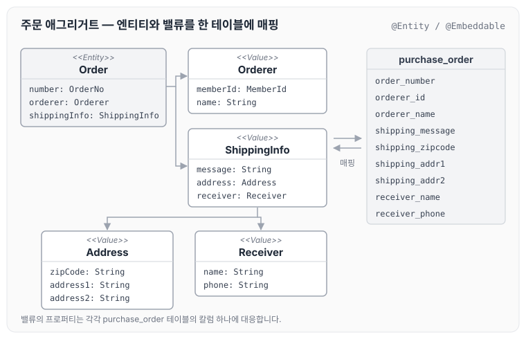
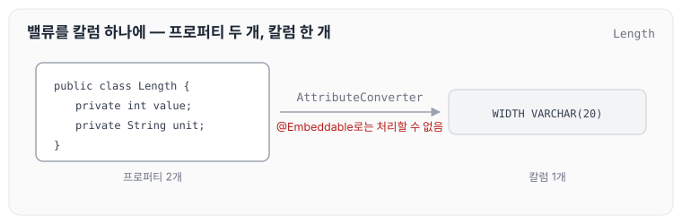
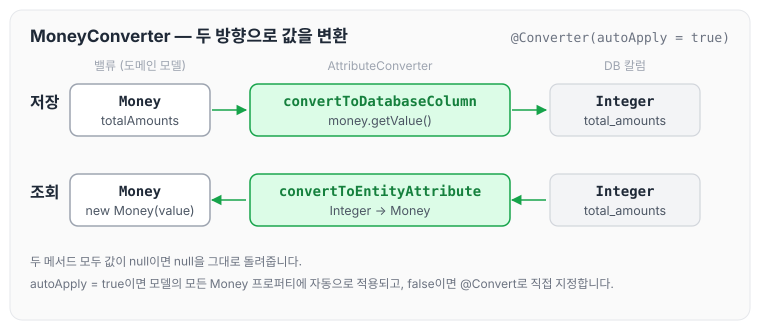
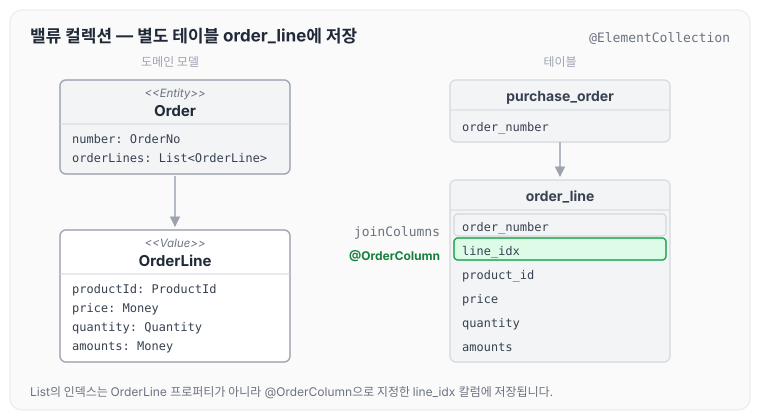
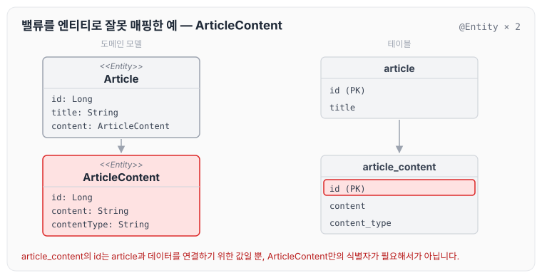
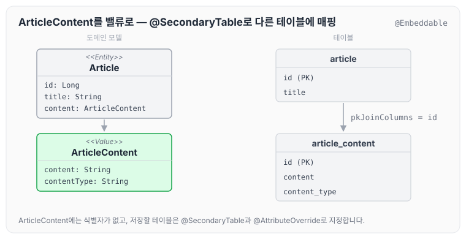
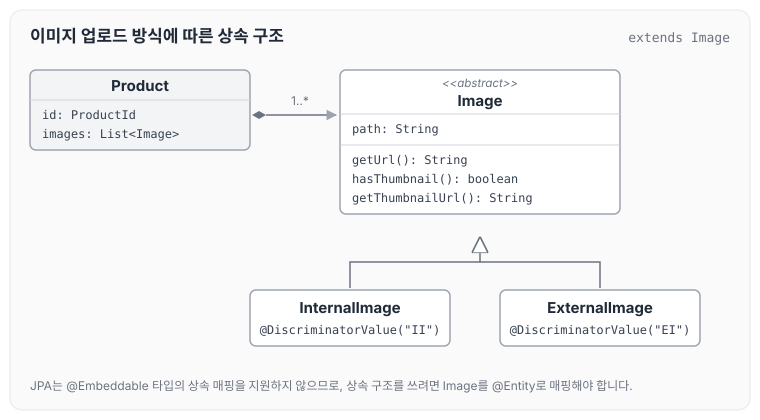
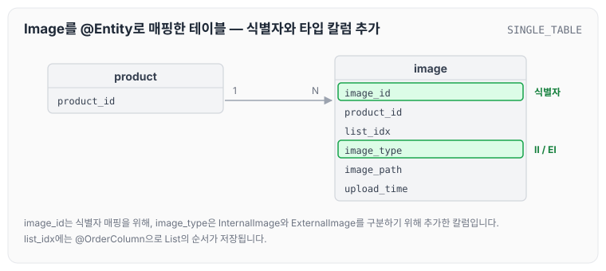
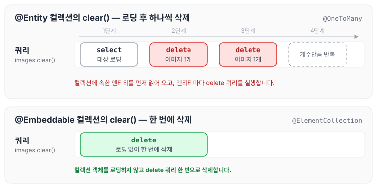
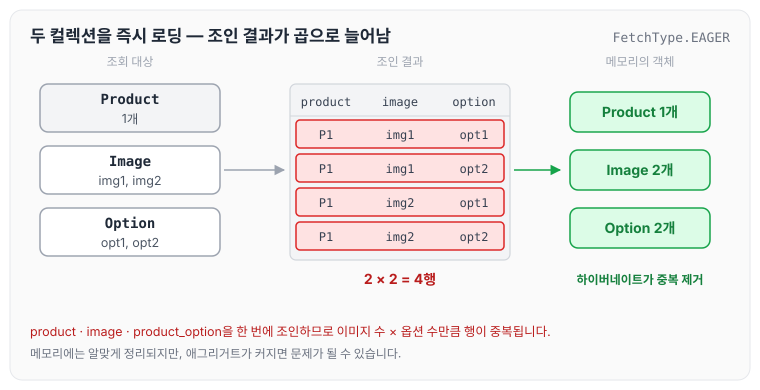

이전에 [애그리거트](../ddd-aggregate/)에 대해 작성하였습니다. 이번 글에서는 책 4장인 리포지터리와 모델 구현 중에서 밸류 타입을 JPA로 매핑하는 방법과, 애그리거트를 완전한 상태로 조회하고 저장하는 방법에 대해 정리하도록 하겠습니다.

기존에 JPA를 사용하고 있었기 때문에 기본적인 동작인 4.2 리포지터리 구현에 대해서는 생략하였습니다.

## 매핑 구현

### 엔티티와 밸류 매핑

애그리거트 루트는 엔티티이므로 `@Entity`로 매핑하고, 한 테이블에 엔티티와 밸류 데이터가 같이 있으면 밸류는 `@Embeddable`로 매핑합니다. 주문 애그리거트는 아래 그림처럼 엔티티인 Order와 밸류인 Orderer, ShippingInfo가 `purchase_order` 테이블 하나에 매핑됩니다.



그림에서 밸류 객체의 프로퍼티가 각각 테이블의 칼럼 하나씩에 대응하는 것을 확인할 수 있습니다. 루트 엔티티인 Order는 아래와 같이 `@Entity`로 매핑합니다.

```java
@Entity
@Table(name = "purchase_order")
public class Order {
 ...
}
```

Order에 속하는 Orderer는 밸류이므로 `@Embeddable`로 매핑합니다.

```java
package triple.review.service;

import javax.persistence.*;

@Entity
@Embeddable
public class Orderer {
    @Embedded
    @AttributeOverrides(
            @AttributeOverride(name = "id", column = @Column(name = "order_id"))
    )
    private MemberId memberId;

    @Column(name = "orderer_name")
    private String name;

}
```

Orderer의 memberId는 Member 애그리거트를 ID로 참조합니다.

```java
@Embeddable
public class MemberId implements Serializable {
    @Column(name = "member_id")
		private String id;
}
```

Orderer의 `memberId` 프로퍼티와 매핑되는 칼럼 이름은 `orderer_id`이므로, MemberId에 설정된 `member_id`와 이름이 다릅니다. 이처럼 `@Embeddable` 타입에 설정한 칼럼 이름과 실제 칼럼 이름이 다를 때는 `@AttributeOverrides` 애너테이션을 이용해 매핑할 칼럼 이름을 변경합니다.

ShippingInfo 밸류도 Address와 Receiver를 포함하며, 마찬가지로 `@AttributeOverrides`를 사용해 칼럼 이름을 변경합니다.

```java
@Entity
@Embeddable
public class ShippingInfo {
    @Embedded
    @AttributeOverrides({
            @AttributeOverride(name = "zipCode", column = @Column(name = "shipping_zipcode")),
            @AttributeOverride(name = "address1", column = @Column(name = "shipping_addr1")),
            @AttributeOverride(name = "address2", column = @Column(name = "shipping_addr2"))
    })
    private Address address;

    @Column(name = "shipping_message")
    private String message;

    @Embedded
    private Receiver receiver;

}
```

루트 엔티티인 Order 클래스는 `@Embedded`를 이용해서 밸류 타입 프로퍼티를 설정합니다.

```java
@Entity
public class Order {
		...
    @Embedded
		private Orderer orderer;

    @Embedded
		private ShippingInfo shippingInfo;
}
```

### 기본 생성자

JPA에서 `@Entity`와 `@Embeddable`로 클래스를 매핑하려면 기본 생성자를 제공해야 합니다. DB에서 데이터를 읽어 와 매핑된 객체를 생성할 때 기본 생성자를 사용하기 때문입니다.

이 때문에 Receiver와 같은 불변 타입은 기본 생성자가 필요하지 않은데도 기술적인 제약으로 기본 생성자를 추가해야 합니다. 다만 기본 생성자를 다른 코드에서 사용하면 값이 없는 온전하지 못한 객체가 만들어지므로, 아래와 같이 `protected`로 선언합니다.

```java
@Embeddable
public class Receiver {
		@Column(name = "receiver_name")
		private String name;

		@Column(name = "receiver_phone")
		private String phone;

		protected Receiver() {}

		public Receiver(String name, String phone) {
			this.name = name;
			this.phone = phone;
		}
}
```

### AttributeConverter를 이용한 밸류 매핑 처리

int, long, String, LocalDateTime과 같은 타입은 DB 테이블의 칼럼 한 개에 매핑됩니다. 이와 비슷하게 밸류 타입의 프로퍼티를 칼럼 한 개에 매핑해야 할 때도 있습니다. 예를 들어 아래 Length는 값과 단위 두 프로퍼티를 가지지만, DB에는 칼럼 하나에 저장하고 싶을 수 있습니다.

```java
public class Length {
		private int value;
		private String unit;
}
```



두 개 이상의 프로퍼티를 가진 밸류 타입을 칼럼 한 개에 매핑하는 것은 `@Embeddable` 애너테이션으로는 처리할 수 없습니다. 이럴 때 사용할 수 있는 것이 AttributeConverter입니다. 인터페이스는 아래와 같습니다.

```java
public interface AttributeConverter<X, Y> {
		public Y convertToDatabaseColumn(X attribute);
		public X convertToEntityAttribute(Y dbData);
}
```

- `convertToDatabaseColumn()`: 밸류 타입을 DB 칼럼 값으로 변환합니다.
- `convertToEntityAttribute()`: DB 칼럼 값을 밸류 타입으로 변환합니다.

Money 밸류를 정수 칼럼 하나에 저장하는 컨버터는 아래와 같이 구현할 수 있습니다.

```java
@Converter(autoApply = true)
public class MoneyConverter implements AttributeConverter<Money, Integer> {

		@Override
		public Integer convertToDatabaseColumn(Money money) {
				return money == null ? null : money.getValue();
		}

		@Override
		public Money convertToEntityAttribute(Integer value) {
				return value == null ? null : new Money(value);
		}
}
```

두 메서드가 값을 어느 방향으로 바꾸는지 그림으로 보면 아래와 같습니다.



AttributeConverter 인터페이스를 구현한 클래스에는 `@Converter` 애너테이션을 적용합니다. `@Converter`의 `autoApply` 속성을 `true`로 지정하면 모델에 나오는 모든 Money 타입 프로퍼티에 MoneyConverter가 자동으로 적용됩니다.

```java
@Entity
@Table(name = "purchase_order")
public class Order {
	...

	@Column(name = "total_amounts")
	private Money totalAmounts; // MoneyConvert를 적용해서 값 변환

}
```

`autoApply` 속성을 `false`로 지정하면 프로퍼티 값을 변환할 때 사용할 컨버터를 아래와 같이 직접 지정해야 합니다.

```java
public class Order {

	@Column(name = "total_amounts")
	@Convert(converter = MoneyConverter.class)
	private Money totalAmounts; // MoneyConvert를 적용해서 값 변환
}
```

### 밸류 컬렉션: 별도 테이블 매핑

주문 애그리거트는 주문 항목인 OrderLine 목록을 가지고, 이 목록은 `order_line`이라는 별도 테이블에 저장합니다. 구조는 아래와 같습니다.



밸류 컬렉션을 별도 테이블로 매핑할 때는 `@ElementCollection`과 `@CollectionTable`을 함께 사용합니다.

```java
@Entity
@Table(name = "purchase_order")
public class Order{
		@EmbeddedId
		private OrderNo number;
		...
		@ElementCollection(fetch = FetchType.EAGER)
		@CollectionTable(name = "order_line",
														joinColumns = @JoinColumn(name = "order_number"))
		@OrderColumn(name = "line_idx")
		private List<OrderLine> orderLines;

}
```

```java
@Embeddable
public class OrderLine {
		@Embedded
		private ProductId productId;

		@Column(name = "price")
		private Money price;

		@Column(name = "quantity")
		private Quantity quantity;		

		@Column(name = "amonuts")
		private Money money;		
}
```

OrderLine의 매핑을 함께 표시했는데, OrderLine에는 List의 인덱스 값을 저장하기 위한 프로퍼티가 없습니다. List 타입 자체가 인덱스를 가지고 있기 때문입니다. 인덱스 값은 `@OrderColumn`으로 지정한 `line_idx` 칼럼에 저장됩니다.

예제 코드에서는 외부키가 한 개인데, 두 개 이상이면 `@JoinColumn`의 배열을 이용해서 외부키 목록을 지정합니다.

### 밸류 컬렉션: 한 개 칼럼 매핑

밸류 컬렉션을 별도 테이블이 아닌 칼럼 한 개에 저장해야 할 때가 있습니다. 예를 들어 도메인 모델에는 이메일 주소 목록을 Set으로 보관하고, DB에는 칼럼 한 개에 콤마로 구분해서 저장하는 경우입니다. 이때도 AttributeConverter를 사용합니다.

단, AttributeConverter를 사용하려면 밸류 컬렉션을 표현하는 새로운 밸류 타입을 추가해야 합니다.

```java
public class EmailSet {
		private Set<Email> emails = new HashSet<>();

		public EmailSet(Set<Email> emails) {
			this.emails.addAll(emails);
		}

		public Set<Email> getEmails() {
			return Collections.unmodifiableSet(emails);
		}
}
```

EmailSet을 콤마로 이은 문자열로 바꾸고, 다시 문자열을 나눠 EmailSet으로 되돌리는 컨버터는 아래와 같습니다.

```java
public class EmailSetConverter implements AttributeConverter<EmailSet, String> {
    @Override
    public String convertToDatabaseColumn(EmailSet attribute) {
        if (attribute == null) return null;
        return attribute.getEmails().stream()
                .map(email -> email.getAddress())
                .collect(Collectors.joining(","));
    }

    @Override
    public EmailSet convertToEntityAttribute(String dbData) {
        if (dbData == null) return null;
        String[] emails = dbData.split(",");
        Set<Email> emailSet = Arrays.stream(emails)
                .map(value -> new Email(value))
                .collect(toSet());
        return new EmailSet(emailSet);
    }
}
```

남은 것은 EmailSet 타입 프로퍼티가 EmailSetConverter를 사용하도록 `@Convert`로 지정하는 것입니다.

```java
@Column(name = "email")
@Convert(converter = EmailSetConverter.class)
private EmailSet emailSet;
```

### 밸류를 이용한 ID 매핑

지금까지 살펴본 예제에서 OrderNo, MemberId 등이 식별자를 표현하기 위해 사용한 밸류입니다. 밸류 타입을 식별자로 매핑하려면 `@Id` 대신 `@EmbeddedId` 애너테이션을 사용합니다.

```java
@Entity
@Table(name = "purchase_order")
public class Order {
		@EmbeddedId
		private OrderNo orderNo;
		...

}

@Embeddable
public class OrderNo implements Serializable {
			@Column(name = "order_number")
			private String number;
			...
}
```

JPA에서 식별자 타입은 Serializable 타입이어야 하므로, 식별자로 사용할 밸류 타입은 Serializable 인터페이스를 상속받아야 합니다.

밸류 타입으로 식별자를 구현하면 식별자에 기능을 추가할 수 있다는 장점이 있습니다. 예를 들어 1세대 시스템의 주문번호와 2세대 시스템의 주문번호를 첫 글자로 구분한다면, 아래와 같이 OrderNo 클래스에 시스템 세대를 구분하는 기능을 구현할 수 있습니다.

```java
@Embeddable
public class OrderNo implements Serializable {
		@Column(name = "order_number")
		private String number;

		public boolean is2ndGeneration() {
			return number.startsWith("N");
		}
}
```

```java
if (order.getNumber().is2ndGeneration()) {
		...
}
```

### 별도 테이블에 저장하는 밸류 매핑

애그리거트에서 루트 엔티티를 뺀 나머지 구성요소는 대부분 밸류입니다. 루트 엔티티 외에 또 다른 엔티티가 있다면 진짜 엔티티인지 의심해 봐야 합니다. 별도 테이블에 데이터를 저장한다고 해서 엔티티인 것은 아닙니다. 주문 애그리거트도 OrderLine을 별도 테이블에 저장하지만, OrderLine 자체는 엔티티가 아니라 밸류입니다.

밸류가 아니라 엔티티가 확실하다면 다른 애그리거트는 아닌지 확인해야 합니다. 특히 자신만의 라이프 사이클을 갖는다면 구분되는 애그리거트일 가능성이 높습니다.

아래는 밸류를 엔티티로 잘못 매핑한 예입니다.



ArticleContent를 엔티티로 생각할 수 있지만, ArticleContent는 Article의 내용을 담고 있는 밸류로 보는 것이 맞습니다. `article_content` 테이블의 ID는 식별자이긴 하지만, 이 식별자를 사용하는 이유는 `article` 테이블과 데이터를 연결하기 위해서이지 ArticleContent를 위한 별도 식별자가 필요해서가 아닙니다.

ArticleContent를 밸류로 보고 모델을 그리면 아래와 같습니다.



ArticleContent는 밸류이므로 `@Embeddable`로 매핑합니다. 다만 ArticleContent와 매핑되는 테이블은 Article과 매핑되는 테이블과 다릅니다. 이때 밸류를 매핑할 테이블을 지정하기 위해 `@SecondaryTable`과 `@AttributeOverride`를 사용합니다.

```java
@Entity
@Table(name = "article")
@SecondaryTable(
        name = "article_content",
        pkJoinColumns = @PrimaryKeyJoinColumn(name = "id")
)
public class Article {
    @Id
    @GeneratedValue(strategy = GenerationType.IDENTITY)
    private Long id;

    private String title;

    @AttributeOverrides({
            @AttributeOverride(
                    name = "content",
                    column = @Column(table = "article_content", name = "content")),
            @AttributeOverride(
                    name = "contentType",
                    column = @Column(table = "article_content", name = "content_type"))
    })
    @Embedded
    private ArticleContent content;
```

- `@SecondaryTable`의 `name` 속성: 밸류를 저장할 테이블을 지정합니다.
- `pkJoinColumns` 속성: 밸류 테이블에서 엔티티 테이블로 조인할 때 사용할 칼럼을 지정합니다.
- content 필드의 `@AttributeOverride`: 해당 밸류 데이터가 저장된 테이블 이름을 지정합니다.

이렇게 매핑하면 Article을 조회할 때 `article_content` 테이블을 조인해서 함께 읽어 옵니다.

```java
// @SecondaryTable로 매팽된 article_content 테이블을 조인
Article article = entityManager.find(Article.class, 1L);
```

이 방식에는 주의할 점이 있습니다. 게시글 목록을 보여 주는 화면은 `article` 테이블의 데이터만 필요하고 `article_content` 테이블의 데이터는 필요하지 않습니다. 그런데 `@SecondaryTable`을 사용하면 목록 화면에 보여 줄 Article을 조회할 때도 `article_content` 테이블까지 조인해서 데이터를 읽어 옵니다.

이 문제를 해소하고자 ArticleContent를 엔티티로 매핑하고 Article에서 ArticleContent로의 로딩을 지연 로딩 방식으로 설정할 수도 있습니다. 하지만 이 방식은 밸류인 모델을 엔티티로 만드는 것이므로 좋은 방법이 아닙니다.

### 밸류 컬렉션을 @Entity로 매핑하기

개념적으로 밸류인데 구현 기술의 한계나 팀 표준 때문에 `@Entity`를 사용해야 할 때도 있습니다. 예를 들어 제품의 이미지 업로드 방식에 따라 이미지 경로와 섬네일 이미지 제공 여부가 달라진다고 하면, 아래와 같이 Image를 상속 구조로 만들 수 있습니다.



JPA는 `@Embeddable` 타입의 클래스 상속 매핑을 지원하지 않습니다. 상속 구조를 가지려면 `@Entity`를 이용해야 합니다. 이때 식별자 매핑을 위한 필드와, 구현 클래스를 구분하기 위한 타입 칼럼도 추가해야 합니다. 테이블 구조는 아래와 같습니다.



한 테이블에 Image와 그 하위 클래스를 매핑하므로 Image 클래스에는 다음 설정을 사용합니다.

- `@Inheritance` 애너테이션 사용
- strategy 값으로 `SINGLE_TABLE` 사용
- `@DiscriminatorColumn`으로 타입 구분 칼럼 지정

#### @Inheritance 사용 방법

`@Inheritance`는 객체의 상속 구조를 데이터베이스 테이블에 어떻게 매핑할지 지정하는 JPA 애너테이션입니다. strategy 속성으로 지정할 수 있는 상속 매핑 전략은 아래와 같습니다.

1. 단일 테이블 전략(`InheritanceType.SINGLE_TABLE`): 부모 클래스와 모든 자식 클래스의 필드를 한 테이블에 저장합니다. `@Inheritance(strategy = InheritanceType.SINGLE_TABLE)`와 같이 사용합니다.
2. 구현 클래스마다 테이블 전략(`InheritanceType.TABLE_PER_CLASS`): 구체 클래스마다 별도의 테이블을 만들고, 각 테이블에 부모에게서 물려받은 필드까지 함께 저장합니다. `@Inheritance(strategy = InheritanceType.TABLE_PER_CLASS)`와 같이 사용합니다.
3. 조인 전략(`InheritanceType.JOINED`): 부모 클래스와 자식 클래스마다 테이블을 만들고, 부모 클래스의 필드는 부모 테이블에, 자식 클래스의 필드는 자식 테이블에 저장합니다. 자식 테이블은 부모 테이블의 기본 키를 함께 가지며 조회할 때 조인합니다. `@Inheritance(strategy = InheritanceType.JOINED)`와 같이 사용합니다.

상속 구조를 테이블에 매핑하지 않을 때는 `@Inheritance`를 사용하지 않습니다. 참고로 엔티티 상속 구조에서 `@Inheritance`를 생략하면 기본 전략인 `SINGLE_TABLE`이 적용됩니다.

#### @Inheritance 예제

```java
@Entity
@Inheritance(strategy = InheritanceType.SINGLE_TABLE)
@DiscriminatorColumn(name = "animal_type")
public class Animal {
    @Id
    @GeneratedValue(strategy = GenerationType.IDENTITY)
    private Long id;
    // 공통 필드들
}

@Entity
@DiscriminatorValue("DOG")
public class Dog extends Animal {
    // Dog에 특정한 필드들
}
```

위 예시에서는 Animal과 Dog 클래스가 상속 관계에 있고, 단일 테이블 전략을 사용하므로 Animal 클래스의 필드와 Dog 클래스의 필드가 하나의 테이블에 저장됩니다. `@DiscriminatorColumn`으로 지정한 칼럼에는 어떤 자식 클래스인지 구분하는 값이 들어갑니다.

JPA의 상속 매핑은 데이터베이스 스키마와 객체 모델 간의 매핑을 유연하게 처리하기 위해 사용되며, 선택한 전략에 따라 데이터베이스 테이블의 구성이 결정됩니다.

#### Image 매핑

Image 클래스는 아래와 같이 매핑합니다.

```java
@Entity
@Inheritance(strategy = InheritanceType.SINGLE_TABLE)
@DiscriminatorColumn(name = "image_type")
@Table(name = "image")
public abstract class Image {
    @Id
    @GeneratedValue(strategy = GenerationType.IDENTITY)
    @Column(name = "image_id")
    private Long id;

    @Column(name = "image_path")
    private String path;

    @Column(name = "upload_time")
    private LocalDateTime uploadTime;

    protected Image() {
    }

    public Image(String path) {
        this.path = path;
        this.uploadTime = LocalDateTime.now();
    }

    protected String getPath() {
        return path;
    }

    public LocalDateTime getUploadTime() {
        return uploadTime;
    }

    public abstract String getUrl();
    public abstract boolean hasThumbnail();
    public abstract String getThumbnailUrl();

}
```

Image를 상속받는 클래스는 `@Entity`와 `@DiscriminatorValue`를 사용해서 매핑합니다.

```java
@Entity
@DiscriminatorValue("II")
public class InternalImage extends Image {
    ...
}
@Entity
@DiscriminatorValue("EI")
public class ExternalImage extends Image {
    ...
}
```

Image가 `@Entity`이므로 목록을 담고 있는 Product는 아래와 같이 `@OneToMany`를 이용해서 매핑합니다. Image는 밸류이므로 독자적인 라이프 사이클을 갖지 않고 Product에 완전히 의존합니다. 따라서 Product를 저장할 때 함께 저장되고 Product를 삭제할 때 함께 삭제되도록 cascade 속성을 지정합니다. 리스트에서 Image 객체를 제거하면 DB에서도 함께 삭제되도록 `orphanRemoval`도 `true`로 설정합니다.

```java
@Entity
@Table(name = "product")
public class Product {
    @EmbeddedId
    private ProductId id;
    private String name;

    @Convert(converter = MoneyConverter.class)
    private Money price;
    private String detail;

    @OneToMany(cascade = {CascadeType.PERSIST, CascadeType.REMOVE},
            orphanRemoval = true, fetch = FetchType.LAZY)
    @JoinColumn(name = "product_id")
    @OrderColumn(name = "list_idx")
    private List<Image> images = new ArrayList<>();

	  ...

    public void changeImages(List<Image> newImages) {
        images.clear();
        images.addAll(newImages);
    }

}
```

#### clear()의 삭제 방식

이미지를 교체하기 위해 `changeImages()`에서 `images.clear()`를 사용하고 있습니다. 그런데 `@Entity`에 대한 `@OneToMany` 매핑에서 컬렉션의 `clear()` 메서드를 호출하면 삭제 과정이 효율적이지 않습니다. select 쿼리로 대상 엔티티를 로딩하고, 각 엔티티마다 delete 쿼리를 실행하기 때문입니다.

반면 `@Embeddable` 타입에 대한 컬렉션의 `clear()` 메서드를 호출하면 컬렉션에 속한 객체를 로딩하지 않고 한 번의 delete 쿼리로 삭제 처리를 수행합니다. 두 경우에 실행되는 쿼리를 비교하면 아래와 같습니다.



따라서 애그리거트의 특성을 유지하면서 이 문제를 해결하려면 결국 상속을 포기하고 `@Embeddable`로 매핑된 단일 클래스로 구현해야 합니다.

```java
@Embeddable
public class Image {
	@Column(name = "image_type")
	private String imageType;
	@Column(name = "image_path")
	private String path;

	@Temporal(TemporalType.TIMESTAMP)
	@Column(name = "upload_time")
	private Date uploadTime;
	...

	public boolean hasThumbnail() {
		// 성능을 위해 다형을 포기하고 if - else 로 구현
		if (imageType.equals("II")) {
			return true;
		} else {
			return false;
		}
	}
}
```

## 애그리거트 로딩 전략

JPA 매핑을 설정할 때 항상 기억해야 할 점은 애그리거트에 속한 객체가 모두 모여야 완전한 하나가 된다는 것입니다.

```java
// product는 완전한 하나여야 한다.
Product product = productRepository.findById(id);
```

조회 시점에 애그리거트를 완전한 상태로 만들려면 애그리거트 루트에서 연관 매핑의 조회 방식을 즉시 로딩으로 설정하면 됩니다.

```java
@OneToMany(cascade = {CascadeType.PERSIST, CascadeType.REMOVE},
          orphanRemoval = true, fetch = FetchType.EAGER)
@JoinColumn(name = "product_id")
@OrderColumn(name = "list_idx")
private List<Image> images = new ArrayList<>();
```

즉시 로딩 방식으로 설정하면 애그리거트 루트를 로딩하는 시점에 애그리거트에 속한 모든 객체를 함께 로딩할 수 있다는 장점이 있지만, 항상 좋은 것은 아닙니다. 특히 컬렉션에 대해 로딩 전략을 EAGER로 설정하면 오히려 문제가 됩니다.

예를 들어 Product 애그리거트 루트가 `@Entity`로 구현한 Image와 `@Embeddable`로 구현한 Option 목록을 갖고 있다고 하겠습니다.

```java
@Entity
@Table(name = "product")
public class Product {
...

		@OneToMany(cascade = {CascadeType.PERSIST, CascadeType.REMOVE},
            orphanRemoval = true, fetch = FetchType.EAGER)
    @JoinColumn(name = "product_id")
    @OrderColumn(name = "list_idx")
    private List<Image> images = new ArrayList<>();

		@OneToMany(cascade = {CascadeType.PERSIST, CascadeType.REMOVE},
            orphanRemoval = true, fetch = FetchType.EAGER)
    @JoinColumn(name = "product_id")
    @OrderColumn(name = "list_idx")
    private List<Option> Options = new ArrayList<>();
...
}
```

`EntityManager#find()` 메서드로 Product를 조회하면 하이버네이트는 아래와 같이 Product를 위한 테이블과 Image, Option을 위한 테이블을 조인하는 쿼리를 실행합니다.

```sql
select
			p.product_id, ... ,...
	from 
			product p
			left outer join image img on p.product_id = img.product_id
			left outer join product_option opt on p.product_id = opt.product_id
 where p.product_id = ?
```

이 쿼리는 카타시안(Cartesian) 조인을 사용하며, 이는 쿼리 결과에 중복을 발생시킵니다. 이미지가 2개, 옵션이 2개인 상품을 조회하면 결과 행은 2 × 2 = 4개가 됩니다.



물론 하이버네이트가 중복된 데이터를 알맞게 제거해서 실제 메모리에는 1개의 Product 객체, 2개의 Image 객체, 2개의 Option 객체로 변환해 주지만, 애그리거트가 커지면 문제가 될 수 있습니다.

### 카타시안 조인

카타시안 조인은 조인 조건이나 연결 칼럼(Joining Column)이 지정되지 않은 상태에서 두 개 이상의 테이블을 조인할 때 발생하는 조인 유형입니다. 한 테이블의 각 행을 다른 테이블의 모든 행과 결합하므로, 결과적으로 두 테이블의 모든 가능한 조합이 생성됩니다.

예를 들어 두 개의 테이블 A와 B가 있다고 하겠습니다.

테이블 A

| ID | Name |
| --- | --- |
| 1 | Alice |
| 2 | Bob |

테이블 B

| ID | Product |
| --- | --- |
| 101 | Apple |
| 102 | Banana |

카타시안 조인은 아래와 같은 쿼리로 수행할 수 있습니다.

```sql
SELECT * FROM A, B;
```

이 쿼리는 테이블 A의 각 행을 테이블 B의 모든 행과 결합하여 가능한 모든 조합을 생성하므로, 결과는 아래와 같이 4개의 행이 됩니다.

| ID | Name | ID | Product |
| --- | --- | --- | --- |
| 1 | Alice | 101 | Apple |
| 1 | Alice | 102 | Banana |
| 2 | Bob | 101 | Apple |
| 2 | Bob | 102 | Banana |

카타시안 조인은 일반적으로 데이터베이스 성능에 부정적인 영향을 미치고 원하지 않는 결과를 만들 수 있으므로 주의해야 합니다. 조인할 때는 적절한 조인 조건이나 연결 칼럼을 사용해 원하는 결과만 얻도록 해야 합니다.

### 상태 변경과 지연 로딩

컬렉션을 지연 로딩으로 설정해도, 트랜잭션 범위 안에서는 상태를 변경하는 시점에 필요한 연관 객체를 로딩할 수 있습니다.

```java
@Transactional
public void removeOptions(ProductId id, int optIdxToBeDelete) {
		//Product를 로딩 - 컬렉션은 지연 로딩으로 설정했다면, Option은 로딩하지 않음
		Product product = productRepository.findById(id);
		// 트랜잭션 범위이므로 지연 로딩으로 설정한 연관 로딩 가능
		product.removeOption(optIdxToBeDelete);
}
```

일반적인 애플리케이션은 상태 변경 기능을 실행하는 빈도보다 조회 기능을 실행하는 빈도가 훨씬 높습니다. 그러므로 상태 변경을 위해 지연 로딩을 사용할 때 발생하는 추가 쿼리로 인한 실행 속도 저하는 보통 문제가 되지 않습니다.

## 애그리거트의 영속성 전파

애그리거트가 완전한 상태여야 한다는 것은 애그리거트 루트를 조회할 때뿐만 아니라 저장하고 삭제할 때도 하나로 처리해야 함을 의미합니다.

- 저장 메서드는 애그리거트 루트만 저장하면 안 되고 애그리거트에 속한 모든 객체를 저장해야 합니다.
- 삭제 메서드는 애그리거트 루트뿐만 아니라 애그리거트에 속한 모든 객체를 삭제해야 합니다.

`@Embeddable` 매핑 타입은 함께 저장되고 삭제되므로 cascade 속성을 추가로 설정하지 않아도 됩니다. 반면에 애그리거트에 속한 `@Entity` 타입에 대한 매핑은 cascade 속성을 사용해서 저장과 삭제 시에 함께 처리되도록 설정해야 합니다.

`@OneToOne`, `@OneToMany`는 cascade 속성의 기본값이 없으므로, 아래 코드처럼 cascade 속성값으로 `CascadeType.PERSIST`, `CascadeType.REMOVE`를 설정합니다.

```java
@OneToMany(cascade = {CascadeType.PERSIST, CascadeType.REMOVE},
        orphanRemoval = true, fetch = FetchType.LAZY)
@JoinColumn(name = "product_id")
@OrderColumn(name = "list_idx")
private List<Image> images = new ArrayList<>();
```

## 식별자 생성 기능

식별자는 크게 세 가지 방식 중 하나로 생성합니다.

- 사용자가 직접 생성
- 도메인 로직으로 생성
- DB를 이용한 일련번호 사용

### 사용자가 직접 생성

이메일 주소처럼 사용자가 직접 입력한 값을 식별자로 사용하는 경우입니다. 식별자를 만드는 주체가 사용자이므로 도메인 영역에 식별자 생성 기능을 따로 구현하지 않아도 됩니다.

### 도메인 로직으로 생성

식별자 생성 규칙이 있다면, 아래와 같이 식별자를 만드는 기능을 도메인 서비스로 분리합니다.

```java
public class ProductIdService {
		public ProductId nextId() {
			.. // 정해진 규칙으로 식별자 생성
		}
}
```

응용 서비스는 이 도메인 서비스를 이용해 식별자를 구한 뒤 애그리거트를 생성합니다.

```java
public class CreateProductService {
		@Autowired private ProductIdService productIdService;
		@Autowired private ProductRepository productRepository;

		@Transactional
		public ProductId createProduct(ProductCreationCommand cmd) {
			// 응용 서비스 도메인 서비스를 이용해서 식별자를 생성
			ProductId id = productIdService.nextId();
			Product product = new Product(id, cmd.getDetail(), cmd.getPrice(), ...);
			productRepository.save(product);
			return id;
		}
}
```

특정 값의 조합으로 식별자를 만드는 것도 같은 방식으로 구현합니다. 아래는 주문자 ID와 현재 시각을 이어 주문 식별자를 만드는 도메인 서비스입니다.

```java
public class OrderIdService {
		public OrderId createId(UserId userId) {
				if (userId == null) {
					throw new IllegalArgumentException("invalid userid:" + userId);
				}
				return new OrderId(userId.toString() + "-" + timestamp());
		}

		private String timestamp() {
			return Long.toString(System.currentTimeMillis());
		}
}
```

### DB를 이용한 일련번호 사용

DB의 자동 증가 칼럼을 식별자로 사용할 때는 `@GeneratedValue`를 사용합니다.

```java
@Entity
@Table(name = "article")
public class Article {
    @Id
    @GeneratedValue(strategy = GenerationType.IDENTITY)
    private Long id;
```

## 마무리

오늘은 밸류 타입을 JPA로 매핑하는 여러 방법과, 애그리거트를 완전한 상태로 다루기 위한 로딩 전략, 영속성 전파, 식별자 생성 방식에 대해 정리하였습니다. 별도 테이블에 저장한다고 해서 엔티티가 되는 것은 아니라는 점은 매핑을 설계할 때 기억해 두면 좋을 것 같습니다. 다음 글에서는 [스프링 데이터 JPA를 이용한 조회 기능](../ddd-spring-data-jpa-query/)을 정리하도록 하겠습니다.

참조 : [도메인 주도 개발 시작하기 - 예스24](https://www.yes24.com/Product/Goods/108431347?pid=123487&cosemkid=go16481149689793107&gclid=Cj0KCQjwgNanBhDUARIsAAeIcAvU1218EfnAWaB7jwT88mKqCJ9UJbgjm5qk12G3_kgbQFKtHnPTQaUaArR8EALw_wcB)
