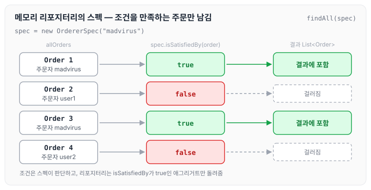
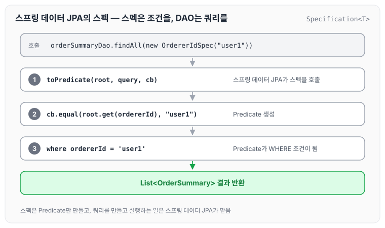
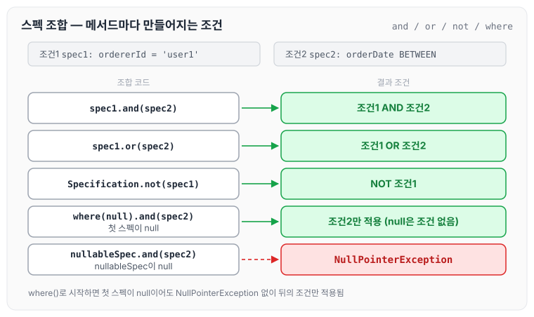
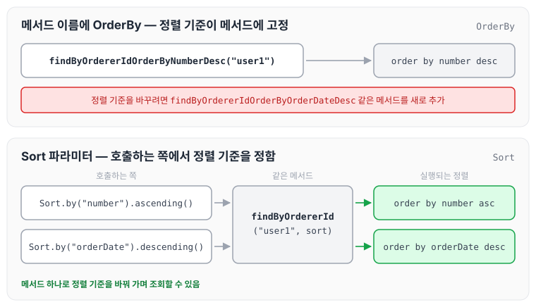
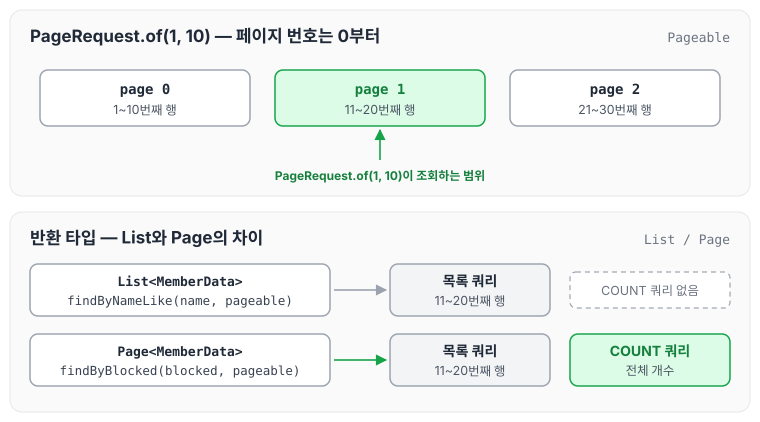
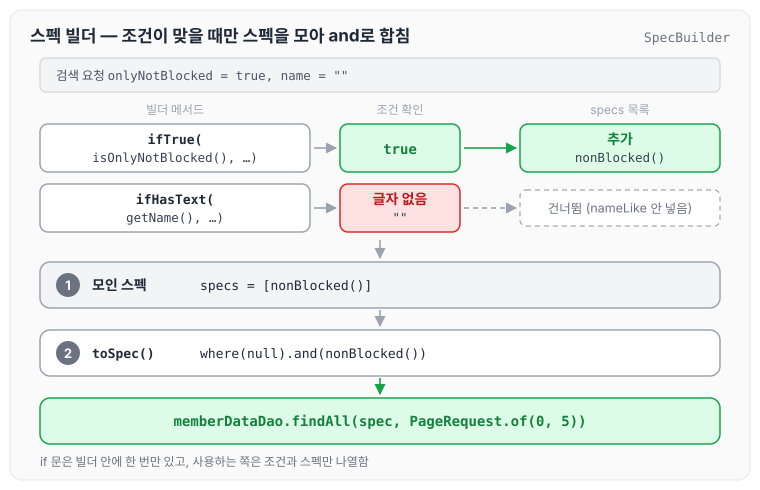
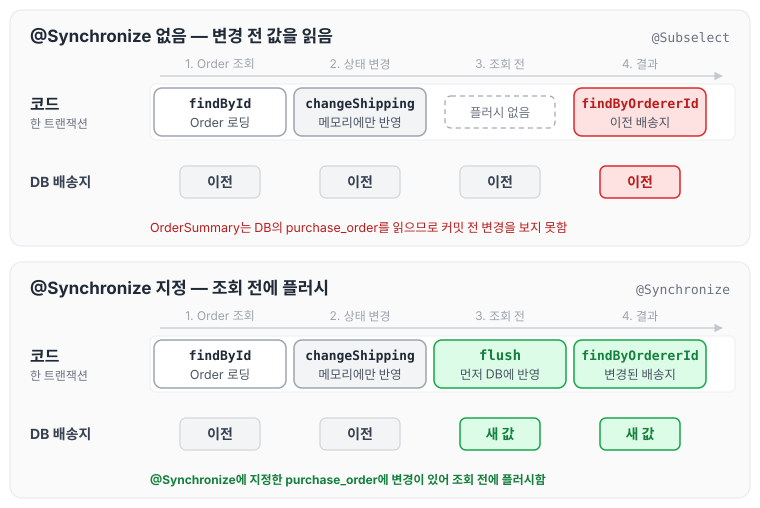

이전에 [리포지터리와 모델 구현](../ddd-repository-model/)에 대해 작성하였습니다. 그 글에서는 밸류 타입을 JPA로 매핑하는 방법과 애그리거트를 저장·조회하는 방법을 정리하였습니다. 오늘은 도메인 주도 개발 시작하기 5장의 내용인 스프링 데이터 JPA를 이용한 조회 기능에 대해 정리하도록 하겠습니다.

## CQRS와 조회 모델

이 장에서 다루는 조회 기능은 CQRS의 조회 모델에 해당합니다. CQRS는 명령(Command) 모델과 조회 모델을 분리하는 패턴입니다. 명령 모델은 상태를 변경하는 기능을 구현할 때 사용하고, 조회 모델은 데이터를 조회하는 기능을 구현할 때 사용합니다. CQRS 자체는 [CQRS](../ddd-cqrs/) 글에서 따로 정리하였습니다.

## 검색을 위한 스펙

검색 조건이 고정되어 있고 단순하면 아래와 같이 특정 조건으로 조회하는 기능을 만들면 됩니다.

```java
public interface OrderDateDao {
		Optional<OrderDate> findById(OrderNo id);
		List<OrderDate> findByOrderer(String ordererId, Date fromDate, Date toDate);
		...
}
```

다만 검색 조건을 다양하게 조합해야 할 때는 조합마다 메서드를 만들 수 없습니다. 이럴 때 사용할 수 있는 것이 스펙(Specification)입니다. 스펙은 애그리거트가 특정 조건을 충족하는지를 검사할 때 사용하는 인터페이스입니다.

```java
public interface Specification<T> {
		public boolean isSatisfiedBy(T agg);
}
```

Order 애그리거트 객체가 특정 고객의 주문인지 확인하는 스펙은 다음과 같이 구현할 수 있습니다.

```java
public class OrdererSpec implements Specification<Order> {
		private String ordererId;
		
		public OrdererSpec(String ordererId) {
			this.ordererId = ordererId;
		}

		public boolean isSatisfiedBy(Order agg) {
				return agg.getOrdererId().getMemberId().getId().equals(ordererId);
		}
}
```

리포지터리나 DAO는 검색 대상을 걸러내는 용도로 스펙을 사용합니다. 메모리에 모든 애그리거트를 보관하고 있다면 다음과 같이 사용할 수 있습니다.

```java
public class MemoryOrderRepository implements OrderRepository {
		
		public List<Order> findAll(Specification<Order> spec) {
			List<Order> allOrders = findAll();
			return allOrders.stream()
											.filter(order -> spec.isSatisfiedBy(order))
											.toList();		
		}
		...
}
```

리포지터리가 스펙을 이용해서 검색 대상을 걸러 주므로, 특정 조건을 충족하는 애그리거트를 찾고 싶으면 원하는 스펙을 생성해서 리포지터리에 전달하면 됩니다.

```java
Specification<Order> ordererSpec = new OrdererSpec("madvirus");
List<Order> orders = orderRepository.findAll(ordererSpec);
```

위 코드에서 리포지터리가 스펙으로 주문을 걸러 내는 과정을 그림으로 나타내면 아래와 같습니다.



어떤 조건으로 거를지는 스펙이 정하고, 리포지터리는 스펙을 만족하는 애그리거트만 돌려줍니다. 조건이 바뀌면 리포지터리 메서드를 추가하지 않고 다른 스펙을 넘기면 됩니다.

## 스프링 데이터 JPA를 이용한 스펙 구현

스프링 데이터 JPA는 검색 조건을 표현하기 위한 인터페이스인 Specification을 제공합니다. 메모리에서 객체를 검사하는 대신 JPA Criteria API의 Predicate, 즉 쿼리의 WHERE 조건을 만들어 돌려주는 방식입니다.

```java

package org.springframework.data.jpa.domain;

import javax.persistence.criteria.CriteriaBuilder;
import javax.persistence.criteria.CriteriaQuery;
import javax.persistence.criteria.Predicate;
import javax.persistence.criteria.Root;

/**
 * Specification in the sense of Domain Driven Design.
 * 
 * @author Oliver Gierke
 * @author Thomas Darimont
 */
public interface Specification<T> {

	/**
	 * Creates a WHERE clause for a query of the referenced entity in form of a {@link Predicate} for the given
	 * {@link Root} and {@link CriteriaQuery}.
	 * 
	 * @param root
	 * @param query
	 * @return a {@link Predicate}, must not be {@literal null}.
	 */
	Predicate toPredicate(Root<T> root, CriteriaQuery<?> query, CriteriaBuilder cb);
}
```

이 인터페이스를 구현한 스펙은 아래와 같이 작성할 수 있습니다.

```java
public class OrdererIdSpec implements Specification<OrderSummary> {
		private String ordererId;

		public OrdererIdSpec(String ordererId) {
				this.ordererId = ordererId;
		}

		@Override
		public Predicate toPredicate(Root<OrderSummary> root, CriteriaQuery<?> query, CriteriaBuilder cb){
				return cb.equal(root.get(OrderSummary_.ordererId), ordererId); 
		}
}
```

아래는 스펙 생성 기능을 별도 클래스에 모은 예입니다.

```java
public class OrderSummarySpecs {
	public static Specification<OrderSummary> orderId(String ordererId) {
		return (Root<OrderSummary> root, CriteriaQuery<?> query,
			 CriteriaBuilder cb) -> 
					cb.equal(root.<String>get("ordererId"), ordererId);
	}

	public static Specification<OrderSummary> orderDateBetween(LocalDateTime from,
			LocalDateTime to) {
		return (Root<OrderSummary> root, CriteriaQuery<?> query,
			 CriteriaBuilder cb) -> 
					cb.between(root.get(OrderSummary_.orderDate), from, to);
	}
}
```

스펙 인터페이스는 함수형 인터페이스이므로 위와 같이 람다식을 이용해 객체를 생성할 수 있습니다.

## 리포지터리/DAO에서 스펙 사용하기

스펙을 충족하는 엔티티를 검색하고 싶다면 스펙 인터페이스를 파라미터로 갖는 findAll() 메서드를 사용하면 됩니다.

```java
public interface OrderSummaryDao 
			extends Repository<OrderSummary, String> {
			List<OrderSummary> findAll(Specification<OrderSummary> spec);
}
```

이 메서드를 사용하는 코드는 아래와 같습니다.

```java
// 스팩 객체를 생성
Specification<OrderSummary> spec = new OrdererIdSpec("user1");
// findAll() 메서드를 이용해서 검색
List<OrderSummary> results = orderSummaryDao.findAll(spec);

```

스펙이 만든 Predicate가 실제 쿼리의 어디에 들어가는지 그려 보면 아래와 같습니다.



스펙은 조건만 만들고, 쿼리 실행은 스프링 데이터 JPA가 맡습니다.

## 스펙 조합

스프링 데이터 JPA가 제공하는 스펙 인터페이스는 스펙을 조합할 수 있는 and()와 or() 두 메서드를 제공하고 있습니다.

```java
public interface Specification<T> extends Serializable {
		... 생략

		default Specification<T> and (@Nullable Specification<T> other) {...}
		default Specification<T> or (@Nullable Specification<T> other) {...}

		@Nullable
		Predicate toPredicate(Root<T> root,
												CriteriaQuery<?> query,
												CriteriaBuilder criteriaBuilder);
}
```

### and()로 조합하기

두 스펙을 각각 만든 뒤 and()로 묶는 예입니다.

```java
Specification<OrderSummary> spec1 = OrderSummarySpecs.orderId("user1");
Specification<OrderSummary> spec2 = OrderSummarySpecs.orderDateBetween(
				LocalDateTime.of(2022,1,1,0,0,0),
				LocalDateTime.of(2022,1,2,0,0,0));

Specification<OrderSummary> spec3 = spec1.and(spec2);
```

개별 스펙 변수를 따로 두지 않고 바로 이어서 조합할 수도 있습니다.

```java
Specification<OrderSummary> spec = OrderSummarySpecs.orderId("user1")
							.and(OrderSummarySpecs.orderDateBetween(from, to));
```

### not()으로 반대 조건 만들기

조건을 반대로 적용해야 할 때는 정적 메서드인 not()을 사용합니다.

```java
Specification<OrderSummary> spec = Specification.not(OrderSummarySpecs.orderId("user1"));
```

### where()로 null 스펙 다루기

null 가능성이 있는 스펙 객체와 다른 스펙을 조합해야 할 때가 있습니다. 이 경우 다음 코드처럼 null 여부를 판단해 NullPointerException이 발생하는 것을 막아야 하는데, null 여부를 매번 검사하는 것은 다소 번거롭습니다.

```java
Specification<OrderSummary> nullableSpec = createNullableSpec(); // null 일 수 있음
Specification<OrderSummary> otherSpec = createOtherSpec();

Specification<OrderSummary> spec = 
			nullableSpec == null ? otherSpec : nullableSpec.and(otherSpec);
```

where() 메서드를 사용하면 이런 번거로움을 줄일 수 있습니다. where()는 null을 전달하면 아무 조건도 생성하지 않는 스펙을 돌려주고, null이 아니면 전달받은 스펙을 그대로 돌려줍니다.

```java
Specification<OrderSummary> spec = 
	Specification.where(createNullableSpec()).and(createOtherSpec());
```

위의 조합 방법이 각각 어떤 WHERE 조건이 되는지 정리하면 아래와 같습니다.



where()로 시작하면 첫 스펙이 null이어도 NullPointerException 없이 뒤의 조건만 적용됩니다.

## 정렬 지정하기

스프링 데이터 JPA는 두 가지 방법을 사용해서 정렬을 지정할 수 있습니다.

- 메서드 이름에 OrderBy를 사용해서 정렬 기준 지정
- Sort를 인자로 전달

### 메서드 이름에 OrderBy 사용

조회하는 find 메서드는 이름 뒤에 OrderBy를 붙여 정렬 순서를 지정할 수 있습니다.

```java
public interface OrderSummaryDao extends Repository<OrderSummary, String> {

		List<OrderSummary> findByOrdererIdOrderByNumberDesc(String ordererId);
}
```

두 개 이상의 프로퍼티에 대한 정렬 순서를 지정하는 예입니다.

```java
findByOrdererIdOrderByOrderDateDescNumberAsc
```

이 방법의 장점과 단점은 아래와 같습니다.

- 장점: 사용하는 방법이 간단합니다.
- 단점: 정렬 프로퍼티가 2개 이상이면 메서드 이름이 길어집니다.
- 단점: 정렬 순서가 메서드 이름에 고정되기 때문에 상황에 따라 정렬 순서를 변경할 수 없습니다.

### Sort 타입 사용

이 단점을 해결하기 위해 스프링 데이터 JPA는 정렬 순서를 지정할 때 사용할 수 있는 Sort 타입을 제공합니다. find 메서드의 마지막 파라미터로 Sort를 받도록 선언합니다.

```java
public interface OrderSummaryDao extends Repository<OrderSummary, String> {

	List<OrderSummary> findByOrdererId(String ordererId, Sort sort);
	List<OrderSummary> findAll(Specification<OrderSummary> spec, Sort sort);
}
```

find 메서드를 사용하는 코드는 알맞은 Sort 객체를 생성해서 전달하면 됩니다.

```java
Sort sort = Sort.by("number").ascending();
List<OrderSummary> results = orderSummaryDao.findByOrdererId("user1", sort);
```

두 방법을 비교하면 아래와 같습니다.



정렬 기준이 상황마다 달라지는 화면이라면 Sort 파라미터를 받는 쪽이 메서드를 늘리지 않아도 됩니다.

## 페이징 처리하기

스프링 데이터 JPA는 페이징 처리를 위해 Pageable 타입을 이용합니다. Sort 타입과 마찬가지로 find 메서드에 Pageable 타입 파라미터를 사용하면 페이징을 자동으로 처리해 줍니다.

```java
public interface MemberDataDao extends Repository<MemberData, String> {
	
		List<MemberData> findByNameLike(String name, Pageable pageable);
}
```

Pageable 타입 객체는 PageRequest 클래스로 생성합니다. PageRequest.of()의 첫 번째 인자는 페이지 번호, 두 번째 인자는 한 페이지의 개수이며, 페이지 번호는 0부터 시작합니다. 따라서 아래 코드는 한 페이지에 10개씩 나눴을 때 두 번째 페이지(11번째부터 20번째까지)를 조회합니다.

```java
PageRequest pageReq = PageRequest.of(1, 10);
List<MemberData> user = memberDataDao.findByNameLike("사용자", pageReq);
```

반환 타입으로 Page를 사용하면 데이터 목록뿐만 아니라 조건에 해당하는 전체 개수도 구할 수 있습니다.

```java
public interface MemberDataDao extends Repository<MemberData, String> {
		Page<MemberData> findByBlocked(boolean blocked, Pageable pageable);
}
```

스펙을 사용하는 findAll() 메서드도 Pageable을 사용할 수 있습니다.

```java
public interface MemberDataDao extends Repository<MemberData, String> {
		Page<MemberData> findAll(Specification<MemberData> spec, Pageable pageable);
}
```

PageRequest.of(1, 10)이 어떤 범위를 가리키는지, 반환 타입에 따라 무엇을 더 조회하는지 그려 보면 아래와 같습니다.



findByNameLike처럼 프로퍼티를 비교하는 find 메서드는 반환 타입이 List이면 COUNT 쿼리를 실행하지 않습니다. 반면 스펙을 사용하는 findAll()에 Pageable을 사용하면 반환 타입이 Page가 아니어도 COUNT 쿼리를 실행합니다.

## 스펙 조합을 위한 스펙 빌더 클래스

검색 조건에 따라 스펙을 조합하는 코드는 아래와 같습니다.

```java
Specification<MemberData> spec = Specification.where(null);
if (searchRequest.isOnlyNotBlocked()) {
		spec = spec.and(MemberDataSpecs.nonBlocked());
}

if (StringUtils.hasText(searchRequest.getName())) {
		spec = spec.and(MemberDataSpecs.nameLike(searchRequest.getName()));
}
List<MemberData> result = memberDataDao.findAll(spec, PageRequest.of(0, 5));	
```

이 코드는 if 문과 각 스펙을 조합하는 코드가 섞여 있어 실수하기 쉽고 구조가 복잡합니다. 스펙 빌더를 만들어 사용하면 아래와 같이 조건과 스펙을 한 줄씩 나열할 수 있습니다.

```java
Specification<MemberData> spec = SpecBuilder.builder(MemberData.class)
		.ifTrue(searchRequest.isOnlyNotBlocked(),
						() -> MemberDataSpecs.nonBlocked())
		.ifHasText(searchRequest.getName(),
						name -> MemberDataSpecs.nameLike(searchRequest.getName()))
		.toSpec();

List<MemberData> result = memberDataDao.findAll(spec, PageRequest.of(0, 5));	
```

스펙 빌더 코드는 다음과 같습니다.

```java
public class SpecBuilder {
    public static <T> Builder<T> builder(Class<T> type) {
        return new Builder<T>();
    }

    public static class Builder<T> {
        private List<Specification<T>> specs = new ArrayList<>();

        private void addSpec(Specification<T> spec) {
            if (spec != null) {
                specs.add(spec);
            }
        }

        public Builder<T> and(Specification<T> spec) {
            addSpec(spec);
            return this;
        }

        public Builder<T> ifHasText(String str,
                                    Function<String, Specification<T>> specSupplier) {
            if (StringUtils.hasText(str)) {
                addSpec(specSupplier.apply(str));
            }
            return this;
        }

        public Builder<T> ifTrue(Boolean cond,
                                 Supplier<Specification<T>> specSupplier) {
            if (cond != null && cond.booleanValue()) {
                addSpec(specSupplier.get());
            }
            return this;
        }

        public <V> Builder<T> ifNotNull(V value,
                                        Function<V, Specification<T>> specSupplier) {
            if (value != null) {
                addSpec(specSupplier.apply(value));
            }
            return this;
        }

        public Specification<T> toSpec() {
            Specification<T> spec = Specification.where(null);
            for (Specification<T> s : specs) {
                spec = spec.and(s);
            }
            return spec;
        }
    }
}
```

빌더가 조건을 확인해 스펙을 모으고 toSpec()에서 하나로 합치는 과정은 아래와 같습니다.



조건을 확인하는 코드는 빌더 안에 한 번만 있고, 사용하는 쪽은 어떤 조건에 어떤 스펙을 쓸지만 적으면 됩니다.

## 동적 인스턴스 생성

JPA는 쿼리 결과에서 임의의 객체를 동적으로 생성할 수 있는 기능을 제공합니다. JPQL의 select 절에 new 키워드와 생성할 클래스의 이름, 생성자에 전달할 인자를 지정하면 됩니다.

```java
public interface OrderSummaryDao extends Repository<OrderSummary, String> {
	
	@Query("""    
            select new com.myshop.order.query.dto.OrderView(
                o.number, o.state, m.name, m.id, p.name
            )
            from Order o join o.orderLines ol, Member m, Product p
            where o.orderer.memberId.id = :ordererId
            and o.orderer.memberId.id = m.id
            and index(ol) = 0
            and ol.productId.id = p.id
            order by o.number.number desc
            """)
    List<OrderView> findOrderView(String ordererId);

}
```

쿼리 결과를 담는 OrderView 클래스는 아래와 같습니다.

```java
public class OrderView {

    private final String number;
    private final OrderState state;
    private final String memberName;
    private final String memberId;
    private final String productName;

    public OrderView(OrderNo number, OrderState state, String memberName, MemberId memberId, String productName) {
        this.number = number.getNumber();
        this.state = state;
        this.memberName = memberName;
        this.memberId = memberId.getId();
        this.productName = productName;
    }

    public String getNumber() {
        return number;
    }

    public OrderState getState() {
        return state;
    }

    public String getMemberName() {
        return memberName;
    }

    public String getMemberId() {
        return memberId;
    }

    public String getProductName() {
        return productName;
    }
}
```

조회 전용 모델을 만드는 이유는 표현 영역을 통해 사용자에게 데이터를 보여 주기 위해서입니다. 많은 웹 프레임워크는 새로 추가한 밸류 타입을 알맞은 형식으로 출력하지 못하므로, 위 코드처럼 생성자에서 OrderNo, MemberId 같은 밸류를 기본 타입으로 변환해 두면 편리합니다.

## 하이버네이트 @Subselect 사용

@Subselect는 쿼리 결과를 @Entity로 매핑할 수 있는 기능입니다.

```java
import org.hibernate.annotations.Immutable;
import org.hibernate.annotations.Subselect;
import org.hibernate.annotations.Synchronize;

import javax.persistence.Column;
import javax.persistence.Entity;
import javax.persistence.Id;
import java.time.LocalDateTime;

@Entity
@Immutable
@Subselect(
        """
        select o.order_number as number,
        o.version,
        o.orderer_id,
        o.orderer_name,
        o.total_amounts,
        o.receiver_name,
        o.state,
        o.order_date,
        p.product_id,
        p.name as product_name
        from purchase_order o inner join order_line ol
            on o.order_number = ol.order_number
            cross join product p
        where
        ol.line_idx = 0
        and ol.product_id = p.product_id"""
)
@Synchronize({"purchase_order", "order_line", "product"})
public class OrderSummary {
    @Id
    private String number;
    private long version;
    @Column(name = "orderer_id")
    private String ordererId;
    @Column(name = "orderer_name")
    private String ordererName;
    @Column(name = "total_amounts")
    private int totalAmounts;
    @Column(name = "receiver_name")
    private String receiverName;
    private String state;
    @Column(name = "order_date")
    private LocalDateTime orderDate;
    @Column(name = "product_id")
    private String productId;
    @Column(name = "product_name")
    private String productName;

    protected OrderSummary() {
    }

   ...
}
```

`@Immutable`, `@Subselect`, `@Synchronize`는 하이버네이트 전용 애너테이션으로, 이 애너테이션을 사용하면 테이블이 아닌 쿼리 결과를 @Entity로 매핑할 수 있습니다.

DBMS가 여러 테이블을 조인해서 조회한 결과를 한 테이블처럼 보여 주기 위한 용도로 뷰를 사용하는 것처럼, `@Subselect`를 사용하면 쿼리 실행 결과를 매핑할 테이블처럼 사용합니다.

### @Immutable

뷰를 수정할 수 없듯이 `@Subselect`로 조회한 `@Entity` 역시 수정할 수 없습니다. 실수로 매핑 필드를 수정하면 하이버네이트는 변경 내역을 반영하는 update 쿼리를 실행하는데, 매핑한 테이블이 없으므로 오류가 발생합니다. 이런 문제를 방지하기 위해 `@Immutable`을 사용합니다.

`@Immutable`을 사용하면 하이버네이트는 해당 엔티티의 매핑 필드·프로퍼티가 변경되어도 DB에 반영하지 않고 무시합니다.

### @Synchronize

아래 코드를 보겠습니다.

```java
//purchase_order 테이블에서 조회
Order order = orderRepostiory.findById(orderNumber);
order.changeShipping(newInfo);//상태변경

// 변경 내역이 DB에 반영되지 않았는데 purchase_order 테이블에서 조회
List<OrderSummary> summarises = orderSummaryRepository.findByOrdererId(userId);
```

이 코드는 Order의 상태를 변경한 뒤 OrderSummary를 조회합니다. 하이버네이트는 트랜잭션을 커밋하는 시점에 변경 사항을 DB에 반영하므로, Order의 변경 내역이 아직 purchase_order 테이블에 반영되지 않은 상태에서 purchase_order 테이블을 사용하는 OrderSummary를 조회하게 됩니다. 이 때문에 OrderSummary에는 최신 값이 아닌 이전 값이 담기게 됩니다.

이런 문제를 해결하기 위해 `@Synchronize`를 사용합니다. `@Synchronize`는 해당 엔티티와 관련된 테이블 목록을 명시합니다. 하이버네이트는 엔티티를 로딩하기 전에 지정한 테이블과 관련된 변경이 발생하면 플러시를 먼저 합니다. 따라서 OrderSummary를 로딩하는 시점에는 변경 내역이 반영되어 있습니다.

두 경우를 비교하면 아래와 같습니다.



`@Subselect`를 적용한 `@Entity`는 일반 `@Entity`와 동일한 방법으로 조회할 수 있습니다.

```java
// @Subselect를 적용한 @Entity는 일반 @Entity와 동일한 방법으로 조회할 수 있다.
Specification<OrderSummary> spec = orderDateBetween(from, to);
Pageable pageable = PageRequest.of(1,10);
List<OrderSummary> results = orderSummaryDao.findAll(spec, pageable);
```

### from 절의 서브 쿼리

`@Subselect`는 이름처럼 `@Subselect`의 값으로 지정한 쿼리를 from 절의 서브 쿼리로 사용합니다. 주문자 ID로 OrderSummary를 조회할 때 실행되는 쿼리는 아래와 같은 형식입니다.

```sql
select osm.number as number1_0, ... 새략
  from(
	select o.order_number as number,
        o.version,
        o.orderer_id,
        o.orderer_name,
        o.total_amounts,
        o.receiver_name,
        o.state,
        o.order_date,
        p.product_id,
        p.name as product_name
        from purchase_order o inner join order_line ol
            on o.order_number = ol.order_number
            cross join product p
        where
        ol.line_idx = 0
        and ol.product_id = p.product_id
) osm
where osm.orderer_id = ? order by osm.number desc;
```

## 마무리

오늘은 도메인 주도 개발 시작하기 5장의 내용인 스펙을 이용한 검색과 스펙 조합, 정렬과 페이징 처리, 동적 인스턴스 생성과 `@Subselect`를 이용한 조회 전용 모델 구현에 대해 정리하였습니다. 다음 글에서는 6장의 [표현 영역과 응용 영역](../ddd-presentation-application/)을 정리하겠습니다.

참조 : [도메인 주도 개발 시작하기 - 예스24](https://www.yes24.com/Product/Goods/108431347?pid=123487&cosemkid=go16481149689793107&gclid=Cj0KCQjwgNanBhDUARIsAAeIcAvU1218EfnAWaB7jwT88mKqCJ9UJbgjm5qk12G3_kgbQFKtHnPTQaUaArR8EALw_wcB)
