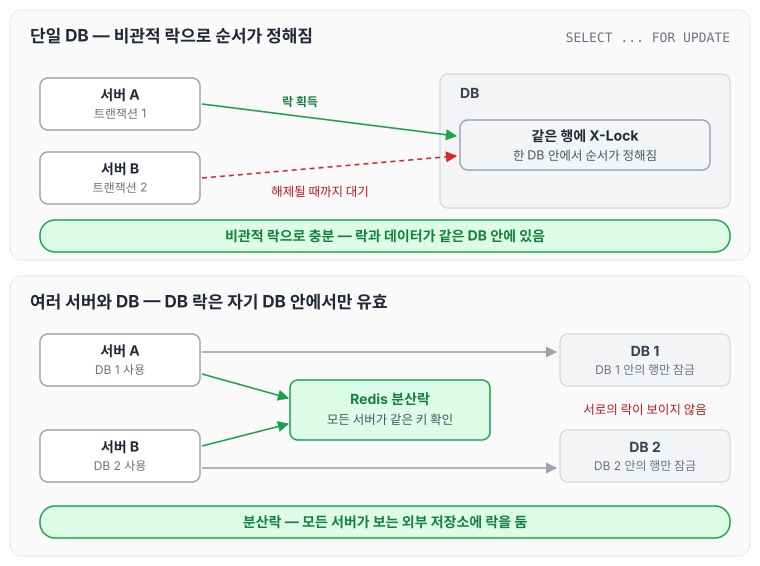
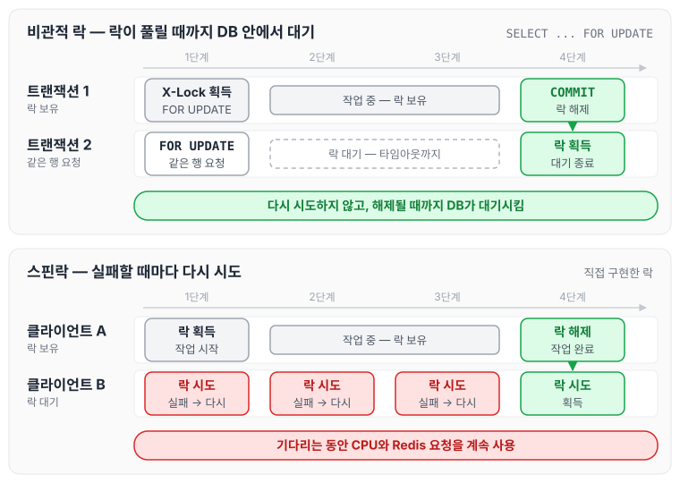
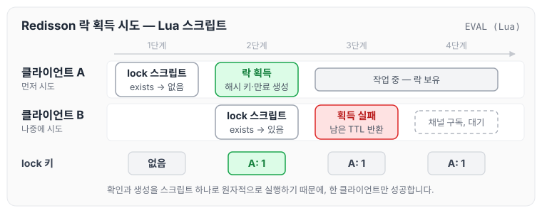
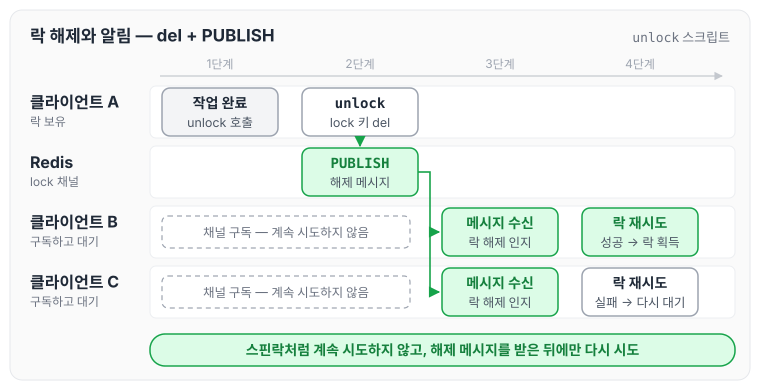
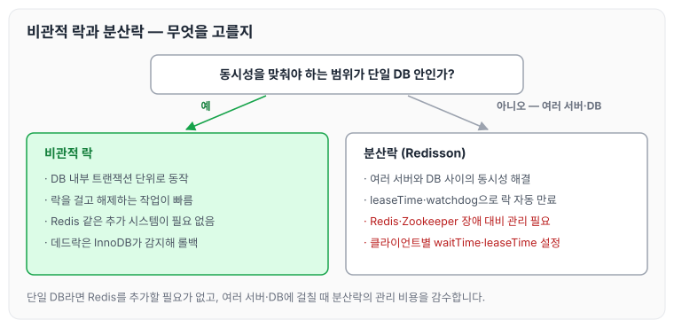

이전에 [비관적 락](../pessimistic-lock/)에 대해 작성하였습니다. 이번 글에서는 비관적 락이 분산 환경에서 갖는 한계와, 이를 해결하기 위해 사용하는 분산락에 대해 정리하도록 하겠습니다.

비관적 락을 요약하자면 아래와 같습니다.

- 모든 트랜잭션에 충돌이 날 것이라고 가정하고, 우선적으로 Lock을 점유하여 다른 트랜잭션이 접근하지 못하게 하는 방법입니다.
- 데이터를 수정할 때 X-Lock을 점유하고 있으므로 충돌이 발생할 가능성이 적습니다.
- 사용자가 수정을 마칠 때까지 다른 사용자는 락이 풀릴 때까지 대기하고 있습니다. 이 때문에 비관적 락의 경우 Time-out 설정을 통해 언제까지 대기할 것인지 꼭 지정해 줘야 합니다.
- 비관적 락의 경우 next-key lock을 사용하기 때문에, 갭 락과 next-key lock이 무엇이고 어떻게 동작하는지 알아두면 비관적 락을 사용할 때 큰 도움이 될 것입니다.
    - 갭 락은 인덱스 레코드 사이의 빈 구간인 "갭"에 거는 락이고, next-key lock은 인덱스 레코드에 거는 레코드 락과 그 레코드 바로 앞의 갭 락을 합친 것입니다. 이를 통해 트랜잭션이 실행되는 동안 새로운 레코드가 해당 범위에 삽입되는 것을 방지합니다. 갭락 설명 블로그: [https://idea-sketch.tistory.com/46](https://idea-sketch.tistory.com/46)

## 분산락이란

분산락은 여러 서버(프로세스)가 공유 자원에 접근할 때 데이터의 정합성을 지키기 위해 사용하는 락입니다.

Redisson을 어노테이션 기반으로 구현하여 사용하는 방법은 아래 글들을 참고하였습니다.

- 어노테이션 기반의 Redisson 분산락 구현: [https://helloworld.kurly.com/blog/distributed-redisson-lock/](https://helloworld.kurly.com/blog/distributed-redisson-lock/)
- 커스텀 어노테이션 사용 방법: [[Spring] Spring Annotation 그리고 Custom Annotation](../spring-custom-annotation/)
- 트랜잭션 Isolation: [[JAVA] @Transactional 이란? 트랜잭션 성질 (1)](../transactional-basics/)

## 분산락을 사용하는 이유

비관적 락은 단일 데이터베이스 인스턴스 내에서 동시성 문제를 해결하는 데 적합하지만, 분산 환경에서의 여러 서버와 DB 간의 동시성은 해결해 주지 못합니다. 이 때문에 분산 환경에서도 동시성을 해결하기 위해 분산락을 사용합니다. 자세한 이유는 아래와 같습니다.

1. 분산 환경에서는 네트워크 지연, 패킷 손실, 장애 등이 발생할 경우 락을 유지하기가 어렵습니다.
2. 비관적 락을 사용하면 락에 접근하려는 모든 노드가 락이 풀릴 때까지 대기 상태가 되면서, 병목 현상이 발생할 수 있습니다.
3. 위와 같은 상황 때문에 분산 환경에서 지연이 발생하고, 이것이 누적되면 큰 문제로 이어질 수 있습니다.

단일 DB일 때와 여러 서버·DB가 함께 동작할 때 락이 미치는 범위를 비교하면 다음과 같습니다.

비관적 락은 DB 안의 행에 걸리기 때문에, 같은 DB를 거치는 요청끼리만 순서를 정할 수 있습니다. 분산락은 모든 서버가 바라보는 외부 저장소(Redis)에 락을 두기 때문에, 서버와 DB가 여러 개여도 같은 키로 순서를 정할 수 있습니다.

## 락 획득 방식

### 비관적 락: 락이 풀릴 때까지 대기

비관적 락은 `SELECT ... FOR UPDATE`로 락을 잡은 트랜잭션이 커밋하거나 롤백할 때까지, 같은 행에 락을 요청한 다른 트랜잭션을 DB 안에서 대기시킵니다. 대기는 `innodb_lock_wait_timeout`(기본 50초)까지 이어지고, 그 안에 락을 얻지 못하면 에러가 발생합니다. 기다리는 쪽이 다시 시도하는 것이 아니라 DB가 락이 풀릴 때까지 대기시키는 방식입니다.

반면 Redis 같은 외부 저장소에 락을 직접 구현하면, 락을 얻지 못한 클라이언트가 스스로 다시 시도해야 합니다. 이때 락이 풀릴 때까지 계속 시도하는 방식이 스핀락이며, 그동안 CPU 시스템 자원과 Redis 요청이 비효율적으로 사용됩니다. 스핀락의 동작은 [스핀락, 뮤텍스, 세마포](../spinlock-mutex-semaphore/)에서 정리하였습니다.

두 대기 방식을 나란히 그리면 다음과 같습니다.

아래쪽 스핀락에서 B는 1단계부터 3단계까지 실패할 것을 알면서도 계속 시도합니다. Redisson은 이 부분을 pub/sub으로 바꿔서 해결합니다.

### Redisson 분산락: pub/sub

Redisson의 분산락은 Lua 스크립트로 락을 잡고, 기다리는 동안에는 pub/sub 채널로 해제 소식을 받습니다. MySQL의 방식과 나란히 놓고 단계별로 정리하면 아래와 같습니다.

첫 번째 단계는 락 획득 시도입니다.

- MySQL에서는 `SELECT ... FOR UPDATE`와 같은 쿼리를 사용하여 특정 행에 대해 락을 시도합니다. 만약 다른 트랜잭션이 이미 해당 행에 대해 락을 걸었다면, 현재 트랜잭션은 락이 해제될 때까지 대기 상태에 들어갑니다.
- Redisson에서 락을 시도할 때, 클라이언트는 Redis에 Lua 스크립트를 보냅니다. 스크립트는 락을 나타내는 키가 존재하는지 확인하고, 없으면 해시 키를 만들어(`hincrby`) 만료 시간(`pexpire`)을 설정합니다. 이렇게 키를 만든 클라이언트가 락을 획득합니다. 이미 키가 있으면 남은 만료 시간을 돌려받고 락 획득에 실패합니다.
- Redis는 Lua 스크립트를 원자적으로 실행하기 때문에, 키를 확인하고 만드는 사이에 다른 클라이언트가 끼어들 수 없습니다. 락을 직접 구현할 때는 "키가 존재하지 않을 때만 생성"하는 `SETNX`를 많이 사용하는데, Redisson은 같은 클라이언트의 재진입과 만료 시간 설정까지 한 번에 처리하기 위해 스크립트를 사용합니다.

Redisson 쪽 흐름을 그리면 다음과 같습니다.

lock 키가 한 번 만들어지면 그 뒤의 시도는 모두 실패하기 때문에, 키를 먼저 만든 A만 락을 획득합니다.

두 번째 단계는 Pub/Sub 채널 구독과 해제 알림입니다.

- 락을 보유한 트랜잭션이 완료되거나 롤백되면, MySQL은 락을 자동으로 해제하고 대기 중인 트랜잭션 중 하나가 락을 획득하게 됩니다.
- Redisson에서 락 획득에 실패한 클라이언트는 그 락의 Pub/Sub 채널을 구독하고 대기합니다. 락을 보유한 클라이언트가 작업을 마치고 unlock을 호출하면, 해제용 Lua 스크립트가 락 키를 삭제(`del`)하고 같은 채널에 해제 메시지를 `PUBLISH`합니다. 이를 통해 대기 중이던 클라이언트들이 락이 해제되었음을 인지하고 다시 락 획득을 시도합니다.

락이 해제되고 알림이 전달되는 흐름은 다음과 같습니다.

이를 통해 스핀락처럼 지속적으로 CPU를 낭비하면서 확인할 필요 없이, 해제 메시지를 받았을 때만 다시 시도하면 됩니다. 앞의 스핀락 그림과 비교하면, 대기하는 동안 반복해서 시도하던 부분이 채널 구독으로 바뀐 것을 확인할 수 있습니다.

## 비관적 락 대신 분산락을 사용하면 될까

비관적 락을 사용하지 않고 분산락을 바로 사용하는 것이 더 좋아 보일 수 있지만, 아래와 같은 이유로 항상 그렇지는 않습니다.

1. 단일 데이터베이스에서 사용하는 것이라면 내부 트랜잭션 단위로 동작하기 때문에 락을 걸고 해제하는 작업이 빠르므로, 굳이 Redis라는 추가적인 작업을 할 필요는 없을 것입니다.
2. 분산락은 Redis나 Zookeeper 같은 외부 시스템에 의존합니다. 이러한 시스템에 장애가 발생하면 신뢰성을 보장하기 위해 시스템 자체적으로 관리가 필요합니다.
3. 비관적 락은 [데드락](../deadlock/)이 발생하면 InnoDB가 감지해 한쪽 트랜잭션을 롤백하고, 오래 기다리는 락은 `innodb_lock_wait_timeout`으로 끊을 수 있습니다. 하지만 분산락을 도입하면 클라이언트별로 대기 시간(`waitTime`)과 락 유지 시간(`leaseTime`)을 설정해야 합니다. Redisson은 `leaseTime`이 지나면 락을 자동으로 만료시키고, `leaseTime`을 지정하지 않으면 watchdog이 락을 가진 클라이언트가 살아 있는 동안 만료 시간(기본 30초)을 계속 연장합니다. 이 때문에 클라이언트가 죽어도 락이 영원히 남지는 않지만, 작업이 `leaseTime`보다 오래 걸리면 작업 도중 락이 풀릴 수 있어 시간을 적절히 정해야 합니다.

두 방식을 고르는 기준을 정리하면 다음과 같습니다.

개발을 하다 보면 trade off는 항상 발생할 수밖에 없다고 생각합니다. 어느 시스템에 어떤 방법이 적절한지 알고 있다면, 이후에 발생하는 문제에 대해서도 적절하게 선택할 수 있을 것 같습니다.

오늘은 비관적 락의 한계와 분산락의 락 획득 방식, 그리고 두 방식 사이의 트레이드오프에 대해 정리하였습니다.
