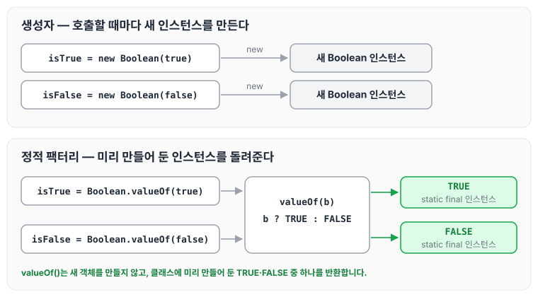
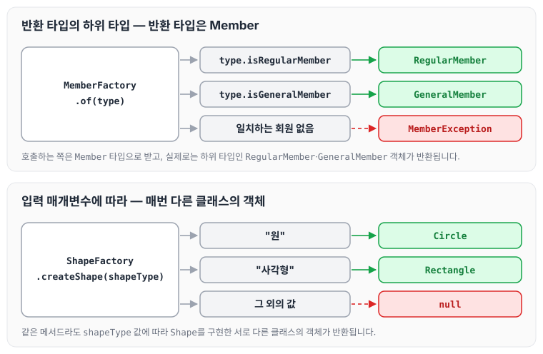
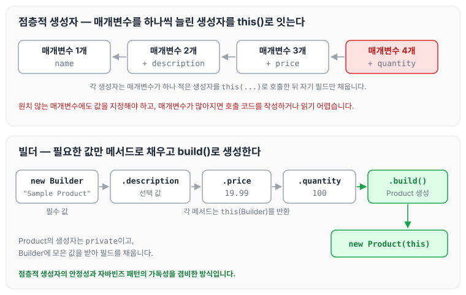
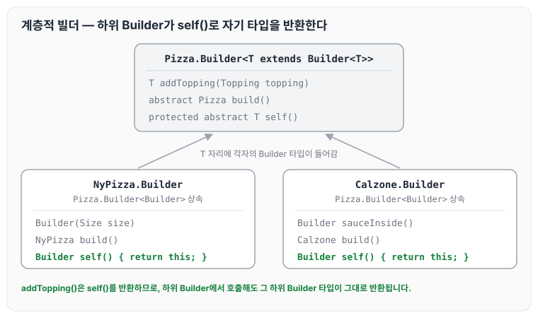

이전에 [정적 팩토리 메소드 패턴](../static-factory-method/)에 대해 작성하였습니다. 그 글에서는 Track에서 Cars 객체를 생성하는 코드에 정적 팩토리 메소드 패턴을 적용해 보았습니다. 오늘은 이펙티브 자바 2장 객체 생성과 파괴를 읽고, 객체를 만들어야 할 때와 만들지 말아야 할 때를 구분하는 법, 올바른 객체 생성 방법과 불필요한 생성을 피하는 방법 중 생성자 대신 정적 팩터리 메서드를 고려하는 방법과 매개변수가 많을 때 빌더를 고려하는 방법에 대해 정리하도록 하겠습니다.

## 생성자 대신 정적 팩터리 메서드를 고려하라

### 장점

정적 팩터리 메서드의 장점은 아래와 같습니다.

1. 이름을 가질 수 있습니다.

    아래는 `BigInteger`를 생성자로 만드는 경우와, 이름을 가진 정적 팩터리 메서드 `probablePrime()`으로 만드는 경우입니다.
    
    ```java
    BigInteger bigInteger = new BigInteger(int ,int, Random);
    BigInteger bigInteger = BigInteger.probablePrime();
    ```
    
2. 호출할 때마다 인스턴스를 새로 생성하지는 않아도 됩니다.

    생성자로 `Boolean`을 만들면 아래와 같이 호출할 때마다 새 인스턴스가 생성됩니다.
    
    ```java
    Boolean isTrue = new Boolean(true);
    Boolean isFalse = new Boolean(false);
    ```

    반면 `Boolean.valueOf()`는 클래스에 미리 만들어 둔 `TRUE`, `FALSE`를 반환합니다.
    
    ```java
    Boolean isTrue = Boolean.valueOf(true);
    Boolean isFalse = Boolean.valueOf(false);
    
    public final class Boolean implements java.io.Serializable, Comparable<Boolean>{
    	public static final Boolean TRUE = new Boolean(true);
      public static final Boolean FALSE = new Boolean(false);
    
    	public static Boolean valueOf(boolean b) {
    	    return (b ? TRUE : FALSE);
    	}
    }
    ```

    두 방식의 차이를 그림으로 보면 아래와 같습니다.

    

    `valueOf()`는 매개변수 `b`에 따라 `TRUE`나 `FALSE` 중 하나를 돌려줄 뿐 새 객체를 만들지 않습니다.
    
3. 반환 타입의 하위 타입 객체를 반환할 수 있는 능력이 있습니다.

    아래 `MemberFactory.of()`는 반환 타입이 `Member`이지만, 실제로는 `type`에 따라 하위 타입인 `RegularMember`나 `GeneralMember`를 반환합니다.
    
    ```java
    public class Member {
    		public Member() {}
    }
    
    public class RegularMember extends Member {
    		public RegularMember() {}
    }
    
    public class GeneralMember extends Member {
    		public GeneralMember() {}
    }
    
    public class MemberFactory {
    		private static final String MEMBER_ERROR = "일치하는 회원이 없습니다.";
    	
    		public static Member of(Type type) {
    			if (type.isRegularMember) {
    				return new RegularMember();
    			}
    			if (type.isGeneralMember) {
    				return new GeneralMember();
    			}
    			throw new MemberException(MEMBER_ERROR);
    		}
    }
    ```
    
4. 입력 매개변수에 따라 매번 다른 클래스의 객체를 반환할 수 있습니다.

    아래 `ShapeFactory.createShape()`는 `shapeType` 값에 따라 `Shape`를 구현한 `Circle`이나 `Rectangle`을 반환합니다.
    
    ```java
    // Shape 인터페이스
    interface Shape {
        void draw();
    }
    
    // Circle 클래스
    class Circle implements Shape {
        @Override
        public void draw() {
            System.out.println("원 그리기");
        }
    }
    
    // Rectangle 클래스
    class Rectangle implements Shape {
        @Override
        public void draw() {
            System.out.println("사각형 그리기");
        }
    }
    
    class ShapeFactory {
        public static Shape createShape(String shapeType) {
            if (shapeType.equalsIgnoreCase("원")) {
                return new Circle();
            } else if (shapeType.equalsIgnoreCase("사각형")) {
                return new Rectangle();
            } else {
                return null;
            }
        }
    }
    ```

    3번과 4번 예제의 흐름을 함께 보면 아래와 같습니다.

    

    호출하는 쪽은 반환 타입(`Member`, `Shape`)만 알면 되고, 어떤 구현 클래스의 객체가 만들어지는지는 정적 팩터리 메서드 안에서 결정됩니다. 일치하는 값이 없을 때 `MemberFactory`는 예외를 던지고, `ShapeFactory`는 `null`을 반환합니다.
    
5. 정적 팩터리 메서드를 작성하는 시점에는 반환할 객체의 클래스가 존재하지 않아도 됩니다.

### 단점

1. 상속을 하려면 public이나 protected 생성자가 필요하므로, 정적 팩터리 메서드만 제공하면 하위 클래스를 만들 수 없습니다.
2. 정적 팩터리 메서드는 프로그래머가 찾기 어렵습니다.

### 정적 팩터리 메서드 명명 방식

정적 팩터리 메서드에 흔히 사용하는 이름은 아래와 같습니다.

- `from` : 하나의 매개 변수를 받아서 객체를 생성
- `of` : 여러개의 매개 변수를 받아서 객체를 생성
- `getInstance` | `instance` : 인스턴스를 생성. 이전에 반환했던 것과 같을 수 있음.
- `newInstance` | `create` : 새로운 인스턴스를 생성
- `get[OtherType]` : 다른 타입의 인스턴스를 생성. 이전에 반환했던 것과 같을 수 있음.
- `new[OtherType]` : 다른 타입의 새로운 인스턴스를 생성.

> **핵심정리**
> 정적 팩터리 메서드와 public 생성자는 각자의 쓰임새가 있으니 상대적인 장단점을 이해하고 사용하는 것이 좋습니다. 그렇다고 하더라도 정적 팩터리를 사용하는 게 유리한 경우가 더 많으므로, 무작정 public 생성자를 제공하던 습관이 있다면 고치는 것이 좋습니다.

## 생성자에 매개변수가 많다면 빌더를 고려하라

정적 팩터리와 생성자에는 선택적 매개변수가 많을 때 적절히 대응하기 어렵다는 제약이 있습니다. 아래는 매개변수를 하나씩 늘린 생성자를 차례로 두는 점층적 생성자 패턴입니다.

```java
public class Product {
    private String name;
    private String description;
    private double price;
    private int quantity;

    public Product(String name) {
        this.name = name;
    }

    public Product(String name, String description) {
        this(name);
        this.description = description;
    }

    public Product(String name, String description, double price) {
        this(name, description);
        this.price = price;
    }

    public Product(String name, String description, double price, int quantity) {
        this(name, description, price);
        this.quantity = quantity;
    }
}
```

이런 생성자는 사용자가 설정하길 원치 않는 매개변수까지 포함하기 쉬운데, 그런 매개변수에도 어쩔 수 없이 값을 지정해 줘야 합니다. 점층적 생성자 패턴도 쓸 수는 있지만, **매개변수 개수가 많아지면 클라이언트 코드를 작성하거나 읽기 어렵습니다.** 이때 점층적 생성자 패턴의 안정성과 자바빈즈 패턴의 가독성을 겸비한 빌더 패턴을 사용할 수 있습니다.

```java
public class Product {
    private String name;
    private String description;
    private double price;
    private int quantity;

    private Product(Builder builder) {
        this.name = builder.name;
        this.description = builder.description;
        this.price = builder.price;
        this.quantity = builder.quantity;
    }

    public static class Builder {
        private String name;
        private String description;
        private double price;
        private int quantity;

        public Builder(String name) {
            this.name = name;
        }

        public Builder description(String description) {
            this.description = description;
            return this;
        }

        public Builder price(double price) {
            this.price = price;
            return this;
        }

        public Builder quantity(int quantity) {
            this.quantity = quantity;
            return this;
        }

        public Product build() {
            return new Product(this);
        }
    }
}
```

빌더로 `Product`를 생성하는 코드는 아래와 같습니다.

```java
Product product = new Product.Builder("Sample Product")
        .description("This is a sample product.")
        .price(19.99)
        .quantity(100)
        .build();
```

점층적 생성자와 빌더로 객체를 만드는 흐름을 비교하면 아래와 같습니다.



빌더는 필수 값인 `name`으로 `Builder`를 만든 뒤, 필요한 선택 값만 메서드로 채우고 마지막에 `build()`로 `Product`를 생성합니다. 각 메서드가 `this`를 반환하기 때문에 호출을 이어서 작성할 수 있습니다.

### 계층적으로 설계된 클래스와 빌더

빌더 패턴은 계층적으로 설계된 클래스와 함께 쓰기에 좋습니다.

```java
public abstract class Pizza{
   public enum Topping { HAM, MUSHROOM, ONION, PEPPER, SAUSAGE }
   final Set<Topping> toppings;

   abstract static class Builder<T extends Builder<T>> {
      EnumSet<Topping> toppings = EnumSet.noneOf(Topping.class);
      public T addTopping(Topping topping) {
         toppings.add(Objects.requireNonNull(topping));
         return self();
      }

      abstract Pizza build();

      protected abstract T self();
   }

   Pizza(Builder<?> builder) {
      toppings = builder.toppings.clone();
   }
}

```

`Pizza.Builder` 클래스는 재귀적 타입 한정을 이용하는 제네릭 타입입니다. 여기에 추상 메서드인 `self()`를 두어, 하위 클래스가 자기 자신의 타입을 반환하도록 했습니다.

```java
public class NyPizza extends Pizza {
   public enum Size { SMALL, MEDIUM, LARGE }
   private final Size size;

   public static class Builder extends Pizza.Builder<Builder> {
      private final Size size;

      public Builder(Size size) {
         this.size = Objects.requireNonNull(size);
      }

      @Override public NyPizza build() {
         return new NyPizza(this);
      }

      @Override protected Builder self() { return this; }
   }

   private NyPizza(Builder builder) {
      super(builder);
      size = builder.size;
   }
}
```

```java

public class Calzone extends Pizza {
   private final boolean sauceInside;

   public static class Builder extends Pizza.Builder<Builder> {
      private boolean sauceInside = false;

      public Builder sauceInside() {
         sauceInside = true;
         return this;
      }

      @Override public Calzone build() {
         return new Calzone(this);
      }

      @Override protected Builder self() { return this; }
   }

   private Calzone(Builder builder) {
      super(builder);
      sauceInside = builder.sauceInside;
   }
}
```

세 Builder의 관계를 그림으로 보면 아래와 같습니다.



`NyPizza.Builder`와 `Calzone.Builder`는 `Pizza.Builder<Builder>`를 상속하면서 `self()`가 자기 자신(`this`)을 반환하도록 구현합니다. 또한 `build()`는 `Pizza` 대신 각각 `NyPizza`, `Calzone`을 반환하도록 재정의되어 있습니다.

## 마무리

오늘은 이펙티브 자바 2장에서 생성자 대신 정적 팩터리 메서드를 고려해야 하는 이유와 명명 방식, 그리고 생성자에 매개변수가 많을 때 점층적 생성자 대신 빌더 패턴을 사용하는 방법에 대해 정리하였습니다. 무작정 public 생성자를 제공하기보다, 객체를 만드는 방식마다 장단점을 따져 보고 선택하는 습관을 들이면 좋을 것 같습니다.
