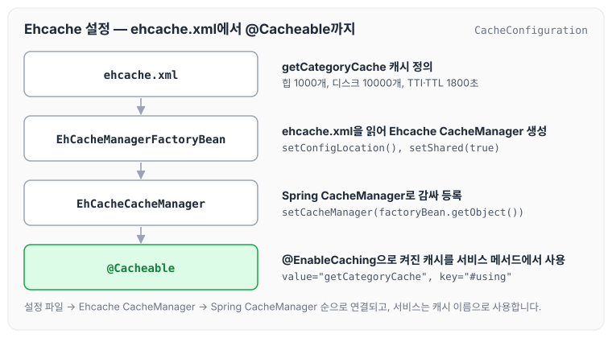
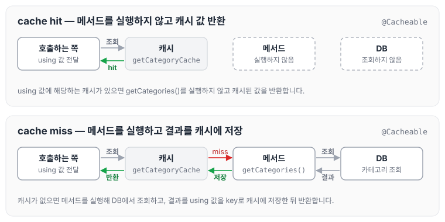

오늘은 카테고리 작업을 하면서 받은 요청사항에 대해 정리하려고 합니다. 캐시 업데이트 시간을 빠르게 단축해 달라는 요청이었는데, 캐싱 관련 세팅을 따로 해 본 적이 없어서 어디서부터 어디까지 작업해야 할지 몰랐습니다. 이번에 배우게 된 내용을 정리하도록 하겠습니다.

## Ehcache를 사용하는 이유

Spring에서 캐싱 작업은 보통 Ehcache를 사용합니다.

Ehcache는 거의 변경되지 않는 DB의 값을 메모리 혹은 디스크에 보관하다가, 호출되었을 때 DB를 조회하지 않고 메모리 혹은 디스크에서 값을 조회해서 돌려줍니다. 이렇게 사용하면 DB의 부하는 줄이고 조회 속도는 올릴 수 있는 장점이 있습니다. 하지만 값이 실시간으로 변경되지 않는다는 단점이 있습니다.

## ehcache.xml 설정

캐시 설정은 아래와 같이 `ehcache.xml`에 작성합니다.

```xml
<?xml version="1.0" encoding="UTF-8"?>
<ehcache xmlns:xsi="http://www.w3.org/2001/XMLSchema-instance"
    xsi:noNamespaceSchemaLocation="http://ehcache.org/ehcache.xsd"
    updateCheck="false">
    
    <diskStore path="java.io.tmpdir" />
    
    <cache name="getCategoryCache"
           maxEntriesLocalHeap="1000"  
           maxEntriesLocalDisk="10000" 
           eternal="false"
           diskSpoolBufferSizeMB="20"
           timeToIdleSeconds="1800" timeToLiveSeconds="1800"
           memoryStoreEvictionPolicy="LFU"
           transactionalMode="off">
           <persistence strategy="localTempSwap" />
    </cache>
</ehcache>
```

각 속성의 의미는 아래와 같습니다.

| 속성 | 설명 | 비고 |
| --- | --- | --- |
| maxEntriesLocalHeap | 힙 메모리에 유지될 최대 객체 수 |  |
| maxEntriesLocalDisk | 로컬 디스크에 유지될 최대 객체 수 |  |
| eternal | true면 시간 설정(timeToIdleSeconds, timeToLiveSeconds)을 무시하고 만료하지 않음 |  |
| diskSpoolBufferSizeMB | 디스크 캐시에 쓰기 모드로 들어갈 때 사용될 비동기 모드 스풀 버퍼 크기 설정. OutOfMemory 에러가 발생하면 수치를 낮춥니다. |  |
| timeToIdleSeconds | 마지막 접근 후 이 시간 동안 접근이 없으면(Idle) 만료 |  |
| timeToLiveSeconds | 생성된 뒤 만료되기까지 캐시가 유지되는 시간 (0이면 만료 시간을 지정하지 않은 것으로 보고 계속 유지, default: 0) |  |
| memoryStoreEvictionPolicy | 객체의 개수가 설정된 maxEntriesLocalHeap에 도달했을 때 메모리에서 객체를 어떻게 제거할지에 대한 제거 알고리즘 | FIFO: First In First Out, LFU: Least Frequently Used, LRU: Least Recently Used |
| transactionalMode | copyOnRead, copyOnWrite 시 트랜잭션 모드를 설정 |  |

## Spring Boot에서 Ehcache 설정

Spring Boot에서 Ehcache를 사용하기 위해서는 `@Configuration` 클래스에 `@EnableCaching`을 추가하고, `CacheManager`를 Bean으로 등록합니다.

```java
@Configuration
@EnableCaching
public class CacheConfiguration {

    @Bean
    public EhCacheManagerFactoryBean cacheManager() {
        EhCacheManagerFactoryBean cacheManagerFactoryBean = new EhCacheManagerFactoryBean();
        // ehcache 설정 정보를 담은 xml 위치
				cacheManagerFactoryBean.setConfigLocation(new ClassPathResource("ehcache.xml"));
        // cachemanager의 싱글톤 여부를 지정하는 값으로 true로 설정시 만약 기존 cachemanager가 존재하지 않을 경우 새로 생성
				cacheManagerFactoryBean.setShared(true);

        return cacheManagerFactoryBean;
    }

		@Bean
		EhCacheCacheManager ehCacheCacheManager(EhCacheManagerFactoryBean ehCacheManagerFactoryBean) {
			EhCacheCacheManager ehCacheCacheManager = new EhCacheCacheManager();
			ehCacheCacheManager.setCacheManager(ehCacheManagerFactoryBean.getObject());
			return ehCacheCacheManager;
		}
}
```

`EhCacheManagerFactoryBean`이 `ehcache.xml`을 읽어 Ehcache의 CacheManager를 만들고, `EhCacheCacheManager`가 이를 감싸 Spring의 CacheManager로 등록합니다. 설정이 연결되는 순서를 그리면 다음과 같습니다.



## CacheManager 커스터마이징

cacheManager를 커스터마이징하고 싶다면 아래와 같이 `CacheManagerCustomizer` 인터페이스를 구현한 다음 Bean으로 등록합니다.

```java
@Component
public class CustomCacheManger implements CacheManagerCustomizer<ConcurrentMapCacheManager> {

    @Override
    public void customize(ConcurrentMapCacheManager cacheManager) {
        cacheManager.setAllowNullValues(false);

    }
}
```

## @Cacheable 적용

캐시를 사용할 Service 메서드에 `@Cacheable`을 추가합니다.

```java
@Cacheable(value="getCategoryCache", key="#using")
    public List<Category> getCategories(Using using) {
		...
		return;
}
```

`@Cacheable(cacheNames = "getCategoryCache", key = "#using")`

- `ehcache.xml`에서 지정한 `getCategoryCache` 캐시를 사용합니다. `value`와 `cacheNames`는 같은 속성입니다.
- `key`는 메서드 argument인 `using`을 사용하겠다는 의미입니다.
- using 값에 따라 별도로 캐시됩니다.
- `getCategoryCache`는 메서드의 argument에 따라 캐시되기 때문에 `using`에 해당하는 캐시가 있는지 확인합니다.
- 캐시가 있으면 메서드를 실행하지 않고 캐시된 내용을 반환하고, 없으면 메서드를 실행한 뒤 결과를 캐시에 저장합니다.

캐시가 있을 때와 없을 때의 흐름을 나누어 그리면 다음과 같습니다.



캐시가 없는 순간에 많은 요청이 한꺼번에 DB로 몰리는 문제와 그 해결 방법은 [Cache Stampede(캐시 스템피드)](../cache-stampede/)에서 따로 정리하였습니다.

## 마무리

오늘은 Ehcache의 `ehcache.xml` 설정 속성과 Spring Boot에서 CacheManager를 등록하고 `@Cacheable`로 조회 결과를 캐시하는 방법에 대해 정리하였습니다.

참조 : [https://kimyhcj.tistory.com/253](https://kimyhcj.tistory.com/253), [https://ifuwanna.tistory.com/222](https://ifuwanna.tistory.com/222)
