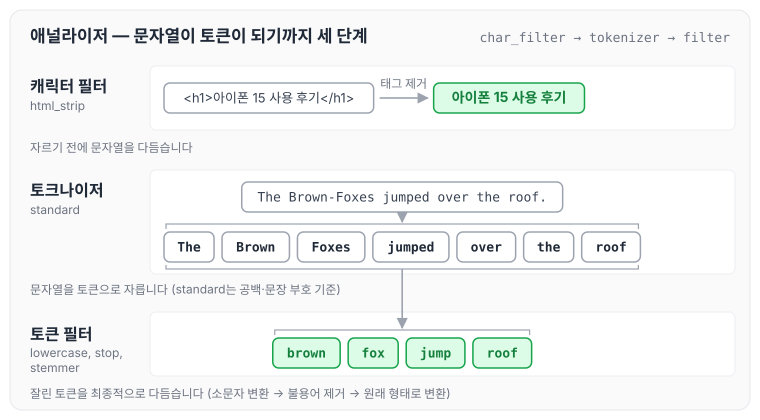
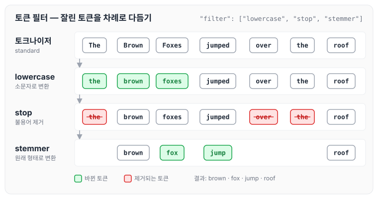
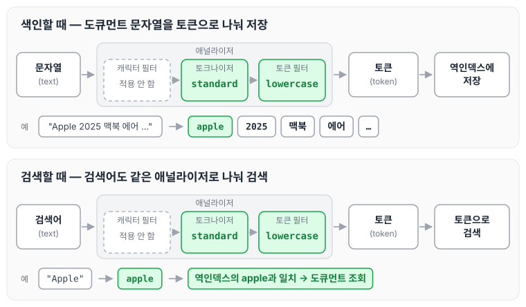
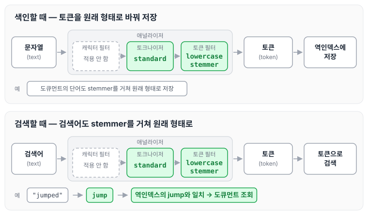

이전에 [색인이 만들어지는 순서와 구조](../es-indexing-structure/)에 대해 작성하였습니다. [역인덱스](../es-inverted-index/) 글에서는 문자열을 토큰 단위로 나눠 저장한다고 정리했는데, 이때 문자열을 토큰으로 나누는 역할을 하는 것이 애널라이저입니다. 오늘은 애널라이저를 구성하는 캐릭터 필터, 토크나이저, 토큰 필터와 한글 검색을 위한 Nori 설정에 대해 정리하도록 하겠습니다.

## 애널라이저란?

애널라이저는 문자열을 토큰으로 변환해 주는 장치입니다. 아래와 같이 도큐먼트 세 개를 넣어 보겠습니다.

```json
POST /products/_create/1
{
  "name": "Apple 2025 맥북 에어 13 M4 10코어"
}

POST /products/_create/2
{
  "name": "Apple 2024 에어팟 4세대"
}

POST /products/_create/3
{
  "name": "Apple 2024 아이패드 mini A17 Pro"
}
```

넣은 문자열은 아래와 같이 토큰으로 나뉘고, 토큰마다 해당 토큰을 가진 도큐먼트 id가 저장됩니다.

| 토큰(token) | 도큐먼트 id |
| --- | --- |
| Apple | [1, 2, 3] |
| 2025 | [1] |
| 맥북 | [1] |
| 에어 | [1] |
| 13 | [1] |
| M4 | [1] |
| 10코어 | [1] |
| 2024 | [2, 3] |
| 에어팟 | [2] |
| 4세대 | [2] |
| 아이패드 | [3] |
| mini | [3] |
| A17 | [3] |
| Pro | [3] |

애널라이저는 문자열을 단순히 단어 단위로 자르지 않고, 여러 단계의 작업을 거쳐 토큰으로 만듭니다. 단계는 캐릭터 필터 → 토크나이저 → 토큰 필터 순서이며, 각 단계를 예시와 함께 그리면 아래와 같습니다.



그림의 세 줄은 아래에서 설명하는 각 단계의 예시입니다. 하나의 애널라이저 안에서 캐릭터 필터를 거친 문자열이 토크나이저로, 토크나이저가 자른 토큰이 토큰 필터로 넘어갑니다.

### 캐릭터 필터

캐릭터 필터는 문자열을 토큰으로 자르기 전에 문자열을 다듬는 역할을 합니다.

- `html_strip`: HTML 태그를 제거합니다.
    - `<h1>아이폰 15 사용 후기</h1>` → `아이폰 15 사용 후기`

### 토크나이저

토크나이저는 문자열을 토큰으로 자르는 역할을 합니다. 예시는 아래와 같습니다.

- standard 토크나이저: 공백 또는 `,`, `.`, `!`, `?`와 같은 문장 부호를 기준으로 자릅니다.

    `The Brown-Foxes jumped over the roof.`

    → [`The`, `Brown`, `Foxes`, `jumped`, `over`, `the`, `roof`]

### 토큰 필터

토큰 필터(token filter)는 **잘린 토큰을 최종적으로 다듬는 역할**을 합니다. 토크나이저 예시에서 잘린 토큰에 필터를 하나씩 적용하면 아래와 같습니다.

1. lowercase 필터 적용 (소문자로 변환)

    [`The`, `Brown`, `Foxes`, `jumped`, `over`, `the`, `roof`]

    → [`the`, `brown`, `foxes`, `jumped`, `over`, `the`, `roof`]

2. stop 필터 적용 (`a`, `the`, `is`와 같이 특별한 의미를 가지지 않는 단어 제거)

    [`the`, `brown`, `foxes`, `jumped`, `over`, `the`, `roof`]

    → [`brown`, `foxes`, `jumped`, `roof`]

3. stemmer 필터 적용 (단어의 원래 형태로 변환)

    [`brown`, `foxes`, `jumped`, `roof`]

    → [`brown`, `fox`, `jump`, `roof`]

세 필터를 차례로 거치는 과정을 그리면 아래와 같습니다.



필터는 `filter` 배열에 적은 순서대로 적용됩니다. lowercase에서 대문자가 소문자로 바뀌고, stop에서 `the`, `over`가 빠지고, stemmer에서 `foxes`, `jumped`가 `fox`, `jump`로 바뀝니다.

### 사용 방법

애널라이저가 토큰을 어떻게 나누는지는 아래 명령어로 확인할 수 있습니다.

```json
// 방법 1 
GET /_analyze
{
  "text": "_________",
  "analyzer": "standard"
}

// 방법 2 (standard analyer의 구성을 직접 명시)
GET /_analyze 
{
  "text": "_________",
  "char_filter": [],
  "tokenizer": "standard",
  "filter": ["lowercase"]
}
```

Custom Analyzer는 다음과 같이 정의합니다.

```json
// 인덱스 생성 + 매핑 정의 + Custom Analyzer 적용
PUT /products
{
  "settings": {
    "analysis": {
      "analyzer": {
        "products_name_analyzer": {
          "char_filter": [],
          "tokenizer": "standard",
          "filter": []
        }
      }
    }
  },
  "mappings": {
	  "properties": {
	    "name": {
	      "type": "text",
	      "analyzer": "products_name_analyzer"
	    }
	  }
	}
}

// 데이터 삽입하기
POST /products/_create/1
{
  "name": "Apple 2025 맥북 에어 13 M4 10코어"
}

//  검색하기
GET /products/_search
{
  "query": {
    "match": {
      "name": "apple"
    }
  }
}

GET /products/_search
{
  "query": {
    "match": {
      "name": "**A**pple"  // --> "filter": []로 커스텀하게 적용안해서 대문자로만 검색가능
    }
  }
}

```

### 애널라이저의 토큰화와 검색 방식

도큐먼트를 생성할 때 애널라이저가 문자열을 토큰으로 분리해 역인덱스를 만듭니다. 그리고 검색을 할 때도 애널라이저가 검색어로 입력한 문자열을 토큰으로 분리해 검색합니다. 두 과정을 standard 애널라이저 기준으로 그리면 아래와 같습니다.



캐릭터 필터는 적용하지 않고, standard 토크나이저와 lowercase 토큰 필터를 거칩니다. 이 때문에 `Apple`이라고 검색어를 입력하더라도 `lowercase token filter`에 의해 `apple`로 바뀐 채로 검색을 하게 됩니다. 그래서 `Apple`이라고 검색했는데도 도큐먼트가 조회된 것입니다.

### HTML 태그 제거하기

HTML 태그가 포함된 데이터를 검색에 사용할 때는 character filter로 `html_strip`을 적용합니다.

```json
PUT /boards
{
  "settings": {
    "analysis": {
      "analyzer": {
        "boards_content_analyzer": {
          "char_filter": [**"html_strip"**],
          "tokenizer": "standard",
          "filter": ["lowercase"]
        }
      }
    }
  },
  "mappings": {
	  "properties": {
	    "content": {
	      "type": "text",
	      "analyzer": "boards_content_analyzer"
	    }
	  }
	}
}

// 데이터 삽입하기
POST /boards/_doc
{
  "content": "<h1>Running cats, jumping quickly — over the lazy dogs!</h1>"
}

// 검색하기
GET /boards/_search
{
  "query": {
    "match": {
      "content": "running"
    }
  }
}

GET /boards/_search
{
  "query": {
    "match": {
      "content": "h1"
    }
  }
}

// **Analyze API 사용하기**
GET /boards/_analyze
{
  "field": "content",
  "text": "<h1>Running cats, jumping quickly — over the lazy dogs!</h1>"
}
```

### 불용어(a, an, the, or, but) 제거하기 (stop)

stop 필터는 의미 없는 불용어를 제거합니다.

```json
// 인덱스 생성 + 매핑 정의 + Custom Analyzer 적용
PUT /boards
{
  "settings": {
    "analysis": {
      "analyzer": {
        "boards_content_analyzer": {
          "char_filter": [],
          "tokenizer": "standard",
          "filter": ["lowercase", **"stop"**]
        }
      }
    }
  },
  "mappings": {
	  "properties": {
	    "content": {
	      "type": "text",
	      "analyzer": "boards_content_analyzer"
	    }
	  }
	}
}
```

- 불용어(a, the, are, is 등)를 활용해 검색할 일이 없는 데이터라면, 역인덱스의 효율성을 위해 token filter로 `stop`을 활용하는 것이 좋습니다.
- 반대로 노래 제목(예: 비틀즈의 Let It Be)처럼 불용어를 포함해서 검색하는 것이 중요할 때는 token filter로 `stop`을 적용하지 않아야 합니다.

### 단어의 형태(-ed, -ing, -s 등)에 상관없이 검색하는 방법

token filter에 `stemmer`를 추가하면 단어의 형태와 상관없이 검색할 수 있습니다.

```json
PUT /boards
{
  "settings": {
    "analysis": {
      "analyzer": {
        "boards_content_analyzer": {
          "char_filter": [],
          "tokenizer": "standard",
          "filter": ["lowercase", **"stemmer"**]
        }
      }
    }
  },
  "mappings": {
	  "properties": {
	    "content": {
	      "type": "text",
	      "analyzer": "boards_content_analyzer"
	    }
	  }
	}
}
```

위 애널라이저로 색인하고 검색하는 과정을 그리면 아래와 같습니다.



색인할 때와 검색할 때 모두 `stemmer`를 거칩니다. 이 때문에 `jumped`라고 검색어를 입력하더라도 `stemmer`에 의해 `jump`로 바뀐 채로 검색을 하게 됩니다. 그래서 `jumped`라고 검색했는데도 도큐먼트가 조회됩니다.

### Nori Analyzer를 활용해 한글이 제대로 검색되게 만들기

한글은 Nori Analyzer를 사용하면 조사 등을 걸러 내고 토큰으로 나눌 수 있습니다.

```json
// 방법 1
GET /_analyze
{
  "text": "백화점에서 쇼핑을 하다가 친구를 만났다.",
  "analyzer": "nori"
}

// 방법 2 (nori analyzer의 구성을 직접 명시)
GET /_analyze
{
  "text": "백화점에서 쇼핑을 하다가 친구를 만났다.",
  "char_filter": [], 
	"tokenizer": "nori_tokenizer", 
	"filter": ["nori_part_of_speech", "nori_readingform", "lowercase"]
}
```

- `nori_part_of_speech` : 의미 없는 조사(`을`, `의` 등), 접속사 등을 제거합니다.
- `nori_readingform` : 한자를 한글로 바꿔서 토큰으로 저장합니다.

### 한글과 영어가 섞인 글을 검색 가능하게 만들기

Nori 필터 뒤에 `stop`과 `stemmer`를 함께 쓰면 불용어가 제거되고 영단어가 기본 형태로 바뀝니다.

```json
GET /_analyze
{
  "text": "오늘 영어 책에서 'It depends on the results.'이라는 문구를 봤다.",
  "char_filter": [], 
	"tokenizer": "nori_tokenizer", 
	"filter": ["nori_part_of_speech", "nori_readingform", "lowercase", **"stop", "stemmer"**]
}
```

오늘은 애널라이저를 구성하는 캐릭터 필터, 토크나이저, 토큰 필터에 대해 정리하였습니다. 역인덱스를 만들 때 애널라이저로 데이터를 미리 나눠 두기 때문에, 어떤 애널라이저를 적용할지 서비스에 맞게 골라 설정해야 합니다. 또한 검색할 때도 정의해 둔 애널라이저로 검색어를 나누기 때문에, 색인과 검색을 함께 고려해서 설정해야 할 것 같습니다.

> 이 글은 인프런 박재성 님의 [실전에서 바로 써먹는 Elasticsearch 입문 (검색 최적화편)](https://www.inflearn.com/course/실전-elasticsearch-입문)을 들으며 정리한 노트입니다.
