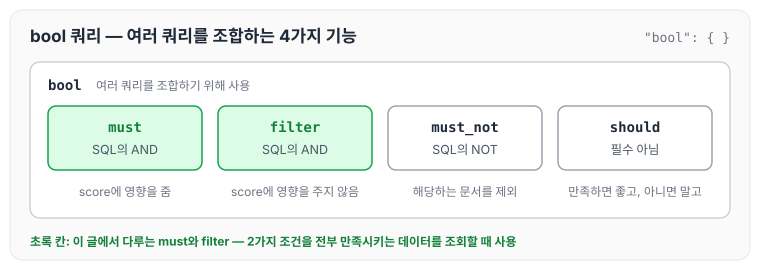
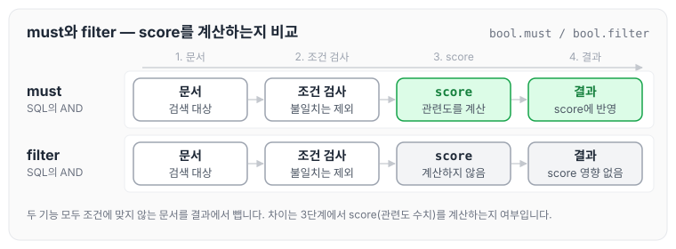
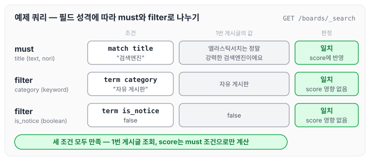

이전에 [검색 쿼리 기본](../es-search/)에서 match, term, terms 쿼리에 대해 작성하였습니다. 앞 글의 쿼리는 1가지 조건으로 데이터를 조회했는데, 이번에는 2가지 이상의 조건을 만족시키는 데이터를 조회할 때 사용하는 bool 쿼리와 must, filter의 차이에 대해 정리하도록 하겠습니다.

## 2가지 이상의 조건을 만족시키는 데이터를 조회하고 싶을 때 (bool: filter, must)

1가지 조건이 아닌 2가지 이상의 조건을 만족시키는 쿼리를 작성하려면 **bool 쿼리**를 활용해야 합니다. bool 쿼리는 여러 쿼리를 조합하기 위해서 사용하는 쿼리이며, 크게 4가지 기능이 있습니다.

- must: SQL문에서의 `AND` 역할을 합니다.
- filter: SQL문에서의 `AND` 역할을 합니다.
- must_not: SQL문에서의 `NOT` 역할을 합니다.
- should: 조건을 만족하면 좋고, 아니면 말고입니다.

4가지 기능을 bool 쿼리 안에 놓고 보면 아래와 같습니다.



must와 filter는 둘 다 `AND` 역할을 하고, must_not은 `NOT`, should는 반드시 만족하지 않아도 되는 조건입니다. 이 중에서 2가지 조건을 전부 만족시키는 데이터를 조회하기 위해 이 글에서는 `must`와 `filter`에 대해 알아보겠습니다. must_not은 [특정 조건을 제외하고 조회하기 — must_not](../es-must-not/)에서 정리하였습니다.

## filter와 must 비교

`filter`와 `must`의 가장 큰 차이는 `filter`는 score(점수)에 영향을 주지 않고, `must`는 score(점수)에 영향을 준다는 점입니다. 여기서 말하는 **score**(점수)는 검색을 할 때 관련도가 얼마나 높은지를 나타내는 수치입니다.

같은 조건을 must와 filter에 각각 넣었을 때의 처리 흐름을 그림으로 보면 아래와 같습니다.



두 기능 모두 조건에 맞지 않는 문서는 결과에서 제외합니다. 차이는 조건에 맞는 문서의 score를 계산해서 결과에 반영하는지 여부입니다.

## 예제로 확인하기

boards 인덱스를 새로 만들고 게시글 1건을 넣은 뒤, title에 `검색엔진`이 들어 있으면서 category가 `자유 게시판`이고 공지 글이 아닌 게시글을 조회하는 예제입니다.

```json
// 기존 인덱스 삭제
DELETE /boards

// 인덱스 생성
PUT /boards
{
  "mappings": {
    "properties": {
      "board_id": {
        "type": "long"
      },
      "title": {
        "type": "text", // 유연한 검색이 필요하므로 text 타입으로 선언
        "analyzer": "nori" // 한글 데이터를 토큰으로 정확하게 나누기 위해
      },
      "category": {
        "type": "keyword" // 유연한 검색이 필요없으므로 keyword 타입으로 선언
      },
      "is_notice": { // (공지글 여부)
        "type": "boolean"
      },
      "created_at": {
        "type": "date"
      }
    }
  }
}

// 데이터 삽입
POST /boards/_doc
{
  "board_id": 1,
  "title": "엘라스틱서치는 정말 강력한 검색엔진이에요",
  "category": "자유 게시판",
  "is_notice": false,
  "created_at": "2025-05-01T12:00:00"
}

GET /boards/_search
{
  "query": {
    "bool": {
      "must": [
        { "match": { "title": "검색엔진" } } // 유연한 검색이 필요 (must)
      ],
      "filter": [
        { "term": { "category": "자유 게시판" } }, // 정확한 검색이 필요 (filter)
        { "term": { "is_notice": false } } // 정확한 검색이 필요 (filter)
      ]
    }
  }
}
```

title은 유연한 검색이 필요해서 text 타입(nori 애널라이저)으로 선언하고 `match` 쿼리를 `must`에 두었습니다. category(keyword)와 is_notice(boolean)는 값이 정확하게 일치해야 하므로 `term` 쿼리를 `filter`에 두었습니다. 1번 게시글이 각 조건에 어떻게 맞는지 그림으로 보면 아래와 같습니다.



1번 게시글은 세 조건을 모두 만족합니다. 이때 score는 must에 둔 title 조건으로만 계산되고, filter에 둔 category와 is_notice 조건은 score에 영향을 주지 않습니다.

오늘은 bool 쿼리의 4가지 기능과 그중 must와 filter의 차이에 대해 정리하였습니다. 유연한 검색이 필요한 조건은 must에, 정확하게 일치해야 하는 조건은 filter에 나눠 두면 관련도가 필요한 조건으로만 score를 계산할 수 있을 것 같습니다.

> 이 글은 인프런 박재성 님의 [실전에서 바로 써먹는 Elasticsearch 입문 (검색 최적화편)](https://www.inflearn.com/course/실전-elasticsearch-입문)을 들으며 정리한 노트입니다.
