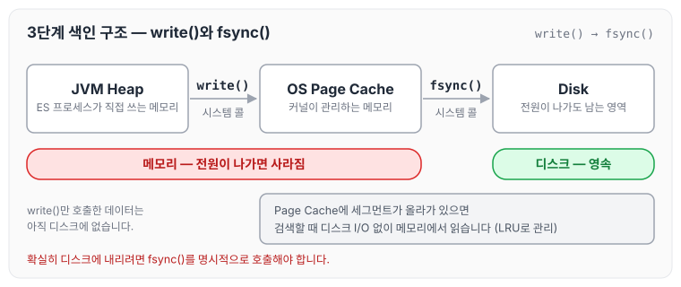
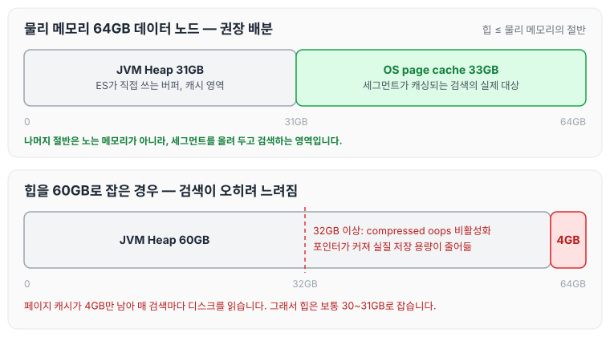
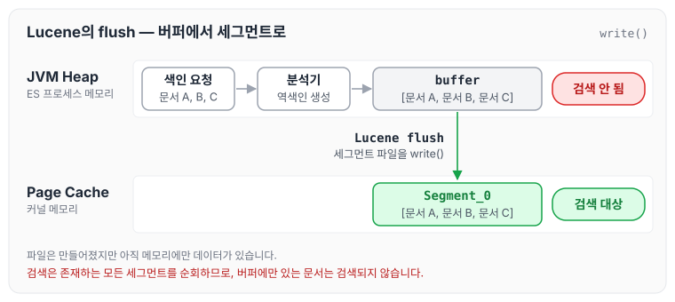
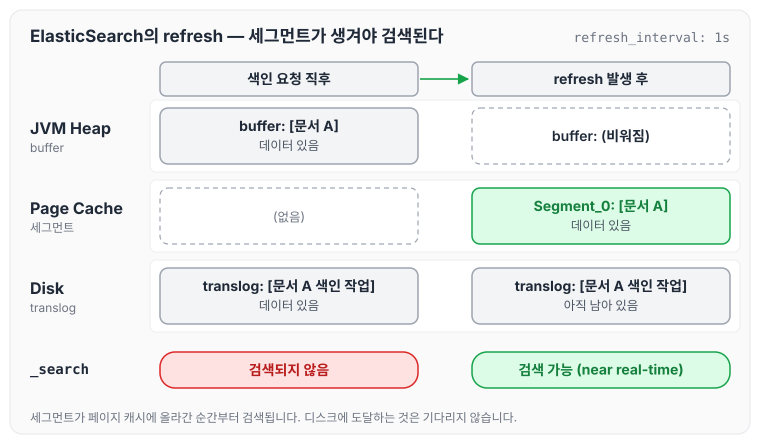
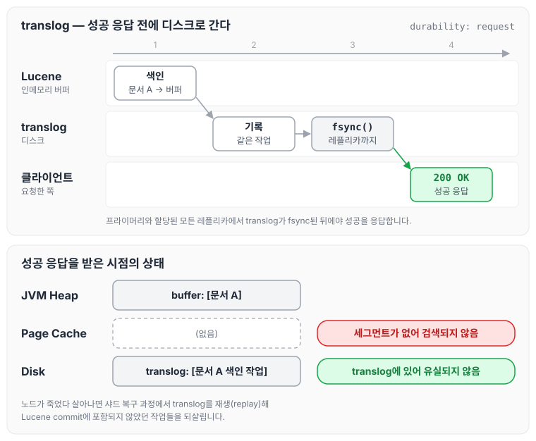
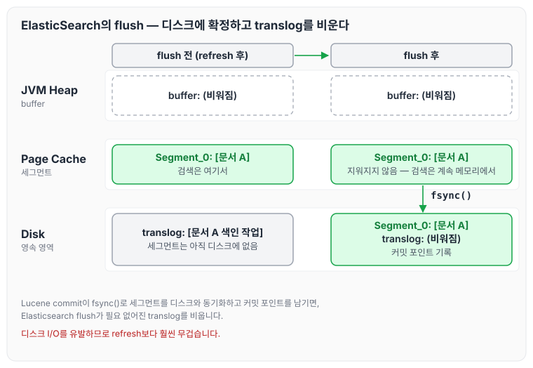
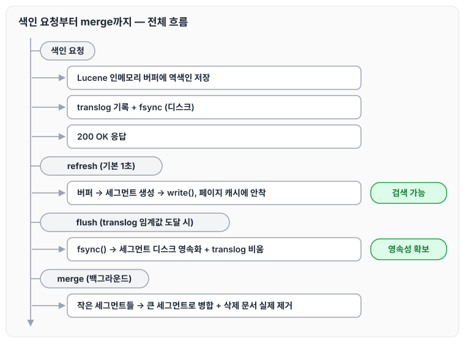

이전에 [한계점과 개선해야 할 점](../es-limitations/)에 대해 작성하였습니다. 그 글에서 ES는 쓰기 비용을 메모리 버퍼에 모았다가 1초에 한 번 세그먼트로 내리는 방식으로 상쇄하고, 그 대가로 near real-time이 된다고 정리하였습니다. 이번 글에서는 색인 요청이 들어온 뒤 데이터가 버퍼, 페이지 캐시, 디스크를 거쳐 저장되는 순서와 구조를 정리하도록 하겠습니다.

## 1. 3단계 색인 구조

색인 요청으로 들어온 데이터는 JVM Heap, OS Page Cache, Disk 세 단계를 거쳐 저장됩니다. 각 단계 사이는 `write()`와 `fsync()` 시스템 콜이 이어 줍니다.



`write()`를 호출해도 데이터는 바로 디스크에 기록되지 않습니다. 커널 메모리(페이지 캐시)에 복사될 뿐이고, 실제 디스크 기록은 OS가 나중에 처리합니다. 확실히 디스크에 내리려면 `fsync()`를 명시적으로 호출해야 합니다.

따라서 "파일로 저장됐다"는 것과 "디스크에 안전하게 저장됐다"는 것은 다른 의미입니다. 그 사이의 상태가 페이지 캐시이고, 뒤에서 정리할 Elasticsearch의 refresh와 flush도 이 지점을 기준으로 나뉩니다.

### 페이지 캐시와 검색 성능

페이지 캐시는 검색 성능에도 영향을 줍니다. Elasticsearch가 빠른 이유의 상당 부분이 여기에 있는데, 검색 대상인 세그먼트 파일이 페이지 캐시에 올라가 있으면 검색할 때 디스크 I/O가 발생하지 않고 메모리에서 읽습니다.

페이지 캐시는 커널이 LRU로 관리하므로, 자주 검색되는 인덱스의 세그먼트는 메모리에 남고 사용하지 않는 것부터 밀려납니다. 별도 설정 없이 동작합니다.

이 때문에 **JVM 힙을 물리 메모리의 절반 이하로 설정**하도록 권장합니다. 물리 메모리 64GB인 데이터 노드를 예로 들면 아래와 같습니다.



힙을 제외한 나머지 절반은 노는 메모리가 아니라, 세그먼트가 캐싱되는 검색 대상 영역입니다. 힙을 60GB로 잡으면 페이지 캐시가 4GB밖에 남지 않아 매 검색마다 디스크를 읽게 되고, 힙을 키운 것이 오히려 검색을 느리게 만듭니다.

> **31GB 선이 따로 있는 이유**
> JVM의 compressed oops는 객체 포인터를 32비트로 압축해 메모리를 절약하는데, 힙이 32GB 이상이면 비활성화됩니다. 그러면 포인터가 커져서 힙을 늘렸는데도 실질 저장 용량은 줄어드는 구간이 생깁니다. 그래서 힙은 32GB 미만으로, 여유를 두어 보통 30~31GB로 잡습니다.

---

## 2. Lucene의 flush

문서 색인 요청이 들어오면 Lucene은 아래 순서로 처리합니다.

1. 문서를 분석기에 통과시켜 역색인을 생성합니다.
2. 생성된 역색인을 인메모리 버퍼에 쌓습니다.
3. flush: 버퍼의 내용을 세그먼트(segment)라는 파일로 만들어 `write()`합니다.

분석기에 대해서는 [애널라이저: 토크나이저와 필터](../es-analyzer/)에서 따로 정리하였습니다. 문서 A, B, C를 색인했을 때의 흐름은 아래와 같습니다.



세그먼트 파일은 만들어졌지만, 데이터는 아직 메모리(페이지 캐시)에만 있습니다.

세그먼트는 Lucene이 검색을 수행하는 단위입니다. 검색 요청이 오면 Lucene은 현재 존재하는 모든 세그먼트를 순회하며 결과를 모읍니다. 따라서 세그먼트로 만들어지기 전, 버퍼에만 있는 문서는 **검색되지 않습니다.**

---

## 3. ElasticSearch의 refresh

Elasticsearch의 refresh는 Lucene flush를 트리거해서, 색인된 문서를 검색 가능한 상태로 만드는 작업입니다. 문서 A를 색인했을 때, 색인 요청 직후와 refresh 발생 후의 상태를 비교하면 아래와 같습니다.



- 색인 요청 직후에는 문서 A가 버퍼와 translog에만 있습니다. 페이지 캐시에 세그먼트(데이터)가 없기 때문에 검색되지 않습니다.
- refresh가 발생하면 버퍼가 비워지고, 세그먼트(`Segment_0`)가 만들어져 페이지 캐시에 올라갑니다. 이 순간부터 검색이 가능하며, 디스크에 도달하는 것은 기다리지 않습니다. translog는 그대로 남아 있습니다(4장에서 정리합니다).

이것이 Elasticsearch가 실시간(real-time)이 아니라 **near real-time**으로 동작하는 이유입니다.

### refresh 주기와 search idle

기본 refresh 주기는 1초이며 `index.refresh_interval`로 조정합니다.

다만 refresh는 세그먼트 파일 생성과 searcher 갱신을 동반하는 비용이 있는 작업이라, Elasticsearch는 이를 줄이는 최적화를 하나 두고 있습니다. 일정 시간(`index.search.idle.after`, 기본 30초) 동안 검색 요청이 없었던 샤드는 주기적인 refresh를 건너뜁니다. 아무도 조회하지 않는 인덱스에 1초마다 세그먼트를 만들 필요가 없기 때문입니다.

이 최적화에는 주의할 점이 두 가지 있습니다.

1. 이 최적화는 `refresh_interval`을 명시적으로 설정하지 않은 인덱스에만 적용됩니다. 값을 직접 지정하면 샤드는 search idle 상태로 들어가지 않고, 지정한 주기대로 계속 refresh합니다.
2. search idle 상태의 샤드에 검색이 들어오면, 그 검색은 다음 refresh가 완료될 때까지 대기합니다. 트래픽이 적은 인덱스의 첫 검색이 수백 ms~1초씩 걸리는 현상의 원인이 이것입니다. 안정적인 응답 시간이 필요하다면 `refresh_interval`을 명시하는 편이 낫습니다.

**색인 직후 바로 검색해야 할 때**

테스트 코드나 "저장하고 바로 목록 조회" 같은 흐름에서는 `refresh` 파라미터를 사용합니다.

```
POST /products/_doc?refresh=wait_for   ← 다음 refresh까지 기다렸다 응답 (권장)
POST /products/_doc?refresh=true       ← 즉시 refresh 강제 (남용하면 세그먼트 폭증)
```

`wait_for`는 추가 세그먼트를 만들지 않고 다음 주기를 기다리기만 하므로 부작용이 적습니다. 반면 `true`는 매번 세그먼트를 만들어 내므로 운영 코드에서는 피해야 합니다.

> **예외: ID로 조회하는 GET은 실시간입니다.** `GET /products/_doc/1`은 refresh와 관계없이 항상 최신 값을 돌려줍니다. 세그먼트에 없으면 translog에서 찾기 때문입니다. 검색(`_search`)만 near real-time이고, 단건 조회는 실시간입니다.

## 4. 검색되지 않는 구간의 데이터는 어떻게 유지하는가?

여기까지의 구조에는 문제가 하나 있습니다. 세그먼트는 페이지 캐시에만 있고, 페이지 캐시는 전원이 나가면 사라지는 휘발성 메모리입니다. 색인 성공 응답을 이미 보냈는데 노드가 죽으면 데이터가 사라집니다.

Elasticsearch는 이 문제를 translog(transaction log)로 해결합니다. RDBMS의 WAL(Write-Ahead Logging)과 같은 패턴이며, MySQL InnoDB의 redo log에 대응한다고 보면 됩니다.

동작 순서는 아래와 같습니다.

1. 문서를 Lucene 인메모리 버퍼에 색인
2. 같은 작업을 translog에 기록
3. translog를 fsync
4. 클라이언트에게 200 OK 응답

### translog는 매 요청마다 디스크로 갑니다

이 부분이 중요합니다. 기본 설정인 `index.translog.durability: request`는 translog가 **프라이머리와 할당된 모든 레플리카에서 fsync되어 커밋된 뒤에야** 클라이언트에게 성공을 응답한다는 의미입니다.

위 순서와 색인 성공 응답을 받은 시점의 상태를 그림으로 정리하면 아래와 같습니다.



- 페이지 캐시에 세그먼트가 적재되지 않았기 때문에 검색되지 않습니다.
- translog에 데이터가 적재되었기 때문에 유실되지 않습니다.

노드가 죽었다 살아나면 샤드 복구 과정에서 translog를 재생(replay)해서, Lucene commit에 포함되지 않았던 작업들을 되살립니다.

---

## 5. Lucene의 commit과 Elasticsearch의 flush

translog가 계속 쌓이기만 하면 두 가지 문제가 생깁니다.

- 디스크 공간을 계속 차지합니다
- 복구 시 재생할 양이 많아져 샤드 복구가 오래 걸립니다

그래서 주기적으로 세그먼트를 실제 디스크에 내리고, 그만큼의 translog를 버리는 작업이 필요합니다.

Lucene의 commit이 그 역할을 합니다. `fsync()` 시스템 콜로 페이지 캐시의 세그먼트를 디스크와 동기화하고, 커밋 포인트(commit point)를 기록해 여기까지는 안전하다고 표시합니다.

Elasticsearch의 flush는 이 Lucene commit을 트리거하고, 추가로 필요 없어진 translog를 비웁니다. flush 전후의 상태는 아래와 같습니다.



이때 페이지 캐시의 세그먼트는 **지워지지 않으며**, 검색은 계속 메모리에서 이루어집니다. fsync는 디스크에 사본을 확정하는 작업이지 메모리를 비우는 작업이 아닙니다.

flush는 디스크 I/O를 유발하므로 refresh보다 훨씬 무겁습니다. 자주 할 수는 없고, 그렇다고 미루면 translog가 커져 복구가 느려집니다. 이 균형을 잡는 것이 flush 임계값 설정입니다.

---

## 6. 용어 정리

`flush`라는 단어는 Lucene과 Elasticsearch에서 서로 다른 뜻으로 쓰입니다.

| 부르는 이름 | 하는 일 | 도착지 | 결과 |
| --- | --- | --- | --- |
| Lucene flush | 버퍼 → 세그먼트 생성 → `write()` | 페이지 캐시 (메모리) | 검색 가능해짐 |
| Elasticsearch refresh | Lucene flush를 트리거 | 페이지 캐시 (메모리) | 검색 가능해짐 |
| Lucene commit | `fsync()` 호출 + 커밋 포인트 기록 | 디스크 | 영속성 확보 |
| Elasticsearch flush | Lucene commit 트리거 + translog 비움 | 디스크 | 영속성 확보 |

```
Elasticsearch refresh  =  Lucene flush     (메모리까지, 검색 가능)
Elasticsearch flush    =  Lucene commit    (디스크까지, 영속)
```

Lucene의 flush와 Elasticsearch의 flush는 이름만 같을 뿐 도착지가 다른 작업입니다. 이 대응 관계를 정리해 두면 나머지 용어도 크게 헷갈리지 않습니다.

---

## 전체 흐름

색인 요청부터 refresh, flush, 그리고 백그라운드에서 진행되는 merge까지 전체 흐름을 정리하면 아래와 같습니다.



merge는 작은 세그먼트들을 큰 세그먼트로 병합하면서, 삭제된 문서를 실제로 제거하는 작업입니다.

오늘은 색인 요청이 버퍼, 페이지 캐시, 디스크를 거쳐 저장되는 순서와 refresh, translog, flush의 역할에 대해 정리하였습니다. 정리를 통해 Elasticsearch가 검색을 최적화하기 위해 미리 선행 작업을 진행한다는 것, 이 선행 작업 때문에 실시간으로 반영되지 않는다는 것, 그리고 그만큼 비용이 든다는 것을 알 수 있었습니다.

> 이 글은 인프런 박재성 님의 [실전에서 바로 써먹는 Elasticsearch 입문 (검색 최적화편)](https://www.inflearn.com/course/실전-elasticsearch-입문)을 들으며 정리한 노트입니다.
