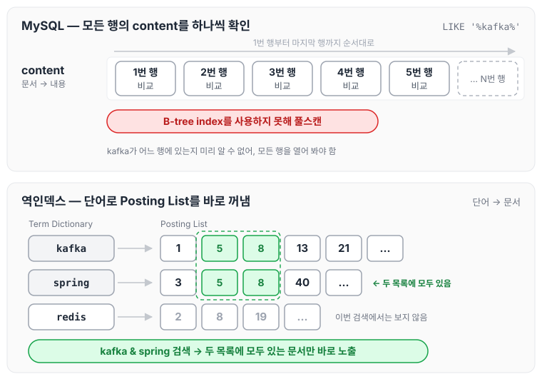
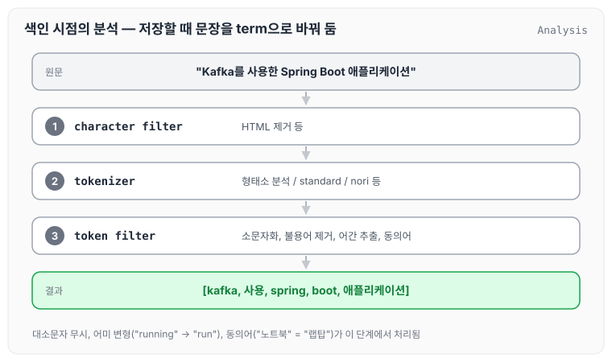
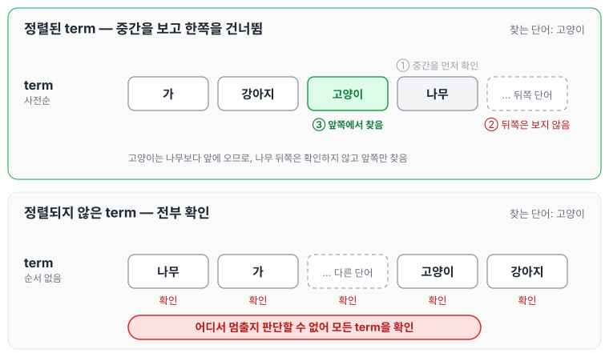
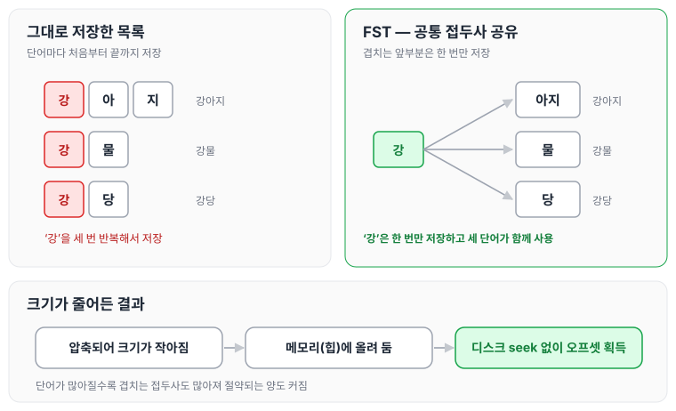

대량 거래 데이터에서 여러 조건을 조합해 이상 건을 찾아내는 작업을 진행하는데, 데이터 조건이 너무 많고 다양한 사유로 RDBMS의 Index로는 한계가 존재하였습니다. 때문에 이를 해결하기 위해 ElasticSearch를 적용하게 되었습니다.

이번 글에서는 ElasticSearch를 적용하면 검색이 빠른 이유와, 역색인으로 얻을 수 있는 장점에 대해 정리하겠습니다.

## ElasticSearch가 빠른 이유

ElasticSearch를 적용하면 빠른 이유는 아래와 같습니다.

### 1. 역인덱스

RDB는 문서 → 내용 방향으로 데이터를 찾지만, 역인덱스는 단어 → 그 단어를 가진 문서 방향으로 조회합니다. 단어(Term Dictionary)마다 그 단어를 가진 문서 번호 목록(Posting List)이 연결되어 있으며, 아래와 같습니다.

```text
Term Dictionary        Posting List
"kafka"        →  [1, 5, 8, 13, 21, ...]
"spring"       →  [3, 5, 8, 40, ...]
"redis"        →  [2, 8, 19, ...]
```

kafka & spring을 검색하면 두 단어의 Posting List에 모두 들어 있는 5번 같은 문서를 바로 노출해 주기 때문에 매우 빠르고, 속도 또한 O(1)에 가깝습니다.

만약 MySQL 기준으로 조회를 한다면 `WHERE content LIKE '%kafka%'`와 같은 형태가 될 것입니다. 이 경우 B-tree index를 사용하지 못하여 풀스캔이 발생하게 됩니다.

같은 단어를 MySQL과 역인덱스로 찾는 과정을 나란히 놓으면 다음과 같습니다.



MySQL은 kafka가 어느 행에 있는지 미리 알 수 없어 모든 행의 content를 확인해야 합니다. 역인덱스는 kafka와 spring의 Posting List를 바로 꺼내, 두 목록에 함께 들어 있는 문서만 고르면 됩니다.

### 2. 색인 시점의 분석(Analysis)

분석은 검색할 때가 아니라 데이터를 저장할 때 "미리 해두는 것"입니다. 문장 하나는 아래 순서를 거쳐 단어 목록으로 바뀝니다.

```text
"Kafka를 사용한 Spring Boot 애플리케이션"
  → character filter (HTML 제거 등)
  → tokenizer (형태소 분석 / standard / nori 등)
  → token filter (소문자화, 불용어 제거, 어간 추출, 동의어)
  → [kafka, 사용, spring, boot, 애플리케이션]
```

위와 같은 문장을 저장할 때 해당하는 Analysis를 사용하여 미리 변환한 뒤 저장해 놓습니다. 단계별로 펼쳐 보면 아래와 같습니다.



대소문자 무시, 어미 변형("running" → "run"), 동의어("노트북" = "랩탑") 처리를 검색 시점이 아닌 **색인 시점에 모두 완료합니다.**

## 역색인으로 인한 장점

1. Term dictionary 탐색이 O(log n) 이하
    - term들이 사전순으로 정렬되어 있고, Lucene은 여기에 FST(Finite State Transducer)를 사용합니다.

> 💡 term들이 사전순으로 정렬되어 있다는 것의 의미
>
> term들이 사전순 정렬 → FST로 접두사 공유 → **메모리에 올릴 수 있음** → 디스크 seek 없이 오프셋 획득으로 이어집니다. 사전순 정렬은 역인덱스에 저장된 단어들이 `가` → `강아지` → `고양이` → `나무` 순으로 줄 세워져 있다는 뜻입니다.
>
> 이렇게 정렬해 두는 이유는 정렬되어 있어야 보지 않고 건너뛰는 탐색이 가능하기 때문입니다. "고양이"를 찾을 때 처음부터 하나씩 확인하지 않고, 중간을 먼저 확인해 "나"로 시작하는 단어가 나오면 뒤쪽은 확인하지 않고 앞쪽만 찾습니다(사전을 중간부터 펴서 찾는 것과 같습니다). 정렬되어 있지 않으면 이런 판단을 할 수 없어 모든 단어를 확인해야 합니다.

정렬된 경우와 정렬되지 않은 경우를 비교하면 다음과 같습니다.



정렬된 쪽은 나무 하나를 확인한 것만으로 뒤쪽 단어를 모두 건너뛸 수 있지만, 정렬되지 않은 쪽은 어디서 멈출지 알 수 없어 끝까지 확인해야 합니다.

추가로 디스크 seek 없이 오프셋을 획득한다는 것은 아래 두 번째 의미인, 메모리 힙에 올려 둘 수 있다는 것과 이어집니다. FST가 무엇이고 왜 메모리에 올릴 수 있는지는 아래와 같습니다.

1. FST는 공통 접두사를 공유하는 상태 기계입니다.
    - 사전으로 치면 본문(= 실제 단어 목록과 뜻)은 두껍고 무겁기 때문에, 맨 뒤에 붙은 얇은 색인 페이지를 따로 만드는 것과 같습니다.

        ```text
        ㄱ ..... 3쪽
        ㄴ ..... 88쪽
        ㄷ ..... 140쪽
        ```

        FST가 바로 이 색인 페이지 역할을 합니다. 다만 단순한 목록이 아니라 압축되어 있습니다.

        `강아지`, `강물`, `강당` 세 단어를 저장할 때 `강`을 세 번 쓰지 않고, 한 번만 저장한 뒤 세 단어가 함께 사용합니다. 단어가 많아질수록 겹치는 부분도 많아지므로 절약되는 양도 그만큼 커집니다.

2. 메모리 사용량이 작아서 힙에 올려 둘 수 있습니다.
    - 압축 덕분에 색인 페이지가 아주 얇아졌으므로 메모리에 올릴 수 있습니다.

세 단어를 그대로 저장할 때와 FST로 저장할 때를 비교하면 다음과 같습니다.



그림에서 `강`은 한 번만 저장되고 뒤에 오는 `아지`, `물`, `당`만 갈라집니다. 이렇게 크기가 줄어든 덕분에 힙에 올려 둘 수 있고, 디스크 seek 없이 오프셋을 얻을 수 있습니다.

오늘은 ElasticSearch를 도입하게 된 이유와, 역인덱스와 색인 시점의 분석 덕분에 검색이 빠른 이유에 대해 정리하였습니다. 다음 글인 [RDBMS와 ElasticSearch 용어 대응시키기](../es-terms-commands/)에서는 두 시스템의 용어 차이와 기본 명령어를 정리하였고, 역인덱스의 동작 원리는 [단어 검색은 어떻게 동작할까 — 역인덱스](../es-inverted-index/)에서 좀 더 자세히 다룹니다.
