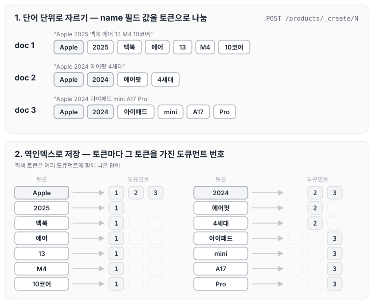
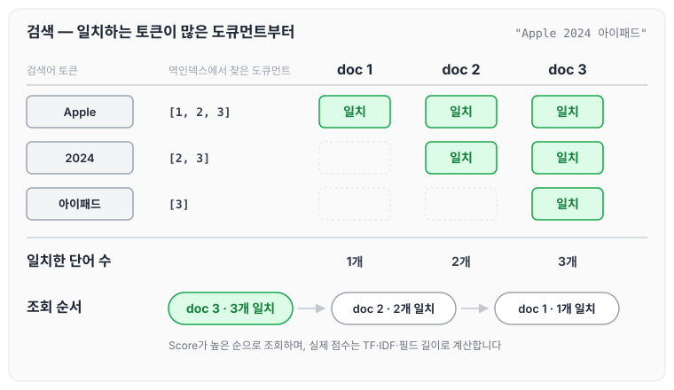
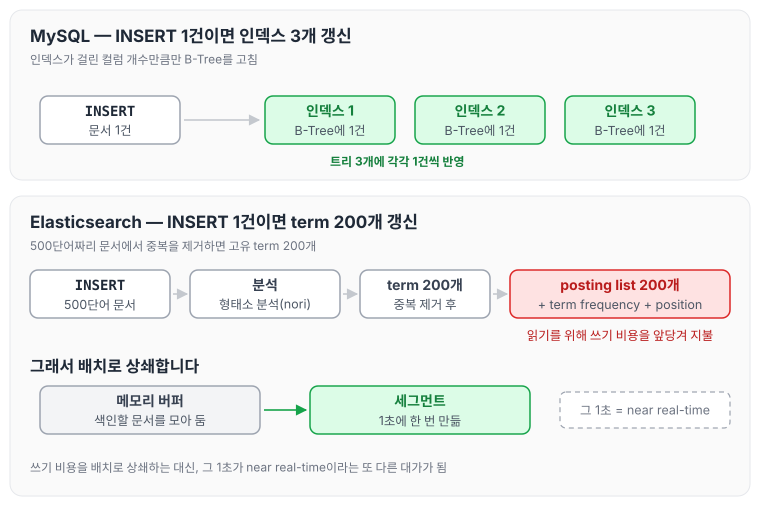
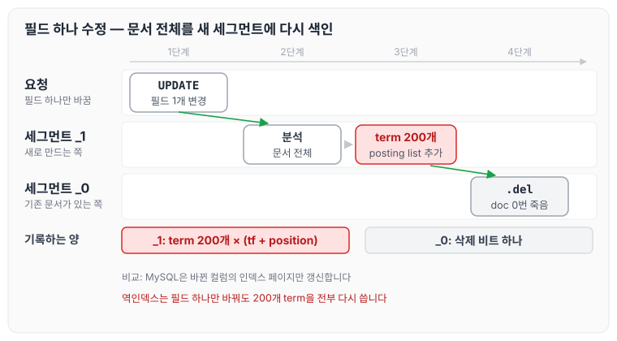

이전에 [RDBMS와 ElasticSearch 용어 대응시키기](../es-terms-commands/)에서 기본 명령어로 도큐먼트를 생성하고 조회하는 방법을 작성하였습니다. 오늘은 ElasticSearch의 단어 검색이 어떻게 동작하는지 역인덱스를 중심으로 정리하고, MySQL 인덱스와 비교했을 때의 트레이드오프까지 정리하도록 하겠습니다.

저희는 어떠한 물건을 검색할 때 단어의 순서를 정확하게 기억하고 검색하지는 않습니다. 예를 들어 맥북을 검색할 때도 `맥북 14 에어`, `맥북 에어 14`, `맥북 에어 14 M4`처럼 다양한 형태로 검색을 진행합니다.

이를 MySQL에서 `SELECT * FROM products WHERE name = "%맥북 14 에어%";`와 같이 검색한다면, 정확히 일치하는 단어가 없을 때 검색에 실패하게 됩니다.

반면 Elasticsearch는 역인덱스를 활용해 원하는 데이터를 추출합니다.

## 역인덱스

역인덱스는 필드 값을 단어마다 쪼개 찾기 쉽게 미리 정리해 놓은 목록입니다.

```json
POST /products/_create/1
{
  "name": "Apple 2025 맥북 에어 13 M4 10코어"
}

POST /products/_create/2
{
  "name": "Apple 2024 에어팟 4세대"
}

POST /products/_create/3
{
  "name": "Apple 2024 아이패드 mini A17 Pro"
}
```

위와 같은 3개의 도큐먼트를 Elasticsearch에 저장한다고 가정하면, 내부적으로는 아래 순서로 데이터를 저장합니다.

1. **단어 단위로 자르기**

```text
"name": "Apple 2025 맥북 에어 13 M4 10코어"
→ [Apple, 2025, 맥북, 에어, 13, M4, 10코어]

"name": "Apple 2024 에어팟 4세대"
→ [Apple, 2024, 에어팟, 4세대]

"name": "Apple 2024 아이패드 mini A17 Pro"
→ [Apple, 2024, 아이패드, mini, A17, Pro]
```

2. **역인덱스로 저장**

products의 name 필드에 대한 역인덱스는 아래와 같습니다.

| 토큰 | 도큐먼트 |
| --- | --- |
| Apple | [1, 2, 3] |
| 2025 | [1] |
| 맥북 | [1] |
| 에어 | [1] |
| 13 | [1] |
| M4 | [1] |
| 10코어 | [1] |
| 2024 | [2, 3] |
| 에어팟 | [2] |
| 4세대 | [2] |
| 아이패드 | [3] |
| mini | [3] |
| A17 | [3] |
| Pro | [3] |

두 단계를 그림으로 나타내면 아래와 같습니다. 위쪽은 도큐먼트마다 name 값을 토큰으로 자른 결과이고, 아래쪽은 그 토큰을 기준으로 도큐먼트 번호를 모은 역인덱스입니다.



`Apple`과 `2024`처럼 여러 도큐먼트에 함께 나온 단어는 하나의 토큰 아래에 도큐먼트 번호가 모입니다. 검색할 때는 문서를 하나씩 읽지 않고 이 목록에서 토큰을 찾기만 하면 됩니다.

`Apple 2024 아이패드`라고 검색하면 역인덱스를 활용해 일치하는 단어가 많은 도큐먼트를 우선적으로 조회합니다. 즉, Score가 높은 순으로 조회합니다.

- id가 1인 도큐먼트 : 단어 1개 일치
- id가 2인 도큐먼트 : 단어 2개 일치
- id가 3인 도큐먼트 : 단어 3개 일치

검색어의 토큰마다 역인덱스에서 도큐먼트를 찾아 모으는 과정은 아래와 같습니다.



세 단어가 모두 일치한 3번 도큐먼트가 가장 먼저 조회되고, 2번과 1번 도큐먼트가 그 뒤를 잇습니다.

score 계산 로직은 아래와 같으며, 추후에 상세하게 알아두면 좋을 것 같습니다.

1. **Term Frequency (TF)**

    문서 내에서 검색어가 얼마나 자주 등장하는지를 봅니다. 많이 등장할수록 점수가 높아집니다.

2. **Inverse Document Frequency (IDF)**

    검색어가 전체 문서 중 얼마나 희귀한지를 봅니다. 희귀할수록 점수가 높아지고, 흔한 단어일수록 점수가 낮아집니다.

3. **Field Length Normalization**

    문서(필드)가 짧을수록 점수가 높아집니다. 검색어가 짧은 문서에서 등장하면 더 관련성이 높다고 판단하기 때문입니다.

이러한 동작 구조는 데이터 타입이 `Text`일 경우에만 적용됩니다.

## 역인덱스 조회와 MySQL 인덱스 조회의 Trade-off 관계

역인덱스는 검색을 빠르게 해 주는 대신 MySQL의 B-Tree 인덱스와 비교했을 때 아래와 같은 비용을 감수합니다.

### 1. 쓰기 증폭

B-Tree는 문서 하나를 INSERT할 때 인덱스가 걸린 컬럼 개수만큼만 갱신합니다. 인덱스가 3개라면 트리 3개에 각각 1건씩 반영됩니다.

반면 역인덱스는 문서 하나에 **토큰 개수만큼** posting list를 갱신합니다. 500단어짜리 문서에서 중복을 제거한 뒤 200개의 고유 term이 나오면, 200개의 posting list에 doc id를 추가해야 합니다.

```text
MySQL:  INSERT 1건 → 인덱스 3개 갱신
ES:     INSERT 1건 → term 200개 × (posting list + term frequency + position) 갱신
```

여기에 색인 시점의 분석 비용(형태소 분석, 특히 nori 같은 분석기는 무겁습니다)까지 더해집니다. 읽기를 빠르게 하기 위해 쓰기 비용을 앞당겨 지불하는 구조입니다.

그래서 ES는 이 비용을 배치로 상쇄합니다. 메모리 버퍼에 모았다가 1초에 한 번 세그먼트로 만듭니다. 대신 그 1초가 near real-time이라는 또 다른 대가가 됩니다.

INSERT 1건이 각각 어떤 갱신으로 이어지는지 비교하면 아래와 같습니다.



MySQL은 인덱스 개수만큼만 갱신하지만, ES는 분석을 거쳐 나온 term 수만큼 갱신하기 때문에 같은 INSERT 1건이라도 쓰는 양이 훨씬 많습니다.

### 2. UPDATE/DELETE 비용

역인덱스에서는 **필드 하나만 바꿔도 문서 전체가 다시 색인됩니다.** 200개의 term을 전부 다시 쓰게 되며, MySQL이 해당 컬럼의 인덱스 페이지만 갱신하는 것과 대비됩니다.

여기서 term은 문서를 분석기에 통과시켜 분리된 단어를 말합니다. 예를 들면 아래와 같습니다.

```text
{
  "name": "카카오프렌즈 라이언 쿠션",
  "description": "부드러운 극세사 소재로 제작된 대형 쿠션입니다. 거실 소파나 ... (200자)",
  "stock": 100
}
이 문서 1건을 분석기에 통과시키면:

[부드럽다, 극세사, 소재, 제작, 대형, 쿠션, 거실, 소파, 침대, 사용, 커버, 분리, 세탁, 가능, ...]
으로 분리되서 저장하는 것을 말합니다.

```

재색인할 때 실제로 일어나는 일은 아래와 같습니다.

```text
새 세그먼트 _1 을 만들면서
  ├─ "부드럽다" → posting list에 [새 doc id] 추가
  ├─ "극세사"   → posting list에 [새 doc id] 추가
  ├─ "소재"     → posting list에 [새 doc id] 추가
  ├─ ... (이 문서의 term 200개)
  └─ 각 term마다 term frequency, position 정보도 함께 기록

기존 세그먼트 _0 은
  └─ .del 파일에 "doc 0번 죽음" 비트만 세움  ← 여기가 전부
```

이 과정을 단계별로 나누면 아래와 같습니다.



기존 세그먼트 _0에서는 문서를 지우지 않고 삭제 비트만 세우며, 실제 쓰기는 새 세그먼트 _1에서 term 200개만큼 일어납니다.

### 3. 스키마 변경이 어려움

B-Tree 인덱스는 `ALTER TABLE ... ADD INDEX`로 나중에 자유롭게 추가·삭제할 수 있습니다. 반면 역인덱스는 **분석기가 색인 시점에 이미 적용되어 굳어 버립니다.**

동의어 사전을 고치거나, tokenizer를 standard에서 nori로 바꾸거나, 필드 타입을 `text`에서 `keyword`로 바꾸는 순간 전체 reindex가 필요합니다. 수억 건이라면 몇 시간이 걸리는 작업이고, 무중단으로 진행하려면 alias 스위칭 전략이 필요합니다.

오늘은 역인덱스가 단어 단위 검색을 처리하는 방식과, MySQL 인덱스와 비교했을 때 역인덱스가 감수하는 비용에 대해 정리하였습니다. MySQL 관계형 데이터베이스에서의 한계점을 역인덱스를 통해 해결한 것을 알 수 있었고, 각각의 장단점을 잘 알고 적용해야 될 것 같습니다. 이 내용을 바탕으로 프로젝트에 적용할 때 발생할 문제점은 [한계점과 개선해야 할 점](../es-limitations/)에 정리하였습니다.

> 이 글은 인프런 박재성 님의 [실전에서 바로 써먹는 Elasticsearch 입문 (검색 최적화편)](https://www.inflearn.com/course/실전-elasticsearch-입문)을 들으며 정리한 노트입니다.
