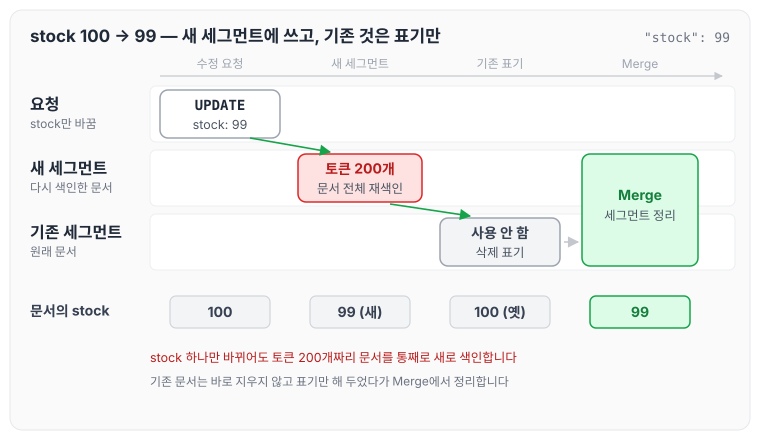
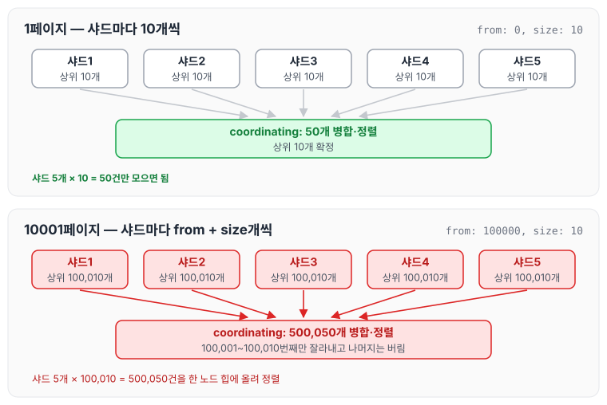
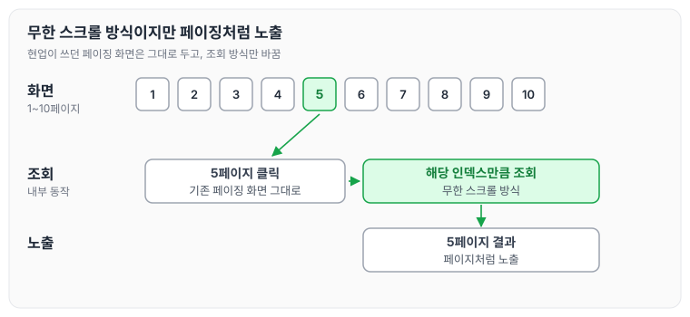

이전에 [단어 검색은 어떻게 동작할까 — 역인덱스](../es-inverted-index/)에서 역인덱스가 쓰기와 갱신에서 감수하는 비용에 대해 작성하였습니다. 오늘은 현재까지 공부한 내용을 토대로 프로젝트에 적용할 때 발생할 문제점에 대해 정리하겠습니다.

저희 프로젝트는 웹페이지에서 조회한 뒤 검수 처리를 진행하고, 검수 처리 유무에 따라 [검수, 의심, 정상]으로 나누어 조회합니다. 또한 해당 조회 페이지는 현재 페이징 처리를 제공하고 있어, 운영 조직에서는 ES 적용으로 기능이 바뀌는 것을 원하지 않을 것으로 예상됩니다.

이를 고려했을 때 ES를 적용하면 발생할 문제점은 다음과 같습니다.

## 쓰기 증폭

B-Tree는 문서 하나를 INSERT할 때 인덱스가 걸린 컬럼 개수만큼만 갱신합니다. 인덱스가 3개라면 트리 3개에 각각 1건씩 반영됩니다.

반면 역인덱스는 문서 하나에 **토큰 개수만큼** posting list를 갱신합니다. 500단어짜리 문서에서 중복을 제거한 뒤 200개의 고유 term이 나오면, 200개의 posting list에 doc id를 추가해야 합니다.

```text
MySQL:  INSERT 1건 → 인덱스 3개 갱신
ES:     INSERT 1건 → term 200개 × (posting list + term frequency + position) 갱신
```

여기에 색인 시점의 분석 비용(형태소 분석, 특히 nori 같은 분석기는 무겁습니다)까지 더해집니다. 읽기를 빠르게 하기 위해 쓰기 비용을 앞당겨 지불하는 구조입니다.

그래서 ES는 이 비용을 배치로 상쇄합니다. 메모리 버퍼에 모았다가 1초에 한 번 세그먼트로 만듭니다. 대신 그 1초가 near real-time이라는 또 다른 대가가 됩니다.

예를 들면 아래와 같은 문서가 있습니다.

```json
{
  "name": "카카오프렌즈 라이언 쿠션",
  "description": "부드러운 극세사 소재로 제작된 대형 쿠션입니다. 거실 소파나 ... (200자)",
  "stock": 100
}
```

이 **문서 1건**을 분석기에 통과시키면 다음과 같습니다.

```text
[부드럽다, 극세사, 소재, 제작, 대형, 쿠션, 거실, 소파, 침대, 사용, 커버, 분리, 세탁, 가능, ...]
```

이렇게 나온 토큰이 200개인 문서에서 stock을 99로 수정한다면, 재색인 시 실제로는 새 세그먼트를 만들어 문서를 다시 색인하고 기존 세그먼트의 문서는 사용하지 않는다고 표기해 둡니다. 이후 Merge를 통해 문서를 정리합니다.

stock 하나를 수정했을 때의 흐름을 그림으로 나타내면 아래와 같습니다.



바뀐 값은 stock 하나뿐이지만 새 세그먼트에는 토큰 200개짜리 문서 전체가 다시 쓰이고, 기존 문서는 Merge 전까지 표기만 된 채 남아 있습니다.

관련 상세 내용은 [색인이 만들어지는 순서와 구조](../es-indexing-structure/) 편에서 다루었습니다.

## Paging 문제

검색 조건이 `from: 100,000, size: 10`이라면 다음과 같은 문제가 발생합니다.

단일 서버라면 정렬된 인덱스를 앞에서부터 읽어 10만 번째부터 10개를 가져오면 됩니다. 하지만 ES에서 데이터가 샤드 5개에 흩어져 있다면, coordinating 노드는 어느 샤드에 상위 결과가 몰려 있는지 알 수 없습니다. 그래서 각 샤드에서 100,000건의 데이터를 가져와야 하고, 가져오는 데이터의 양이 크게 늘어납니다.

`from: 0, size: 10` (1페이지)인 경우는 아래와 같습니다.

```text
샤드1 → 로컬 상위 10개
샤드2 → 로컬 상위 10개
샤드3 → 로컬 상위 10개
샤드4 → 로컬 상위 10개
샤드5 → 로컬 상위 10개
       ↓
coordinating: 50개 병합·정렬 → 상위 10개 확정
```

`from: 100000, size: 10` (10001페이지)인 경우는 아래와 같습니다.

```text
샤드1 → 로컬 상위 100,010개   ← from + size
샤드2 → 로컬 상위 100,010개
샤드3 → 로컬 상위 100,010개
샤드4 → 로컬 상위 100,010개
샤드5 → 로컬 상위 100,010개
       ↓
coordinating: 500,050개 병합·정렬 → 100,001~100,010번째 잘라내기
```

두 경우를 나란히 그리면 아래와 같습니다.



샤드마다 가져오는 개수가 from + size이기 때문에, 화면에 보여 주는 결과는 똑같이 10개여도 coordinating 노드가 모아서 정렬하는 양은 50건에서 500,050건으로 늘어납니다.

이로 인해 발생할 문제점은 다음과 같습니다.

- **메모리**: coordinating 노드 힙에 50만 건의 `(doc id, sort value)`가 한꺼번에 올라갑니다. 동시 요청 몇 개만 겹쳐도 GC가 폭주하고 OOM으로 이어집니다. 한 노드가 죽으면 클러스터 전체가 흔들립니다.
- **CPU**: 샤드마다 10만 건 우선순위 큐 정렬을 하고, 여기에 더해 중앙에서 50만 건을 다시 정렬해야 합니다.
- **네트워크**: 50만 건의 정렬 키가 노드 간에 오갑니다.
- **페이지 번호에 비례하는 비용**: 1페이지는 50건이지만 10001페이지는 50만 건입니다. 뒤로 갈수록 계속 무거워집니다.

이 때문에 ES는 기본값으로 `index.max_result_window`를 10,000으로 두어 이보다 깊은 조회를 아예 막아 둡니다.

따라서 무한 스크롤 방식이 적절하지만, 현업에서는 기존에 페이징 방식을 사용하고 있기 때문에 ES로 변경한다고 하여 해당 기능이 강제로 바뀌는 것을 원하지 않습니다.

이를 해결하기 위해 무한 스크롤 방식이지만 페이징처럼 노출하는 방식을 택하게 되었습니다.

- 1~10페이지가 있다면 5페이지를 클릭했을 때 해당하는 인덱스만큼 조회해서 노출하는 방식입니다.

화면과 내부 조회를 나누어 보면 아래와 같습니다.



현업이 사용하던 페이징 화면은 그대로 두고, 내부에서 조회하는 방식만 무한 스크롤 방식으로 바꾸는 것입니다.

오늘은 ElasticSearch를 프로젝트에 적용할 때 발생할 수 있는 쓰기 증폭과 Paging 문제에 대해 정리하였습니다. 정리를 통해 ElasticSearch를 사용할 때 고려해야 할 점과 주의해야 할 점, 그리고 현재 프로젝트에 적용할 때 신경 써야 할 부분을 알 수 있었습니다.
