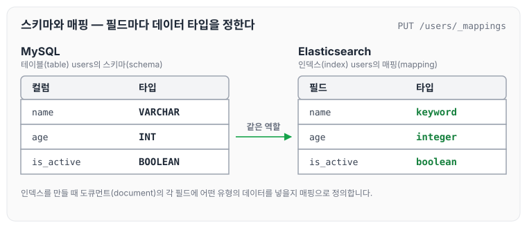
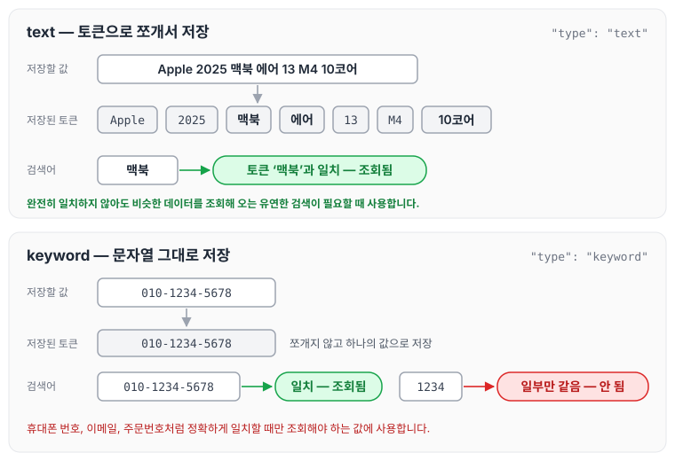
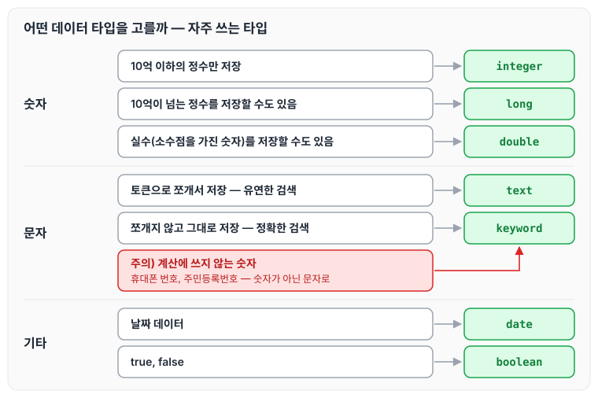

이전에 [애널라이저: 토크나이저와 필터](../es-analyzer/)에 대해 작성하였습니다. 애널라이저는 문자열을 토큰으로 쪼개는 장치인데, 필드 값을 토큰으로 쪼갤지 그대로 둘지는 매핑에서 정하는 데이터 타입에 따라 달라집니다. 오늘은 매핑과 자주 사용하는 데이터 타입에 대해 정리하도록 하겠습니다.

## 매핑(mapping)

**매핑**(mapping)은 도큐먼트(document)의 각 필드가 어떤 데이터 타입을 가지고 있는지 정의하는 설정입니다.

MySQL에서 테이블을 만들 때 어떤 유형의 데이터를 넣을지 스키마(schema)를 정의하는 것처럼, Elasticsearch에서는 인덱스를 만들 때 어떤 유형의 데이터를 넣을지 매핑(mapping)을 정의할 수 있습니다. [RDBMS와 ElasticSearch 용어 대응시키기](../es-terms-commands/)에서 매핑을 정의한 `users` 인덱스를 MySQL 테이블과 나란히 놓으면 아래와 같습니다.

## 데이터 타입(data type)

Elasticsearch의 데이터 타입은 종류가 아주 많습니다. 이 글에서는 그중 자주 사용하는 데이터 타입만 정리하겠습니다.

**[숫자]**

- 10억 이하의 정수만 저장하면 되는 경우: `integer`
- 10억이 넘어가는 정수를 저장해야 될 수도 있는 경우: `long`
- 실수(소수점을 가진 숫자 포함)를 저장해야 될 수도 있는 경우: `double`

**[문자]**

- 문자열을 토큰으로 쪼개서 저장하고 싶은 경우: `text`
    - 유연한 검색이 필요할 때 사용합니다(완전히 일치하지 않아도 비슷한 데이터를 조회해 오는 방식).
- 문자열을 토큰으로 쪼개지 않고, 문자열 그대로 저장하고 싶은 경우: `keyword`
    - 정확한 검색이 필요할 때 사용합니다(정확하게 일치할 때만 데이터를 조회해 오는 방식).
    - ex) 휴대폰 번호(`010-1234-5678`), 이메일(`jscode@gmail.com`), 주문번호(`156293920`)
    - **주의)** 계산에 쓰는 값이 아니라면 숫자가 아닌 문자로 저장해야 합니다. 예를 들어 휴대폰 번호나 주민등록번호는 숫자를 더하거나 빼지 않습니다. 따라서 휴대폰 번호나 주민등록번호는 숫자가 아닌 문자로 저장해야 합니다.

text와 keyword가 실제로 어떻게 저장되고 검색되는지 비교하면 아래와 같습니다. text 예시 문자열은 [애널라이저](../es-analyzer/) 글에서 사용한 상품명입니다.

text로 저장한 상품명은 토큰 중 하나인 `맥북`으로도 조회되지만, keyword로 저장한 휴대폰 번호는 값 전체가 정확하게 일치할 때만 조회됩니다.

**[기타]**

- 날짜 데이터를 저장해야 하는 경우: `date`
- true, false를 저장해야 하는 경우: `boolean`

위에서 정리한 데이터 타입을 어떤 값에 사용하는지 모아 보면 아래와 같습니다.

오늘은 매핑의 개념과 자주 사용하는 데이터 타입, 그리고 문자열을 text와 keyword로 구분해서 저장해야 하는 이유에 대해 정리하였습니다.

> 이 글은 인프런 박재성 님의 [실전에서 바로 써먹는 Elasticsearch 입문 (검색 최적화편)](https://www.inflearn.com/course/실전-elasticsearch-입문)을 들으며 정리한 노트입니다.
