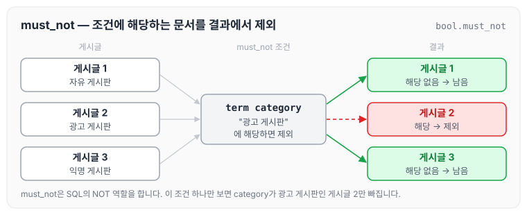
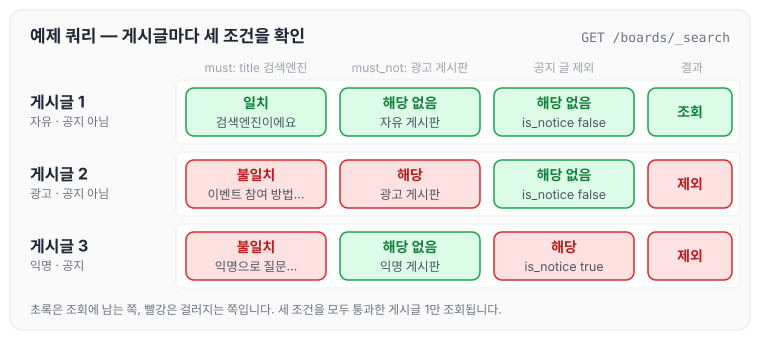
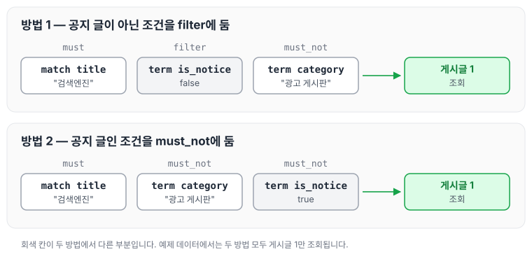

이전에 [여러 조건을 함께 만족시키기 — bool 쿼리](../es-bool-query/)에서 bool 쿼리의 4가지 기능과 must, filter의 차이에 대해 작성하였습니다. 이번에는 그중 SQL문의 `NOT` 역할을 하는 must_not으로 특정 조건을 제외하고 조회하는 방법을 정리하도록 하겠습니다.

## must_not

must_not은 bool 쿼리 안에서 조건에 해당하는 도큐먼트를 결과에서 제외할 때 사용합니다. 예제로 boards 인덱스를 다시 만들고, 카테고리와 공지 여부가 서로 다른 게시글 3건을 넣었습니다.

```json
// 기존 인덱스 삭제
DELETE /boards

// 인덱스 생성
PUT /boards
{
  "mappings": {
    "properties": {
      "board_id": {
        "type": "long"
      },
      "title": {
        "type": "text", // 유연한 검색이 필요하므로 text 타입으로 선언
        "analyzer": "nori" // 한글 데이터를 토큰으로 정확하게 나누기 위해
      },
      "category": {
        "type": "keyword" // 유연한 검색이 필요없으므로 keyword 타입으로 선언
      },
      "is_notice": { // (공지글 여부)
        "type": "boolean"
      },
      "created_at": {
        "type": "date"
      }
    }
  }
}

// 데이터 삽입
POST /boards/_doc
{
  "board_id": 1,
  "title": "엘라스틱서치는 정말 강력한 검색엔진이에요",
  "category": "자유 게시판",
  "is_notice": false,
  "created_at": "2025-05-01T12:00:00"
}

POST /boards/_doc
{
  "board_id": 2,
  "title": "이벤트 참여 방법 안내드립니다",
  "category": "광고 게시판",
  "is_notice": false,
  "created_at": "2025-05-02T10:30:00"
}

POST /boards/_doc
{
  "board_id": 3,
  "title": "익명으로 질문하고 답변 받을 수 있어요",
  "category": "익명 게시판",
  "is_notice": true,
  "created_at": "2025-05-03T08:20:00"
}
```

이 3건에 must_not 조건 하나(category가 `광고 게시판`)만 적용한다고 하면 아래와 같이 동작합니다.



조건에 해당하는 게시글 2만 결과에서 빠지고, 해당하지 않는 게시글 1과 3은 남습니다.

## 검색 쿼리 사용해 보기

`광고 게시판`의 글이 아니면서, `공지 글`이 아니면서, `검색엔진`이라는 키워드와 관련된 게시글을 조회해 보겠습니다. 같은 결과를 내는 쿼리를 2가지 방법으로 작성하였습니다.

```json
// 방법 1
GET /boards/_search
{
  "query": {
    "bool": {
      "must": [
        { "match": { "title": "검색엔진" } } // 유연한 검색이 필요 (must)
      ],
      "filter": [
        { "term": { "is_notice": false } } // 정확한 검색이 필요 (filter)
      ],
      "must_not": [
        { "term": { "category": "광고 게시판" } }
      ]
    }
  }
}

// 방법 2
GET /boards/_search
{
  "query": {
    "bool": {
      "must": [
        { "match": { "title": "검색엔진" } } // 유연한 검색이 필요 (must)
      ],
      "must_not": [
        { "term": { "category": "광고 게시판" } },
        { "term": { "is_notice": true } }
      ]
    }
  }
}
```

게시글 3건에 세 조건을 하나씩 적용해 보면 아래와 같습니다.



게시글 2는 `광고 게시판`이라 must_not에 해당하고, 게시글 3은 공지 글이라 제외됩니다. 두 게시글은 title에 `검색엔진`도 들어 있지 않아 must 조건도 만족하지 않습니다. 결과적으로 세 조건을 모두 통과하는 게시글 1만 조회됩니다.

방법 1과 방법 2는 공지 글을 제외하는 조건을 어디에 두었는지가 다릅니다.



방법 1은 공지 글이 아닌 조건(`is_notice: false`)을 filter에 두었고, 방법 2는 공지 글인 조건(`is_notice: true`)을 must_not에 두었습니다. 예제 데이터에서는 두 방법 모두 게시글 1만 조회됩니다.

오늘은 bool 쿼리의 must_not으로 특정 조건을 제외하고 조회하는 방법에 대해 정리하였습니다. 같은 조건이라도 filter로 포함할 값을 지정할 수도 있고, must_not으로 제외할 값을 지정할 수도 있어서 상황에 맞게 골라 쓰면 될 것 같습니다.

> 이 글은 인프런 박재성 님의 [실전에서 바로 써먹는 Elasticsearch 입문 (검색 최적화편)](https://www.inflearn.com/course/실전-elasticsearch-입문)을 들으며 정리한 노트입니다.
