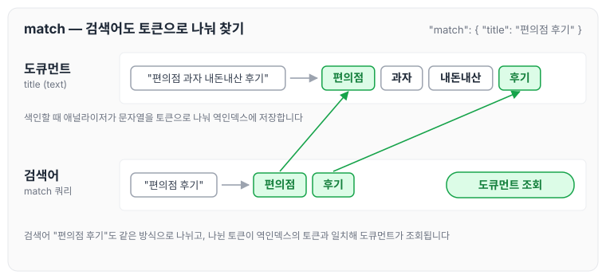
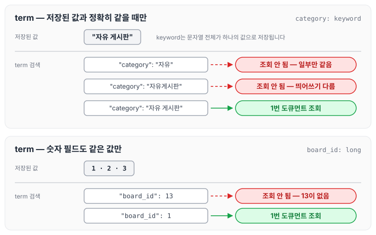
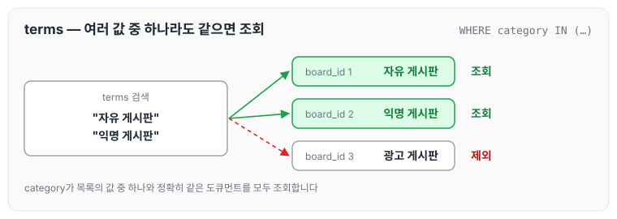

이전에 [매핑 설계](../es-mapping/)에 대해 작성하였습니다. 매핑으로 필드의 타입을 정의했다면, 다음은 저장된 도큐먼트를 조회하는 방법입니다. 오늘은 ElasticSearch에서 기본으로 사용하는 검색 쿼리인 match, term, terms에 대해 정리하도록 하겠습니다.

## 키워드가 포함된 데이터를 조회하고 싶을 때

특정 키워드가 포함된 도큐먼트를 조회할 때는 match 쿼리를 사용합니다. 아래는 `title`을 text 타입으로 정의하고 `편의점 후기`로 검색하는 예시입니다.

```json
### **인덱스 생성 및 매핑 정의하기**
PUT /boards
{
  "mappings": {
    "properties": {
      "title": {
        "type": "text"
      }
    }
  }
}

### **데이터 삽입하기**
POST /boards/_doc
{
  "title": "편의점 과자 내돈내산 후기"
}

### **도큐먼트 검색해보기**
GET /boards/_search
{
  "query": {
    "match": {
      "title": "편의점 후기" 
    }
  }
}
```

`title`은 text 타입이기 때문에 색인할 때 애널라이저가 문자열을 토큰으로 나눠 역인덱스에 저장합니다. match 쿼리는 검색어도 같은 애널라이저로 나눈 뒤 검색합니다. 이 과정을 그리면 아래와 같습니다.



검색어 `편의점 후기`가 `편의점`, `후기`로 나뉘고, 나뉜 토큰이 도큐먼트의 토큰과 일치하기 때문에 `편의점 과자 내돈내산 후기` 도큐먼트가 조회됩니다. 검색할 때 애널라이저가 적용되는 방식은 [애널라이저: 토크나이저와 필터](../es-analyzer/)에 정리하였습니다.

## 특정 값과 정확하게 일치하는 데이터를 조회하고 싶을 때

- term 쿼리는 특정 값과 정확히 일치하는 모든 도큐먼트를 조회합니다.
- term 쿼리는 text를 제외한 모든 타입에서 사용합니다.

아래는 `board_id`를 long, `category`를 keyword로 정의하고 term 쿼리로 검색하는 예시입니다.

```json
### 인덱스 생성 및 정의
PUT /boards
{
  "mappings": {
    "properties": {
      "board_id": {
        "type": "long"
      },
      "category": {
        "type": "keyword"
      }
    }
  }
}

### 데이터 삽입
POST /boards/_doc
{
  "board_id": 1,
  "category": "자유 게시판"
}

POST /boards/_doc
{
  "board_id": 2,
  "category": "익명 게시판"
}

POST /boards/_doc
{
  "board_id": 3,
  "category": "광고 게시판"
}

### 도큐먼트 검색
GET /boards/_search
{
  "query": {
    "term": {
      "category": "자유"
    }
  }
}

GET /boards/_search
{
  "query": {
    "term": {
      "category": "자유게시판"
    }
  }
}

GET /boards/_search
{
  "query": {
    "term": {
      "board_id": 13
    }
  }
}

GET /boards/_search
{
  "query": {
    "term": {
      "category": "자유 게시판"
    }
  }
}

GET /boards/_search
{
  "query": {
    "term": {
      "board_id": 1
    }
  }
}

## SQL문으로
### SELECT * FROM boards WHERE category = "자유 게시판"
### SELECT * FROM boards WHERE board_id = 152
```

위 검색 중 어떤 쿼리에서 도큐먼트가 조회되는지 그리면 아래와 같습니다.



`category`는 keyword 타입이라 `자유 게시판` 전체가 하나의 값으로 저장됩니다. 그래서 `자유`처럼 일부만 같거나 `자유게시판`처럼 띄어쓰기가 다르면 조회되지 않고, `자유 게시판`으로 정확히 같을 때만 조회됩니다. 숫자 필드인 `board_id`도 마찬가지로 저장된 값과 같은 `1`일 때만 조회되고, 없는 값인 `13`으로는 조회되지 않습니다.

## 여러 개의 값 중 하나라도 일치하는 도큐먼트 조회

`SELECT * FROM boards WHERE category IN ("자유 게시판", "익명 게시판")`처럼 `category`가 `자유 게시판` 또는 `익명 게시판`인 모든 데이터를 조회하고 싶다고 가정해 보겠습니다. 이때는 terms 쿼리를 사용합니다.

```json
GET /boards/_search
{
  "query": {
    "terms": {
      "category": ["자유 게시판", "익명 게시판"]
    }
  }
}
```

앞의 term 예시에서 넣은 도큐먼트 세 개에 위 쿼리를 실행하면 아래와 같습니다.



terms 쿼리는 목록에 적은 값 중 하나와 정확히 일치하는 도큐먼트를 모두 조회합니다. 그래서 `자유 게시판`, `익명 게시판` 도큐먼트는 조회되고 `광고 게시판` 도큐먼트는 제외됩니다.

오늘은 ElasticSearch의 기본 검색 쿼리인 match, term, terms에 대해 정리하였습니다. text 필드는 검색어를 토큰으로 나눠 찾는 match로, keyword나 숫자처럼 정확한 값을 비교해야 하는 필드는 term과 terms로 조회한다는 점을 구분해서 사용해야 할 것 같습니다.

> 이 글은 인프런 박재성 님의 [실전에서 바로 써먹는 Elasticsearch 입문 (검색 최적화편)](https://www.inflearn.com/course/실전-elasticsearch-입문)을 들으며 정리한 노트입니다.
