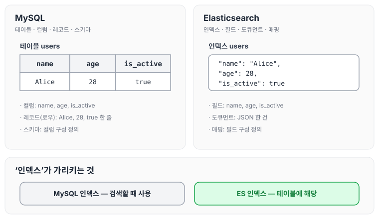
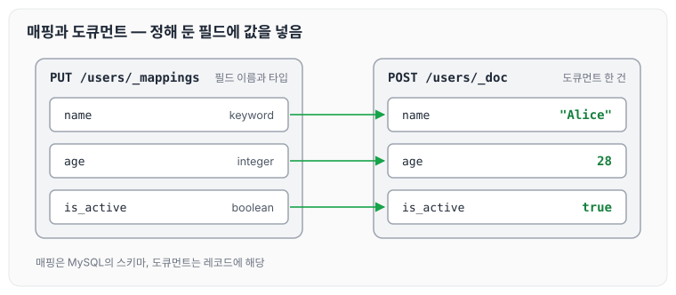
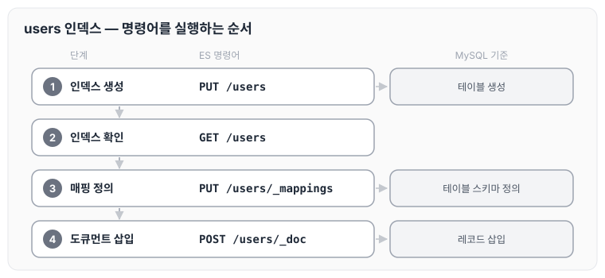

이전에 [ElasticSearch를 도입하게 된 이유](../es-intro/)에 대해 작성하였습니다. 이번 글에서는 RDBMS와 ES의 용어를 대응시켜 정리하고, 기본 명령어를 실습한 내용을 정리하겠습니다.

## RDBMS와 ES의 용어

RDBMS와 ES는 용어가 다르기 때문에, 나중에 용어에서 헷갈리지 않도록 잘 정리해 두어야 합니다.

이론을 들으면서 가장 헷갈렸던 것은 인덱스였습니다. MySQL에서는 검색할 때 인덱스를 사용하지만, 엘라스틱서치에서는 인덱스가 테이블처럼 불리기 때문입니다.

두 용어를 대응시키면 아래와 같습니다.

| MySQL | Elasticsearch |
| --- | --- |
| 테이블(table) | 인덱스(index) |
| 컬럼(column) | 필드(field) |
| 레코드(record), 로우(row) | 도큐먼트(document) |
| 스키마(schema) | 매핑(mapping) |

같은 users 데이터를 두 용어로 나란히 놓으면 다음과 같습니다.



MySQL에서 한 줄의 레코드였던 데이터가 ES에서는 JSON 한 건의 도큐먼트가 되고, 같은 ‘인덱스’라는 이름이 MySQL에서는 검색에 쓰이는 것을, ES에서는 테이블에 해당하는 것을 가리킵니다.

## 인덱스 생성하기 및 조회

MySQL 기준으로는 테이블을 생성하는 작업에 해당합니다. `PUT`으로 인덱스를 만들고 `GET`으로 확인합니다.

```text
### 인덱스 생성
PUT /users

### 인덱스 확인
GET /users

```

## 인덱스 삭제

인덱스 삭제는 `DELETE`를 사용합니다.

```text
### 인덱스 생성
PUT /users

### 인덱스 삭제
DELETE /boards
```

## 매핑 정의

MySQL 기준으로는 테이블 스키마를 정의하는 작업에 해당합니다. `_mappings`에 필드마다 타입을 지정합니다.

```text
### 맵핑 정의
PUT /users/_mappings
{
  "properties": {
    "name": { "type": "keyword" },
    "age": { "type": "integer" },
    "is_active": { "type": "boolean" }
  }
}

```

## 도큐먼트 삽입 및 조회

MySQL 기준으로는 레코드를 삽입하는 작업에 해당합니다.

```text
# 도큐먼트 삽입
POST /users/_doc
{
  "name": "Alice",
  "age": 28,
  "is_active": true
}

```

앞에서 정의한 매핑과 삽입한 도큐먼트를 필드별로 맞춰 보면 다음과 같습니다.



매핑에서 정해 둔 필드마다 도큐먼트의 값이 하나씩 들어갑니다.

지금까지 실행한 명령어를 users 인덱스 기준으로 순서대로 놓고, MySQL 기준 작업과 함께 보면 아래와 같습니다.



간단한 C/R/U/D 작업을 진행하였고, 해당 명령어를 실행할 때 JSON 형태의 데이터로 검색을 진행해야 된다는 것을 알 수 있었습니다. 오늘은 RDBMS와 ES의 용어를 대응시키고 기본 명령어에 대해 정리하였습니다. 이어서 [단어 검색과 역인덱스](../es-inverted-index/)에 대해 정리하도록 하겠습니다.

> 이 글은 인프런 박재성 님의 [실전에서 바로 써먹는 Elasticsearch 입문 (검색 최적화편)](https://www.inflearn.com/course/실전-elasticsearch-입문)을 들으며 정리한 노트입니다.
