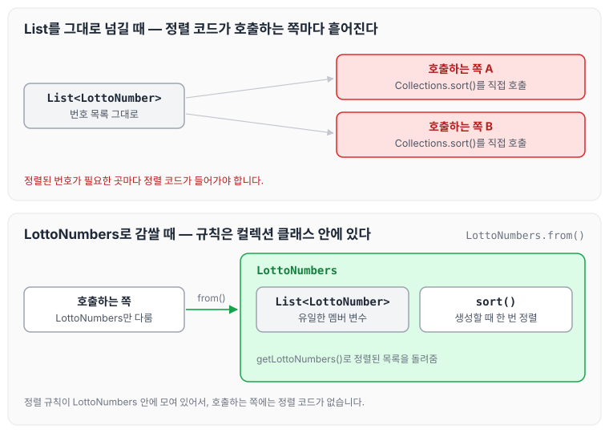

오늘은 일급 컬렉션에 대해 정리하도록 하겠습니다.

일급 컬렉션은 Collection을 Wrapping하면서, 그 외의 멤버 변수가 없는 상태를 말합니다.

## 일급 컬렉션의 장점

일급 컬렉션의 장점은 다음과 같습니다.

1. 코드 가독성 향상: 관련된 데이터와 동작이 하나의 단위로 묶여 코드의 가독성이 좋아집니다. 컬렉션을 다루는 로직이 여러 곳에 흩어지지 않고 한 곳에 모여 있어서, 코드의 의도를 더 명확하게 전달할 수 있습니다.
2. 모듈화와 캡슐화 강화: 관련된 데이터와 기능이 하나의 클래스로 묶이므로 모듈화와 캡슐화가 강화됩니다. 코드를 수정하거나 기능을 확장할 때 영향을 최소화할 수 있고, 변경에 따른 오류 가능성도 줄일 수 있습니다.
3. 유지보수성 향상: 수정이 필요한 경우 해당 클래스 내부만 수정하면 되므로 코드의 수정이나 유지보수를 더 효율적으로 진행할 수 있습니다. 다른 부분에 영향을 덜 주어 변경 내역의 파급 효과도 줄어듭니다.
4. 확장성: 새로운 기능이나 속성을 추가할 때도 일급 컬렉션을 확장하면 됩니다. 새로운 메서드를 추가하거나 기존 동작을 확장하기 쉬워서 애플리케이션의 확장성을 높일 수 있습니다.
5. 중복 코드 감소: 동일한 기능을 여러 곳에서 반복해서 구현하지 않아도 됩니다. 해당 기능을 일급 컬렉션 내부에 구현하면 코드의 중복을 방지하고 유지보수성을 높일 수 있습니다.
6. 테스트 용이성: 단위 테스트를 작성하기 쉽습니다. 각 컬렉션 클래스의 메서드를 개별적으로 테스트할 수 있어서, 특정 기능을 검증하는 테스트 케이스 작성이 간단해집니다.
7. 명확한 의미 부여: 해당 컬렉션의 의미와 역할을 명확하게 표현할 수 있습니다. 클래스 이름과 메서드 이름을 통해 컬렉션의 역할과 기능을 직관적으로 이해할 수 있습니다.

## 일급 컬렉션 사용법

로또 번호 목록을 일급 컬렉션으로 만든 예시는 아래와 같습니다.

```java
import java.util.Collections;
import java.util.List;

public class LottoNumbers {
    private List<LottoNumber> lottoNumbers;

    public LottoNumbers(List<LottoNumber> lottoNumbers) {
        this.lottoNumbers = lottoNumbers;
        sort();
    }

    public static LottoNumbers from(List<LottoNumber> lottoNumbers) {
        return new LottoNumbers(lottoNumbers);
    }

    public List<LottoNumber> getLottoNumbers() {
        return lottoNumbers;
    }

    public void sort() {
        Collections.sort(lottoNumbers);
    }
}
```

이렇게 로또 번호를 관리하는 객체를 만들어 번호 목록이라는 상태와 정렬 같은 동작을 객체 안에 보관하고, 밖에서는 이 객체를 호출하는 형태로 사용해 유지보수하는 방법입니다. 객체를 만들 때는 [정적 팩토리 메소드 패턴](../static-factory-method/)에서 정리한 `from`을 사용하였습니다.

컬렉션을 그대로 넘길 때와 `LottoNumbers`로 감쌀 때를 비교하면 아래와 같습니다.



`List`를 그대로 넘기면 정렬된 번호가 필요한 곳마다 정렬 코드를 넣어야 하지만, `LottoNumbers`로 감싸면 생성할 때 한 번 정렬되고 호출하는 쪽은 `LottoNumbers`만 다루면 됩니다. 원시값을 객체로 감싸는 방법은 [원시값 포장](../primitive-wrapping/)에 정리하였습니다.

## 마무리

오늘은 일급 컬렉션에 대해 정리하였습니다. 실무에서 사용하게 된다면 소스코드를 좀 더 간결하게 호출하는 형태로 바꿀 수 있을 것 같아서 좋았고, 서비스 레이어를 간결하게 만들 수 있을 것 같아 빨리 적용해 보고 싶다는 생각이 들었습니다. 이후 실제 프로젝트에 적용하면서 겪은 문제는 [\[Java\] Spring JPA 1:N 일급컬렉션 Cascade insert시 null 발생](../jpa-cascade-null/)에 정리하였습니다.
