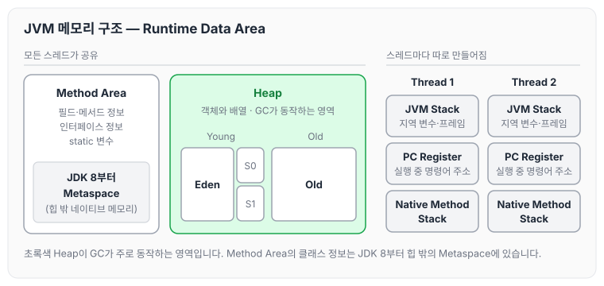
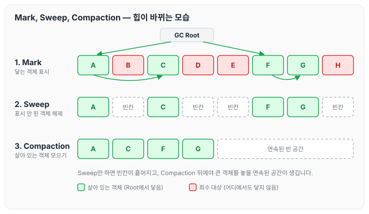
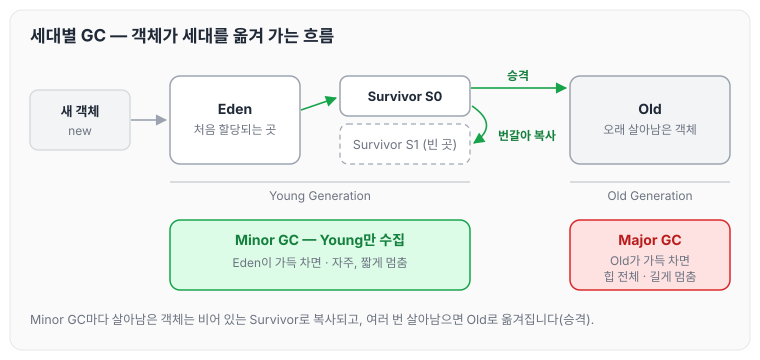
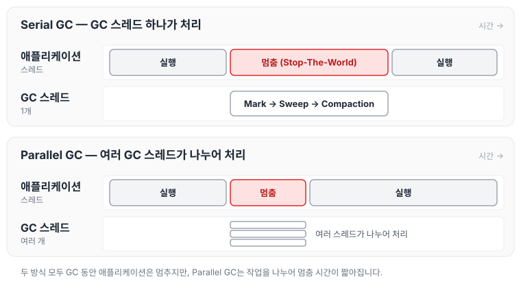
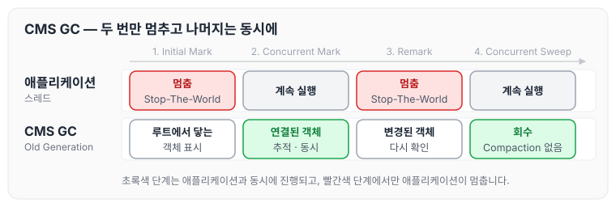
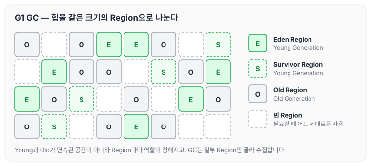
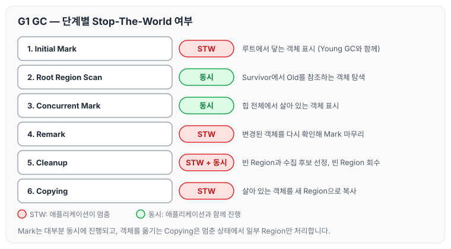
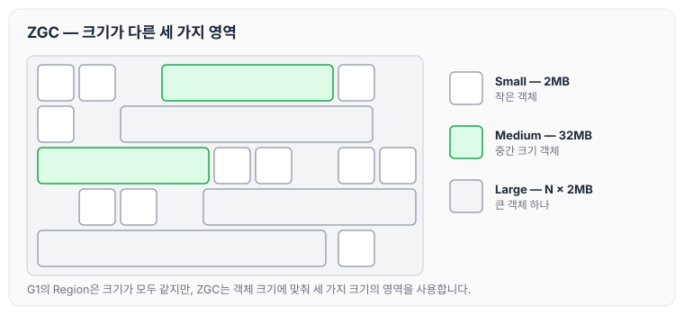
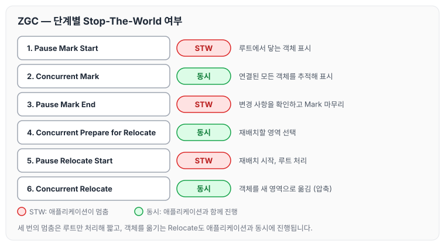
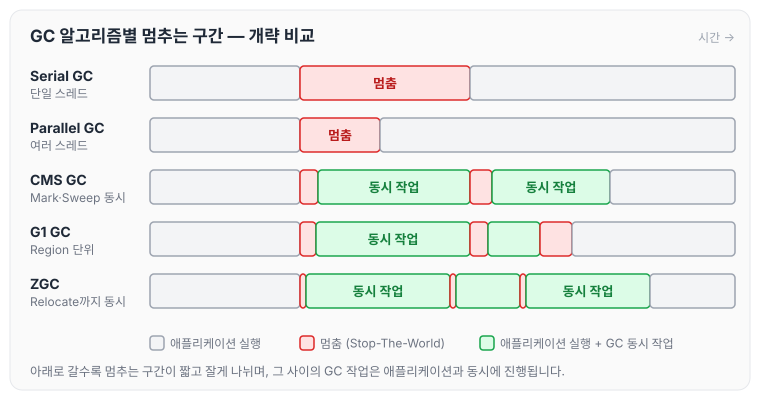

오늘은 Garbage Collection(GC)에 대해 정리하도록 하겠습니다. GC가 무엇이고 어떤 단점이 있는지 먼저 살펴보고, GC가 동작하는 JVM 메모리 구조와 힙 영역에서의 동작 원리, 그리고 Serial GC부터 ZGC까지 주요 GC 알고리즘을 순서대로 정리하겠습니다.

## Garbage Collection이란?

GC는 메모리 관리를 자동으로 해 주는 시스템입니다. 프로그램이 더 이상 사용하지 않는 메모리 영역을 자동으로 찾아 해제해서 메모리 누수를 방지하며, 힙 영역에서 동작합니다. 이를 통해 개발자는 메모리를 직접 관리하지 않고 개발에만 집중할 수 있습니다.

다만 메모리를 자동으로 관리해 주는 만큼 언제 메모리가 해제되는지 알 수 없어 제어하기 어렵습니다. 또한 GC가 동작하면 Stop-The-World로 다른 동작들이 멈추기 때문에 오버헤드가 발생합니다.

> **Stop-The-World**
>
> - GC 시작: GC가 시작되면 JVM은 애플리케이션의 모든 스레드를 일시 정지합니다.
> - 메모리 분석: GC는 Root 객체로부터 시작해 도달 가능한 객체를 표시하고, 더 이상 사용되지 않는 객체를 해제합니다. 이 과정에서 애플리케이션은 어떤 작업도 수행하지 않습니다.
> - 메모리 회수: 사용되지 않는 객체가 해제되고 메모리가 회수되면, JVM은 모든 스레드를 다시 시작합니다.
> - 애플리케이션 재개: 스레드가 다시 실행되고, 애플리케이션이 정상적으로 동작합니다.

GC가 어디에서 어떻게 동작하는지 이해하려면 먼저 JVM의 메모리 구조를 알아야 합니다.

## JVM 메모리 구조

자바 프로그램이 실행되면 OS로부터 메모리를 할당받고, 용도에 따라 여러 영역으로 나눕니다. 컴퓨터의 메모리는 한정되어 있기 때문에 이를 어떻게 관리하느냐에 따라 프로그램의 속도가 좌우됩니다. 결과적으로 같은 기능의 프로그램이더라도 메모리 관리에 따라 성능 차이가 크게 날 수 있습니다.

JVM이 나누는 메모리 영역(Runtime Data Area)은 다음과 같습니다.



- Method Area(메소드 영역)
    - 필드, 메서드, 인터페이스 정보
    - 정적 변수(static fields)
    - 클래스가 로드되면 클래스 정보가 메소드 영역에 올라가고, 클래스가 언로딩되기 전까지 유지됩니다.
    - HotSpot JVM은 JDK 8부터 이 정보를 힙 밖의 네이티브 메모리인 Metaspace에 둡니다. 그 전에는 힙 옆의 Permanent Generation에 두었습니다.
- Heap(힙)
    - 모든 객체와 배열이 할당되는 메모리 영역
    - 동적으로 생성되는 객체 및 배열
    - GC가 주로 동작하는 영역입니다.
- Stack(스택)
    - 메소드의 지역 변수, 파라미터, 반환 값, 중간 연산 결과 등을 저장
    - 지역 변수(Local Variables), 연산 스택(Operand Stack), 프레임 데이터가 포함
- PC Register(PC 레지스터)
    - 현재 실행 중인 JVM 명령어의 주소(PC, Program Counter)를 저장
- Native Method Stack(네이티브 메소드 스택)
    - 자바가 아닌 네이티브 언어(C나 C++)로 작성된 메소드가 실행될 때 사용하는 스택

그림처럼 Method Area와 Heap은 모든 스레드가 함께 사용하고, Stack, PC Register, Native Method Stack은 스레드마다 따로 만들어집니다. 클래스가 언제 로드되고 Metaspace와 힙에 각각 무엇이 남는지는 [JVM은 어떻게 실행되고 클래스를 로딩하는가](../jvm-execution-classloading/)에서 정리하였습니다.

## Heap 영역에서 GC가 동작하는 원리

GC는 아래 단계를 거쳐 메모리를 회수합니다.

- Mark 단계
    - GC는 루트 객체부터 시작해 도달할 수 있는 객체들을 찾아 표시해 둡니다.
    - 객체를 탐색하면서 살아 있는 객체에 Mark 표시를 합니다.

    > **루트 객체**
    >
    > JVM 스레드 스택에 있는 지역 변수, static 변수, 메소드 호출 체인에서 참조되는 객체들입니다.

- Sweep 단계
    - Mark 단계에서 표시되지 않은 객체들은 더 이상 참조되지 않는다고 판단해 메모리에서 해제합니다.
    - 사용하지 않는 객체들을 청소한다는 의미로 Sweep이라고 합니다.
- Compaction 단계
    - 메모리 회수가 완료되면, 살아 있는 객체들을 앞으로 보내 연속된 빈 공간을 확보합니다.
- Stop-The-World 발생
    - GC가 실행되면 애플리케이션의 모든 스레드가 일시적으로 중지되며, 이를 Stop-The-World 상태라고 합니다.

객체 여덟 개가 있는 힙에서 세 단계를 차례로 그리면 다음과 같습니다.



Sweep만 하면 회수한 공간이 B, D, E, H 자리처럼 흩어져 있습니다. Compaction으로 살아 있는 객체를 앞으로 모아야 큰 객체도 놓을 수 있는 연속된 빈 공간이 생깁니다.

GC가 멈추는 시간은 어느 영역을 수집하느냐에 따라 달라집니다.

- Minor GC는 짧은 시간 동안 동작하기 때문에 Stop-The-World 시간이 짧습니다.
- Major GC나 Full GC는 Old Generation의 객체를 처리하는 동안 시간이 오래 걸리기 때문에 Stop-The-World 시간이 더 길어집니다.

Minor GC와 Major GC는 힙을 세대로 나누는 구조에서 나온 구분입니다.

## Generational GC의 동작

Heap 영역은 크게 Young Generation과 Old Generation으로 나눌 수 있습니다. 이 구조는 GC의 성능을 최적화하는 데 중요한 역할을 합니다.

- Young Generation
    - Eden 공간: 새롭게 생성된 객체가 처음으로 할당되는 공간입니다.
    - Survivor 공간(S0, S1): Eden 공간에서 살아남은 객체가 이동하는 공간입니다. S0과 S1 두 개의 Survivor 공간을 번갈아 사용하며, 둘 중 한 곳은 항상 비어 있습니다.
    - Minor GC: Young Generation에서 발생하는 GC입니다. 자주 발생하며 객체가 빠르게 회수됩니다.
- Old Generation
    - Young Generation에서 오래 살아남은 객체가 이동하는 영역입니다.
    - Major GC(또는 Full GC): Old Generation이 가득 차면 발생하는 GC로, 힙 전체를 수집합니다. 느리게 동작하며 애플리케이션에 큰 영향을 줄 수 있습니다.

객체가 할당된 뒤 세대를 옮겨 가는 흐름은 다음과 같습니다.



Minor GC가 일어날 때마다 Eden과 사용 중인 Survivor에서 살아남은 객체가 비어 있는 Survivor로 복사되고, 이 과정을 여러 번 견딘 객체는 Old로 옮겨집니다. Young은 자주, 짧게 수집되고 Old는 드물지만 오래 수집됩니다.

이 Major GC의 긴 멈춤을 줄이기 위해 가비지 컬렉션의 알고리즘은 계속 발전해 왔습니다.

## 가비지 컬렉션의 알고리즘

### 1. Serial GC

- Serial GC는 단일 스레드를 사용해 GC를 처리합니다. Young Generation과 Old Generation에서 발생하는 GC를 모두 단일 스레드로 순차적으로 수행합니다.
- 작은 힙 크기를 가진 애플리케이션에서 주로 사용됩니다.

동작 순서는 아래와 같습니다.

1. Minor GC (Young Generation에서 수행)
    - Mark: Young Generation(Eden 및 Survivor 영역)에서 루트 객체(root objects)로부터 접근 가능한 객체를 표시합니다.
    - Copying: 살아남은 객체를 Survivor 영역으로 복사합니다.
    - Sweep: Eden 영역의 나머지 객체(더 이상 참조되지 않는 객체)를 삭제해 메모리를 회수합니다.
    - Compaction: 필요하지 않습니다. 복사한 뒤 Eden 영역을 비우기만 하면 됩니다.
2. Major GC (Old Generation에서 수행)
    - Mark: Old Generation에서 루트 객체로부터 접근 가능한 객체를 표시합니다.
    - Sweep: 표시되지 않은 객체들을 제거하고 메모리를 회수합니다.
    - Compaction: 메모리 단편화를 방지하기 위해 객체들을 앞쪽으로 밀어 메모리 공간을 연속적으로 만듭니다.
3. Stop-The-World: Serial GC는 GC를 처리하는 동안 애플리케이션 스레드를 멈춥니다. 모든 GC 작업이 단일 스레드에서 진행되기 때문에 Stop-The-World 시간이 길어질 수 있습니다.

실행 옵션은 아래와 같습니다.

```text
-XX:+UseSerialGC
```

### 2. Parallel GC

- Parallel GC는 여러 스레드를 사용해 Young Generation과 Old Generation의 GC 작업을 병렬로 처리합니다.
- 멀티코어 CPU를 가진 환경에서 성능을 높이는 데 적합하며, 서버 애플리케이션에 주로 사용됩니다.

동작 순서는 아래와 같습니다.

1. Minor GC (Young Generation에서 수행)
    - Mark: 여러 스레드를 사용해 Eden과 Survivor 영역에서 접근 가능한 객체를 표시합니다.
    - Copying: 여러 스레드를 사용해 살아남은 객체를 Survivor 영역으로 병렬로 복사합니다.
    - Sweep: Eden 영역에서 사용되지 않는 객체들을 제거합니다.
    - Compaction: 필요하지 않습니다. 복사한 뒤 Eden 영역을 비우기만 하면 됩니다.
2. Major GC (Old Generation에서 수행)
    - Mark: 여러 스레드를 사용해 Old Generation의 객체를 스캔하고, 접근 가능한 객체를 표시합니다.
    - Sweep: 사용되지 않는 객체들을 병렬로 제거합니다.
    - Compaction: 메모리 단편화를 방지하기 위해 객체를 병렬로 메모리 앞부분으로 이동시킵니다.
3. Stop-The-World: GC 작업을 병렬로 처리하므로 Stop-The-World 시간이 Serial GC보다 짧습니다. 하지만 여전히 애플리케이션의 모든 스레드가 멈춥니다.

Serial GC와 Parallel GC에서 애플리케이션 스레드와 GC 스레드가 동작하는 모습을 시간 순서로 비교하면 다음과 같습니다.



두 방식 모두 GC가 도는 동안 애플리케이션은 멈춥니다. 차이는 그 시간 동안 일하는 GC 스레드의 수이고, Parallel GC는 작업을 나누어 처리하기 때문에 멈춤 시간이 짧아집니다.

실행 옵션은 아래와 같습니다.

```text
-XX:+UseParallelGC
```

추가 옵션

- Old Generation도 병렬로 처리

    ```text
    -XX:+UseParallelOldGC
    ```

다만 [JEP 366](https://openjdk.org/jeps/366)에 따르면 `-XX:+UseParallelGC`만 지정해도 Young과 Old 모두 병렬 알고리즘이 선택되며, `UseParallelOldGC` 옵션은 JDK 14에서 deprecated되었습니다.

### 3. CMS (Concurrent Mark-Sweep) GC

- CMS GC는 애플리케이션과 동시에 GC를 수행하려는 목적을 가진 알고리즘으로, Old Generation에서의 Stop-The-World 시간을 최소화하는 데 중점을 둡니다.
- Mark and Sweep 방식을 사용해 Old Generation의 GC를 처리합니다.
- 메모리 단편화가 발생할 수 있다는 단점이 있습니다.

동작 순서는 아래와 같습니다.

1. Initial Mark (Stop-The-World)
    - 루트 객체로부터 Old Generation에서 접근 가능한 객체들을 찾고 표시(mark)합니다.
    - 이 단계는 빠르게 완료되며, Stop-The-World 상태가 발생합니다.
2. Concurrent Mark (애플리케이션과 동시에)
    - 루트 객체로부터 연결된 모든 객체를 스캔해 살아 있는 객체들을 표시합니다.
    - 이 단계는 애플리케이션 스레드와 동시에 수행되기 때문에 애플리케이션이 계속 실행될 수 있습니다.
3. Remark (Stop-The-World)
    - Concurrent Mark 단계 동안 변경된 객체들을 다시 한 번 확인해, GC에 반영되지 않은 객체들을 표시합니다.
    - 이 단계는 Stop-The-World 상태에서 진행되지만, 짧게 완료됩니다.
4. Concurrent Sweep (애플리케이션과 동시에)
    - Concurrent Mark와 Remark 단계에서 도달할 수 없다고 판단한 객체를 애플리케이션과 동시에 제거하고 메모리를 회수합니다.
5. Compaction 없음
    - CMS는 객체를 이동시키지 않기 때문에 Compaction 단계가 없고, 그만큼 메모리 단편화가 발생할 수 있습니다.
    - 메모리 단편화가 심해지면 Full GC가 발생해 Old Generation을 다시 압축하게 됩니다.
6. Stop-The-World: CMS는 Stop-The-World 시간을 최소화하도록 설계되었지만, Initial Mark와 Remark 단계에서는 애플리케이션이 멈춥니다. 그 외의 단계는 애플리케이션과 동시에 진행됩니다.

네 단계를 애플리케이션 스레드와 함께 시간 순서로 그리면 다음과 같습니다.



빨간색으로 표시한 Initial Mark와 Remark에서만 애플리케이션이 멈추고, 시간이 오래 걸리는 Mark와 Sweep의 대부분은 애플리케이션과 동시에 진행됩니다.

CMS GC는 JDK 9에서 deprecated되었고([JEP 291](https://openjdk.org/jeps/291)), JDK 14에서 제거되었습니다([JEP 363](https://openjdk.org/jeps/363)). 지연 시간을 줄이기 위한 중요한 GC 알고리즘이었지만, 메모리 단편화 문제와 유지보수의 복잡성이 주요 단점이었습니다.

이후 G1 GC가 이러한 문제를 해결하면서 CMS는 점차 사용되지 않게 되었습니다. G1 GC 외에도 ZGC와 Shenandoah GC 같은 GC 알고리즘들이 CMS를 대체해, 더 효율적인 메모리 관리와 짧은 Stop-The-World 시간을 제공하고 있습니다.

실행 옵션은 아래와 같습니다.

```text
-XX:+UseConcMarkSweepGC
```

추가 옵션

- Compaction을 하기 전에 수행할 Full GC 횟수 지정 (기본값 0)

    ```text
    -XX:CMSFullGCsBeforeCompaction=<횟수>
    ```

### 4. G1(Garbage First) GC

- G1 GC는 힙을 같은 크기의 여러 영역(Region)으로 나누어 GC를 수행합니다. Young과 Old를 연속된 메모리로 나누지 않을 뿐, 세대 구분은 그대로 사용합니다.
- 각 Region을 Young Generation(Eden, Survivor) 또는 Old Generation으로 다루며, 병렬로 GC를 처리합니다.
- Stop-The-World 시간을 최소화하고, 대규모 애플리케이션에서 성능을 향상시키기 위해 설계된 GC입니다.
- 이름의 Garbage First는 가비지가 가장 많은 Region부터 먼저 회수한다는 의미입니다.

G1 GC의 힙을 Region 단위로 그리면 다음과 같습니다.



Eden, Survivor, Old Region이 힙 안에 흩어져 있고, 빈 Region은 필요할 때 어느 세대로든 쓰입니다. 이 덕분에 G1은 힙 전체가 아니라 일부 Region만 골라 수집할 수 있습니다.

동작 순서는 아래와 같습니다.

1. Initial Mark (Stop-The-World)
    - 루트 객체로부터 접근 가능한 Young Generation 및 Old Generation의 객체들을 표시(mark)합니다.
    - 이 단계는 Young GC의 멈춤에 함께 수행되어 빠르게 완료됩니다.
2. Root Region Scan (애플리케이션과 동시에)
    - Initial Mark 후 Survivor Region에서 Old Region을 참조하는 객체를 찾습니다.
3. Concurrent Mark (애플리케이션과 동시에)
    - 힙 전체에서 살아 있는 객체를 찾아 표시합니다.
4. Remark (Stop-The-World)
    - Concurrent Mark 동안 변경된 객체들을 다시 확인해 도달할 수 없는 객체들을 표시합니다.
    - 이 단계는 짧게 진행되며, Stop-The-World 상태에서 수행됩니다.
5. Cleanup (일부 Stop-The-World, 일부 애플리케이션과 동시에)
    - 멈춘 동안 완전히 비어 있는 Region과 다음 수집 대상이 될 Old Region을 고릅니다.
    - 빈 Region을 회수해 다시 사용할 수 있게 하는 작업은 애플리케이션과 동시에 진행됩니다.
6. Copying (Stop-The-World)
    - G1은 메모리 단편화를 방지하기 위해 Compaction을 적극적으로 사용합니다.
    - 애플리케이션을 멈추고 살아 있는 객체들을 새로운 Region으로 복사해 압축한 뒤, 빈 공간을 확보합니다.
7. Stop-The-World: G1 GC는 Young Region만 수집하는 Young GC와, Young Region과 함께 일부 Old Region을 수집하는 Mixed GC로 나누어 Region 단위로 GC를 수행합니다. 힙 전체를 한 번에 수집하지 않기 때문에 Stop-The-World 시간이 짧고, 애플리케이션의 응답성을 중시하는 환경에서 특히 유용합니다. 다만 복사할 공간이 부족해지면 힙 전체를 멈추고 수집하는 Full GC가 발생할 수 있습니다.

여섯 단계를 멈추는 단계와 동시에 진행되는 단계로 나누어 정리하면 다음과 같습니다.



Mark는 대부분 애플리케이션과 동시에 진행되고, 객체를 옮기는 Copying은 애플리케이션을 멈춘 상태에서 진행됩니다. 대신 일부 Region만 복사하기 때문에 멈춤 시간을 짧게 유지할 수 있습니다.

실행 옵션은 아래와 같습니다.

```text
-XX:+UseG1GC
```

추가 옵션

- Max Pause Time 설정 (GC의 최대 일시정지 시간 목표를 설정, G1의 기본값은 200ms)

    ```text
    -XX:MaxGCPauseMillis=<밀리초>
    ```

이 값은 GC에게 주는 목표이기 때문에 항상 지켜지지는 않습니다. JVM이 이 목표를 맞추기 위해 힙 크기를 조정하는 방식은 [GC의 역할과 튜닝 기준: Ergonomics와 JVM 기본 설정](../gc-tuning-criteria/)에서 정리하였습니다.

### 5. ZGC

- 압축형(Compacting): ZGC는 객체 재배치(Relocation)로 살아 있는 객체를 다른 영역으로 옮겨 메모리 단편화를 해결합니다. 이 재배치가 압축에 해당하며, 애플리케이션과 동시에 진행된다는 점이 다른 GC와 다릅니다.
- 병행(Concurrent): 대부분의 작업이 애플리케이션과 동시에 수행됩니다.
- 대규모 힙을 지원: ZGC는 수백 MB부터 TB 단위의 대규모 메모리까지 처리할 수 있으며, 힙 크기에 관계없이 일시정지 시간을 10ms 이하로 유지하는 것을 목표로 합니다.

ZGC도 힙을 여러 영역으로 나누어 관리하며, 영역의 크기는 세 가지입니다.



G1의 Region은 크기가 모두 같지만, ZGC는 Small(2MB), Medium(32MB), Large(N × 2MB) 세 가지 크기의 영역을 객체 크기에 맞춰 사용합니다.

동작 순서는 아래와 같습니다.

1. Pause Mark Start (Stop-The-World)
    - 루트 객체로부터 도달할 수 있는 객체들을 빠르게 표시(mark)합니다.
    - 이 단계는 매우 짧은 Stop-The-World 상태에서 수행됩니다.
2. Concurrent Mark (애플리케이션과 동시에)
    - Pause Mark Start 후, 루트 객체에서 연결된 모든 객체들을 추적해 살아 있는 객체를 표시합니다.
    - 이 작업은 애플리케이션과 동시에 수행되어 애플리케이션의 중단 없이 진행됩니다.
3. Pause Mark End (Stop-The-World)
    - Concurrent Mark 단계에서 객체의 생존 상태가 변동된 경우, 다시 한번 정확하게 확인하고 Mark를 마칩니다.
    - 이 단계 역시 매우 짧은 Stop-The-World 상태에서 수행됩니다.
4. Concurrent Prepare for Relocate (애플리케이션과 동시에)
    - 객체를 새로운 메모리 영역으로 재배치할 준비를 합니다. 이동할 객체들이 있는 영역을 선택해 재배치 대상을 정하는 단계입니다.
    - 이 과정 역시 애플리케이션과 병행으로 진행됩니다.
5. Pause Relocate Start (Stop-The-World)
    - 재배치를 시작하기 위해 루트를 처리하는 짧은 멈춤입니다.
6. Concurrent Relocate (애플리케이션과 동시에)
    - 선택된 영역의 객체들을 새로운 메모리 영역으로 재배치해 메모리 단편화를 방지합니다.
    - 이 작업 역시 애플리케이션과 동시에 진행되기 때문에, 객체를 옮기는 동안에도 애플리케이션이 멈추지 않습니다.

여섯 단계를 G1과 같은 방식으로 정리하면 다음과 같습니다.



ZGC도 세 번 멈추지만, 멈추는 동안에는 루트만 처리하기 때문에 힙이 커져도 멈춤 시간이 늘어나지 않습니다. G1과 달리 객체를 옮기는 Relocate도 애플리케이션과 동시에 진행됩니다.

실행 옵션은 아래와 같습니다.

```text
-XX:+UseZGC
```

## 정리

지금까지 살펴본 GC 알고리즘을 정리하면 아래와 같습니다.

| GC 알고리즘 | JVM 옵션 | 적용 상황 | Java 버전별 기본 GC |
| --- | --- | --- | --- |
| Serial GC | `-XX:+UseSerialGC` | 작은 애플리케이션이나 리소스가 제한된 시스템 | 서버급이 아닌 환경(단일 CPU 등)에서 기본 |
| Parallel GC | `-XX:+UseParallelGC` | 대규모 애플리케이션, 처리량을 극대화하고자 할 때 | Java 8까지 서버급 환경에서 기본, Java 9부터 옵션 선택 |
| CMS GC | `-XX:+UseConcMarkSweepGC` | 빠른 응답 시간과 낮은 지연 시간을 중요시하는 애플리케이션 (Deprecated) | Java 9에서 deprecated, Java 14에서 제거 |
| G1 GC | `-XX:+UseG1GC` | 대규모 힙을 사용하는 시스템에서 성능을 최적화할 때 | Java 9부터 기본 GC |
| ZGC | `-XX:+UseZGC` | 매우 큰 힙을 사용하는 애플리케이션에서 짧은 Stop-The-World 시간을 필요로 할 때 | Java 11에서 실험 기능, Java 15부터 정식 기능 |

다섯 가지 GC에서 애플리케이션이 멈추는 구간을 한 축에 놓고 비교하면 다음과 같습니다.



막대의 길이는 개략적인 비교입니다. 아래로 갈수록 멈추는 구간은 짧고 잘게 나뉘며, 그 사이의 GC 작업은 애플리케이션과 동시에 진행됩니다.

## 마무리

오늘은 JVM 메모리 구조와 GC의 동작 원리, 세대별 GC, 그리고 Serial GC부터 ZGC까지 주요 GC 알고리즘에 대해 정리하였습니다. 알고리즘마다 어느 단계에서 애플리케이션이 멈추는지 비교해 보니, GC가 Stop-The-World 구간을 줄이는 방향으로 발전해 왔다는 것을 알 수 있었습니다.

참조 : [가비지 컬렉션 동작 원리 & GC 종류 총정리](https://inpa.tistory.com/entry/JAVA-☕-가비지-컬렉션GC-동작-원리-알고리즘-💯-총정리), [[Java] Garbage Collection - 개념, 구조, GC 종류(Serial GC, Parallel GC, CMS GC, G1 GC, Z GC)](https://velog.io/@erinleeme/Garbage-Collection-개념-구조-GC-종류Serial-GC-Parallel-GC-CMS-GC-G1-GC-Z-GC), [Generations (Oracle GC Tuning Guide, Java 8)](https://docs.oracle.com/javase/8/docs/technotes/guides/vm/gctuning/generations.html), [Garbage-First Garbage Collector (Oracle GC Tuning Guide, Java 8)](https://docs.oracle.com/javase/8/docs/technotes/guides/vm/gctuning/g1_gc.html), [Garbage-First (G1) Garbage Collector (Oracle HotSpot GC Tuning Guide, JDK 21)](https://docs.oracle.com/en/java/javase/21/gctuning/garbage-first-g1-garbage-collector1.html), [JEP 333: ZGC](https://openjdk.org/jeps/333), [JEP 377: ZGC (Production)](https://openjdk.org/jeps/377), [JEP 122: Remove the Permanent Generation](https://openjdk.org/jeps/122)
