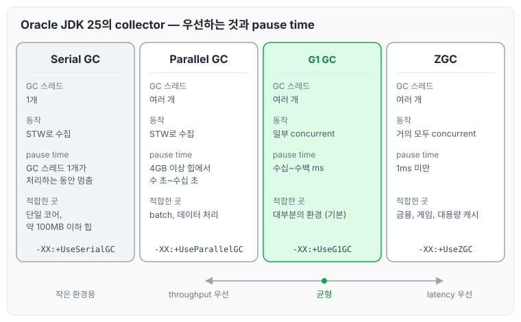
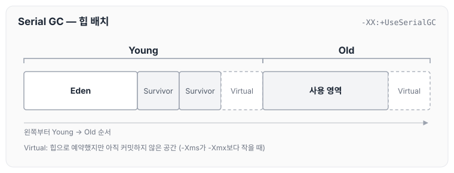
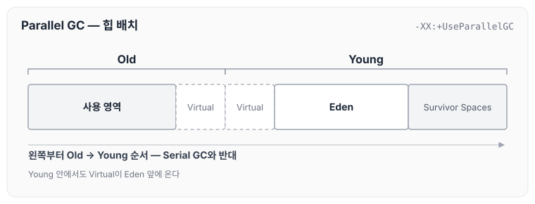
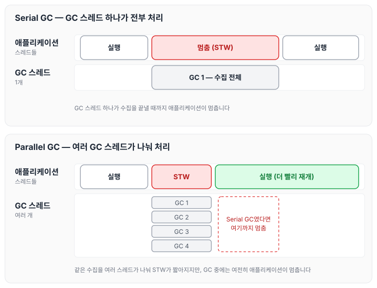
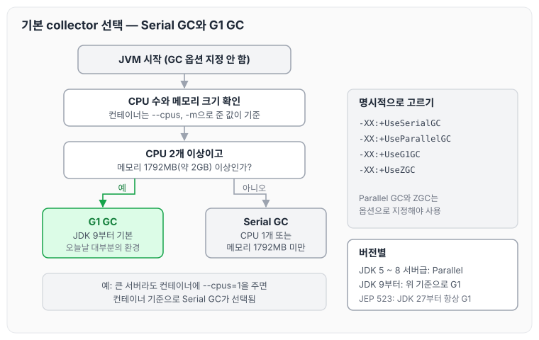
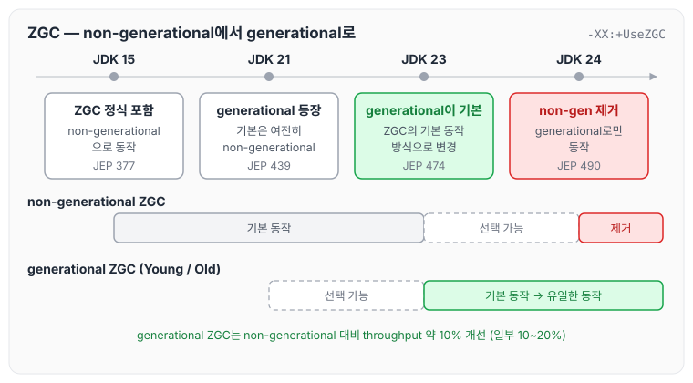
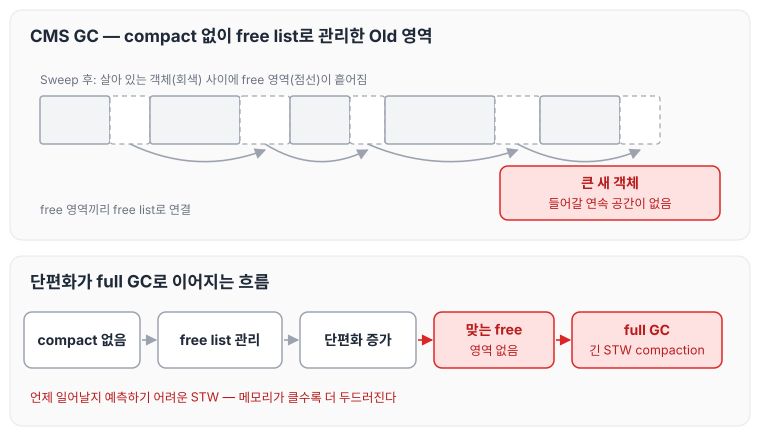
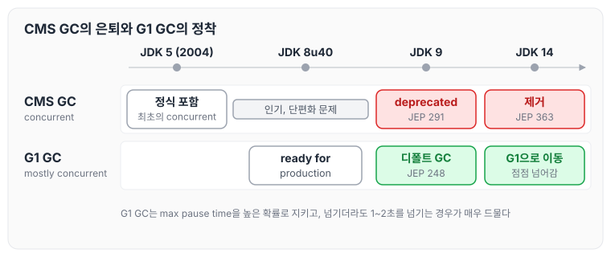
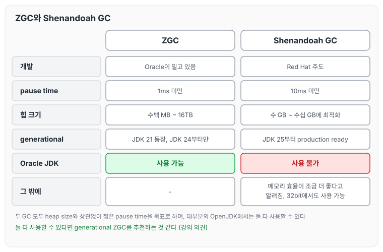

이전에 [TLAB과 Generation 크기 조정: Serial GC의 힙 크기 옵션](../gc-heap-generation-sizing/)에 대해 작성하였습니다. 이번 글에서는 Oracle JDK 25 기준으로 사용할 수 있는 garbage collector 네 가지의 특징과 디폴트로 선택되는 기준, 그리고 지금은 제거된 CMS GC와 Oracle JDK에서는 쓸 수 없는 Shenandoah GC에 대해 정리하도록 하겠습니다.

## 이용 가능한 collector 종류 (Oracle JDK 25 기준)

Oracle JDK 25에서 사용할 수 있는 collector는 아래 네 가지입니다.

- Serial GC
- Parallel GC
- G1 GC (Garbage-First GC)
- ZGC

네 가지를 GC 스레드 수, 동작 방식, pause time, 적합한 환경으로 나란히 놓으면 아래와 같습니다.

Parallel GC는 throughput을, ZGC는 latency를 가장 우선하고, G1 GC는 그 사이에서 균형을 잡습니다. Serial GC는 단일 코어나 작은 힙처럼 작은 환경을 위한 collector입니다. 아래에서 하나씩 정리하겠습니다.

### Serial GC

Serial GC는 GC가 single thread로 동작하는 generational GC입니다.

single core 환경이거나 사용하는 메모리가 약 100MB 이하인 애플리케이션이라면 이점이 있습니다.

- 어차피 core가 하나라면 GC 스레드가 하나인 것이 확실히 유리합니다. GC는 CPU를 집중적으로 쓰는 작업이기 때문입니다.
- 애플리케이션의 사용 메모리가 100MB 정도뿐이라면 오히려 single thread로 동작하는 것이 효율적일 수 있습니다.

CPU core가 하나이거나 물리 메모리가 1792MB(약 2GB)보다 작으면 Serial GC가 디폴트로 선택됩니다.

- 명시적으로 사용하고 싶을 경우: `-XX:+UseSerialGC`
- 컨테이너 환경에서는 컨테이너의 CPU 수와 메모리 크기가 기준이 됩니다(e.g. `--cpus`, `-m`).

Serial GC의 heap은 아래와 같이 배치됩니다. Oracle GC Tuning Guide의 그림을 다시 그린 것입니다.

왼쪽부터 Young(Eden, Survivor 두 개, Virtual), Old(사용 영역, Virtual) 순서입니다. Oracle 문서에 따르면 `-Xms`가 `-Xmx`보다 작을 때 예약된 공간이 처음부터 모두 커밋되지는 않으며, 이 커밋되지 않은 공간을 그림에서 Virtual로 표시합니다. 각 세대는 필요에 따라 Virtual 영역까지 늘어날 수 있습니다.

### Parallel GC

Parallel GC는 throughput collector라고도 불리며, collector 중에서 throughput이 가장 좋습니다.

Serial GC처럼 generational GC이지만 구조가 조금 다릅니다. Parallel GC의 heap 배치는 아래와 같습니다.

Serial GC는 왼쪽부터 Young, Old 순서였지만, Parallel GC는 Old가 먼저 오고 Young이 뒤에 옵니다. Young 안에서도 Virtual 영역이 Eden 앞에 있습니다.

Serial GC와의 가장 큰 차이점은 속도 향상을 위해 GC가 multi thread로 동작한다는 점입니다. 두 GC가 한 번 수집하는 과정을 나란히 놓으면 아래와 같습니다.

두 GC 모두 수집하는 동안에는 애플리케이션이 멈추는(STW) 방식입니다. 다만 Parallel GC는 같은 수집을 여러 GC 스레드가 나눠 처리하기 때문에 애플리케이션이 더 빨리 다시 실행됩니다.

- 중량급·대량급의 heap size를 가지는 애플리케이션이 multi-core나 multi-hardware thread 환경에서 동작할 때를 대상으로 합니다.
- 한 번 GC 할 때 pause time이 길더라도, 예를 들어 10시간 걸릴 작업을 9시간으로 끝낼 수 있는 것처럼 전체 throughput이 좋아지는 편이 더 중요한 경우에 적절합니다.
  - 특히 heap size가 4GB 이상일 때는 pause time이 수 초, 매우 심하면 수십 초에 이르기도 합니다.
  - throughput이 가장 좋기 때문에 batch나 데이터 처리에 적절할 수 있습니다.
- 사용하려면 `-XX:+UseParallelGC` 옵션을 명시해야 합니다. JDK 5부터 JDK 8까지는 server-class 머신에서 default GC였습니다.

또한 Parallel GC는 Ergonomics가 가장 효용성 있는 collector입니다. [GC의 역할과 튜닝 기준: Ergonomics와 JVM 기본 설정](../gc-tuning-criteria/)에서 정리한 Pause-Time 목표와 Throughput 목표를 아래 옵션으로 지정합니다.

- `-XX:MaxGCPauseMillis=N`
- `-XX:GCTimeRatio=M`
- 함께 볼 옵션: `-XX:+UseAdaptiveSizePolicy`

### G1 GC (Garbage-First GC)

G1 GC는 mostly concurrent collector입니다. GC의 일부 무거운(expensive) 작업을 애플리케이션 코드와 동시에(concurrently) 수행합니다.

- high throughput을 달성하면서도 높은 확률로 max pause-time goal을 충족할 수 있습니다.
- throughput collector(Parallel GC)의 단점이 pause time이 길다는 것이었는데, G1 GC는 이를 극복하기 위해 나왔습니다.
  - throughput과 latency 사이에서 최대한 균형을 추구하는 GC입니다.
  - 여전히 high throughput을 보이지만 Parallel GC만큼은 아닙니다. 대신 pause time은 Parallel GC보다 크게 개선되었습니다(수십~수백 ms).
- 기본적으로 generational GC 방식이지만, region이라는 전혀 새로운 개념이 도입되었습니다.
- 소규모 스펙의 하드웨어부터 대규모 스펙의 하드웨어까지 다양한 machine을 커버할 수 있습니다.
  - 실제로 G1 GC를 모든 환경에서 default GC로 설정하려는 움직임이 있고, 이 내용을 담은 [JEP 523](https://openjdk.org/jeps/523)이 JDK 27에 반영되었습니다. JDK 27부터는 CPU 수나 메모리 크기와 관계없이 G1 GC가 기본으로 선택됩니다.

JDK 9부터는 CPU core가 두 개 이상이고 물리 메모리가 1792MB(약 2GB) 이상이면 G1 GC가 디폴트로 선택됩니다. 오늘날 대부분의 환경이 여기에 해당합니다.

- 명시적으로 사용하고 싶을 경우: `-XX:+UseG1GC`
- 컨테이너 환경에서는 컨테이너의 CPU 수와 메모리 크기가 기준이 됩니다(e.g. `--cpus`, `-m`).

Serial GC와 G1 GC 중 어느 쪽이 디폴트로 선택되는지 정리하면 아래와 같습니다.

컨테이너에서 실행할 때는 호스트 머신이 아니라 컨테이너에 준 CPU 수와 메모리 크기로 판단합니다. 그래서 서버가 크더라도 컨테이너에 CPU를 1개만 주거나 메모리를 1792MB보다 작게 주면 Serial GC가 선택됩니다. Parallel GC와 ZGC는 디폴트로 선택되지 않으므로 옵션으로 지정해야 합니다.

### ZGC

ZGC는 ultra-low latency collector입니다.

- 수백 MB부터 16TB까지 다양한 heap size에서 일관되게 1ms 미만의 pause time을 보장합니다. 즉, pause time이 heap size와 무관(independent)합니다.
- GC의 거의 모든 무거운 작업을 애플리케이션 코드와 동시에(concurrently) 수행합니다.
- throughput 일부를 희생하더라도 ultra-low latency를 추구합니다.
  - 금융·주식 거래, 게임, 대용량 캐시 등 latency가 핵심인 서비스에 적절합니다.
- 사용하려면 `-XX:+UseZGC` 옵션을 명시해야 합니다.

ZGC는 처음에는 세대를 나누지 않는 non-generational 방식으로 시작했고, 이후 generational ZGC로 바뀌었습니다. 버전별 흐름은 아래와 같습니다.

- JDK 15에서 ZGC가 정식으로 포함되었습니다([JEP 377](https://openjdk.org/jeps/377)). 이때는 non-generational ZGC로 동작했습니다.
- JDK 21에서 generational ZGC가 등장했습니다([JEP 439](https://openjdk.org/jeps/439)). 이때 ZGC의 default 동작은 여전히 non-generational이었습니다.
- generational ZGC는 non-generational ZGC에 비해 throughput이 10% 개선되었고, 일부 10~20% 개선되는 경우도 보였습니다.
- JDK 23에서 generational ZGC가 ZGC의 default 동작 방식으로 변경되었습니다([JEP 474](https://openjdk.org/jeps/474)).
- JDK 24에서 non-generational ZGC가 완전히 제거되었습니다([JEP 490](https://openjdk.org/jeps/490)). 이때부터 ZGC는 generational ZGC로만 동작할 수 있습니다.

JDK 21부터 JDK 23까지는 두 방식을 모두 선택할 수 있었고(JDK 23에서는 기본값만 바뀌었습니다), JDK 24부터는 generational ZGC만 남았습니다.

## CMS (Concurrent Mark Sweep) GC

CMS GC는 application code와 concurrent하게 동작하는 최초의 concurrent collector입니다. 2004년 JDK 5에 정식으로 포함되었습니다. CMS GC의 단계별 동작은 [Garbage Collection(GC)](../garbage-collection/)에서 그림으로 정리한 적이 있습니다.

CMS GC가 쓰이던 2000년대 중후반의 상황은 다음과 같습니다.

- 하드웨어 스펙이 점점 좋아지면서 멀티 코어와 GB 단위의 메모리가 대중화되었습니다.
- 2004년부터 페이스북 등 소셜 미디어가 등장하면서 사용자 참여형 웹 애플리케이션이 크게 늘었고, 웹 애플리케이션의 latency가 중요해졌습니다.
- Serial GC나 Parallel GC는 언제나 STW(stop-the-world)로 동작하기 때문에 latency에 좋지 않았습니다.

### CMS GC의 특징과 문제점

- 대부분의 GC 단계를 애플리케이션 코드와 concurrent하게 수행합니다. 그래서 STW 구간이 짧고 low latency가 가능해 인기가 많아졌습니다.
- 하지만 compact 단계가 없습니다. free 영역을 별도의 free list로 관리하기 때문에 단편화가 늘어나고, 객체를 놓을 적당한 free 영역이 없으면 full GC가 일어나 긴 STW compaction이 발생합니다.
- 이 때문에 예측할 수 없는 STW 시간이 단점으로 부각되었고, 메모리 크기가 커질수록 이 단점이 더 두드러졌습니다.

free 영역의 합은 충분해도 큰 객체를 놓을 연속된 공간이 없으면 full GC가 일어나고, 이때 compaction을 하는 동안 애플리케이션이 길게 멈춥니다.

### G1 GC의 안정화와 CMS GC의 은퇴

- JDK 8u40에서 G1을 ready for production으로 공식 선언하였고, JDK 9에서 G1 GC가 디폴트가 되면서([JEP 248](https://openjdk.org/jeps/248)) 점점 G1 GC로 넘어가게 되었습니다.
- G1 GC도 concurrent collector이면서 max pause time을 높은 확률로 보장합니다. max pause time을 넘기더라도 1~2초를 넘기는 경우는 매우 드뭅니다.
- CMS GC는 JDK 9에서 deprecated되었고([JEP 291](https://openjdk.org/jeps/291)), JDK 14에서 완전히 제거되었습니다([JEP 363](https://openjdk.org/jeps/363)).

## Shenandoah GC

Shenandoah GC는 ZGC와 유사하게 heap size와 상관없이 10ms 미만의 pause time을 보장합니다.

Red Hat이 주도해서 개발하였습니다.

- Oracle은 ZGC를 밀고 있기 때문에 Oracle JDK에서는 Shenandoah GC를 쓸 수 없습니다.
- 대부분의 OpenJDK에서는 ZGC와 Shenandoah GC를 둘 다 쓸 수 있습니다.

특징은 다음과 같습니다.

- JDK 25부터는 generational Shenandoah GC를 production ready 상태로 사용할 수 있습니다([JEP 521](https://openjdk.org/jeps/521)). 이로 인해 throughput이 더 좋아졌습니다.
- 중대형 규모의 힙 사이즈(수 GB~수십 GB)에 최적화되어 있습니다.
- ZGC보다 메모리 효율이 조금 더 좋다고 알려져 있습니다.
- 32bit에서도 사용할 수 있습니다.

ZGC와 나란히 비교하면 아래와 같습니다.

둘 다 사용할 수 있는 환경이라면, 강의에서는 generational ZGC를 추천하는 것 같다고 하였습니다.

## 마무리

오늘은 Oracle JDK 25 기준으로 사용할 수 있는 Serial, Parallel, G1, ZGC의 특징과 디폴트로 선택되는 기준, generational ZGC의 버전별 변화, 그리고 CMS GC가 은퇴한 과정과 Shenandoah GC에 대해 정리하였습니다.

정리하면서 collector마다 throughput과 latency 중 무엇을 우선하는지가 다르다는 것을 알 수 있었습니다. 대부분의 환경에서는 G1 GC가 디폴트로 쓰이지만, 컨테이너에 CPU나 메모리를 작게 주면 Serial GC가 선택될 수 있다는 점은 기억해 두어야 할 것 같습니다.

다음 글에서는 이 중 Parallel GC를 자세히 다룬 [Parallel GC: GC 스레드, PLAB와 Ergonomics](../gc-parallel-collector/)에 대해 정리하도록 하겠습니다.

참고 자료
- [GC 6부: GC 종류 정리](https://youtube.com/live/AtEu4_qwN-w?feature=share) (멤버십 전용 영상)
- [Available Collectors (Oracle HotSpot GC Tuning Guide, JDK 25)](https://docs.oracle.com/en/java/javase/25/gctuning/available-collectors.html)
- [Factors Affecting Garbage Collection Performance (Oracle HotSpot GC Tuning Guide, JDK 25)](https://docs.oracle.com/en/java/javase/25/gctuning/factors-affecting-garbage-collection-performance.html)
- [The Parallel Collector (Oracle HotSpot GC Tuning Guide, JDK 25)](https://docs.oracle.com/en/java/javase/25/gctuning/parallel-collector1.html)
- [Garbage-First (G1) Garbage Collector (Oracle HotSpot GC Tuning Guide, JDK 25)](https://docs.oracle.com/en/java/javase/25/gctuning/garbage-first-g1-garbage-collector1.html)
- [The Z Garbage Collector (Oracle HotSpot GC Tuning Guide, JDK 25)](https://docs.oracle.com/en/java/javase/25/gctuning/z-garbage-collector1.html)
- [JEP 248: Make G1 the Default Garbage Collector](https://openjdk.org/jeps/248)
- [JEP 523: Make G1 the Default Garbage Collector in All Environments](https://openjdk.org/jeps/523)
- [JEP 291: Deprecate the Concurrent Mark Sweep (CMS) Garbage Collector](https://openjdk.org/jeps/291)
- [JEP 363: Remove the Concurrent Mark Sweep (CMS) Garbage Collector](https://openjdk.org/jeps/363)
- [JEP 377: ZGC: A Scalable Low-Latency Garbage Collector (Production)](https://openjdk.org/jeps/377)
- [JEP 439: Generational ZGC](https://openjdk.org/jeps/439)
- [JEP 474: ZGC: Generational Mode by Default](https://openjdk.org/jeps/474)
- [JEP 490: ZGC: Remove the Non-Generational Mode](https://openjdk.org/jeps/490)
- [JEP 521: Generational Shenandoah](https://openjdk.org/jeps/521)
