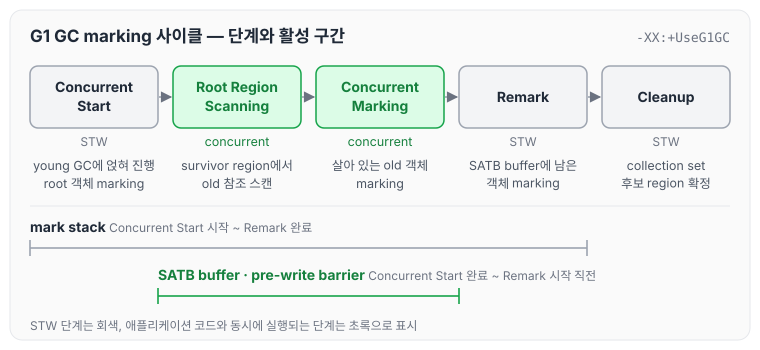
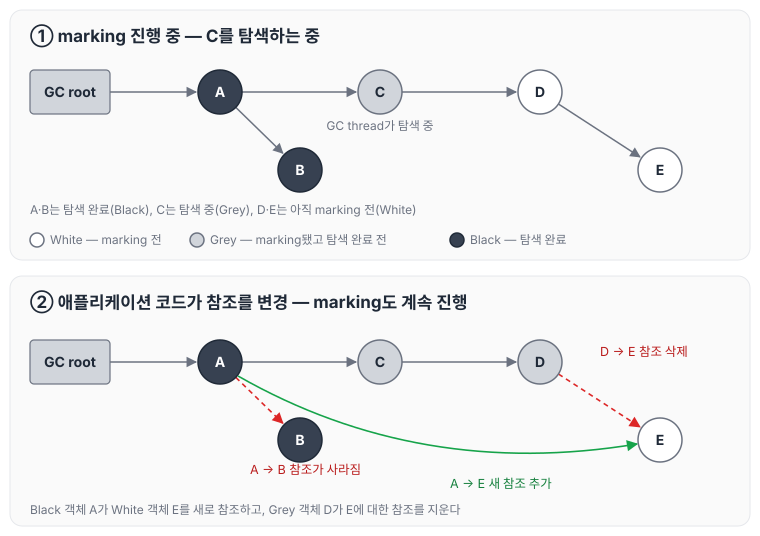
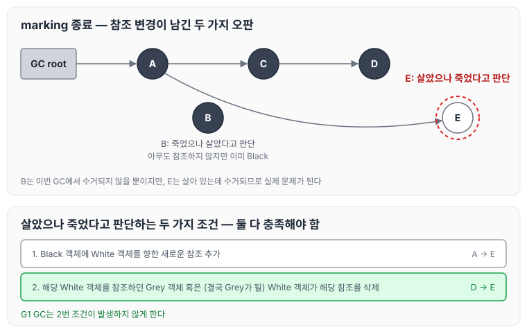
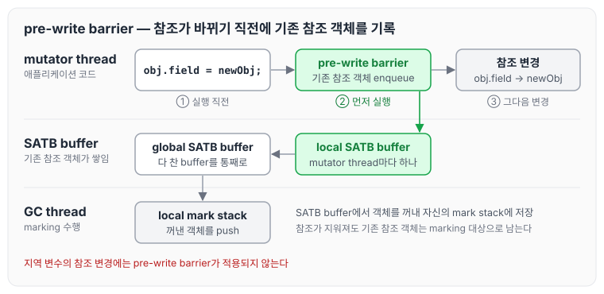
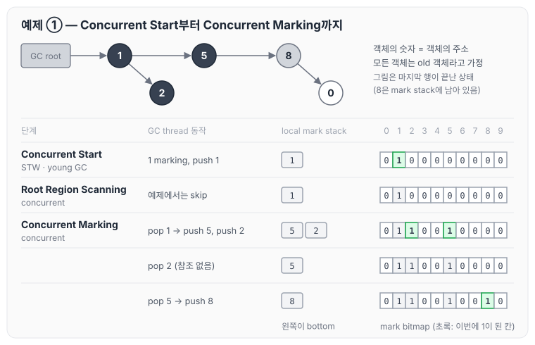
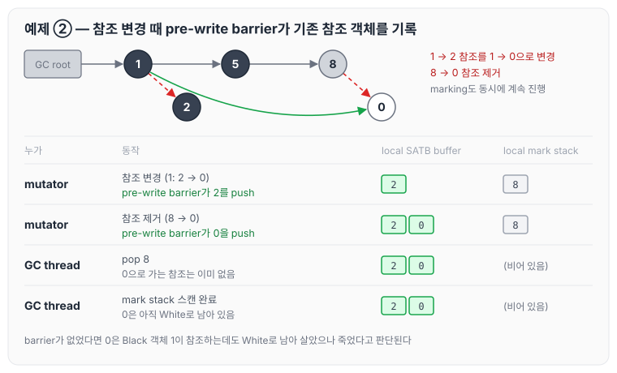
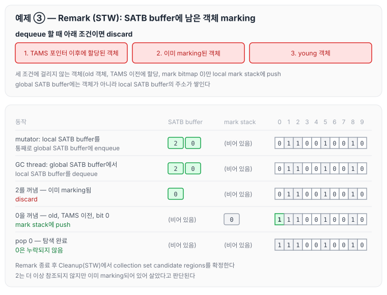
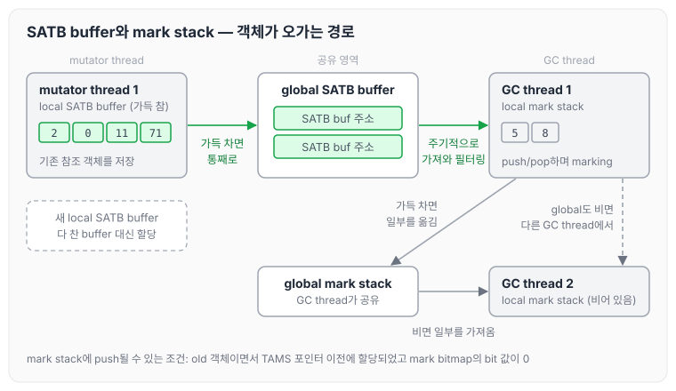
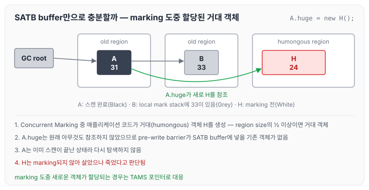
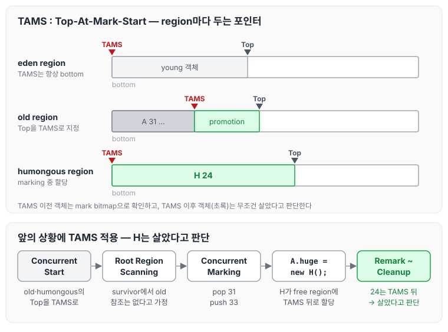

이전에 [G1 GC 핵심 원리: region, mixed collection과 concurrent marking](../gc-g1-core/)에 대해 작성하였습니다. 그 글에서 G1 GC가 STW를 줄이기 위해 old 객체의 marking을 애플리케이션 코드와 동시에(concurrent) 진행한다고 정리했는데, 이번 글에서는 marking을 동시에 진행할 때 생기는 문제와 G1 GC가 이를 pre-write barrier, SATB buffer, mark stack, TAMS 포인터로 해결하는 방식에 대해 정리하도록 하겠습니다.

## G1 GC 핵심 요약

앞 글에서 정리한 G1 GC의 핵심을 다시 요약하자면 아래와 같습니다.

1. STW를 어떻게 줄일 수 있을지 고민합니다.
2. young GC는 원래 방식대로 동작합니다. evacuation(mark-copy), parallel-threaded, STW
3. heap을 region 단위로 나눠서 사용합니다. 그러면 young/old generation의 크기를 더 유연하게 관리할 수 있습니다.
4. old generation이 다 차기 전에 미리미리 old generation의 garbage들을 처리합니다.
5. old generation을 collection 하는 알고리즘으로 evacuation을 사용합니다.
6. 애플리케이션 코드와 old 객체의 marking 작업을 concurrent 하게 진행합니다.
7. Young GC에 숟가락을 얹는 방식으로 old generation의 garbage들을 야금야금 정리합니다.

이번 글에서 다루는 것은 6번입니다.

강의에서는 G1 GC의 단계를 Oracle의 G1 GC 튜토리얼에 있는 표로 함께 보았습니다. 표의 내용을 옮기면 아래와 같습니다.

| Phase | Description |
|-------|-------------|
| (1) Initial Mark (Stop the World Event) | STW 단계입니다. G1에서는 일반 young GC에 얹혀서(piggybacked) 수행됩니다. old generation의 객체를 참조하고 있을 수 있는 survivor region(root region)을 표시합니다. |
| (2) Root Region Scanning | survivor region에서 old generation을 가리키는 참조를 스캔합니다. 애플리케이션이 계속 실행되는 동안 진행되며, 다음 young GC가 일어나기 전에 끝나야 합니다. |
| (3) Concurrent Marking | heap 전체에서 살아 있는 객체를 찾습니다. 애플리케이션이 실행되는 동안 진행되며, young GC에 의해 중단될 수 있습니다. |
| (4) Remark (Stop the World Event) | heap의 살아 있는 객체 marking을 마무리합니다. CMS collector에서 쓰던 방식보다 훨씬 빠른 snapshot-at-the-beginning(SATB) 알고리즘을 사용합니다. |
| (5) Cleanup (Stop the World Event and Concurrent) | 살아 있는 객체와 완전히 비어 있는 region을 집계하고(STW), remembered set을 정리하고(STW), 빈 region을 초기화해 free list로 돌려보냅니다(concurrent). |
| (*) Copying (Stop the World Event) | 살아 있는 객체를 사용하지 않는 region으로 evacuation 하거나 copy 하는 STW 단계입니다. young generation region만 대상이면 `[GC pause (young)]`, young과 old generation region을 함께 대상으로 하면 `[GC Pause (mixed)]`로 로그에 남습니다. |

표의 Initial Mark는 현재 Oracle 문서(JDK 25)에서는 Concurrent Start라고 부릅니다. 이 글에서도 Concurrent Start로 적겠습니다. Concurrent Start는 old generation 점유율이 임계값을 넘었을 때 시작되고, Young-Only 단계 안에서 Concurrent Start → Remark → Cleanup이 이어진 뒤 Space-Reclamation 단계로 넘어갑니다. 이 흐름은 [G1 GC 핵심 원리: region, mixed collection과 concurrent marking](../gc-g1-core/)에서 정리하였습니다.

marking 한 사이클을 단계 순서로 놓으면 아래와 같습니다.

Concurrent Start, Remark, Cleanup은 STW이고, Root Region Scanning과 Concurrent Marking은 애플리케이션 코드와 동시에 실행됩니다. 아래에서 설명할 SATB buffer와 pre-write barrier는 Concurrent Start가 끝난 뒤부터 Remark 시작 직전까지, mark stack은 Concurrent Start 시작부터 Remark 완료까지 쓰입니다.

## concurrent mark의 문제점

marking을 애플리케이션 코드와 동시에 진행하면 어떤 문제가 생기는지부터 정리하겠습니다. 강의에서는 marking 중인 객체를 세 가지 상태로 나누어 설명하였습니다.

- marking 전 객체 (White)
- marking됐고 탐색 완료 전 객체 (Grey) — 살아 있다고 표시했지만, 이 객체가 참조하는 객체들은 아직 확인하지 않은 상태입니다.
- marking됐고 탐색 완료된 객체 (Black) — 이 객체가 참조하는 객체들까지 모두 확인한 상태입니다.

GC root에서 시작해서 White 객체를 Grey로, Grey 객체를 Black으로 바꿔 가며 marking을 진행합니다(흔히 tri-color marking이라고 부릅니다). GC root는 [Generational GC 핵심 원리: GC root, remembered set, minor GC와 major GC](../gc-generational-collection/)에서 정리하였습니다.

marking이 끝났을 때 Black으로 남은 객체는 살아 있다고, White로 남은 객체는 죽었다고 판단합니다. 그런데 marking이 진행되는 동안 애플리케이션 코드도 함께 실행되기 때문에, 그 사이에 객체 간의 참조가 바뀔 수 있습니다. 강의의 예제는 아래와 같습니다.

GC thread가 Grey 객체 C를 탐색하는 중에 애플리케이션 코드가 참조를 바꿉니다.

- Black 객체 A가 참조하던 B 대신 White 객체 E를 참조하도록 바뀝니다.
- Grey 객체 D가 참조하던 E에 대한 참조가 삭제됩니다.

그 뒤 marking이 계속 진행되어 종료되면 아래와 같은 결과가 나옵니다.

- B는 더 이상 아무도 참조하지 않지만, 이미 Black이 되었기 때문에 **죽었으나 살았다고 판단**됩니다.
- E는 A가 참조하고 있어 살아 있지만, A는 이미 탐색이 끝났고 D에서 E로 가는 참조는 지워졌기 때문에 White로 남습니다. 즉, **살았으나 죽었다고 판단**됩니다.

죽었으나 살았다고 판단되는 객체는 이번 GC에서 수거되지 않을 뿐이지만, 살았으나 죽었다고 판단되는 객체는 수거되어 버리기 때문에 실제로 문제가 됩니다. 살았으나 죽었다고 판단하는 문제가 발생하려면 아래 두 조건을 둘 다 충족해야 합니다.

1. Black 객체에 White 객체를 향한 새로운 참조 추가.
2. 해당 White 객체를 참조하던 Grey 객체 혹은 (결국 Grey가 될) White 객체가 해당 참조를 삭제.

G1 GC는 이 중 두 번째 조건이 발생하지 않게 합니다.

## pre-write barrier & SATB buffer

G1 GC의 전략은 pre-write barrier를 통해 객체 간의 참조가 바뀔 때마다 이전에 참조하고 있던 객체를 SATB buffer에 enqueue하는 것입니다. SATB는 Snapshot-At-The-Beginning의 약자입니다.

- pre-write barrier는 객체의 참조가 변경되기 직전에 실행되는 코드 조각입니다. 지역 변수의 참조에는 적용되지 않습니다.
  - e.g.) `obj.field = newObj;` ← 변경되기 직전에 pre-write barrier가 실행됩니다.
- 객체의 참조 변경이 있을 때마다 pre-write barrier가 실행되어 기존에 참조하던 객체를 SATB buffer에 enqueue합니다.
- GC thread는 SATB buffer에서 객체들을 꺼내서 자신의 mark stack에 저장합니다.

참조가 지워지더라도 지워지기 전의 참조 대상이 SATB buffer에 남기 때문에, 두 번째 조건이 성립하지 않습니다. 참조 하나가 바뀔 때 pre-write barrier가 하는 일을 그리면 아래와 같습니다.

## 예제로 보는 SATB buffer와 mark stack

강의에서는 객체 다섯 개로 marking 한 사이클을 따라갔습니다. 예제의 전제는 아래와 같습니다.

- 객체의 숫자는 객체의 주소입니다. mark bitmap의 0~9번 칸이 각 주소에 해당합니다.
- 모든 객체는 old 객체라고 가정합니다.
- 참조 관계는 GC root → 1, 1 → 5, 1 → 2, 5 → 8, 8 → 0입니다.
- GC thread는 local mark stack을, mutator thread(애플리케이션 thread)는 local SATB buffer를 가지고, 그 사이에 global SATB buffer가 있습니다.

### Concurrent Start부터 Concurrent Marking까지

단계별로 진행하면 아래와 같습니다.

- Concurrent Start (young GC에 숟가락을 얹어 진행하며, young 객체는 evacuation 됩니다): GC root가 참조하는 1을 mark bitmap에 표시하고 local mark stack에 push합니다. young GC가 완료됩니다.
- Root Region Scanning (young GC 후 survivor regions 대상, concurrent): 예제에서는 skip합니다.
- Concurrent Marking (애플리케이션 코드와 동시 실행)
  - 1을 pop하고, 1이 참조하는 5와 2를 mark bitmap에 표시한 뒤 push합니다.
  - 2를 pop합니다. 2는 참조하는 객체가 없습니다.
  - 5를 pop하고, 5가 참조하는 8을 표시한 뒤 push합니다.

이 시점의 mark bitmap은 1, 2, 5, 8번 칸이 1이고, local mark stack에는 8이 남아 있습니다.

### 애플리케이션 코드가 참조를 변경

marking이 진행되는 동안 애플리케이션 코드가 참조를 변경합니다(marking도 동시에 계속 진행됩니다).

- 참조 변경: 1이 2 대신 0을 참조하도록 바뀝니다. 참조가 바뀌기 직전에 pre-write barrier가 동작해서 기존에 참조하던 2를 local SATB buffer에 push합니다.
- 참조 제거: 8이 0을 참조하던 것이 제거됩니다. 이때도 pre-write barrier가 동작해서 0을 local SATB buffer에 push합니다.
- GC thread는 그 사이에 8을 pop합니다. 8이 참조하던 0은 이미 지워졌으므로 더 push할 것이 없습니다.
- Concurrent Marking 단계에서 mark stack에 있던 모든 객체의 스캔이 완료됩니다.

pre-write barrier가 없었다면 0은 Black 객체 1이 참조하는데도 White로 남아, 앞에서 본 살았으나 죽었다고 판단하는 경우가 됩니다.

### Remark와 Cleanup

Remark 단계에서는 STW 상태에서 SATB buffer에 남아 있는 객체를 marking합니다.

- mutator thread의 local SATB buffer는 통째로 global SATB buffer에 enqueue됩니다. global SATB buffer에는 객체가 아니라 SATB buffer의 주소가 쌓입니다.
- GC thread가 global SATB buffer에서 local SATB buffer를 dequeue하고, 안의 객체를 하나씩 꺼냅니다.
- dequeue할 때 아래 조건으로 필터링해서 discard시킵니다.
  1. TAMS 포인터 이후에 할당된 객체
  2. 이미 marking된 객체
  3. young 객체
- 2는 이미 marking되었으므로 discard합니다.
- 0은 mark stack에 push합니다. mark bitmap의 0번 칸이 1이 되고, 0을 pop해서 탐색을 마칩니다. 0이 누락되지 않았습니다.
- Remark가 종료됩니다.

Cleanup 단계에서는 STW 상태에서 collection set candidate regions를 확정합니다.

최종 mark bitmap은 0, 1, 2, 5, 8번 칸이 1입니다. 0은 누락 없이 살았다고 판단되었고, 2는 실제로는 더 이상 참조되지 않지만 살았다고 판단됩니다.

### SATB buffer와 mark stack 정리

예제에서 본 SATB buffer의 동작을 정리하면 아래와 같습니다.

- SATB buffer와 pre-write barrier가 활성화되는 구간: Concurrent Start 완료 시점 ~ Remark 시작 직전
- 각 application(mutator) thread는 local SATB buffer를 가집니다.
- 참조 쓰기가 발생했을 때 pre-write barrier를 통해 기존에 참조하던 객체를 local SATB buffer에 저장합니다.
- local SATB buffer가 다 차면 global SATB buffer로 통째로 옮기고 새로운 local SATB buffer를 할당합니다.

mark stack의 동작은 아래와 같습니다.

- mark stack이 활성화되는 구간: Concurrent Start 시작 시점 ~ Remark 완료 시점
- 각 GC thread는 local mark stack을 가집니다.
- GC root와 Root regions부터 시작해서 local mark stack에 push/pop을 하며 살아 있는 old 객체를 marking합니다.
- GC thread는 concurrent marking 중에 주기적으로 global SATB buffer에서 완료된 local SATB buffer를 가져옵니다.
  - 이때 local SATB buffer에서 필터링을 통해 일부 객체는 버리고 대상이 되는 old 객체만 local mark stack에 push합니다.
- 자신의 local mark stack이 가득 차면 global mark stack으로 일부를 옮깁니다.
- 반면에 자신의 local mark stack이 비게 되면 global mark stack에서 일부를 가져옵니다.
  - global mark stack도 비어 있으면 다른 GC thread의 local mark stack에서 일부를 가져옵니다.
- mark stack에 push될 수 있는 조건
  - old 객체이면서 TAMS 포인터 이전에 할당되었으며 mark bitmap에서 bit 값이 0인 경우

두 자료구조 사이에서 객체가 오가는 경로를 그리면 아래와 같습니다.

## SATB : Snapshot-At-The-Beginning

SATB는 concurrent start 시작 때 살아 있는 객체는 모두 살아 있다고 보는 전략입니다. pre-write barrier로 기존 참조 객체를 SATB buffer에 넣는 이유도 이 때문입니다. 참조가 지워지더라도 marking을 시작한 시점에 살아 있던 객체라면 살아 있다고 보는 것입니다.

하지만 pre-write barrier와 local SATB buffer만으로 충분할까요? 강의에서는 아래 상황을 예로 들었습니다.

- Concurrent Marking 중입니다. GC root가 old region의 A(31)를 참조하고, A는 다른 old region의 B(33)를 참조합니다. A는 스캔이 이미 끝난 상태이고, local mark stack에는 33이 있습니다.
- 이때 애플리케이션 코드가 거대(humongous) 객체를 생성합니다: `A.huge = new H();`
  - region size의 ½ 이상이면 거대 객체입니다. H(24)는 humongous region에 할당됩니다.
- `A.huge`는 원래 아무것도 참조하지 않았으므로 pre-write barrier가 SATB buffer에 넣을 기존 객체가 없습니다.
- A는 스캔이 이미 끝났기 때문에 H는 marking되지 않습니다. 즉, H는 살았으나 죽었다고 판단됩니다.

marking 도중 새로운 객체가 할당되는 경우는 SATB buffer로 대응할 수 없습니다. G1 GC는 이를 TAMS 포인터로 대응합니다.

## TAMS : Top-At-Mark-Start

TAMS 포인터의 규칙은 아래와 같습니다.

- 각 region의 기본 TAMS pointer 위치는 bottom입니다.
- Concurrent Start 시 old/humongous regions의 Top을 TAMS 포인터로 지정합니다.
- TAMS 이후 객체는 무조건 살았다고 판단합니다(TAMS 이전 객체는 mark bitmap으로 확인합니다).

강의에서는 region에 객체가 할당되는 과정부터 따라갔습니다.

- free region의 Top과 Bottom은 같은 위치에 있습니다.
- eden region에 객체가 할당될 때마다 Top이 뒤로 이동합니다. TAMS는 bottom에 그대로 있습니다.
- young GC가 발생하면 살아 있는 객체가 survivor region으로 copy되고, eden region은 비워져 다시 Top과 Bottom이 같아집니다.
- Young region(= eden/survivor region)의 TAMS 포인터는 항상 해당 region의 bottom을 가리킵니다.
- young 객체에게는 TAMS 포인터가 사실상 별다른 의미가 없습니다. young 객체는 단순히 reachable 할 때마다 다른 region으로 copy되기 때문입니다.

이어서 앞의 humongous 객체 상황으로 돌아가면 아래와 같습니다.

- Concurrent Start 시작(young GC): old region의 Top이 TAMS가 됩니다. A(31)가 있는 old region과 B(33)가 있는 old region 모두 TAMS가 Top 위치로 옮겨집니다.
- Concurrent Start 종료: GC root가 참조하는 A를 mark bitmap에 표시하고 local mark stack에 push합니다. young GC가 끝나 eden region은 비워지고, 살아 있는 객체는 survivor region으로 옮겨집니다.
- Root Region Scanning 시작(concurrent): survivor region에서 old 객체를 참조하는 것은 없었다고 가정합니다.
- Concurrent Marking 시작: A를 pop하고, A가 참조하는 B(33)를 push합니다.
- 이때 `A.huge = new H();`로 거대 객체 H(24)가 free region에 할당됩니다. 이 region의 TAMS는 bottom이고, H가 할당되면서 Top만 H 뒤로 이동합니다.
- Remark ~ Cleanup 단계에서 24는 TAMS 뒤에 있는 old 객체이기 때문에 살았다고 판단합니다.

Concurrent Start 시점에 Top이었던 위치가 TAMS가 되므로, 그 뒤에 할당된 객체는 모두 TAMS 이후에 놓입니다. 그래서 marking 도중 할당된 객체는 mark bitmap을 보지 않고도 살았다고 판단할 수 있습니다. 앞에서 SATB buffer를 필터링할 때 TAMS 포인터 이후에 할당된 객체를 버린 것도 같은 이유입니다.

## G1 GC가 문제 없이 concurrent marking이 가능했던 이유

지금까지의 내용을 정리하면 아래와 같습니다.

- SATB buffer & pre-write barrier: marking 도중에 참조가 바뀌는 경우를 대응합니다.
- TAMS pointer: marking 도중에 새로운 old 객체가 할당되는 경우를 대응합니다(humongous 객체, promotion 등).
- 물론 단점은 garbage임에도 살았다고 판단되는 경우가 있다는 것입니다. 이는 다음 cycle에서 해결됩니다.

## 마무리

오늘은 G1 GC가 old 객체를 애플리케이션 코드와 동시에 marking할 때 생기는 두 가지 오판과, 이를 막기 위한 pre-write barrier, SATB buffer, mark stack, TAMS 포인터의 동작에 대해 정리하였습니다.

정리하면서 G1 GC는 살아 있는 객체를 놓치지 않는 쪽을 택하고, 그 대가로 일부 garbage를 다음 cycle로 넘긴다는 것을 알 수 있었습니다. 다음 글에서는 [G1 GC의 remembered set과 collection set](../gc-g1-remembered-set/)에 대해 정리하겠습니다.

참고 자료
- [GC 9부: G1GC concurrent marking](https://youtube.com/live/bp8f2vuH2BQ?feature=share) (멤버십 전용 영상)
- [Garbage-First (G1) Garbage Collector (Oracle HotSpot GC Tuning Guide, JDK 25)](https://docs.oracle.com/en/java/javase/25/gctuning/garbage-first-g1-garbage-collector1.html)
- [Getting Started with the G1 Garbage Collector (Oracle 튜토리얼)](https://www.oracle.com/technetwork/tutorials/tutorials-1876574.html)
