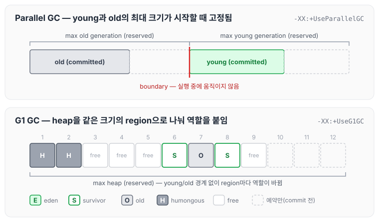
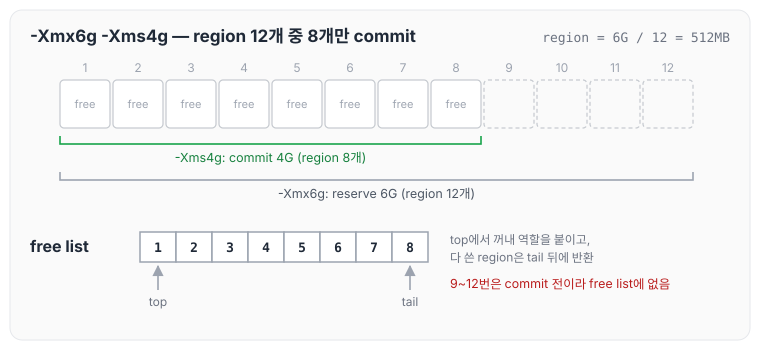
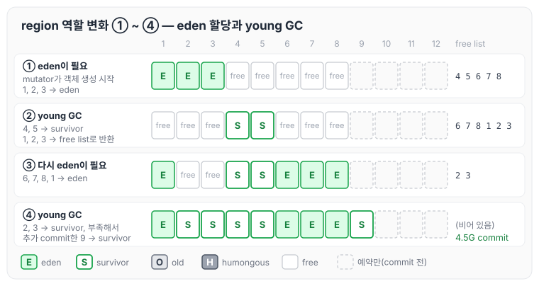
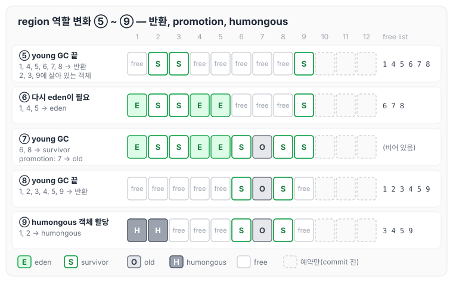
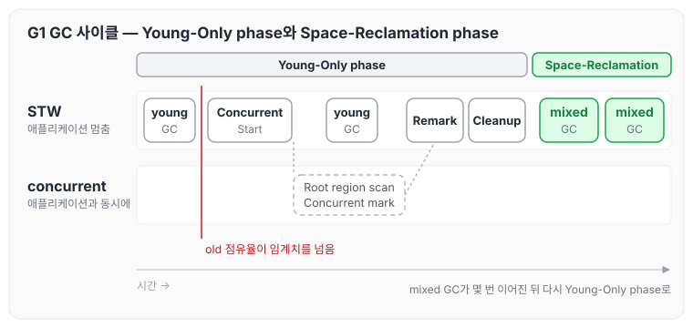
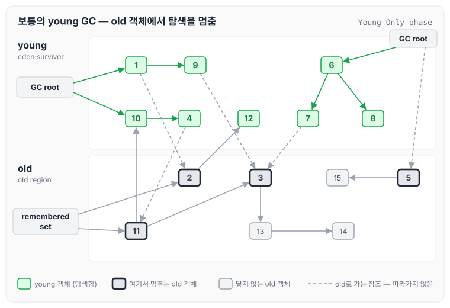
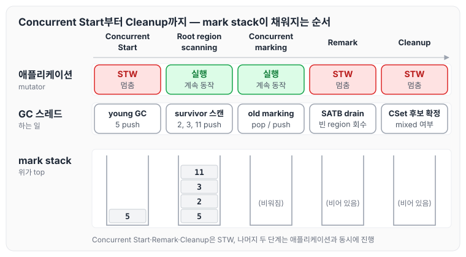
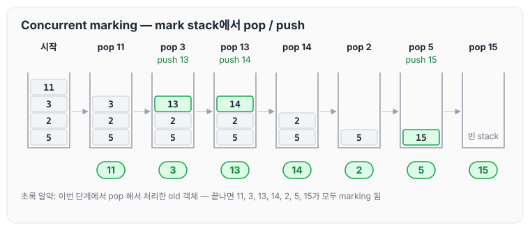
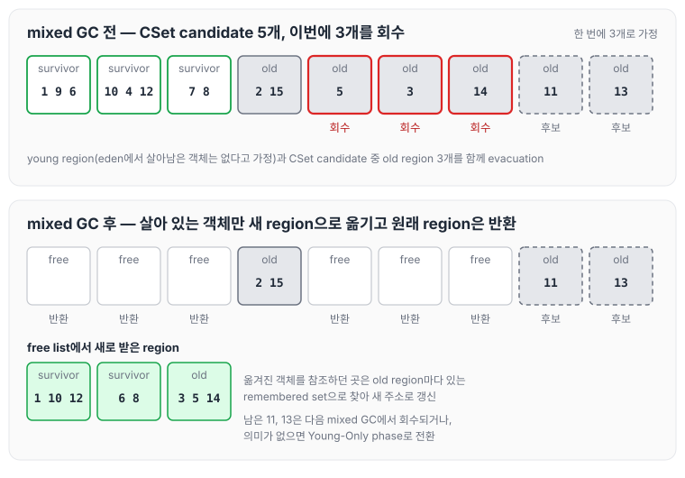
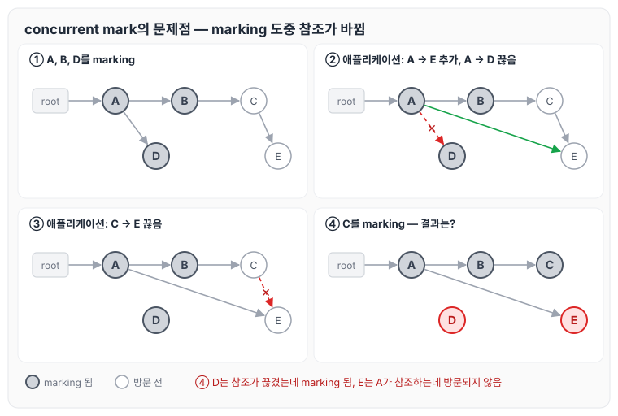

이전에 [Parallel GC: GC 스레드, PLAB와 Ergonomics](../gc-parallel-collector/)에 대해 작성하였습니다. [GC 종류: Serial, Parallel, G1, ZGC와 CMS, Shenandoah](../gc-collector-types/)에서는 G1 GC를 collector 중 하나로 간단히 다뤘는데, 이번 글에서는 Serial GC와 Parallel GC의 문제점에서 출발해서 G1 GC가 heap을 region 단위로 나눠 쓰는 방식과 old generation을 조금씩 회수하는 mixed collection, 그리고 이를 위한 marking 과정에 대해 정리하도록 하겠습니다.

## Serial GC, Parallel GC의 문제점

강의에서는 Serial GC와 Parallel GC의 문제점을 두 가지로 정리하였습니다.

1. Stop-The-World(STW, pause)
   - GC가 동작하는 동안 애플리케이션 코드는 동작을 멈춥니다.
   - 멀티 코어의 이점을 살리지 못합니다(애플리케이션과 GC가 동시에 동작하지 않습니다).
   - G1 GC는 old generation을 collection 할 때 concurrent 하게 동작합니다.
2. young, old generation의 최대 크기가 프로세스 시작 때 고정됩니다.
   - young/old 영역을 유동적으로 사용하는 데 일정 부분 한계가 있습니다.
   - 실행 중에 young/old의 boundary 자체를 조정하지는 않습니다.
     - `UseAdaptiveGCBoundary` 옵션은 버그가 많아 잘 쓰이지 않았고, 결국 폐기되었습니다(JDK 15에서 obsoleted, JDK 16에서 expired 되었고, [Parallel GC: GC 스레드, PLAB와 Ergonomics](../gc-parallel-collector/)에서 정리하였습니다).
   - G1 GC는 region이라는 개념을 도입하였습니다.

두 번째 문제를 Parallel GC와 G1 GC의 heap 배치로 나란히 놓으면 아래와 같습니다.

Serial GC와 Parallel GC는 순서만 다를 뿐, young generation과 old generation이 각각 연속된 주소 공간으로 예약(reserved)되고 그 경계가 시작할 때 정해집니다. G1 GC는 heap 전체를 같은 크기의 region으로 나누고, 각 region에 eden, survivor, old 같은 역할을 그때그때 붙여서 사용합니다.

## G1 GC heap layout: region

G1 GC가 heap을 다루는 방식을 요약하자면 아래와 같습니다.

- 더 이상 young generation과 old generation 각각을 연속된 주소 공간으로 잡지 않습니다.
- region이라는 개념을 도입하여, young/old generation 각각이 연속적인 주소 공간이어야 했던 제약에서 벗어났습니다.
- 애플리케이션 시작 시 `-Xmx` 크기를 기준으로 region의 크기를 결정한 후, 전체 heap을 region 단위로 쪼개서 사용합니다.
  - region 크기는 한번 고정되면 바뀌지 않습니다.
- region은 최초에는 free 상태입니다.
  - free region들은 free list에서 관리합니다(free list는 주로 linked list로 구현됩니다).
- 애플리케이션과 GC가 실행되면서 새로운 region이 필요할 때마다 free list로부터 free region을 받아서 역할에 맞게 사용합니다.
  - 역할: Eden, Survivor, Old, Humongous
- 역할을 마치고 다시 free가 된 region은 free list로 반환합니다.
  - 그러므로 각 region의 역할은 고정되는 것이 아니라 계속해서 바뀝니다.

### region 크기와 commit

강의에서는 `-Xmx`가 6G인 heap을 예로 들었습니다. G1 GC가 이 heap을 12개의 region으로 나눈다면 region 하나의 크기는 6G / 12 = 512MB가 됩니다. 설명을 위해 12개로 나눈 것이고, 실제로는 약 2048개의 region으로 나눕니다.

여기에 `-Xms4g`를 주면 시작할 때 4G, 즉 region 8개만 commit 됩니다.

1~8번 region은 commit 되어 free list에 들어가 있고, 9~12번 region은 아직 reserve만 된 상태라 free list에 없습니다. 강의에서는 free list를 top에서 region을 꺼내 주고 반환된 region을 tail 뒤에 붙이는 줄로 설명하였습니다. 참고로 HotSpot 구현에서는 반환된 region을 region 번호 순서대로 끼워 넣고, eden·survivor region은 list의 뒤쪽에서, old·humongous region은 앞쪽에서 꺼냅니다. reserve와 commit의 차이는 [TLAB과 Generation 크기 조정: Serial GC의 힙 크기 옵션](../gc-heap-generation-sizing/)에서 정리하였는데, 그 차이가 region 단위로 적용되는 것입니다.

### region의 역할이 바뀌는 과정

애플리케이션 스레드(mutator)가 객체를 만들고 young GC가 일어나는 동안, region이 free list에서 나가고 돌아오는 과정을 차례대로 따라가 보겠습니다. 앞의 네 단계는 아래와 같습니다.

1. mutator가 객체 생성을 시작해서 eden이 필요해졌습니다. free list의 top에서 1, 2, 3번 region을 꺼내 eden으로 사용합니다.
2. young GC가 발생해서 survivor region이 필요해졌습니다. 4, 5번 region을 survivor로 쓰고, 살아 있는 객체를 옮긴 뒤 1, 2, 3번 region은 free list로 반환합니다. free list는 6, 7, 8, 1, 2, 3이 됩니다.
3. 다시 애플리케이션 코드가 실행되어 eden region이 필요해졌습니다. 6, 7, 8, 1번 region을 eden으로 사용합니다.
4. young GC가 발생해서 survivor region이 필요해졌습니다. 2, 3번 region을 survivor로 썼는데 더 필요해서 추가로 commit 합니다. heap(committed)이 4.5G가 되고, 새로 commit 된 9번 region도 survivor로 사용합니다.

이어지는 다섯 단계는 아래와 같습니다.

5. young GC가 끝나면 1, 4, 5, 6, 7, 8번 region을 free region으로 반환합니다. 살아 있는 객체는 2, 3, 9번 survivor region에 남아 있습니다.
6. 다시 애플리케이션 코드가 실행되어 1, 4, 5번 region을 eden으로 사용합니다.
7. young GC가 발생해서 6번 region을 survivor로 쓰고, promotion도 발생해서 7번 region을 old로 사용합니다. 다시 survivor region이 필요해져 8번 region도 survivor로 씁니다.
8. young GC가 끝나면 1, 2, 3, 4, 5, 9번 region을 free region으로 반환합니다.
9. 다시 애플리케이션 코드가 시작되었는데 humongous 객체가 할당되었습니다. free list에서 1, 2번 region을 꺼내 humongous region으로 사용합니다.

처음에 eden이었던 1번 region이 free를 거쳐 다시 eden이 되고, 마지막에는 humongous region이 되는 것처럼, 같은 region이 계속 다른 역할로 쓰이는 것을 볼 수 있습니다. 이렇게 보면 G1 GC에서 generation은 아래와 같이 정의됩니다.

- young generation = young(eden + survivor) region들의 집합
- old generation = old(old + humongous) region들의 집합

heap을 region 단위로 나누면서 연속된 공간이어야 했던 제약이 사라졌고, young/old generation의 최대 크기가 고정되지 않아서 heap을 더 유연하게 사용할 수 있게 되었습니다.

참고로 humongous region은 크기가 큰 객체를 담는 region입니다. [Oracle 문서](https://docs.oracle.com/en/java/javase/25/gctuning/garbage-first-g1-garbage-collector1.html)에서는 region 크기의 절반 이상인 객체를 humongous 객체라고 설명합니다.

### region을 2차원으로 그리는 이유

G1 GC의 heap은 보통 1차원 띠가 아니라 2차원 격자로 그립니다. 강의에서 정리한 이유는 아래와 같습니다.

- 비연속적인 메모리 공간 할당을 강조할 수 있습니다.
- 시각적으로 더 직관적입니다.
  - region 단위가 더 잘 인식됩니다.
  - 길게 늘어놓는 것보다 더 직관적입니다.
  - 복사 과정을 보여 주기 쉽습니다.
  - region의 역할 변화를 보여 주기 쉽습니다.

## STW는 왜 문제이고, 어디를 collection 할 때 특히 문제인가

region으로 두 번째 문제를 풀었으니, 이제 첫 번째 문제인 STW를 살펴볼 차례입니다.

- GC를 수행하는 동안 애플리케이션이 완전히 멈추기 때문에 문제가 됩니다.
- young GC는 STW여도 그래도 나름 괜찮습니다. 강의에서는 보통 200ms 미만이고, 아무리 길어도 1초 미만이라고 하였습니다.
- 문제는 old generation을 collection 할 때입니다.

young generation과 old generation의 collection을 비교하면 아래와 같습니다. 각 내용은 [Generational GC 핵심 원리: GC root, remembered set, minor GC와 major GC](../gc-generational-collection/)에서 정리하였습니다.

| | young generation collection | old generation collection |
|---|---|---|
| 약한 세대별 가설 | 대부분의 객체는 일찍 죽는다. | 오래 살아남은 객체는 앞으로도 계속 살아남을 가능성이 크다. |
| 사이즈 | 상대적으로 작음 | 상대적으로 큼 |
| 알고리즘 | mark-copy | mark-sweep-compact (serial full GC @ Serial GC) mark-summary-compact (parallel full GC @ Parallel GC) concurrent mark-sweep (parallel major GC @ CMS GC) mark-sweep-compact (serial full GC @ CMS GC) |

old generation은 크기가 크고, 살아 있는 객체가 많으며, 알고리즘도 compact 단계가 들어가기 때문에 collection 하는 데 더 오래 걸릴 수밖에 없습니다.

## old generation collection 동안의 STW를 줄이는 방법

강의에서는 old generation collection 동안의 STW를 줄이는 방법으로 아래 세 가지를 생각해 보았습니다.

1. old generation 전체를 다 collection 하는 것이 아니라 일부만 collection 한다.
2. old generation을 collection 할 때 알고리즘을 더 빠른 것으로 바꾼다.
3. old generation을 collection 할 때, 동시에(concurrently) 애플리케이션 코드도 실행될 수 있게 한다.

## G1 GC는 이 부분을 어떻게 접근했나

먼저 young GC는 원래 방식대로 동작합니다. evacuation(mark-copy), parallel-threaded, remembered set을 그대로 사용합니다. 그리고 위 세 가지 방법에 대해서는 아래와 같이 접근하였습니다.

1. old generation 중에서도 garbage가 많은 일부 region들만 collection 합니다(Garbage-First).
   - old generation이 다 차기 전에 어느 정도 임계치를 넘으면 선제적으로 old generation을 collection 합니다.
   - region 기반이기 때문에 old generation 중에서도 garbage가 많은 old region들 위주로만 선택해서 collection 할 수 있습니다.
2. old generation을 collection 하는 알고리즘으로 evacuation을 사용합니다.
   - 1번과 이어서 보면, old generation이 다 차기 전에 선제적으로 collection 하기 때문에 아직 free한 region들이 존재합니다.
   - 그러므로 old region들 중에 살아 있는 old 객체들을 free region들로 대피(evacuation)시키면 compact 할 필요가 없어서 더 빠릅니다.
3. 애플리케이션 코드와 old generation marking 작업을 concurrent 하게 실행합니다.
   - marking이 끝난 뒤 old region들 중에 garbage가 많은 region들 위주로 선택적으로 collection 합니다.
   - 이때 선택된 old region들은 young GC가 동작할 때 같이 조금씩 evacuation 됩니다. 이것을 mixed collection이라고 합니다.

그래도 회수가 따라가지 못하는 최후의 상황에는 full GC가 동작합니다. G1 GC의 full GC는 아래와 같습니다.

- parallel
- STW
- mark-sweep-compact

## G1 GC 동작 핵심: Young-Only phase와 Space-Reclamation phase

G1 GC는 두 phase를 번갈아 가며 동작합니다.

- Young-Only phase
  - 평소에는 young GC만 수행합니다.
  - old generation에 어느 정도 객체가 쌓이면 mixed collection을 위한 concurrent marking을 시작합니다.
  - 이때도 틈틈이 young GC는 발생합니다.
  - Cleanup 단계에서 회수해야 할 old region들을 확정합니다.
- Space-Reclamation phase(= mixed collection)
  - young GC가 발생할 때마다 선별된 old region들 중 일부를 점진적으로 evacuation 합니다.
  - 더 이상 old region을 evacuation 해도 큰 의미가 없겠다 싶으면 다시 Young-Only phase로 전환합니다.

강의에서는 Oracle 문서의 G1 GC 사이클 그림으로 이 흐름을 보았습니다. 같은 흐름을 시간 순서로 다시 그리면 아래와 같습니다.

old generation 점유율이 임계치를 넘으면 그다음 young GC가 Concurrent Start가 되고, Remark와 Cleanup을 지나면 Space-Reclamation phase로 넘어갑니다. Space-Reclamation phase에서는 young GC 대신 mixed GC가 몇 번 이어진 뒤 다시 Young-Only phase로 돌아옵니다.

### mixed collection 동작의 핵심

mixed collection의 핵심은 young GC 때 old region의 일부를 함께 처리한다는 것입니다.

- 지금까지 고민의 핵심은 old generation의 garbage들을 어떻게 처리할 것인가(STW 이슈)였습니다.
- G1 GC의 전략은, 어차피 young GC는 자주 발생하니까 young GC를 할 때 old generation에서 garbage가 많은 일부 region들도 같이 처리하는 것입니다.
- 그러면 throughput goal을 달성하면서도 동시에 max pause-time goal까지 달성할 수 있을 것이라고 보았습니다.
- 강의에서는 이를 young GC에 "숟가락을 얹는다(piggybacked)"고 표현하였습니다.

### mixed collection을 위한 marking의 핵심

그렇다면 old 객체를 어떻게 찾아 marking 할 것인지가 남습니다.

- 어차피 young GC 때 살아 있는 young 객체를 marking 하니까, 하는 김에 살아 있는 old 객체도 marking 합니다.
- 그리고 이것을 concurrent 하게 하면 더 좋습니다.
- marking 후에는 각 old region에 garbage가 얼마나 있는지 계산할 수 있습니다.
- 이렇게 계산된 정보를 바탕으로 회수할 old region들을 선별해서 young GC 때 같이 회수(evacuation)합니다.

## young GC 때 marking 방식

### 보통의 young GC 때 marking 방식

Young-Only phase의 보통 young GC는 marking 중에 GC root나 young 객체가 old 객체를 참조하고 있으면, 그 old 객체까지 탐색하지 않고 다음 young 객체로 넘어갑니다. old 객체가 young 객체를 참조하는 경우는 young generation remembered set으로 찾습니다(이 방식은 [Generational GC 핵심 원리: GC root, remembered set, minor GC와 major GC](../gc-generational-collection/)에서 정리하였습니다).

강의에서 사용한 예제의 객체 참조 관계를 그리면 아래와 같습니다.

1, 4, 6, 7, 8, 9, 10, 12는 young 객체이고 2, 3, 5, 11, 13, 14, 15는 old 객체입니다. 보통의 young GC는 young 객체만 따라가기 때문에, old 객체 5(GC root가 직접 참조), 2, 3, 11(young 객체가 참조)에서 탐색을 멈춥니다. remembered set에 있는 2와 11은 young 객체 12, 10을 참조하기 때문에 young 객체를 찾는 출발점으로만 쓰입니다.

### old generation에 객체가 어느 정도 쌓였을 때

old generation에 객체가 어느 정도 쌓이면 old 객체도 marking 해야 합니다. 먼저 생각해 볼 수 있는 방식은, marking 중에 GC root나 young 객체가 old 객체를 참조하고 있으면 그 old 객체를 mark stack에 push하고 다음 young 객체로 넘어가는 것입니다. 위 예제라면 young GC 동안 5, 2, 3, 11의 주소가 mark stack에 쌓입니다.

다만 이렇게 하면 young GC pause time이 길어집니다. 그래서 G1 GC는 young GC 중에는 GC root가 old 객체를 직접 참조하고 있을 때만 그 old 객체를 mark stack에 push하고 다음 young 객체로 넘어갑니다. 위 예제에서는 5의 주소만 push 됩니다. young GC에 이 작업을 얹어서 하는 단계를 Concurrent Start라고 합니다.

그렇다면 young 객체가 참조하던 3, 2, 11은 어떻게 찾을까요? young GC가 끝나면 survivor region에는 살아 있는 young 객체들만 남습니다. 이 survivor region들을 Root regions라고 하고, Root regions를 스캔해서 직접 참조되는 old 객체를 mark stack에 push 합니다. 이 단계가 Root region scanning이며, 애플리케이션과 동시에(concurrently) 진행하되 다음 young GC 전까지 끝내야 합니다.

Concurrent Start부터 Cleanup까지의 흐름을 그리면 아래와 같습니다.

Concurrent Start와 Remark, Cleanup은 STW이고, Root region scanning과 Concurrent marking은 애플리케이션과 동시에 진행됩니다. young GC 중에는 5 하나만 push하고, 나머지 2, 3, 11은 young GC가 끝난 뒤 Root region scanning에서 push 합니다.

### Concurrent marking

Concurrent marking 단계에서는 mark stack에서 pop/push 하면서 살아 있는 old 객체를 marking 합니다. mark stack에 11, 3, 2, 5가 위에서부터 쌓여 있을 때의 진행은 아래와 같습니다.

1. pop 11 & nothing
2. pop 3 & push 13
3. pop 13 & push 14
4. pop 14 & nothing
5. pop 2 & nothing
6. pop 5 & push 15
7. pop 15 & nothing

mark stack이 비면 살아 있는 old 객체 2, 3, 5, 11, 13, 14, 15가 모두 marking 된 것입니다.

### Remark

Remark는 별도의 STW 단계입니다.

- SATB buffer를 비웁니다(drain). marking을 마무리하는 단계입니다.
- 완전히 비었다고 판단된 old region은 바로 회수(reclamation)합니다.

### Cleanup

Cleanup도 별도의 STW 단계입니다.

- CSet(collection set) candidate regions를 확정합니다.
- Space-Reclamation(mixed collection) 단계를 실제로 실행할 것인지를 결정합니다.

## mixed collection이 old region을 회수하는 방식

Space-Reclamation phase에서는 아래와 같이 old region을 회수합니다.

- young GC가 동작할 때 CSet candidate regions의 일부도 같이 회수(evacuation)합니다.
- 몇 번의 young GC에 걸쳐서 진행됩니다.
- old region을 더 회수해 봤자 별 의미가 없겠다 싶으면 Space-Reclamation을 종료하고 Young-Only로 전환합니다.

위 예제에서 5, 3, 11, 13, 14가 있는 old region이 CSet candidate가 되었다고 하고, 한 번의 mixed GC에 3개의 region을 회수한다고 가정하면 아래와 같습니다. eden에서 살아남은 객체는 없다고 가정하였습니다.

먼저 young GC 부분에서 살아 있는 young 객체 1, 10, 12와 6, 8을 새 survivor region으로 복사합니다. 강의 그림에서는 이 mixed GC 시점에 9, 4, 7을 가리키던 참조(1 → 9, 10 → 4, 6 → 7)가 없어진 상태라, 앞의 예제와 달리 9, 4, 7은 garbage가 되어 복사되지 않습니다. 이어서 CSet candidate 중 3, 5, 14가 있는 region 세 개를 골라 살아 있는 객체를 free region 하나로 evacuation 하고, 원래 region들은 회수합니다. 각 old region은 자신만의 remembered set을 가지고 있어서, 이를 통해 옮겨진 객체를 참조하던 곳의 주소를 바뀐 위치로 갱신할 수 있습니다.

남은 11, 13이 있는 region은 다음 young GC 때 다시 mixed GC로 회수될 수도 있고, 더 회수할 의미가 없다고 판단되면 Young-Only phase로 전환될 수도 있습니다.

## G1 GC 핵심 정리

강의에서 정리한 G1 GC의 핵심은 아래와 같습니다.

1. young GC는 원래 방식대로 동작합니다. evacuation(mark-copy), parallel-threaded, STW, remembered set을 사용합니다.
2. heap을 region 단위로 나눠서 사용합니다. 그러면 young/old generation의 크기를 더 유연하게 관리할 수 있습니다.
3. old generation이 다 차기 전에 미리미리 old generation의 일부를 회수합니다.
   - garbage가 많은 일부 region들만 collection 합니다(Garbage-First).
4. old generation을 collection 하는 알고리즘으로 evacuation을 사용합니다.
   - heap 전체가 다 차기 전에 미리 old generation의 일부를 collection 하기 때문에 아직 free한 region이 있습니다.
   - 이 free region으로 살아 있는 old 객체들을 대피(evacuation)시킴으로써 더 빠르게 collection 할 수 있습니다.
   - 즉, 정말 간혹 발생하는 full GC만 아니면 compact 하지 않습니다.
5. 애플리케이션 코드와 old 객체의 marking 작업을 concurrent 하게 진행합니다. 강의에서는 이 부분이 다음 시간에 중요하게 다뤄진다고 하였습니다.
6. young GC에 숟가락을 얹는 방식으로 old generation의 garbage들을 조금씩 정리합니다.
   - mixed collection: young GC를 할 때 old region 중 garbage가 많은 region들 위주로 collection 합니다.

## concurrent mark의 문제점

강의 마지막에는 marking을 애플리케이션과 동시에 진행할 때 생기는 문제를 질문으로 남겼습니다. GC root에서 A, A에서 B와 D, B에서 C, C에서 E를 참조하는 객체 그래프에서 marking이 진행되는 동안 애플리케이션이 참조를 바꾸는 상황입니다.

1. GC가 A, B, D를 방문해서 살아 있다고 marking 했습니다. C와 E는 아직 방문 전입니다.
2. 이때 애플리케이션이 A가 D 대신 E를 참조하도록 바꿉니다.
3. 이어서 C가 E를 참조하던 참조를 끊습니다.
4. GC가 C를 방문해서 marking 합니다. C에서는 더 이상 E로 가는 참조가 없습니다.

marking이 끝나고 나면 D는 이제 아무도 참조하지 않는데 살아 있다고 marking 되어 있고, E는 이미 marking이 끝난 A가 참조하고 있는데 방문되지 않은 상태로 남습니다. 강의에서는 두 객체를 "???"로 표시하고 어떻게 처리해야 하는지를 질문으로 남겼습니다. 앞에서 Remark 단계의 SATB buffer가 이 문제와 관련된 것으로 보이는데, 자세한 내용은 다음 글에서 정리하겠습니다.

## 마무리

오늘은 Serial GC와 Parallel GC의 문제점에서 출발해서 G1 GC가 heap을 region 단위로 나눠 쓰는 방식, Young-Only phase와 Space-Reclamation phase, mark stack으로 old 객체를 marking 하는 과정, 그리고 mixed collection이 old region을 회수하는 방식에 대해 정리하였습니다.

정리하면서 G1 GC는 old generation을 한 번에 치우는 대신, 미리 marking 해 둔 정보로 garbage가 많은 region만 골라 young GC 때 조금씩 회수한다는 것을 알 수 있었습니다. region이라는 개념 하나가 generation 크기의 유연함과 evacuation을 함께 가능하게 한 것 같습니다.

다음 글 [G1 GC concurrent marking: SATB, pre-write barrier와 TAMS](../gc-g1-concurrent-marking/)에서는 이번 글 마지막에 남은 concurrent marking의 문제를 이어서 정리하겠습니다.

참고 자료
- [GC 8부: G1GC 핵심 원리](https://youtube.com/live/IaUDinS0O10?feature=share) (멤버십 전용 영상)
- [Garbage-First (G1) Garbage Collector (Oracle HotSpot GC Tuning Guide, JDK 25)](https://docs.oracle.com/en/java/javase/25/gctuning/garbage-first-g1-garbage-collector1.html)
