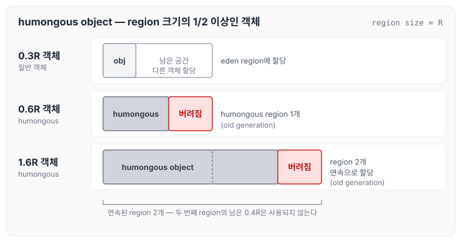
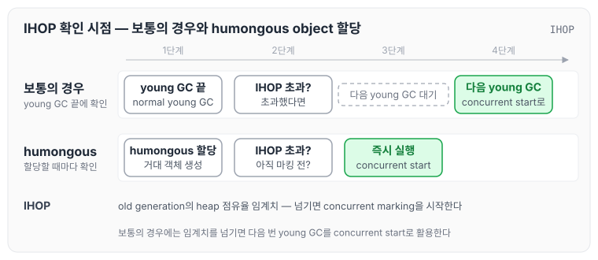
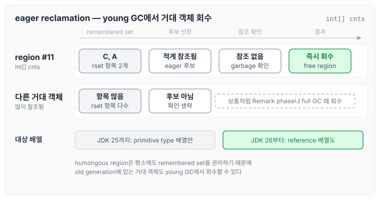
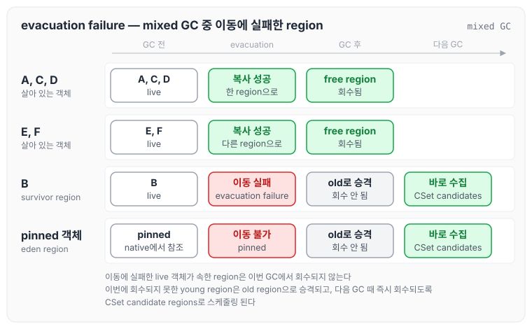
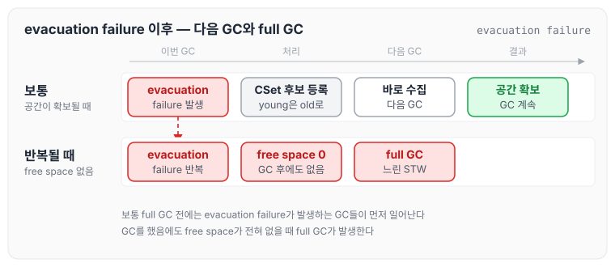
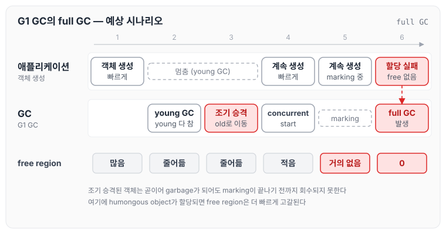
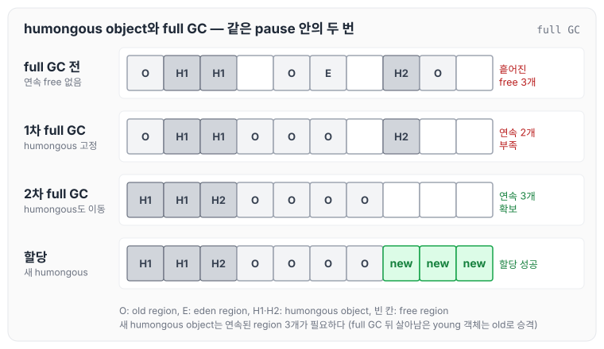
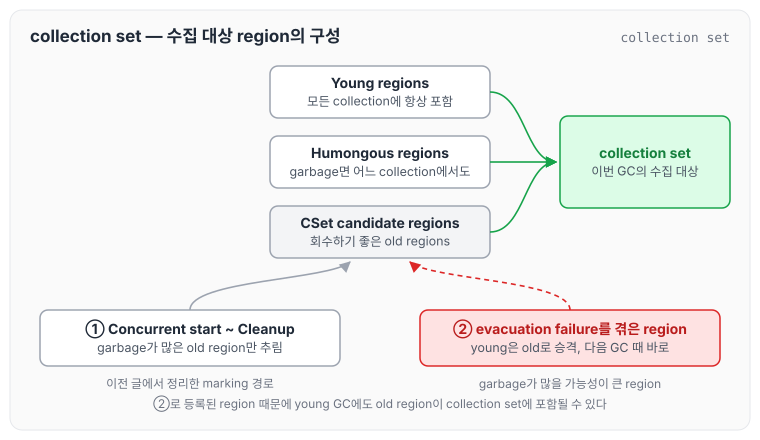
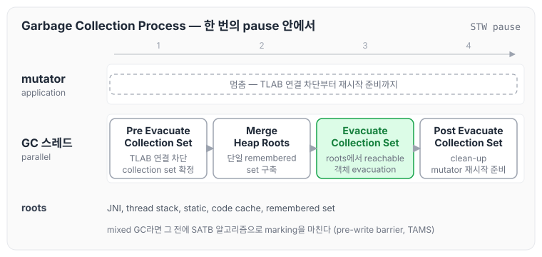

이전에 [G1 GC의 remembered set과 collection set](../gc-g1-remembered-set/)에 대해 작성하였습니다. 이번 글에서는 G1 GC의 특징을 한 번 더 정리하고, 앞에서 다루지 못했던 humongous object(거대 객체)와 eager reclamation, evacuation failure, G1 GC의 full GC, 그리고 collection set과 collection set candidate regions에 대해 정리하도록 하겠습니다.

## G1 GC 특징 정리

G1 GC는 balance collector입니다. high throughput을 보장하면서도 동시에 max pause-time goal을 높은 확률로 충족하는 collector라는 뜻입니다.

- high throughput이 보장되는 이유
  - 여러 GC 스레드가 parallel로 동작합니다.
  - Garbage-First: old generation을 수집할 때 garbage가 많은 old region 위주로 수집합니다.
- 높은 확률로 max pause-time goal이 충족되는 이유
  - young GC: 이전 GC 사이클의 통계와 휴리스틱을 통해 young generation 크기를 동적으로 계산합니다.
  - mixed GC: 매 mixed GC마다 수집될 old generation region들도 고려해서 young generation 크기를 동적으로 계산합니다.
- 가끔 max pause-time goal을 충족하지 못하는 이유(즉, real-time collector는 아닙니다)
  - 예측이 실패하는 경우
  - full GC가 발생하는 경우

Oracle 문서는 G1 GC를 generational, incremental, parallel, mostly concurrent, stop-the-world, and evacuating garbage collector라고 소개합니다. 각 단어의 의미는 아래와 같습니다.

- generational
  - young generation과 old generation으로 구분됩니다.
  - 다만 heap은 region 단위로 관리되기 때문에, 각 generation은 더 이상 연속적인 주소 공간 형태로 관리되지 않습니다.
- incremental
  - old generation 전체를 한 번에 수집하지 않고, 일부 region들만 몇 차례에 걸쳐 조금씩 나눠서 수집합니다(STW를 줄이기 위해서입니다).
  - 즉, Space-reclamation phase에서 mixed GC가 여러 번에 걸쳐 실행됩니다.
- parallel: 여러 GC 스레드를 동시에 사용해서 멀티 코어 환경을 충분히 활용합니다.
- mostly concurrent: marking 과정의 대부분을 mutator(=application) 스레드와 동시에 실행합니다. 사용자 경험에 좋은 영향을 줍니다.
- stop-the-world: young GC, mixed GC, full GC 자체는 항상 STW로 동작합니다. 그 외 일부 phase(Remark, Cleanup)도 STW로 동작합니다.
- evacuating: young GC와 mixed GC 모두 살아 있는 객체를 다른 영역으로 복사하는 방식으로 빠르게 처리합니다(full GC는 제외).

## humongous object

humongous object(거대 객체)는 region 크기의 1/2 이상의 크기를 가지는 객체를 말합니다.

- 하나의 region 크기보다 클 경우에는 연속된 region들에 할당됩니다. 이렇게 할당된 region은 old generation으로 분류됩니다.
  - 할당된 region들 중 마지막 region의 남은 공간은 사용되지 않고 버려집니다.

region 하나보다 큰 humongous object가 연속된 region에 할당되는 모습은 아래와 같습니다.

humongous object가 region 두 개에 걸쳐 할당되면 두 번째 region의 남은 공간에는 다른 객체를 할당하지 않습니다. 그래서 humongous object가 많으면 실제 객체 크기보다 더 많은 heap 공간이 사용됩니다.

### humongous object 할당과 IHOP

humongous object가 할당될 때마다 G1 GC는 매번 임계치(IHOP)를 확인합니다. 현재까지의 할당이 임계치를 넘겼고 아직 마킹 전이라면 concurrent start(pause)를 즉시 실행합니다.

- IHOP: old generation의 heap 점유율 임계치입니다.
- 보통의 경우에는 normal young GC가 끝날 때 IHOP를 확인하고, 임계치를 넘겼으면 다음 번 young GC를 concurrent start로 활용합니다.

IHOP와 concurrent start는 [G1 GC 핵심 원리: region, mixed collection과 concurrent marking](../gc-g1-core/)에서 정리하였습니다.

두 경우를 나란히 놓으면 아래와 같습니다.

보통은 young GC가 끝날 때 확인하고 다음 young GC를 기다리지만, humongous object는 할당할 때마다 확인하기 때문에 concurrent start가 더 일찍 시작될 수 있습니다.

### GC 중의 humongous object

- GC 중에는 humongous object가 살아 있는지만 확인하고, 살아 있더라도 보통은 이동하지 않습니다(옮기는 데 오래 걸리기 때문입니다).
  - 하지만 최후의 full GC가 돌면 그때는 이동합니다(이때의 collection은 매우 느립니다). 마지막 full GC에서 humongous object까지 옮기는 동작은 JDK 21부터 들어갔습니다([JDK-8191565](https://bugs.openjdk.org/browse/JDK-8191565)). 이 내용은 아래 humongous object와 full GC 절에서 다시 정리하겠습니다.
- humongous object가 garbage가 되면 할당되어 있던 humongous region들은 회수됩니다.
- humongous object의 회수는 보통 Remark phase나 full GC 때 일어납니다.
  - 하지만 더 일찍 회수되는 경우도 있습니다(eager reclamation).

## eager reclamation for humongous objects

거대 객체 중에서도 `int[] cnts`처럼 primitive type 배열은 Remark phase나 full GC가 아닌 collection일 때도 garbage로 판단되면 회수될 수 있습니다. 즉, young GC 때도 old generation에 속하는 거대 객체가 회수될 수 있습니다.

- 그 이유는 거대 객체가 빨리 회수되지 않으면 계속 heap 공간의 일부를 차지하고 있어서 GC가 너무 자주 발생할 수 있기 때문입니다.
- 이를 위해 humongous region은 평소에도 remembered set을 관리합니다. remembered set은 [G1 GC의 remembered set과 collection set](../gc-g1-remembered-set/)에서 정리하였습니다.
- young GC 때 remembered set을 통해 적게 참조된다고 판단되는 거대 객체들만 골라서, 실제로 garbage가 되었는지 확인한 후 garbage가 되었다면 회수합니다.

강의에서 본 예시는 `int[] cnts`가 할당된 humongous region #11의 remembered set에 C와 A가 들어 있는 상황이었습니다. 이 흐름을 그리면 아래와 같습니다.

remembered set을 보면 이 거대 객체를 가리키는 곳이 몇 군데인지 바로 알 수 있습니다. 가리키는 곳이 적은 거대 객체만 후보로 골라서 실제로 참조가 남아 있는지 확인하고, 남아 있지 않으면 young GC에서 바로 회수합니다.

- primitive 배열로 한정한 이유는 reference 배열은 오래 살 것이라고 판단했기 때문인 것 같다고 강의에서 이야기하였습니다.
  - 하지만 JDK 26부터는 reference type의 배열도 eager reclamation이 적용됩니다([JDK-8048180](https://bugs.openjdk.org/browse/JDK-8048180)).
- `G1EagerReclaimHumongousObjects` 옵션은 필요가 없어져서 더 이상 제공하지 않습니다. JDK 20에서 제거되었습니다([JDK-8137280](https://bugs.openjdk.org/browse/JDK-8137280)).

## evacuation failure

evacuation failure는 GC 도중 살아 있는 객체들을 다른 region으로 이동시키지 못한 상황을 의미합니다. 원인은 두 가지입니다.

- Allocation 실패: 이동시키려는 목적지에 충분한 공간이 없습니다.
- Pinned 객체: native에서 참조 중이라 현재 위치에 계속 있어야 하는 객체입니다. Oracle 문서에서는 `GetPrimitiveArrayCritical()` 같은 JNI 호출로 native 코드가 안전하게 사용할 수 있도록 고정(pinned)된 객체라고 설명합니다.

evacuation failure가 발생하면 아래와 같이 처리됩니다.

- 이동에 실패한 live 객체가 속한 region은 이번에 회수되지 않고, 다음 GC 때 즉시 회수되도록 CSet candidate regions로 스케줄링 됩니다.
  - 이때 이번에 회수되지 못한 young region들은 old region으로 승격됩니다.

강의에서는 mixed GC 중에 evacuation failure가 일어나는 예시를 보았습니다. GC root에서 A, B, C, D, E, F에 닿을 수 있고, A·C·D와 E·F는 다른 region으로 옮겨졌지만 B는 이동에 실패하였고(evacuation failure), 또 한 객체는 pinned 상태라 옮기지 못한 상황입니다.

이동에 성공한 객체가 있던 region들은 free region이 되지만, B가 있던 region과 pinned 객체가 있던 region은 이번 GC에서 회수되지 못합니다. 두 region은 young region이었기 때문에 old region으로 승격되고, CSet candidates로 등록되어 다음 GC 때 바로 수집됩니다.

evacuation failure 뒤에도 공간이 확보되지 않으면 full GC로 이어집니다.

- GC를 했음에도 free space가 전혀 없다면 full GC가 발생합니다.
- 보통 full GC 전에는 evacuation failure가 발생하는 GC들이 먼저 일어납니다.

## G1 GC의 full GC

G1 GC의 full GC는 더 이상 객체를 할당할 free 공간이 없을 때 발생합니다.

- 주로 애플리케이션의 객체 생성 속도가 회수 속도보다 빠를 때 발생합니다.
- full GC: mark-sweep-compact 방식이고, parallel로 동작합니다(살아남은 young 객체는 모두 old 객체로 승격됩니다).

강의에서 정리한 예상 시나리오는 아래와 같습니다.

- 객체가 빠르게 생성됩니다.
- → young generation이 금방 차기 시작합니다.
- → young 객체가 old generation으로 조기 승격됩니다(곧이어 garbage가 되어도 회수되지 못합니다).
- → concurrent start가 시작됩니다.
- → concurrent marking 중에도 계속 빠르게 새로운 객체가 생성됩니다.
- → free region이 고갈됩니다.

여기에 humongous object는 heap 공간을 더 빠르게 고갈시킵니다. 이 시나리오를 단계별로 그리면 아래와 같습니다.

young GC가 한 번 돌 때마다 일부 young 객체가 old generation으로 조기 승격되고, concurrent marking이 끝나서 old region을 회수하기 전에 새로 생성된 객체와 humongous object가 free region을 모두 차지하면 full GC가 발생합니다.

또한 잔여 공간이 있더라도 humongous object 할당을 위해 full GC가 발생하기도 합니다.

### humongous object와 full GC

humongous object를 할당해야 하는데, 이 객체를 담을 만큼의 연속된 free region들이 없다면 full GC가 발생합니다.

- 이때 1차 full GC에서는 기존 humongous object들의 위치는 옮기지 않고 나머지 객체들만 compact 시킵니다.
- 이렇게 했는데도 연속된 빈 region들이 확보되지 않으면, 같은 pause 안에서 두 번째 full GC가 발생합니다.
- 이때는 humongous object들도 이동해서 압축됩니다.

두 번의 full GC를 거치는 흐름은 아래와 같습니다.

1차 full GC 뒤에도 free region이 여기저기 흩어져 있으면 연속된 공간을 만들 수 없습니다. 두 번째 full GC에서 humongous object까지 옮겨 압축해야 비로소 연속된 free region이 생기고, 새 humongous object를 할당할 수 있습니다.

## Collection set

collection set은 garbage collection 동안 수집해야 할 대상이 되는 region들을 의미합니다. 아래처럼 서로 다른 region들이 collection set을 구성합니다(young GC, full GC 여부와 상관없이).

- Young generation regions
  - G1 GC의 모든 collection은 언제나 young generation을 포함합니다.
- Humongous regions
  - primitive type 배열은 garbage가 되면 어느 collection에서도 회수할 수 있습니다.
- Collection set candidate regions
  - 회수하기에 좋은 것으로 선택된 old generation region들을 의미합니다.
  - 그렇다면 young GC 때도 old region이 collection set에 포함될 수 있다는 뜻일까요? 아래 두 번째 방법이 그 경우입니다.

### Collection set candidate regions

collection set candidate regions가 되는 방법은 두 가지입니다.

- 첫 번째 방법(이전에 정리한 내용)
  - Concurrent start부터 Cleanup까지의 과정을 통해 old region들 중에 garbage가 많은 region들만 추려서 collection set candidate regions로 등록됩니다.
  - 이 과정은 [G1 GC 핵심 원리: region, mixed collection과 concurrent marking](../gc-g1-core/)에서, candidate region을 그룹으로 묶어 다루는 방식은 [G1 GC의 remembered set과 collection set](../gc-g1-remembered-set/)에서 정리하였습니다.
- 두 번째 방법(이번 글에서 정리한 내용)
  - evacuation failure를 경험한 region들입니다.
  - 이 region들은 garbage를 많이 가지고 있을 가능성이 큽니다.
    - young region의 경우: 기본적으로 garbage가 많을 것입니다(세대별 가설). evacuation failure를 경험하면 old region으로 승격됩니다.
    - old region의 경우: evacuation 중에 failure가 발생했다는 것은 애초에 evacuation 대상이 되었다는 것이고, 이는 그 region에 garbage가 많다는 뜻입니다.
  - 이 경우 다음 GC 때 바로 수집됩니다.

collection set을 구성하는 region과 candidate가 되는 두 가지 경로를 함께 그리면 아래와 같습니다.

evacuation failure를 겪은 region은 marking을 기다리지 않고 candidate로 등록되기 때문에, 다음 young GC에서도 old region이 collection set에 포함될 수 있습니다.

## Garbage Collection Process

마지막으로 G1 GC의 collection이 진행되는 과정을 정리하면 아래와 같습니다.

- (Mixed GC) marking: SATB 알고리즘을 통해 marking 합니다(pre-write barrier, TAMS를 사용합니다). SATB와 pre-write barrier, TAMS는 [G1 GC concurrent marking: SATB, pre-write barrier와 TAMS](../gc-g1-concurrent-marking/)에서 정리하였습니다.

1. Pre Evacuate Collection Set
   - mutator 스레드로부터 TLAB 연결을 차단합니다.
   - 이번 collection에서 수집 대상이 될 collection set을 확정합니다.
2. Merge Heap Roots
   - collection set region들을 향하는 단일 remembered set을 구축합니다.
3. Evacuate Collection Set
   - roots에서부터 reachable한 객체들을 evacuation 합니다.
   - roots: JNI, thread stack, static, code cache, remembered set
4. Post Evacuate Collection Set
   - clean-up, mutator 스레드 재시작 준비

네 단계를 STW pause 안에서 순서대로 놓으면 아래와 같습니다.

collection set이 1단계에서 확정되기 때문에, 앞에서 정리한 young region, humongous region, candidate region 중 무엇이 이번 collection에 들어갈지는 pause가 시작될 때 정해집니다.

## 마무리

오늘은 G1 GC의 특징과 humongous object의 할당·회수, eager reclamation, evacuation failure와 pinned 객체, G1 GC의 full GC가 발생하는 흐름, 그리고 collection set과 collection set candidate regions에 대해 정리하였습니다.

정리하면서 humongous object는 할당할 때 IHOP를 확인하고, 연속된 region이 없으면 full GC까지 이어질 수 있어서 heap 사용에 생각보다 큰 영향을 준다는 것을 알 수 있었습니다. 다음 글에서는 [G1 GC 튜닝: young generation 크기, mixed GC, IHOP](../gc-g1-tuning/)에 대해 정리하도록 하겠습니다.

참고 자료
- [GC 11부: G1GC 그 외 정리가 필요한 내용](https://youtube.com/live/qpB4xe5rpM0?feature=share) (멤버십 전용 영상)
- [Garbage-First (G1) Garbage Collector (Oracle HotSpot GC Tuning Guide, JDK 25)](https://docs.oracle.com/en/java/javase/25/gctuning/garbage-first-g1-garbage-collector1.html)
- [JEP 423: Region Pinning for G1](https://openjdk.org/jeps/423)
- [JDK-8048180: G1: Eager reclaim of humongous objects with references](https://bugs.openjdk.org/browse/JDK-8048180)
- [JDK-8137280: Remove eager reclaim of humongous controls](https://bugs.openjdk.org/browse/JDK-8137280)
- [JDK-8191565: Last-ditch Full GC should also move humongous objects](https://bugs.openjdk.org/browse/JDK-8191565)
