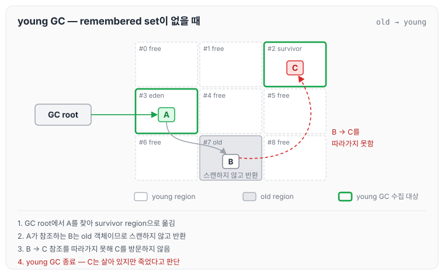
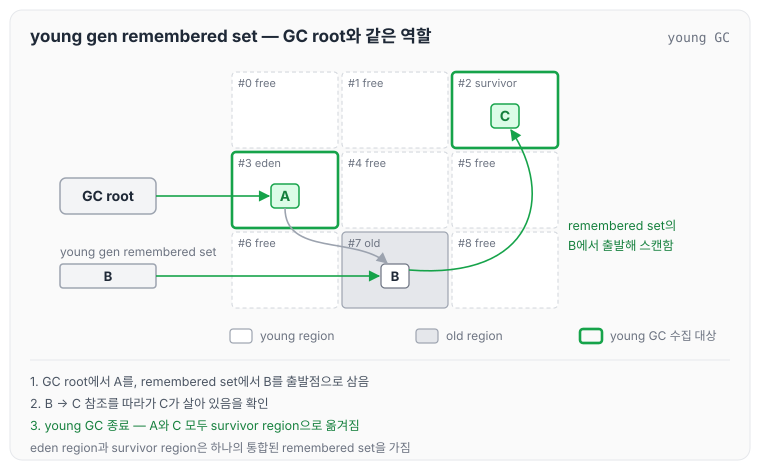
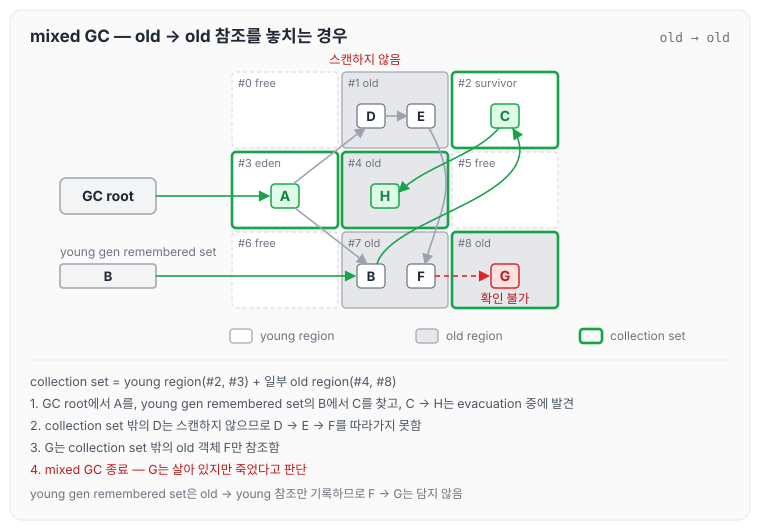
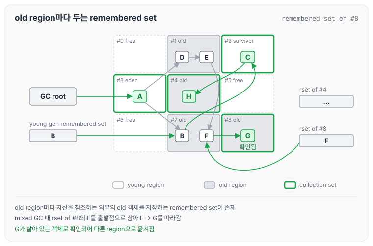
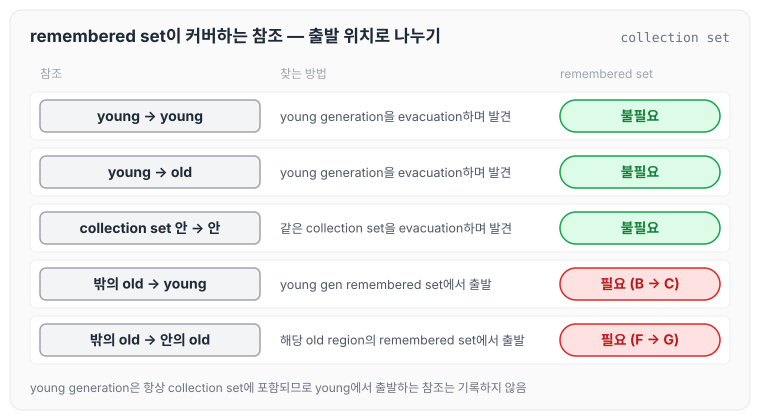
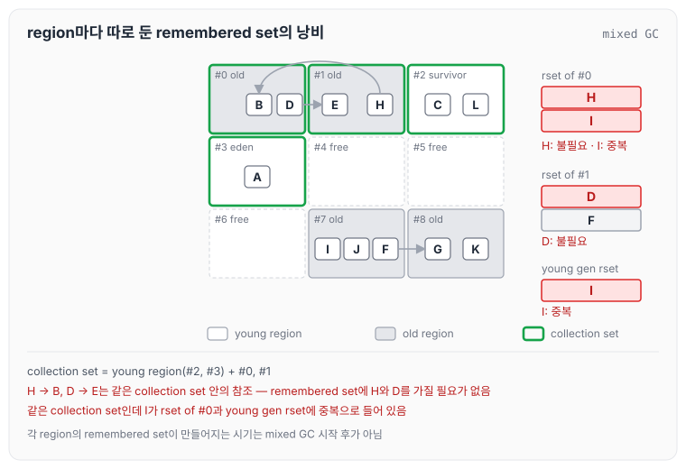
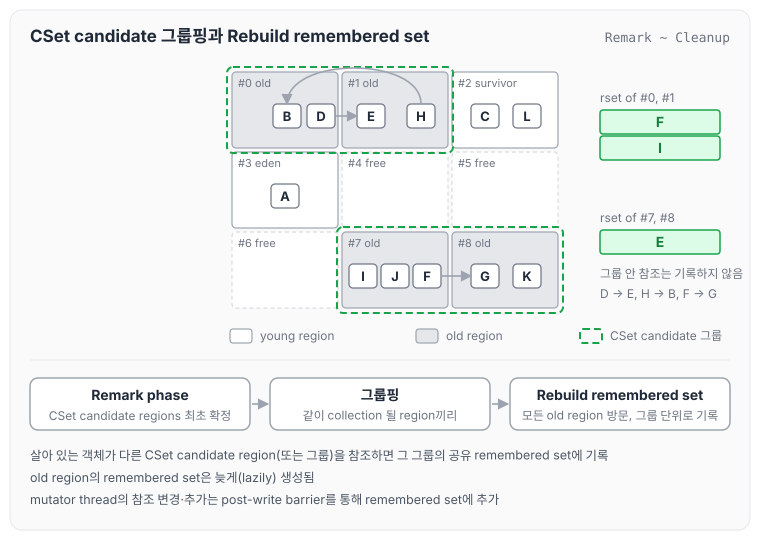
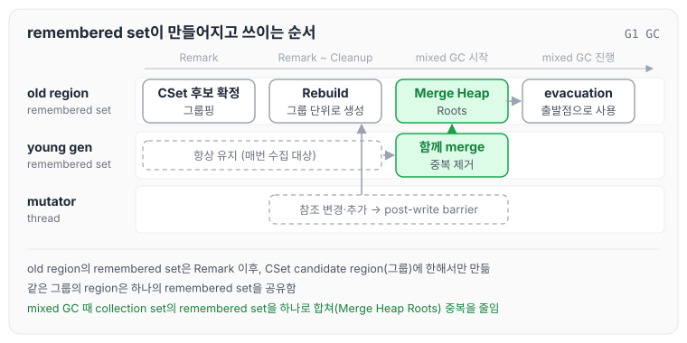
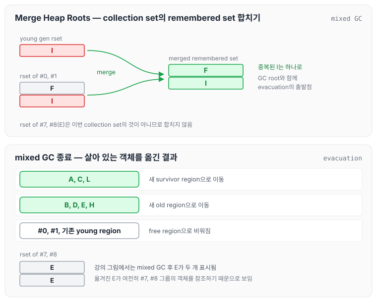

이전에 [G1 GC concurrent marking: SATB, pre-write barrier와 TAMS](../gc-g1-concurrent-marking/)에 대해 작성하였습니다. remembered set은 [Generational GC 핵심 원리: GC root, remembered set, minor GC와 major GC](../gc-generational-collection/)와 [TLAB과 Generation 크기 조정: Serial GC의 힙 크기 옵션](../gc-heap-generation-sizing/)에서 Serial GC를 기준으로 짧게 다뤘습니다. 이번 글에서는 G1 GC가 region 단위로 remembered set을 관리하는 방식과 collection set, 그리고 young GC와 mixed GC에서 remembered set이 어떻게 쓰이는지 정리하도록 하겠습니다.

## young GC 때 old → young 참조는 어떻게 관리되나?

G1 GC의 heap은 region으로 나뉘어 있고, 각 region은 free, eden, survivor, old, humongous 중 하나의 역할을 맡습니다. 강의에서는 아래와 같은 상황을 예로 들었습니다.

- GC root가 eden region의 A를 참조합니다.
- A는 old region의 B를 참조하고, B는 survivor region의 C를 참조합니다.

이때 young GC가 발생하면 문제가 생깁니다.

- young GC는 young 객체만 수집하기 때문에 old 객체인 B를 스캔하지 않습니다.
- 그렇다면 young 객체인 C 또한 스캔되지 않아서, C는 garbage가 될 것입니다.

remembered set 없이 young GC를 진행하면 아래와 같이 흘러갑니다.

GC root에서 출발한 탐색은 A를 survivor region으로 옮기지만, A가 참조하는 B는 old 객체라서 스캔하지 않고 그냥 반환합니다. 그 결과 young GC가 끝났을 때 C는 실제로는 살아 있지만 죽었다고 판단됩니다.

### 해결책은 remembered set

해결책은 remembered set입니다. old 객체가 young 객체를 참조하는 경우를 별도로 관리하는 것입니다.

- remembered set에는 young 객체를 참조하는 old 객체(위 예시에서는 B)가 기록됩니다.
- young GC 때 remembered set은 GC root와 같은 역할을 수행합니다. remembered set에 있는 B를 스캔하면 C가 살아 있다는 것이 확인됩니다.
- young generation(eden regions + survivor regions)은 하나의 통합된 remembered set을 가집니다(young gen remembered set).

GC root에서는 A를, remembered set에서는 B를 출발점으로 삼기 때문에 C도 살아 있는 객체로 확인되어 A와 함께 survivor region으로 옮겨집니다. 여기까지는 [TLAB과 Generation 크기 조정: Serial GC의 힙 크기 옵션](../gc-heap-generation-sizing/)에서 정리한 Serial GC의 remembered set(minor GC root)과 같은 역할입니다.

## mixed GC 때 old → old 참조는 어떻게 관리되나?

mixed GC의 수집 대상(target)은 young generation과 일부 선택된(selected) old region들입니다. 이때는 remembered set이 어떻게 동작해야 하는지 강의의 예시로 살펴보겠습니다.

region에 번호를 붙여 보면 아래와 같습니다.

- #1(old): D, E — D는 E를 참조하고, E는 #7의 F를 참조합니다.
- #2(survivor): C — C는 #4의 H를 참조합니다.
- #3(eden): A — GC root가 A를 참조하고, A는 D와 B를 참조합니다.
- #4(old): H
- #7(old): B, F — B는 C를 참조하고, F는 #8의 G를 참조합니다.
- #8(old): G
- young gen remembered set에는 B가 들어 있습니다.

이번 mixed GC에서는 young region(#2, #3)과 old region #4, #8이 수집 대상입니다.

수집 대상 밖에 있는 D는 스캔하지 않기 때문에, D → E → F → G로 이어지는 참조는 따라가지 못합니다. #8의 G는 수집 대상 밖의 old 객체 F만 참조하고 있으므로 확인할 방법이 없고, mixed GC가 끝나면 G는 살아 있지만 죽었다고 판단됩니다. young gen remembered set은 old → young 참조만 다루기 때문에 이 경우에는 도움이 되지 않습니다.

### 해결책은 old region마다 두는 remembered set

해결책은 old region마다 remembered set을 두는 것(Remembered Set for each old region)입니다. old region마다 자신을 참조하는 외부의 old 객체들을 저장하는 remembered set이 존재합니다.

위 상황을 다시 mixed GC 직전으로 돌려 보면, #8의 remembered set(remembered set of #8)에는 F가 들어 있습니다. mixed GC 때 F를 출발점으로 삼으면 G에 닿을 수 있으므로 G를 놓치지 않습니다. #4를 포함해 다른 old region들도 각자 자신의 remembered set을 가집니다.

## remembered set 중간 정리

여기까지의 내용을 강의에서는 아래와 같이 정리하였습니다.

- 이번 garbage collection의 대상이 되는 region들의 집합을 collection set이라고 합니다.
  - young generation은 collection set에 항상 포함됩니다(young generation은 항상 수집 대상이기 때문입니다).
- remembered set은 collection set을 참조하는 ‘collection set 외부의 old 객체들’을 커버하는 용도로 사용됩니다.
- remembered set을 쓰는 이유는, remembered set을 쓰지 않으면 collection set의 살아 있는 객체를 찾기 위해 heap 전체에 존재하는 살아 있는 객체를 모두 방문해야 하는데 이 비용이 작지 않기 때문입니다.
- mixed GC는 young generation과 함께 일부 old region들을 collection set에 포함합니다. 그렇다면 그 일부 old region들만을 위한 remembered set도 필요하며, 이를 위해 각 old region은 자신만의 remembered set을 가집니다.
  - 이 remembered set은 자신을 참조하는, 자신 외부의 region들에 있는 old 객체들을 커버합니다.
- remembered set은 young 객체는 커버하지 않습니다. garbage collection에서 young generation은 항상 수집 대상이기 때문에, young → young 참조나 young → old 참조는 young generation을 evacuation하는 과정에서 자연스럽게 발견되기 때문입니다.

참조가 어디에서 출발하는지에 따라 정리하면 아래와 같습니다.

collection set 안에서 출발하는 참조는 evacuation하면서 따라가게 되므로, remembered set에 기록해야 하는 것은 collection set 밖의 old 객체에서 collection set 안으로 들어오는 참조뿐입니다.

## remembered set을 더 효율적으로 운영할 순 없을까?

강의에서는 새로운 예시로 old region마다 remembered set을 따로 두었을 때의 낭비를 살펴보았습니다.

- #0(old): B, D — D는 #1의 E를 참조합니다.
- #1(old): E, H — H는 #0의 B를 참조합니다.
- #2(survivor): C, L — GC root가 L을 참조합니다.
- #3(eden): A — GC root가 A를 참조합니다.
- #7(old): I, J, F
- #8(old): G, K — #7의 F가 G를 참조합니다.

region마다 remembered set을 가지고 있다면 아래와 같습니다.

- remembered set of #0: H, I
- remembered set of #1: D, F
- young gen remembered set: I

이 상태에서 young region(#2, #3)과 #0, #1을 collection set으로 하는 mixed GC가 발생한다고 해 보겠습니다. 강의에서는 이때 각 region의 remembered set이 만들어지는 시기가 mixed GC 시작 후가 아니라는 점을 짚고 넘어갔습니다. 이 부분은 아래 Rebuild remembered set에서 정리합니다.

- H → B, D → E는 같은 collection set 안에서의 참조입니다. 즉, #0, #1이 같은 collection set으로 묶였기 때문에 remembered set에 H와 D를 가지고 있을 필요가 없습니다.
- 또한 같은 collection set인데 I가 #0의 remembered set과 young gen remembered set에 중복으로 들어 있습니다.

### CSet candidate regions 그룹핑

G1은 이 낭비를 줄이기 위해 같이 수집될 region들을 묶습니다.

- Remark 단계에서 CSet candidate regions(collection set 후보 region들)이 최초로 확정됩니다. Remark는 [G1 GC concurrent marking: SATB, pre-write barrier와 TAMS](../gc-g1-concurrent-marking/)에서 정리한 단계입니다.
- 이후 같이 collection 될 것 같은 region들끼리 그룹핑합니다.
- 그룹핑하는 이유는 mixed GC들이 incremental하게 실행되기 때문입니다. 같은 그룹에 속하면 같은 mixed GC 때 처리됩니다.
- 그러므로 같은 그룹은 공통의 remembered set을 가집니다.
- 같은 그룹 안의 참조(D → E, H → B, F → G)는 remembered set에 저장할 필요가 없습니다(중복도 제거됩니다).

예시에서는 #0과 #1이 한 그룹, #7과 #8이 한 그룹으로 묶입니다.

### Rebuild remembered set

그룹의 remembered set은 Remark phase부터 Cleanup phase 사이에 다시 만들어집니다(Rebuild remembered set).

- 모든 old region을 방문하며 살아 있는 객체를 찾습니다.
- 만약 살아 있는 객체의 참조가 CSet candidate regions의 다른 region(또는 region group)을 참조한다면, 해당 region의 (shared) remembered set에 해당 참조를 업데이트합니다.
- 즉, old region의 remembered set은 늦게(lazily) 생성됩니다.

예시에 적용하면 결과는 아래와 같습니다.

#0, #1 그룹의 remembered set에는 F와 I만 남고, #7, #8 그룹의 remembered set에는 E가 들어갑니다. 같은 그룹 안의 참조인 H → B, D → E, F → G는 기록되지 않습니다.

Rebuild remembered set의 특징을 정리하면 아래와 같습니다.

- CSet candidate regions가 최초 확정되는 Remark 때 remembered set을 생성합니다. 굳이 미리 만들고 있을 필요가 없기 때문입니다.
- CSet candidate regions에 속한 region(또는 region group)에 대해서만 remembered set을 생성합니다.
- mutator thread에 의해 참조에 변경이나 추가가 있어도 post-write barrier를 통해 remembered set에 추가합니다.

다만 이렇게 만들어도 중복은 남습니다. 예시에서는 I가 young gen remembered set과 #0, #1 그룹의 remembered set 양쪽에 들어 있습니다.

### Merge Heap Roots

남은 중복은 mixed GC를 시작할 때 정리합니다.

- mixed GC를 할 때 collection set의 모든 remembered set을 하나로 합칩니다(Merge Heap Roots).
- 이 과정을 통해 중복을 많이 제거할 수 있습니다.

remembered set이 만들어지고 쓰이는 시점을 순서대로 놓으면 아래와 같습니다.

예시에서 young gen remembered set의 I와 #0, #1 그룹의 remembered set의 F, I를 합치면 merged remembered set은 F, I 두 개가 됩니다.

mixed GC는 GC root와 merged remembered set을 출발점으로 collection set의 살아 있는 객체를 옮깁니다. 예시에서는 A, C, L이 새 survivor region으로, B, D, E, H가 새 old region으로 옮겨지고, #0, #1과 기존 young region은 비워집니다. 강의 그림에서는 mixed GC가 끝난 뒤 #7, #8 그룹의 remembered set에 E가 두 개 표시되어 있습니다. E가 새 old region으로 옮겨진 뒤에도 #7, #8 그룹의 객체를 참조하고 있어서, 옮겨진 위치가 한 번 더 기록된 것으로 보입니다.

강의에서는 remembered set이 메모리를 어떻게 하면 더 아껴 쓸지 많은 고민 끝에 현재와 같은 모습이 되었다고 하였습니다.

## remembered set 후반부 요약

- old region의 remembered set은 불필요한 CPU 및 메모리 낭비를 막기 위해 Remark 이후부터 생성됩니다.
- old region은 remembered set을 굳이 미리 만들지 않고, Remark phase 때 CSet candidate region으로 선정된 old region 혹은 old region 그룹에 한정해 remembered set을 생성합니다(Rebuild Remembered Set).
- 같이 collection 될 것 같은 CSet candidate region들은 그룹핑되며, 하나의 remembered set을 공유합니다(Remark phase).
- mixed GC 때 collection set의 remembered set들을 하나로 머지합니다(Merge Heap Roots).

## 다루지 못한 내용

강의에서는 시간 관계상 아래 내용은 다루지 못하였습니다.

- Card table: remembered set에 저장되는 것은 객체의 주소가 아닙니다.
- refinement buffer와 refinement thread
- post-write barrier

이 중 card에 대해서는 Oracle 문서에 G1이 remembered set 항목을 card라는 heap의 작은 논리 구역(기본 512 byte)으로 표현한다고 적혀 있습니다.

## 마무리

오늘은 G1 GC가 young GC와 mixed GC에서 collection set 밖의 참조를 remembered set으로 찾는 방식과, CSet candidate region 그룹핑, Rebuild remembered set, Merge Heap Roots로 remembered set의 메모리와 중복을 줄이는 방법에 대해 정리하였습니다.

정리하면서 remembered set은 collection set 밖의 old 객체에서 들어오는 참조만 기록하면 된다는 점과, G1이 이를 필요한 region에 한해 필요한 시점에만 만든다는 것을 알 수 있었습니다. 다루지 못한 card table과 refinement는 따로 찾아보면 좋을 것 같습니다.

다음 글에서는 [G1 GC: humongous object, evacuation failure와 full GC](../gc-g1-humongous-evacuation/)에 대해 정리하도록 하겠습니다.

참고 자료
- [GC 10부: G1GC remembered set](https://youtube.com/live/hKgkWAcbHpQ?feature=share) (멤버십 전용 영상)
- [Garbage-First (G1) Garbage Collector (Oracle HotSpot GC Tuning Guide, JDK 25)](https://docs.oracle.com/en/java/javase/25/gctuning/garbage-first-g1-garbage-collector1.html)
