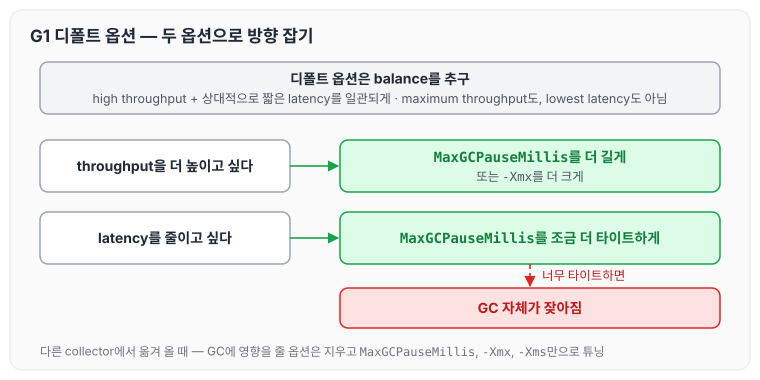
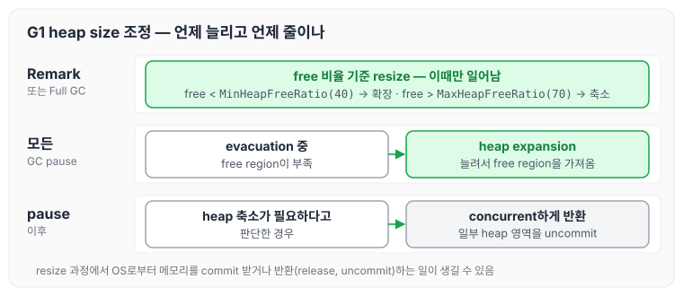
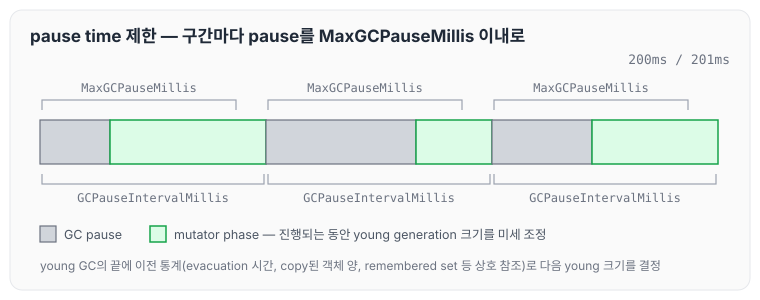
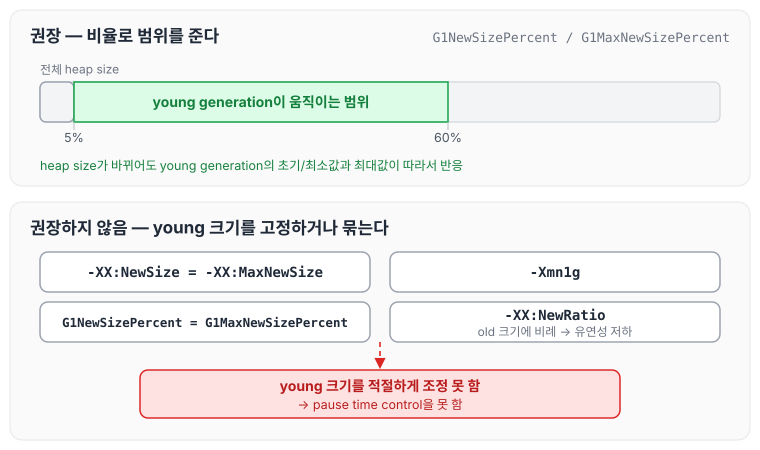
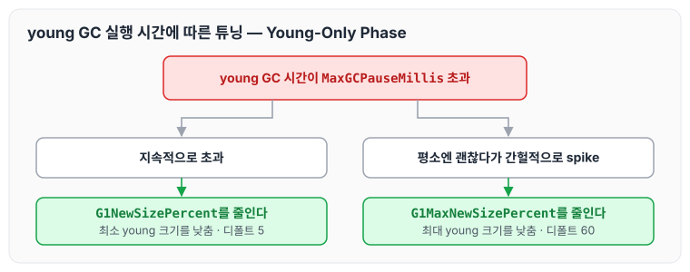
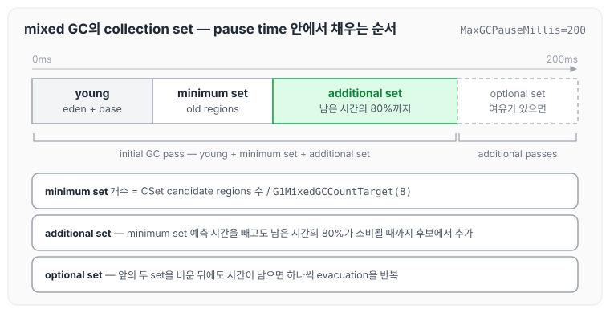
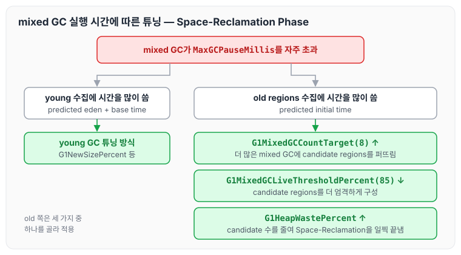
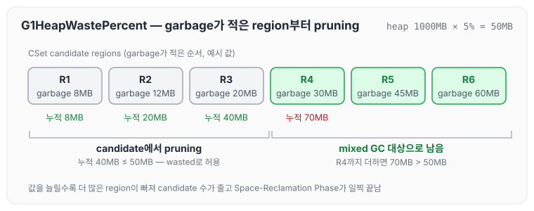
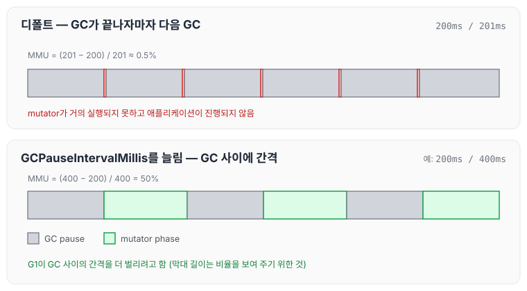
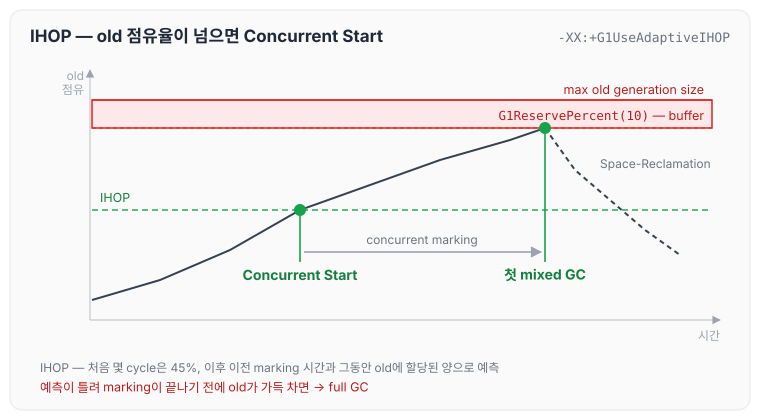

이전에 [G1 GC: humongous object, evacuation failure와 full GC](../gc-g1-humongous-evacuation/)에 대해 작성하였습니다. 이번 글에서는 G1 GC를 튜닝할 때 사용하는 옵션들을 정리하도록 하겠습니다. 디폴트 옵션으로 튜닝하는 방법부터 시작해서, heap 크기와 young generation 크기가 정해지는 방식, young GC와 mixed GC가 max pause-time goal을 넘을 때의 대응, back to back GC와 IHOP, 그리고 full GC와 system 시간이 클 때의 해결책 순서로 살펴보겠습니다.

## 지난 시간 핵심 요약

지난 시간까지 정리한 G1 GC의 특징을 요약하자면 아래와 같습니다.

- G1 GC는 balance collector입니다. high throughput을 보장하면서도 동시에 max pause-time goal을 높은 확률로 충족하는 collector입니다.
- max pause-time goal을 높은 확률로 충족할 수 있는 이유는 아래와 같습니다.
  - young GC: 이전 GC 사이클의 통계와 휴리스틱을 통해 young generation 크기를 동적으로 계산합니다.
  - mixed GC: 매 mixed GC마다 수집될 old regions도 고려해서 young generation 크기를 동적으로 계산합니다.
- 가끔 max pause-time goal을 충족하지 못하는 이유는 예측 실패와 full GC 때문입니다. 즉, G1 GC는 real-time collector가 아닙니다.

G1 GC의 heap은 free, eden, survivor, old, humongous region으로 나뉘어 있고, region마다 역할이 바뀝니다. 그렇다면 young generation의 크기와 old generation의 크기는 어떻게 정해질까요? 이 글에서 다룰 옵션들은 대부분 이 질문과 연결되어 있습니다.

## G1GC 튜닝 — 디폴트 옵션

G1 GC는 기본적으로 디폴트 옵션을 사용할 것을 권장합니다.

- G1 GC의 디폴트 옵션은 balance를 추구합니다.
  - high throughput을 추구하면서도 상대적으로 짧은 latency를 일관되게 추구합니다.
  - maximum throughput을 추구하지도 않고, lowest latency를 추구하지도 않습니다.
- 다른 디폴트 옵션들은 그대로 두고 `-XX:MaxGCPauseMillis`(디폴트 200)와 `-Xmx`만 써도 원하는 형태로 어느 정도 튜닝할 수 있습니다.
  - 더 높은 throughput을 추구하고 싶다면 `-XX:MaxGCPauseMillis`를 조금 더 길게 잡거나 `-Xmx`를 좀 더 크게 잡으면 됩니다.
  - latency를 줄이고 싶다면 `-XX:MaxGCPauseMillis`를 조금 더 타이트하게 잡으면 됩니다. 다만 너무 타이트하면 GC 자체가 잦아집니다.
- 다른 collector를 쓰다가 G1 GC를 쓰려는 경우, 기존 옵션들 중에 GC에 영향을 줄 만한 옵션들은 모두 지우고 `-XX:MaxGCPauseMillis`와 `-Xmx`, `-Xms` 옵션만으로 튜닝합니다.
- `-Xmx`와 `-Xms`를 동일한 값으로 지정하면, JVM이 OS로부터 메모리를 할당하거나 반환하는 과정에서 발생하는 delay를 줄일 수 있습니다.

`MaxGCPauseMillis`와 Ergonomics의 pause time 목표는 [GC의 역할과 튜닝 기준: Ergonomics와 JVM 기본 설정](../gc-tuning-criteria/)에서, `-Xmx`와 `-Xms`를 같게 두는 이유는 [TLAB과 Generation 크기 조정: Serial GC의 힙 크기 옵션](../gc-heap-generation-sizing/)에서 정리하였습니다.

두 옵션으로 방향을 잡는 방법을 그리면 아래와 같습니다.



throughput을 원하면 pause time 목표를 느슨하게 하거나 heap을 키우고, latency를 원하면 pause time 목표를 조이는 방식입니다. 목표를 너무 조이면 GC가 잦아지기 때문에 적당한 선을 찾는 것이 필요합니다.

## G1GC heap size 조정

G1 GC도 기존 VM 옵션들을 사용해서 heap을 resizing 합니다.

- `-XX:InitialHeapSize`(ergo): 초기 heap 사이즈입니다. 디폴트는 machine memory의 1/64입니다.
- `-XX:MaxHeapSize`(ergo): max heap 사이즈입니다. 디폴트는 machine memory의 1/4입니다.
- `-XX:MinHeapSize`(ergo): min heap 사이즈입니다.
- `-XX:MinHeapFreeRatio`(40): free memory 비율이 `MinHeapFreeRatio`보다 낮으면 heap resizing을 통해 이 값보다 높게 만듭니다.
- `-XX:MaxHeapFreeRatio`(70): free memory 비율이 `MaxHeapFreeRatio`보다 높으면 heap resizing을 통해 이 값보다 낮게 만듭니다.
- 위 옵션들에 기반한 resize는 오직 Remark과 Full GC 때만 발생합니다.
- 이 과정에서 실제로 OS로부터 메모리를 할당(commit) 받거나 반환(release, uncommit)하는 일이 일어날 수도 있습니다.

이와 별개로 아래와 같이 동작합니다.

- heap expansion 자체는 어떤 GC pause에서도 발생할 수 있습니다.
  - 예를 들어 evacuation 중에 free region이 부족할 때 heap size를 더 늘릴 수 있다면, heap size를 늘려서 free region을 가지고 오는 형태로 동작합니다.
- heap 크기를 축소해야겠다고 판단한 경우에는 GC pause 후에 concurrent하게 일부 heap 영역이 반환됩니다.

heap 크기가 언제 늘어나고 줄어드는지 정리하면 아래와 같습니다.



`MinHeapFreeRatio`와 `MaxHeapFreeRatio`를 기준으로 한 resize는 Remark과 Full GC 때만 일어나지만, free region이 부족할 때의 확장은 어떤 pause에서도 일어날 수 있다는 점이 다릅니다.

## young generation 크기 조정 (at Young-Only Phase)

G1 GC가 max pause-time goal을 맞추려면 young generation 크기를 유연하게 조정할 수 있어야 합니다.

- young generation이 max pause-time goal을 맞추는 데 있어서 키 포인트인 이유는, 어떤 collection 때라도 항상 수집되는 영역이기 때문입니다.
- max pause-time goal은 `-XX:MaxGCPauseMillis`(200)로 지정합니다.

G1 GC는 `MaxGCPauseMillis`를 고려하여 young GC의 끝에 다음 mutator phase의 초기 young generation size를 결정합니다. 슬라이드에는 이 부분이 `MaxGCPauseMillis(201)`로 적혀 있는데, 201은 아래에서 다룰 `GCPauseIntervalMillis`의 디폴트 값이고 `MaxGCPauseMillis`의 디폴트 값은 200입니다.

- mutator phase가 진행되는 동안 young generation 크기를 미세 조정합니다.
- G1 GC는 매 `-XX:GCPauseIntervalMillis`마다 pause time의 최대 크기를 `-XX:MaxGCPauseMillis`로 제한합니다.
- 이 계산을 위해 아래와 같은 이전의 데이터들을 사용합니다.
  - 비슷한 사이즈의 young generation을 evacuation 시킬 때 걸린 시간
  - 얼마나 많은 객체들이 copy 되어야 했는지
  - 이때 객체들이 얼마나 interconnected 되어 있었는지(remembered set, 상호 참조 등)

`GCPauseIntervalMillis` 구간마다 GC pause가 `MaxGCPauseMillis` 이내로 제한되는 모습을 그리면 아래와 같습니다.



구간마다 GC pause 길이는 달라질 수 있지만 `MaxGCPauseMillis`를 넘지 않도록 young generation 크기를 정하고, 남은 시간 동안 mutator가 실행됩니다.

### young generation size 관련 옵션

`-XX:MaxGCPauseMillis`를 맞추기 위해서는 G1 GC가 young generation 크기를 유연하게 조정할 수 있도록 해 줘야 합니다. G1 GC에서 young generation size와 관련해 권장하는 옵션은 아래와 같습니다.

- `-XX:G1NewSizePercent`(5): 전체 heap size 대비 minimum young generation 비율
- `-XX:G1MaxNewSizePercent`(60): 전체 heap size 대비 maximum young generation 비율

두 옵션은 experimental 옵션이기 때문에, 값을 바꾸려면 `-XX:+UnlockExperimentalVMOptions`를 함께 지정해야 합니다(아래에서 다룰 `-XX:G1MixedGCLiveThresholdPercent`도 마찬가지입니다).

반대로 권장하지 않는 옵션은 아래와 같습니다.

- `-XX:NewSize`, `-XX:MaxNewSize`: young generation의 크기를 바이트 단위로 설정하는 것보다 비율로 설정하는 것을 추천합니다.
  - heap size가 바뀌더라도 바뀐 heap size에 맞춰서 young generation의 초기/최소값과 최대값이 자동으로 반응할 수 있기 때문입니다.
- `-XX:NewSize` = `-XX:MaxNewSize`: young generation의 초기/최소값과 최대값을 같게 설정하면 안 됩니다. young generation 크기가 고정되기 때문입니다.
- `-Xmn`: 위와 동일합니다. 위 두 옵션을 동일하게 설정하는 것과 같으므로 사용하면 안 됩니다(e.g. `-Xmn1g`).
- `-XX:G1NewSizePercent` = `-XX:G1MaxNewSizePercent`: 위와 동일한 이유입니다. 이렇게 동일하게 설정하면 young generation 크기가 고정됩니다.
- young generation size가 고정되면 young generation 크기를 적절하게 조정하지 못하고, 결국 pause time control을 하지 못합니다.
- `-XX:NewRatio`: young generation 크기를 old generation의 크기에 비례해서 설정하기 때문에 young generation 크기 설정의 유연성을 떨어뜨립니다.

권장하는 방식과 권장하지 않는 방식을 나란히 놓으면 아래와 같습니다.



비율로 범위를 주면 G1 GC가 그 안에서 young generation 크기를 움직일 수 있지만, 크기를 고정하거나 old generation에 묶으면 pause time을 맞추기 위한 조정 수단이 사라집니다. `-XX:NewRatio`, `-XX:NewSize`는 [TLAB과 Generation 크기 조정: Serial GC의 힙 크기 옵션](../gc-heap-generation-sizing/)에서 Serial GC 기준으로 정리한 옵션들입니다.

## young GC 실행 시간에 따른 튜닝 (at Young-Only Phase)

young GC 실행 시간이 `MaxGCPauseMillis`를 넘는 모양에 따라 아래와 같이 대응합니다.

- young GC 실행 시간이 지속적으로 `-XX:MaxGCPauseMillis`를 초과한다면 `-XX:G1NewSizePercent`를 줄여 봅니다.
- young GC 실행 시간이 평소에는 괜찮은데 간헐적으로 spike를 치며 `-XX:MaxGCPauseMillis`를 초과한다면 `-XX:G1MaxNewSizePercent`를 줄여 봅니다.

두 경우를 갈래로 나누면 아래와 같습니다.



지속적으로 넘는다면 최소 young generation 크기부터가 너무 큰 것이므로 하한을 낮추고, 간헐적인 spike라면 young generation이 커졌을 때 한 번에 처리할 양이 많아지는 것이므로 상한을 낮추는 방향입니다.

## Garbage Collection Process (지난 시간 복습)

mixed GC 튜닝을 보기 전에 G1 GC의 garbage collection 과정을 다시 짚고 넘어가겠습니다. mixed GC에 앞서 이루어지는 marking은 SATB 알고리즘을 통해 이루어지며, pre-write barrier와 TAMS를 사용합니다. 이 내용은 [G1 GC concurrent marking: SATB, pre-write barrier와 TAMS](../gc-g1-concurrent-marking/)에서 정리하였습니다.

1. Pre Evacuate Collection Set
   - mutator thread로부터 TLAB 연결을 차단합니다.
   - 이번 collection에서 수집 대상이 될 collection set을 확정합니다.
2. Merge Heap Roots
   - collection set regions를 향하는 단일 remembered set을 구축합니다.
3. Evacuate Collection Set
   - roots에서부터 reachable한 객체들을 evacuation 합니다.
   - roots: JNI, thread stack, static, code cache, remembered set
4. Post Evacuate Collection Set
   - clean-up을 하고 mutator thread 재시작을 준비합니다.

## young generation 크기 조정 (at Space-Reclamation Phase)

Space-Reclamation Phase에서 young generation의 크기를 조정하는 방식은 기본적으로 Young-Only Phase 때와 동일합니다.

- 차이는 young generation과 old regions의 minimum set까지 포함하여 pause time을 예측하고, 그에 따라 young generation 크기를 결정한다는 점입니다.
  - 그러므로 young GC 때에 비해 young generation size가 작게 잡힐 가능성이 큽니다.

collection set에 속한 old regions는 세 부류로 분류됩니다.

- minimum set of old regions: (CSet candidate regions 수 / `-XX:G1MixedGCCountTarget`)으로 minimum set의 개수가 결정됩니다.
  - `-XX:G1MixedGCCountTarget`(8): Space-Reclamation Phase에서 몇 번에 걸쳐 mixed GC를 수행할 것인지 결정하는 옵션입니다.
- additional set of old regions: `-XX:MaxGCPauseMillis`에서 minimum set을 수집하는 데 걸릴 예측 시간을 제외하고도 잔여 시간이 있다면, 그 남은 시간의 80%가 소비될 것이라고 예측될 때까지 CSet candidate regions에서 추가로 regions를 collection set에 추가합니다.
- mixed GC 시작 단계(Pre Evacuate Collection Set phase)에서 collection set에 선택되는 old regions는 minimum set과 additional set입니다.
- optional set of old regions: mixed GC의 initial GC pass에서 앞의 두 set이 모두 비워진 후에도 아직 `-XX:MaxGCPauseMillis` 대비 잔여 시간이 남아 있다면, additional collection passes를 통해 CSet candidate regions에서 old regions를 하나씩 더 골라서 evacuation 합니다.
  - max pause-time goal에 다다를 때까지 incremental하게 반복합니다. 즉, 하나를 evacuation 하고 그래도 여유 시간이 있다면 추가로 하나씩 처리하는 방식입니다.

mixed GC 한 번의 pause time 안에서 collection set이 채워지는 순서를 그리면 아래와 같습니다.



young generation과 minimum set, additional set은 initial GC pass에서 함께 처리되고, optional set은 시간이 남을 때에만 하나씩 더해집니다.

## mixed GC 실행 시간에 따른 튜닝 (at Space-Reclamation Phase)

mixed GC가 `-XX:MaxGCPauseMillis`를 지속적으로 자주 초과했을 때는 먼저 young과 old 중 어디에 시간을 많이 썼는지 확인합니다.

- young generation collection에 시간을 많이 썼다면 앞에서 정리한 young GC 실행 시간에 따른 튜닝 방식을 따릅니다.
- old regions collection에 시간을 많이 썼다면 아래 세 가지 방법을 통해 해결할 수 있습니다.

어디에 시간을 썼는지는 아래와 같은 로그로 확인할 수 있습니다. predicted eden time과 predicted base time이 young 쪽 예측 시간이고, predicted initial time이 minimum set of old regions를 evacuation 하는 데 걸릴 예측 시간입니다. Oracle 문서에서는 이 로그를 `gc+ergo+cset=debug`로 켜서 확인한다고 안내하고 있습니다.

```text
Added young regions to CSet. [...] predicted eden time: 4.86ms, predicted base time: 9.98ms, target pause time: 200.00ms, [...]
Finish choosing collection set old regions. [...] predicted initial time: 147.70ms, predicted optional time: 15.45ms, [...]
```

old regions collection에 시간을 많이 썼을 때의 세 가지 방법은 아래와 같습니다.

- `-XX:G1MixedGCCountTarget`(8)을 증가시켜서 더 많은 mixed GC에 CSet candidate regions를 퍼뜨립니다.
- `-XX:G1MixedGCLiveThresholdPercent`(85)를 줄여서 CSet candidate regions가 보다 엄격하게 구성되게 합니다.
  - 전체 region 크기 대비 살아 있는 바이트 비율이 이 값보다 크면 CSet candidate regions에 포함되지 않습니다.
- `-XX:G1HeapWastePercent`를 늘려서 CSet candidate regions 수를 줄임으로써 Space-Reclamation Phase가 조금 더 일찍 끝날 수 있도록 합니다(Oracle JDK 25 문서 기준 디폴트는 5입니다).
  - 전체 heap 크기 대비 wasted 되는 비율을 몇 퍼센트까지 허용할 것인지를 결정합니다.
  - CSet candidate regions 중에 garbage가 가장 적은 region들부터 garbage들의 크기를 누적시키면서, `-XX:G1HeapWastePercent`를 넘지 않을 때까지 해당 region들을 candidate regions에서 pruning 시킵니다.

판단 흐름을 정리하면 아래와 같습니다.



`G1HeapWastePercent`가 candidate regions를 pruning 하는 과정을 예시 값으로 따라가 보면 아래와 같습니다.



heap이 1000MB이고 허용 비율이 5%라면 50MB까지 wasted로 둘 수 있습니다. garbage가 적은 R1~R3을 더하면 40MB로 50MB를 넘지 않기 때문에 candidate에서 빠지고, R4까지 더하면 70MB가 되므로 R4부터는 mixed GC 대상으로 남습니다. garbage가 적은 region은 살아 있는 객체가 많아 수집하는 데 시간이 오래 걸리기 때문에, 이런 region들을 먼저 빼는 것입니다.

## back to back GC가 발생하고 있다면?

back to back GC는 GC가 끝나자마자 바로 또 다른 GC가 이어서 실행되는 경우를 의미합니다.

- `-XX:MaxGCPauseMillis`(200): the maximum GC time per MMU time slice
- `-XX:GCPauseIntervalMillis`(201): GC 사이의 간격입니다. MMU time slice를 의미합니다.
- MMU(minimum mutator utilization): (`GCPauseIntervalMillis` - `MaxGCPauseMillis`) / `GCPauseIntervalMillis`
- GC가 지속적으로 back to back으로 일어나고 있다면 `-XX:GCPauseIntervalMillis` 값을 적절하게 증가시킬 필요가 있습니다.

디폴트 값으로 MMU를 계산하면 (201 - 200) / 201로 약 0.5%입니다. `GCPauseIntervalMillis`를 늘렸을 때와 비교하면 아래와 같습니다.



아래 패널의 400ms는 비교를 위해 넣은 예시 값입니다. `GCPauseIntervalMillis`를 늘리면 MMU가 커지고, G1 GC가 GC 사이의 간격을 더 벌리려고 합니다.

## IHOP (Initiating Heap Occupancy Percent)

IHOP은 언제 Concurrent Start GC가 시작해야 하는지를 결정하는 기준입니다. 전체 heap size 대비 현재 old region들이 차지하고 있는 비율이 IHOP을 넘으면 그때 Concurrent Start가 시작됩니다. Concurrent Start부터 이어지는 concurrent marking 사이클은 [G1 GC 핵심 원리: region, mixed collection과 concurrent marking](../gc-g1-core/)에서 정리하였습니다.

- `-XX:+G1UseAdaptiveIHOP`(true)
  - 디폴트 동작은 enabled입니다.
  - 이전에 marking에 걸렸던 시간과, 그 시간 동안 old regions에 메모리가 얼마나 할당됐는지에 대한 정보를 바탕으로 최적의 IHOP을 유연하게 결정합니다.
- `-XX:InitiatingHeapOccupancyPercent`(45)
  - `-XX:+G1UseAdaptiveIHOP`일 때는 정확한 예측을 위해 몇 번의 cycle을 거치면서 데이터를 모으는 동안만 IHOP으로 이 값을 사용합니다.
  - `-XX:-G1UseAdaptiveIHOP`일 때는 IHOP으로 이 값을 사용합니다.

### -XX:+G1UseAdaptiveIHOP일 때 G1은 어떻게 IHOP을 설정하나?

- Space-Reclamation Phase에서 첫 mixed GC를 시작할 때 old generation이 점유하고 있을 크기가, max old generation size에서 `-XX:G1ReservePercent`를 제외한 크기가 될 수 있도록 IHOP을 설정합니다.
- 즉, `-XX:G1ReservePercent`(10)는 buffer의 개념입니다. 빈 region이 없어서 더 이상 old region을 할당하지 못해 promotion failure가 발생할 확률을 낮추기 위한 것입니다.
  - 0 ~ 50 사이의 값만 지정할 수 있습니다.

old generation 점유율이 올라가면서 Concurrent Start와 첫 mixed GC가 일어나는 지점을 그리면 아래와 같습니다.



IHOP을 넘는 순간 concurrent marking이 시작되고, marking이 끝나 첫 mixed GC가 시작될 때 old generation이 reserve buffer 바로 아래에 오도록 IHOP을 잡는 것입니다. 그런데 IHOP의 예측이 틀렸다면 어떻게 될까요? 이어지는 내용이 그 경우입니다.

## 애플리케이션의 객체 생성 속도가 너무 빨라서 full GC가 발생하는 경우

이 경우는 디폴트 설정만으로는 감당이 안 된다는 의미입니다. Young-Only Phase에서 marking 과정이 다 끝나기도 전에 old generation이 가득 차 버리는 상황입니다.

- humongous 객체는 old generation을 빨리 고갈시키는 데 더 영향을 끼칩니다.
- 이 문제를 해결하려면 old generation이 다 차기 전에 concurrent marking이 끝날 수 있도록 만들거나, humongous 객체가 덜 생성되게 만들어야 합니다.

해결책은 아래와 같습니다.

- heap size를 늘립니다.
- `-XX:ConcGCThreads`를 증가시켜서 concurrent marking thread 수를 늘립니다.
- `-XX:G1ReservePercent` 크기를 늘립니다. 그러면 결과적으로 heap이 더 빨리 찰 것이라고 예상해서 Concurrent Start가 더 빨라질 수 있습니다.
  - 아니면 `-XX:-G1UseAdaptiveIHOP`을 통해 adaptive IHOP을 끄고 `-XX:InitiatingHeapOccupancyPercent` 값을 적절하게 세팅해서 Concurrent Start가 더 빨리 시작할 수 있도록 합니다.
- `-XX:G1HeapRegionSize`를 증가시켜서 humongous 객체가 생성될 가능성을 줄입니다.

humongous 객체가 할당되는 방식은 [G1 GC: humongous object, evacuation failure와 full GC](../gc-g1-humongous-evacuation/)에서 정리하였습니다.

## System.gc()로 인한 full GC

`System.gc()`로 소스 코드상에서 명시적으로 GC를 호출하면 full GC가 동작합니다. 만약 해당 코드를 고칠 수 없거나 고쳐서는 안 되는 상황이라면 아래 방법으로 해결할 수 있습니다.

- `-XX:+ExplicitGCInvokesConcurrent`: full GC가 아니라 concurrent하게 동작하도록 변경합니다.
- `-XX:+DisableExplicitGC`: `System.gc()`를 무시하도록 합니다.

## GC에서 system이 소모하는 시간이 크다면?

`-Xlog:gc+cpu=info` 옵션으로 콘솔 창에 아래와 같은 로그를 출력할 수 있습니다.

```text
User=0.19s Sys=0.00s Real=0.01s.
```

- User: 여러 스레드들에 의해 VM code가 실행된 총 시간의 합
- Sys: 여러 스레드들에 의해 OS code가 실행된 총 시간의 합
- Real: GC pause 동안 경과된 시간

Sys 값이 너무 클 때의 해결책은 아래와 같습니다.

- `-Xmx` = `-Xms` & `-XX:+AlwaysPreTouch`
  - 특히 유닉스/리눅스 계열처럼 demand paging으로 동작하는 경우에 `-XX:+AlwaysPreTouch`가 쏠쏠하다고 하였습니다. 물론 JVM 로딩 타임은 길어집니다.
  - JVM initialization 단계에서 미리 모든 page에 page fault를 시켜서, 메모리에 page를 할당받은 상태에서 시작할 수 있도록 합니다.
- Transparent Huge Pages(THP) feature를 off 합니다.
- log write 중에 발생한 I/O bandwidth 병목 이슈일 수도 있습니다.
  - GC log를 별도의 storage에 저장합니다.
  - 비동기로 저장합니다: `-Xlog:async`

## 마무리

오늘은 G1 GC를 디폴트 옵션과 `MaxGCPauseMillis`, `-Xmx`로 튜닝하는 방법부터 heap 크기와 young generation 크기가 정해지는 방식, young GC와 mixed GC가 pause time 목표를 넘을 때의 대응, back to back GC와 IHOP, 그리고 full GC와 system 시간이 클 때의 해결책에 대해 정리하였습니다.

정리하면서 G1 GC 튜닝의 대부분은 young generation 크기를 G1 GC가 자유롭게 조정할 수 있도록 두는 것과 연결되어 있다는 것을 알 수 있었습니다. 옵션을 하나씩 손대기 전에 로그로 young과 old 중 어디에 시간이 쓰이는지부터 확인하는 습관을 들여야 할 것 같습니다.

다음 글에서는 [ZGC 핵심 요약과 튜닝 옵션](../gc-zgc-summary/)에 대해 정리하도록 하겠습니다.

참고 자료
- [GC 12부: G1GC tuning option](https://youtube.com/live/4O-FjpfcK7E?feature=share) (멤버십 전용 영상)
- [Garbage-First Garbage Collector Tuning (Oracle HotSpot GC Tuning Guide, JDK 25)](https://docs.oracle.com/en/java/javase/25/gctuning/garbage-first-garbage-collector-tuning.html)
- [Garbage-First (G1) Garbage Collector (Oracle HotSpot GC Tuning Guide, JDK 25)](https://docs.oracle.com/en/java/javase/25/gctuning/garbage-first-g1-garbage-collector1.html)
