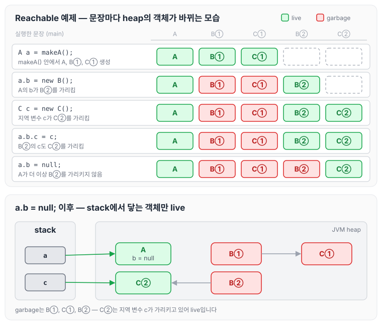
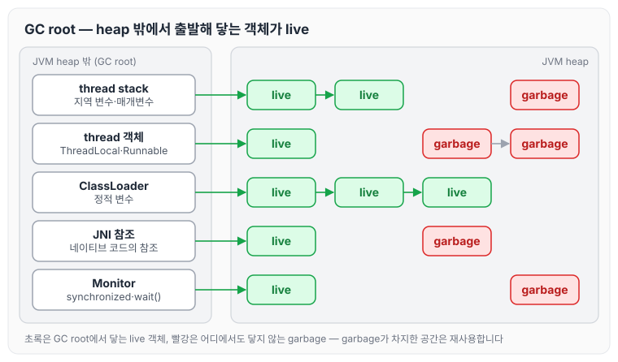
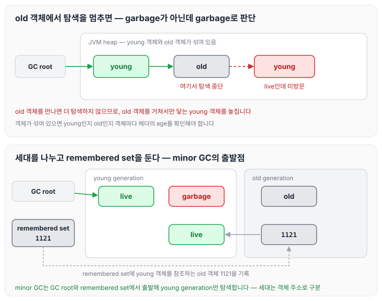
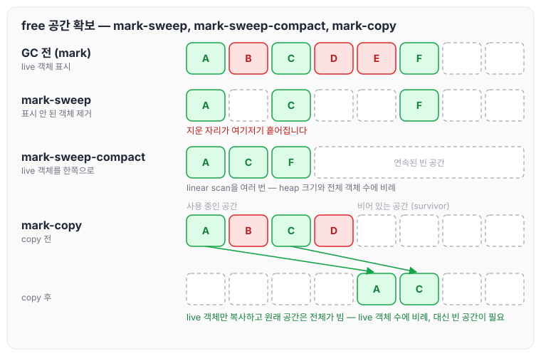
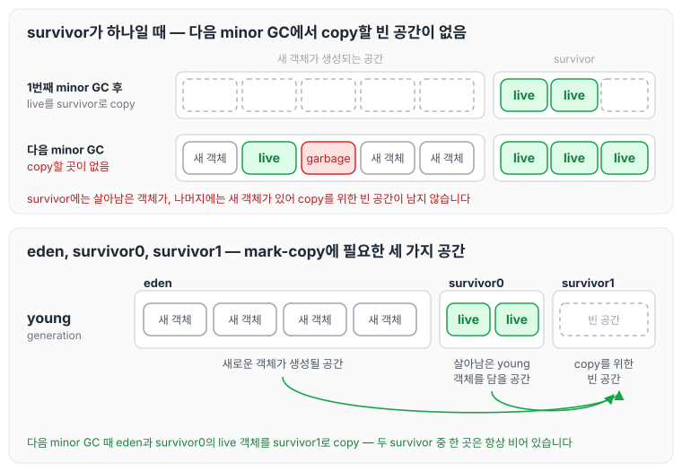
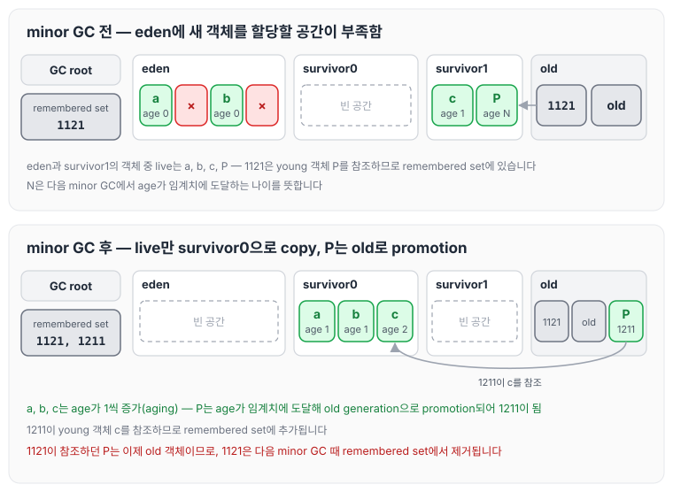
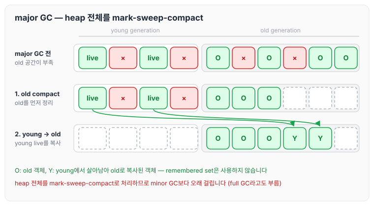
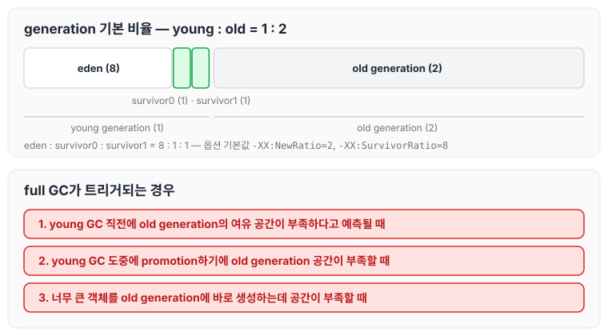

이전에 [GC의 역할과 튜닝 기준: Ergonomics와 JVM 기본 설정](../gc-tuning-criteria/)에 대해 작성하였습니다. 이번 글에서는 GC가 어떤 객체를 garbage로 판단하는지, 그리고 Serial GC를 기준으로 generational collection이 왜 young generation과 old generation, eden과 survivor로 나뉜 구조가 되었는지 정리하도록 하겠습니다.

## 지난 글 복습

- GC는 더 이상 사용되지 않는 객체와 그 객체가 차지한 메모리 공간을 알아서 비웁니다.
- GC 덕분에 개발자가 메모리를 따로 챙기지 않아도 되어 편의성이 증대되었지만, GC가 동작하면 애플리케이션은 pause(Stop-The-World)되기 때문에 애플리케이션 관점에서는 GC가 오버헤드(간접비용)라고 볼 수 있습니다.
- 그러므로 GC pause-time이나 빈도를 줄일수록 애플리케이션 성능에 도움이 됩니다.

## 어떤 객체가 garbage인가

아래 코드를 실행했을 때 JVM heap에 어떤 객체가 생기고, 그중 어떤 객체가 garbage가 되는지 살펴보겠습니다.

```java
public class Reachable {
    public static void main(String[] args) {
        A a = makeA();
        a.b = new B();
        C c = new C();
        a.b.c = c;
        a.b = null;
    }

    public static A makeA() {
        A a = new A();
        a.b = new B();
        a.b.c = new C();
        return a;
    }
}

public static class A {
    public B b;
}

public static class B {
    public C c;
}

public static class C {
}
```

`main`의 문장을 하나씩 실행할 때마다 stack의 지역 변수와 heap의 객체가 어떻게 바뀌는지 그려 보면 아래와 같습니다. `makeA()` 안에서 만든 B, C와 `main`에서 만든 B, C를 구분하기 위해 각각 B①·C①, B②·C②로 표시하였습니다.



- `A a = makeA();`: `makeA()` 안에서 A, B①, C①이 만들어지고, `main`의 지역 변수 `a`가 A를 가리킵니다.
- `a.b = new B();`: A의 `b`가 새로 만든 B②를 가리키게 됩니다. 이제 B①과, B①을 통해서만 닿던 C①은 어디에서도 참조되지 않습니다.
- `C c = new C();`, `a.b.c = c;`: C②가 만들어지고, 지역 변수 `c`와 B②의 `c`가 C②를 가리킵니다.
- `a.b = null;`: A가 더 이상 B②를 가리키지 않으므로 B②도 어디에서도 참조되지 않습니다.

여기서 garbage는 B①, C①, B② 세 개입니다. C②는 B②가 garbage가 되었더라도 지역 변수 `c`가 여전히 가리키고 있으므로 garbage가 아닙니다. 즉, 객체가 unreachable하면 garbage입니다.

그렇다면 무엇으로부터 unreachable하다는 것일까요? 그 출발점이 GC root입니다.

## GC root

GC root의 종류와, 각 GC root에서 reachable한 객체들은 아래와 같습니다.

| GC root | reachable한 객체들 |
|------|------|
| thread stack (지역 변수) | 모든 active thread들의 stack에 있는 지역 변수(매개변수 포함)가 참조하는 객체들 |
| thread 객체 (ThreadLocal) | active thread 객체(`java.lang.Thread`)에서 참조하는 객체들. 대표적으로 ThreadLocal과 Runnable 객체가 있습니다 |
| ClassLoader (정적 변수) | 클래스로더들이 로딩한 클래스들이 참조하는 객체들. 대표적으로 정적 변수가 있습니다 |
| JNI 참조 | 네이티브 코드에서 참조하고 있는 객체들 |
| Monitor | 동기화(e.g. `synchronized`, `wait()`)에 사용 중인 모니터(monitor) 객체들 |
| … | … |

GC root의 종류는 다양하지만, 관리되는 위치는 모두 JVM heap 영역 밖입니다. 위의 예제에서 지역 변수 `a`와 `c`는 thread stack에 있는 GC root였습니다.



GC root는 live(reachable) 객체를 찾기 위한 출발점입니다. GC는 GC root에서 참조를 따라가며 닿는 객체를 live 객체로 보고, live 객체가 아니면 garbage로 판단합니다. garbage가 차지하던 공간은 다시 사용할 수 있습니다.

## Generational collection

설명에 앞서 강의에서 짚은 두 가지가 있습니다.

1. Serial GC 기준입니다. 하지만 이것을 잘 이해해야 앞으로 다른 여러 종류의 collector들도 동작 원리를 잘 이해할 수 있다고 합니다.
2. 이해를 돕기 위해 강사님만의 스토리텔링이 더해졌습니다. 그래서 아래 흐름대로 역사적으로도 실제로 그렇게 발전했는지는 알 수 없지만, 왜 이런 구조가 될 수밖에 없었는지 이해하는 데에는 큰 도움이 될 것이라고 하였습니다.

결과부터 보면, 가상 주소 공간 안의 JVM heap은 young generation과 old generation으로 나뉘고, young generation은 다시 eden, survivor0, survivor1로 나뉩니다. 아래에서는 이 구조에 이르는 과정을 순서대로 정리하겠습니다.

### 매번 모든 live 객체를 방문해야 할까

가장 단순한 방법은 heap이 차면 GC root로부터 모든 live 객체를 탐색하는 것입니다. 하지만 이렇게 하면 GC를 할 때마다 heap에 있는 모든 live 객체를 방문해야 합니다.

여기서 이용하는 것이 객체의 수명 분포입니다. Oracle GC Tuning Guide의 Figure 3-1(Typical Distribution for Lifetimes of Objects)을 보면 할당된 직후에 죽는 객체가 가장 많고, 오래 살아남는 객체는 적습니다.

- 대부분의 객체는 태어나서 금방 죽습니다.
- 오래된 객체는 계속 살아남을 가능성이 큽니다.

그렇다면 young 객체만 탐색하면 됩니다. 이때 young과 old를 구분하는 기준이 age입니다.

- age(나이)는 GC를 경험한 횟수입니다.
- age는 객체의 헤더에 있습니다.
- age가 특정 threshold를 넘으면 old 객체입니다.

### old 객체에서 탐색을 멈추면 생기는 문제

young 객체만 탐색하기 위해, 탐색하다가 old 객체를 만나면 더 이상 탐색하지 않고 다음 young 객체만 탐색한다고 해 보겠습니다.

그러나 이렇게 하면 old 객체를 거쳐서만 닿을 수 있는 young 객체는 방문하지 못합니다. garbage가 아닌데 garbage로 판단하게 되는 것입니다. 또한 young 객체와 old 객체가 heap 곳곳에 섞여 있으면 어떤 객체가 young인지 하나씩 헤더를 확인해야 합니다.

그래서 young generation과 old generation을 나누고, young generation만 collection합니다. 영역을 나누면 객체 주소만 보고도 young인지 old인지 알 수 있습니다.



여기까지 정리하면 다음과 같습니다.

- 객체의 나이(age)에 따라 young generation과 old generation으로 나눕니다.
- young generation이 다 차면 young live 객체만 탐색해서 young generation만 collection합니다(minor GC 또는 young GC).
- minor GC 후에도 살아남은 young 객체는 나이가 1씩 증가합니다(aging).
- age가 임계치(threshold)를 넘으면 old generation으로 올라갑니다(promotion).

### old 객체가 young 객체를 참조할 때 — remembered set

다만 한 가지 문제가 남습니다. 세대를 나누어도 old 객체가 young 객체를 참조하고 있으면, young generation만 탐색해서는 그 young 객체에 닿을 수 없습니다.

여기서 이용하는 성질은 "더 오래된 객체에서 더 젊은 객체를 참조하는 경우는 거의 없다"는 것입니다. 경우가 드물기 때문에, young 객체를 참조하는 old 객체만 따로 기록해 두면 됩니다. 이것이 remembered set입니다.

위 그림 아래쪽에서 old generation의 1121 객체는 young 객체를 참조하고 있습니다. remembered set에는 1121이 기록되고, minor GC 때는 remembered set이 GC root 역할을 합니다. 그래서 GC root와 remembered set에서 출발해 young 객체만 탐색해도 live 객체를 빠뜨리지 않습니다.

## 어떻게 free 공간을 확보할 것인가

live 객체를 찾았다면 이제 garbage가 차지하던 공간을 비워야 합니다. 강의에서는 세 가지 방식을 차례로 살펴보았습니다.

- mark-sweep: live 객체를 표시하고, 표시되지 않은 객체를 지웁니다. 지운 자리가 여기저기 흩어집니다.
- mark-sweep-compact: mark-sweep에 더해 live 객체를 한쪽으로 모읍니다. 단계는 아래와 같습니다.
  1. live object 탐색을 통해 free 공간을 확인합니다.
  2. live object를 compact했을 때의 새로운 주소(forwarding address)를 객체 헤더에 임시로 저장합니다(linear scan).
  3. 참조 주소를 새 주소로 업데이트합니다(GC root, linear scan).
  4. 실제로 객체를 복사합니다(linear scan).
- mark-copy: live 객체를 비어 있는 다른 공간(survivor)으로 복사합니다. 복사하고 나면 원래 공간 전체가 비게 됩니다.



mark-sweep-compact는 linear scan을 여러 번 하기 때문에 비용이 heap 크기와 전체 객체 수에 비례합니다. 반면 mark-copy는 live 객체만 복사하므로 비용이 live 객체 수에 비례합니다. 대부분의 young 객체는 금방 죽기 때문에, young generation에서는 mark-copy가 유리합니다. 다만 mark-copy는 복사해 갈 빈 공간이 있어야 하며, 이 빈 공간이 핵심입니다.

### survivor가 두 개인 이유

survivor가 하나뿐이라면 다음 minor GC 때가 문제입니다. 처음 minor GC에서는 live 객체를 survivor로 복사하면 되지만, 다음 minor GC 때는 survivor에도 살아남은 객체가 있고 나머지 공간에는 새 객체가 생성되어 있어서 복사해 갈 빈 공간이 없습니다.

mark-copy를 계속하려면 아래 세 가지 공간이 필요합니다.

- 살아남은 young 객체를 담을 공간
- 새로운 객체가 생성될 공간
- copy를 위한 빈 공간

그래서 young generation을 eden, survivor0, survivor1로 나눕니다. 새 객체는 eden에 생성되고, minor GC 때마다 eden과 사용 중인 survivor의 live 객체를 비어 있는 survivor로 복사합니다. 두 survivor 중 한 곳은 항상 비어 있습니다. eden에 객체를 할당하는 과정은 [JVM TLAB (Thread Local Allocation Buffer)](../jvm-tlab/)에서 부연해서 정리하였습니다.



### minor GC 한 번의 흐름

eden, survivor0, survivor1로 나눈 상태에서 minor GC가 한 번 일어나는 과정을 그려 보면 아래와 같습니다.



- eden과 survivor1의 live 객체는 모두 비어 있던 survivor0으로 복사되고, age가 1씩 증가합니다. 그 외 young generation 전체는 비게 됩니다.
- age가 임계치에 도달한 객체는 survivor가 아니라 old generation으로 올라갑니다(promotion).
- 이번에 promotion된 객체(1211)가 young 객체를 참조하고 있으므로 remembered set에 1211이 추가됩니다.
- 1121이 참조하던 객체는 이번에 old generation으로 올라갔기 때문에, 1121은 더 이상 young 객체를 참조하지 않습니다. 1121은 다음 minor GC 때 remembered set에서 제거됩니다.

지금까지의 내용을 정리하면 다음과 같습니다.

- 객체의 나이(age)에 따라 young generation과 old generation으로 나눕니다.
- 새로운 객체는 eden에 생성됩니다.
- eden에 새 객체를 할당할 공간이 부족하면 young live 객체만 탐색해서 young generation만 collection합니다(minor GC 또는 young GC).
- minor GC에서 살아남은 young 객체는 age가 1씩 증가합니다(aging).
- minor GC에서 young live 객체는 survivor 중 한 곳으로 모두 복사되고, 그 외 young generation 전체는 비게 됩니다(mark-copy).
- 단, age가 임계치(threshold)에 도달한 young live 객체는 survivor가 아니라 old generation으로 올라갑니다(promotion).
- remembered set(card table)을 통해 young 객체를 참조하는 old 객체를 관리하며, minor GC 중에는 GC root처럼 활용됩니다.

mark-copy는 빈 survivor 공간을 늘 남겨 두어야 하므로, 공간 효율을 포기하더라도 더 빠르게 처리할 수 있는 방식입니다.

## old generation도 공간이 부족하면 — major GC

old generation도 공간이 부족해지면 major GC가 일어납니다.

- heap 전체를 collection합니다(old generation만 collection하는 것이 아닙니다).
- full GC라고도 불립니다.
- mark-sweep-compact 방식으로 동작합니다. full GC가 minor GC보다 더 오래 걸리는 이유입니다.
- young generation에서 살아남은 객체들도 모두 old generation으로 복사합니다(old generation을 먼저 compact한 후에).
- remembered set은 major GC에서는 사용되지 않습니다.



## generation 비율과 full GC가 일어나는 때

generation 비율의 기본값은 아래와 같습니다.

- (default) young generation : old generation = 1 : 2
- (default) eden : survivor0 : survivor1 = 8 : 1 : 1

full GC는 아래와 같은 경우에 트리거됩니다.

- young GC 직전에 old generation의 여유 공간이 부족하다고 예측되면
- young GC 도중에 promotion하기에 old generation 공간이 부족하면
- 너무 큰 객체는 old generation에 바로 생성되는데, 이때 공간이 부족하면



Oracle 문서에서 위 비율은 각각 `-XX:NewRatio`(기본값 2)와 `-XX:SurvivorRatio`(기본값 8) 옵션의 기본값에 해당합니다.

그 밖에 강의에서 정리한 내용은 다음과 같습니다.

- minor GC가 full GC보다 더 자주 일어납니다.
- mark-sweep-compact는 mark-compact라고 부르기도 합니다.
- weak generational hypothesis(약한 세대별 가설)
  - 대부분의 객체는 태어나서 금방 죽습니다.
  - 더 오래된 객체에서 더 젊은 객체를 참조하는 경우는 거의 없습니다.

강의 마지막에는 "무엇이 collecting되는가? live collector?"라는 질문이 남았습니다. 위에서 본 mark-copy와 mark-sweep-compact 모두 실제로 탐색하고 옮기는 대상은 live 객체이므로, 이 점을 다시 생각해 보게 하는 질문인 것 같습니다.

## 마무리

오늘은 GC가 GC root에서 닿지 않는 객체를 garbage로 판단하는 방식과, Serial GC를 기준으로 young generation과 old generation, eden과 survivor로 나뉜 구조가 나오게 된 과정, 그리고 remembered set과 mark-copy, minor GC와 major GC의 동작에 대해 정리하였습니다.

정리하면서 eden과 survivor 두 개로 나뉜 구조가 처음부터 정해진 것이 아니라, young 객체만 탐색하고 mark-copy로 빠르게 비우기 위해 필요한 공간을 나누다 보니 나온 구조라는 것을 알 수 있었습니다. 이 구조를 이해하고 있어야 이후 다른 collector의 동작도 같은 기준으로 비교할 수 있을 것 같습니다.

다음 글에서는 [TLAB과 Generation 크기 조정: Serial GC의 힙 크기 옵션](../gc-heap-generation-sizing/)에 대해 정리하겠습니다.

참고 자료
- [GC 4부: Generational GC 핵심 원리](https://youtube.com/live/3NH50dvzdpE?feature=share) (멤버십 전용 영상)
- [Garbage Collector Implementation (Oracle HotSpot GC Tuning Guide, JDK 25)](https://docs.oracle.com/en/java/javase/25/gctuning/garbage-collector-implementation.html)
- [Factors Affecting Garbage Collection Performance (Oracle HotSpot GC Tuning Guide, JDK 25)](https://docs.oracle.com/en/java/javase/25/gctuning/factors-affecting-garbage-collection-performance.html)
