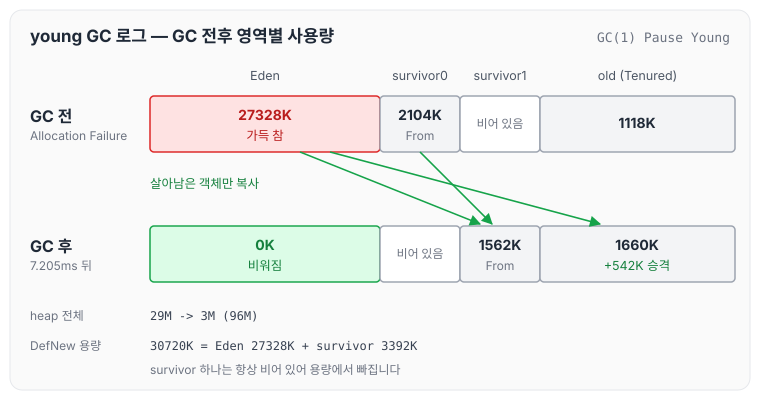
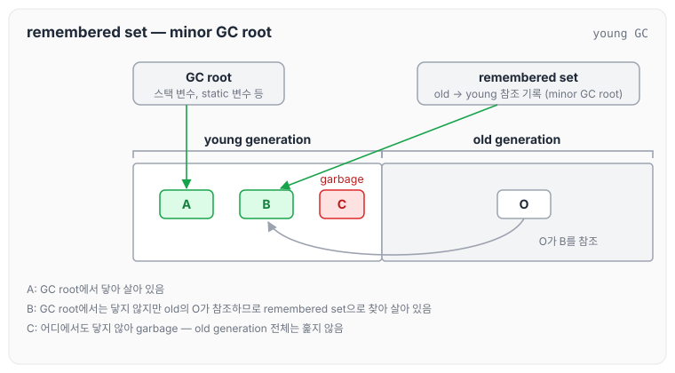
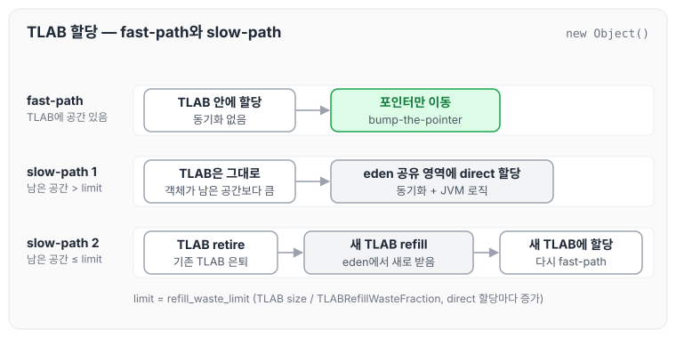
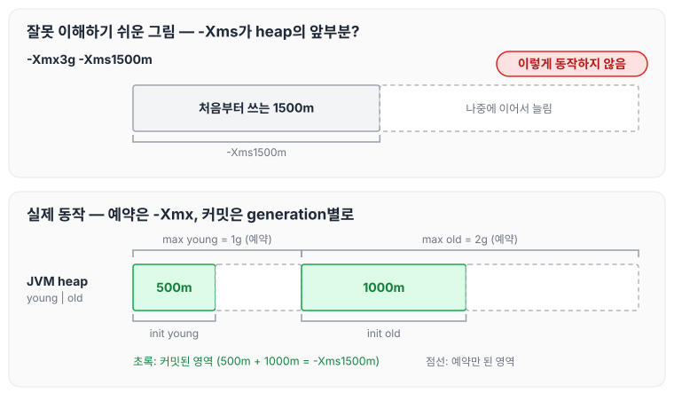
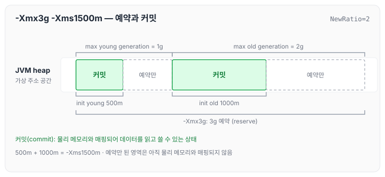
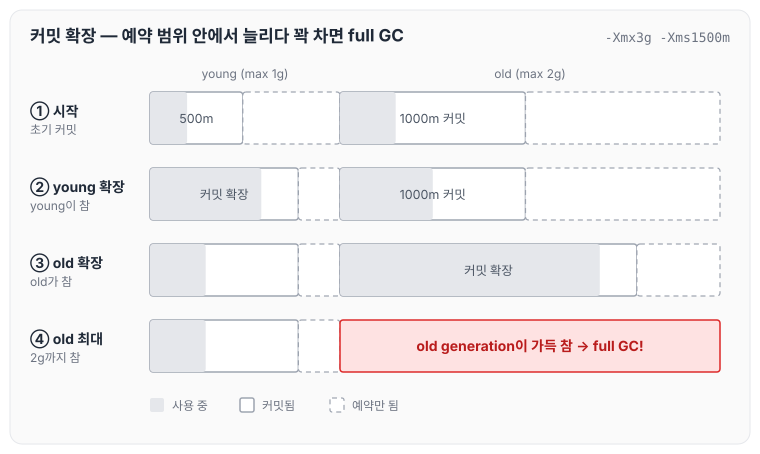
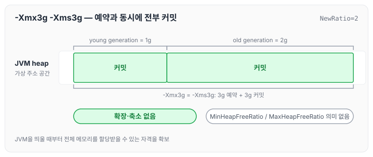
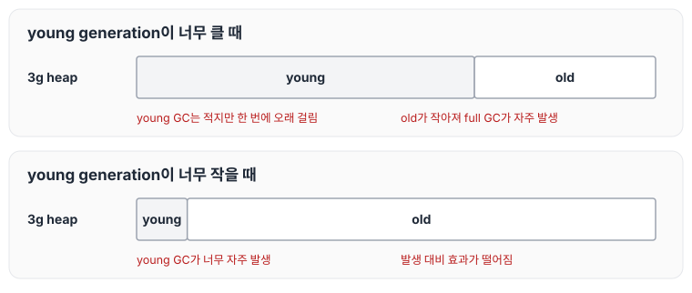
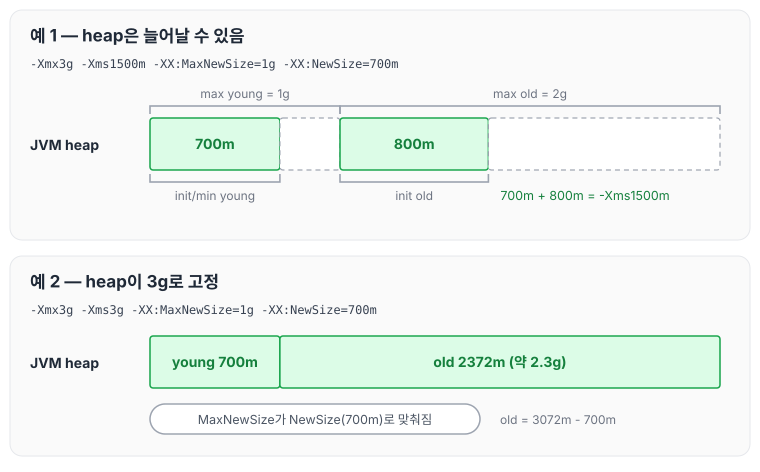
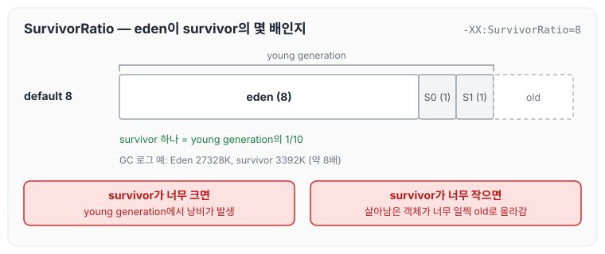

이전에 [Generational GC 핵심 원리: GC root, remembered set, minor GC와 major GC](../gc-generational-collection/)에 대해 작성하였습니다. 이번 글에서는 Serial GC를 기준으로 GC 로그를 읽는 방법과 eden에 객체가 생성되는 방식(TLAB), 그리고 JVM heap과 각 generation의 크기를 정하는 옵션에 대해 정리하도록 하겠습니다.

## 지난 시간 복습

이전 글의 내용을 요약하자면 아래와 같습니다.

1. GC는 garbage가 많을수록 빨리 끝납니다.
2. GC는 live object가 많을수록 오래 걸립니다.
3. 대부분의 객체는 lifetime이 매우 짧습니다.
4. young GC는 mark-copy, full GC는 mark-sweep-compact로 동작합니다.
5. mark-copy가 성능은 더 좋지만, 대신 일부 메모리 공간을 포기해야 합니다.
6. young GC에서 최대한 garbage들이 다 처리되도록 해서 full GC는 적게 일어나는 것이 좋습니다.

## GC 로그

Serial GC로 heap을 100MB로 고정하고 GC 로그를 출력하도록 아래 옵션으로 실행하였습니다.

```text
-XX:+UseSerialGC -Xms100m -Xmx100m -XX:-UseAdaptiveSizePolicy -Xlog:gc*=info
```

### young GC 로그

young GC가 한 번 일어났을 때의 로그는 아래와 같습니다.

```text
[0.170s][info][gc,start ] GC(1) Pause Young (Allocation Failure)
[0.177s][info][gc,heap ] GC(1) DefNew: 29432K(30720K)->1562K(30720K) Eden: 27328K(27328K)->0K(27328K) From: 2104K(3392K)->1562K(3392K)
[0.177s][info][gc,heap ] GC(1) Tenured: 1118K(68288K)->1660K(68288K)
[0.177s][info][gc,metaspace ] GC(1) Metaspace: 115K(320K)->115K(320K) NonClass: 110K(192K)->110K(192K) Class: 4K(128K)->4K(128K)
[0.177s][info][gc ] GC(1) Pause Young (Allocation Failure) 29M->3M(96M) 7.205ms
[0.177s][info][gc,cpu ] GC(1) User=0.01s Sys=0.01s Real=0.01s
```

- `Pause Young (Allocation Failure)`: eden에 더 이상 객체를 할당할 수 없어서 young GC가 일어났습니다.
- `DefNew`: Serial GC의 young generation입니다. 사용량이 29432K에서 1562K로 줄었고, 괄호 안의 30720K는 용량입니다.
- `Eden`, `From`: young generation 안의 eden과 survivor입니다. eden은 27328K에서 0K로 비워졌고, survivor에는 살아남은 객체 1562K가 남았습니다.
- `Tenured`: Serial GC의 old generation입니다. 1118K에서 1660K로 늘어났는데, young GC에서 살아남은 객체 일부가 old generation으로 옮겨졌기 때문입니다.
- `29M->3M(96M) 7.205ms`: heap 전체 사용량이 29M에서 3M로 줄었고, 이번 young GC에 7.205ms가 걸렸습니다.

로그의 값을 heap 영역에 대응시키면 아래와 같습니다.



eden은 모두 비워지고, 살아남은 객체만 survivor와 old generation으로 옮겨진 것을 확인할 수 있습니다. 참고로 `DefNew`의 용량 30720K는 eden(27328K)과 survivor 하나(3392K)를 더한 값이고, heap 전체 용량 96M도 100M에서 survivor 하나만큼을 뺀 값입니다. mark-copy 방식이라 survivor 두 개 중 하나는 항상 비어 있기 때문입니다.

### full GC 로그

`System.gc()`로 full GC를 일으켰을 때의 로그는 아래와 같습니다.

```text
[7.984s][info][gc,start ] GC(572) Pause Full (System.gc())
[7.984s][info][gc,phases,start ] GC(572) Phase 1: Mark live objects
[7.987s][info][gc,phases ] GC(572) Phase 1: Mark live objects 3.474ms
[7.987s][info][gc,phases,start ] GC(572) Phase 2: Compute new object addresses
[7.993s][info][gc,phases ] GC(572) Phase 2: Compute new object addresses 5.278ms
[7.993s][info][gc,phases,start ] GC(572) Phase 3: Adjust pointers
[7.994s][info][gc,phases ] GC(572) Phase 3: Adjust pointers 1.945ms
[7.994s][info][gc,phases,start ] GC(572) Phase 4: Move objects
[7.996s][info][gc,phases ] GC(572) Phase 4: Move objects 1.703ms
[7.996s][info][gc,heap ] GC(572) DefNew: 15212K(30720K)->0K(30720K) Eden: 13649K(27328K)->0K(27328K) From: 1562K(3392K)->0K(3392K)
[7.996s][info][gc,heap ] GC(572) Tenured: 1660K(68288K)->3223K(68288K)
[7.996s][info][gc,metaspace ] GC(572) Metaspace: 115K(320K)->115K(320K) NonClass: 110K(192K)->110K(192K) Class: 4K(128K)->4K(128K)
[7.996s][info][gc ] GC(572) Pause Full (System.gc()) 16M->3M(96M) 12.624ms
[7.996s][info][gc,cpu ] GC(572) User=0.01s Sys=0.00s Real=0.02s
```

full GC는 살아 있는 객체를 표시하고(Phase 1), 객체가 옮겨 갈 새 주소를 계산한 뒤(Phase 2), 참조를 새 주소로 고치고(Phase 3), 객체를 실제로 옮기는(Phase 4) 순서로 진행됩니다. mark-sweep-compact 방식이 단계별로 로그에 남는 것입니다. young generation(`DefNew`)은 0K로 비워지고, 살아남은 객체가 old generation(`Tenured`)으로 옮겨져 1660K에서 3223K로 늘어났습니다. 같은 heap에서 young GC가 7.205ms 걸린 것에 비해 full GC는 12.624ms가 걸렸습니다.

### remembered set (minor GC root)

강의에서는 GC 로그와 함께 heap 그림을 보여 주었는데, 그 그림에는 GC root 외에 remembered set이 minor GC root로 표시되어 있습니다.

young GC는 young generation만 수집합니다. 그런데 old generation의 객체가 young generation의 객체를 참조하고 있다면, GC root에서 직접 닿지 않더라도 그 young 객체는 살아 있는 객체로 봐야 합니다. 이렇게 old generation에서 young generation을 가리키는 참조를 따로 기록해 둔 것이 remembered set이고, young GC(minor GC)에서는 이것을 GC root처럼 사용합니다.



old generation 전체를 훑지 않고 remembered set에 기록된 참조만 따라가면 되므로, young GC를 할 때 old generation을 모두 살펴볼 필요가 없습니다.

## TLAB: eden에서 객체가 생성되는 방식

TLAB은 [JVM TLAB (Thread Local Allocation Buffer)](../jvm-tlab/)에서 동작 방식과 플래그, 로그 보는 법까지 자세히 정리하였습니다. 여기서는 강의에서 다룬 내용을 짧게 정리하겠습니다.

### 왜 TLAB이 필요한가

- JVM heap은 여러 스레드들이 공유하며 접근하는 영역입니다.
- 객체는 JVM heap 중에서도 eden에 생성됩니다.
- 서로 다른 스레드가 우연히 동시에, 심지어 같은 위치에 객체를 생성하려고 하면 스레드 간에 충돌이 생길 수 있습니다.
- 이 synchronization 이슈를 락으로 해결할 수 있지만, 락을 쓰면 병목이 생깁니다.

그래서 eden 영역의 일부를 각 스레드가 독립적으로 사용할 수 있게 나눠 주고, 거기에 객체를 생성하도록 합니다. 이것을 TLAB(Thread Local Allocation Buffer)이라고 부릅니다.

- 각 스레드는 자신만의 TLAB에 객체를 생성합니다. synchronization 이슈가 없고, 경합이 없기 때문에 병목도 없습니다.
- bump-the-pointer: 객체가 생성될 위치를 포인터로 가리키고, 객체가 생성되면 포인터를 그다음 생성될 위치로 옮깁니다.
- TLAB 안에서 객체가 생성되는 경우를 fast-path라고 부릅니다. synchronization 이슈가 없어서 빠르게 객체를 생성할 수 있기 때문입니다.
- TLAB 안에서의 객체 생성은 JIT compiler가 컴파일까지 하고 나면 CPU 명령어 약 10개로 끝납니다.

### TLAB의 남은 공간보다 큰 객체를 할당할 때

1. TLAB에 남은 공간이 여유가 있지만 새로 생성할 객체가 그보다 크면, TLAB 밖의 eden 영역에 직접(direct) 할당합니다.
2. TLAB에 남은 공간이 여유가 없으면, 기존 TLAB을 은퇴(retire)시키고 eden 영역에서 새로운 TLAB을 할당(refill)받습니다.

1번과 2번 모두 eden의 공유 영역에서 일어나며 동기화와 JVM 로직이 개입하기 때문에 속도가 느립니다. 이를 slow-path라고 부릅니다.



TLAB에 남은 공간이 여유가 있는지는 refill_waste_limit으로 판단합니다. 남은 공간이 refill_waste_limit보다 크면 아직 여유가 있다고 보고 1번처럼 동작합니다.

```text
refill_waste_limit = TLAB size / TLABRefillWasteFraction        * -XX:TLABRefillWasteFraction=N (default 64)
refill_waste_limit += TLABWasteIncrement (1번이 발생할 때 마다)   * -XX:TLABWasteIncrement=M (default 4, heap word 단위)
```

### TLAB resize

- `-XX:+ResizeTLAB`(default true) 옵션을 켜면 TLAB의 크기가 동적으로 재조정됩니다.
- young GC 후 스레드별로 앞으로 사용할 TLAB 크기가 재조정되는데, 이것을 desired_size라고 부릅니다.
- TLAB 크기 조정에 영향을 미치는 주요 요소는 아래와 같습니다.
  - eden 크기
  - 스레드 수
  - `-XX:TLABWasteTargetPercent=N`(default 1, 단위 %): 값이 클수록 desired_size가 커집니다. refill이 적게 일어나 객체 생성은 빨라지지만, eden 낭비가 커져서 young GC가 자주 발생할 수 있습니다.
  - allocation rate(각 스레드가 eden의 얼마를 할당받았는지)와 `-XX:TLABAllocationWeight=M`(default 35, 단위 %): 값이 클수록 직전 allocation rate를 더 많이 반영합니다.

### TLAB 관련 주요 VM option

- `-XX:+UseTLAB`: TLAB을 사용할지 선택합니다. default는 true입니다.
- refill: `-XX:TLABRefillWasteFraction=N`(default 64), `-XX:TLABWasteIncrement=M`(default 4, heap word 단위)
- resize: `-XX:+ResizeTLAB`(default true), `-XX:TLABWasteTargetPercent=N`(default 1, 단위 %), `-XX:TLABAllocationWeight=M`(default 35, 단위 %)
- TLAB size
  - `-XX:TLABSize=N`: 스레드가 처음 TLAB을 할당받을 때의 크기입니다. 단위는 bytes이며 default는 0으로, HotSpot VM이 알아서 결정합니다.
  - `-XX:MinTLABSize=M`: TLAB 크기의 최솟값입니다. 단위는 bytes이며 default는 2048입니다.

대부분의 상황에서는 디폴트 값을 그대로 사용하면 됩니다.

## GC 성능 관련 주요 지표

- Throughput(처리량): 전체 실행 시간 중 GC에 소비된 시간을 제외하고 애플리케이션이 실행된 시간입니다. 객체 할당은 애플리케이션 실행 시간에 포함됩니다.
- Latency(지연 시간): GC로 인해 애플리케이션이 멈추는 시간, 즉 stop-the-world 시간입니다. 애플리케이션과 병렬로 실행되는 GC 시간은 포함하지 않습니다.
- Footprint: 애플리케이션이 실제로 점유하고 있는 물리 메모리의 양입니다. 물리 메모리가 적거나 많은 프로세스가 물리 메모리를 공유할 때 중요합니다.
- Promptness: garbage가 된 뒤 해당 메모리가 다시 사용 가능해질 때까지의 시간입니다. RMI를 포함한 분산 환경에서 중요합니다.

GC의 주요 측정 지표는 Throughput과 Latency입니다. 두 지표는 trade-off 관계이므로, 서버 애플리케이션에서 어느 쪽을 우선할지도 고민해 볼 지점입니다. generation의 크기를 정하는 것은 Throughput과 Latency 사이에서 절충점을 고르는 것과 같습니다. Ergonomics가 Pause-Time, Throughput, Footprint 목표를 어떤 순서로 맞추는지는 [GC의 역할과 튜닝 기준: Ergonomics와 JVM 기본 설정](../gc-tuning-criteria/)에서 정리하였습니다.

## GC 성능에 영향을 주는 가장 중요한 두 가지 요소

1. JVM heap size: 가장 중요합니다. 메모리는 많을수록 좋고, TLAB 크기 등에도 영향을 줍니다.
2. JVM heap에서 young generation이 차지하는 비율: 그다음으로 중요합니다.

Oracle GC Tuning Guide에서도 GC 성능에 가장 큰 영향을 주는 두 가지로 사용할 수 있는 전체 메모리와 heap 중 young generation에 할당한 비율을 꼽고 있습니다. 아래에서 두 요소를 정하는 옵션을 차례로 정리하겠습니다.

## -Xmx와 -Xms

- `-XmxNN`: maximum JVM heap size입니다(e.g. `-Xmx3g`). `-XX:MaxHeapSize=NN` 옵션을 지정하는 것과 같습니다.
- `-XmsMM`: minimum/initial JVM heap size입니다(e.g. `-Xms1500m`). `-XX:InitialHeapSize=MM`과 `-XX:MinHeapSize=MM` 옵션을 동시에 지정하는 것과 같습니다.

`-Xmx3g -Xms1500m`이라고 하면, 3g짜리 heap 중 앞쪽 1500m를 먼저 쓰고 나머지를 이어서 늘려 가는 모습을 떠올리기 쉽습니다. 하지만 이런 식으로 동작하지 않습니다.



실제로는 다음과 같이 동작합니다.

- `-XmxNN`: 가상 주소 공간에서 이만큼의 주소 공간을 미리 예약(reserve)해 둡니다.
- `-XmsMM`: generation별로 최소/초기 주소 공간을 커밋(commit)합니다. 커밋은 물리 메모리와 매핑되어 메모리에서 데이터를 읽거나 쓸 수 있는 상태로 만드는 것입니다.
- `-XX:NewRatio=DD`: young과 old generation의 비율입니다. old가 young의 몇 배인지를 의미하며, default는 2입니다.

`-Xmx3g -Xms1500m`에 NewRatio의 default 2를 적용하면 아래와 같습니다.



- `-Xmx3g`로 3g를 예약하고, NewRatio 2에 따라 max young generation은 1g, max old generation은 2g가 됩니다.
- `-Xms1500m`도 같은 비율로 나뉘어, min/init young generation 500m와 min/init old generation 약 1g(1000m)가 커밋됩니다. 둘을 더하면 1500m입니다.

### 왜 일부만 커밋하는가

예약은 3g만큼 해 두고 커밋은 일부만 하는 이유는, 필요한 만큼만 물리 메모리와 매핑해 두고 공간이 부족해질 때 늘려 가기 위해서입니다. 객체가 쌓이는 과정을 따라가 보면 아래와 같습니다.



- young generation과 old generation은 각자 커밋된 영역이 차면, 예약해 둔 범위 안에서 커밋을 늘립니다.
- old generation이 max old generation(2g)까지 커지고 그마저 가득 차면 full GC가 일어납니다.

커밋을 늘리고 줄이는 기준은 아래 두 옵션입니다.

- `-XX:MaxHeapFreeRatio=KK`(default 70%): free 공간이 이 값보다 많으면 generation을 축소(uncommit)합니다.
- `-XX:MinHeapFreeRatio=LL`(default 40%): free 공간이 이 값보다 적으면 generation을 확장(commit)합니다.
- 확장과 축소는 각 generation별로 독립적으로 동작합니다.

## 서버 애플리케이션은 -Xmx와 -Xms를 같은 값으로

- 서버 애플리케이션은 예측 가능한 운영을 위해 `-Xmx`와 `-Xms`를 같은 값으로 지정합니다(e.g. `-Xmx3g -Xms3g`).
- 가상 주소 공간의 예약(reserve)과 커밋(commit)이 동시에 진행됩니다. JVM을 띄울 때부터 전체 메모리를 할당받을 수 있는 자격을 확보하는 셈입니다.
- `-XX:NewRatio`의 default 2에 따라 young generation은 1g, old generation은 2g가 됩니다.



이렇게 하면 더 이상 확장되거나 축소되는 일이 없어서 성능이 향상됩니다. 앞에서 본 `-XX:MaxHeapFreeRatio`와 `-XX:MinHeapFreeRatio`도 이 경우에는 의미가 없습니다.

참고로 Oracle GC Tuning Guide에는 `-Xms`와 `-Xmx`를 같게 지정하면 가장 중요한 크기 결정을 JVM에서 빼앗기 때문에 예측 가능성은 높아지지만, 잘못된 값을 고르면 JVM이 이를 보완할 수 없다는 설명도 함께 적혀 있습니다.

## young generation 크기 조정

young generation의 크기에 따라 아래와 같은 차이가 생깁니다.

- young generation이 너무 크면 young GC는 더 적게 일어나지만, 한 번 일어날 때 더 오래 걸립니다.
- young generation이 너무 크면 상대적으로 old generation이 작아져서 full GC가 더 자주 발생합니다.
- young generation이 너무 작으면 young GC가 너무 자주 발생하고, 발생 대비 효과도 떨어집니다.



그래서 내 애플리케이션이 어떤 식으로 동작하는지 그 경향성을 분석한 뒤 튜닝해야 합니다. 예를 들어 young generation이 얼마나 빨리 차는지도 중요할 수 있습니다(weak generational hypothesis).

young generation의 크기는 아래 옵션으로 정합니다.

- `-XX:NewRatio=DD`: young과 old generation의 비율입니다. old가 young의 몇 배인지를 의미하며, default는 2입니다.
- `-XX:NewSize=MM`: young generation의 초기/최소 크기입니다. default는 ergonomics가 결정합니다.
- `-XX:MaxNewSize=NN`: young generation의 최대 크기입니다. default는 ergonomics가 결정합니다.

`-XX:NewSize`와 `-XX:MaxNewSize`는 `-XX:NewRatio`보다 우선하고, 두 값을 같게 주면 young generation의 크기가 고정됩니다. 두 가지 예를 보면 아래와 같습니다.

```text
-Xmx3g -Xms1500m -XX:MaxNewSize=1g -XX:NewSize=700m
-Xmx3g -Xms3g -XX:MaxNewSize=1g -XX:NewSize=700m
```



- 첫 번째 예는 max young generation 1g, max old generation 2g를 예약하고, init/min young generation 700m와 init old generation 800m를 커밋합니다. 둘을 더하면 `-Xms1500m`입니다.
- 두 번째 예는 heap이 3g로 고정되어 있어서 MaxNewSize가 NewSize로 맞춰집니다. young generation은 700m, old generation은 나머지 약 2.3g(3072m - 700m = 2372m)가 됩니다.

JDK 21에서 두 번째 예를 `-XX:+UseSerialGC -XX:+PrintFlagsFinal`로 실행해 보면 `MaxNewSize`와 `NewSize`가 모두 734003200(700m)으로 출력됩니다. young generation 크기를 고정하려면 이처럼 `-XX:NewSize`와 `-XX:MaxNewSize`를 같은 값으로 맞추면 됩니다.

## survivor 크기 조정

- survivor의 크기는 성능에 그다지 영향을 주지 않을 때도 있습니다.
- `-XX:SurvivorRatio=N`: eden의 크기를 survivor의 몇 배로 잡을지 정합니다. default는 8입니다.
- survivor가 너무 크면 young generation에서 낭비가 발생합니다.
- survivor가 너무 작으면 young GC에서 살아남은 객체가 너무 일찍 old generation으로 올라갈 수 있습니다.

default 8이면 eden 8, survivor 1, survivor 1의 비율이 되어 survivor 하나는 young generation의 1/10이 됩니다. 앞의 GC 로그에서 Eden이 27328K, survivor가 3392K로 약 8배였던 것도 이 default 값 때문입니다.



## 서버 애플리케이션에서의 가이드라인

강의에서 정리한 서버 애플리케이션의 가이드라인은 아래와 같습니다.

- pause가 애플리케이션 성능에 문제가 되지 않는다면 가능한 한 많은 메모리를 JVM에 할당합니다(`-Xmx`).
- `-Xmx`가 JVM이 실행되는 machine의 물리 메모리 크기를 넘어서는 안 됩니다. swap 이슈가 생기면 성능에 치명적입니다.
- `-Xmx`와 `-Xms`를 똑같이 맞춥니다. 확장·축소 이슈가 없기 때문에 성능 면에서 이점이 있고 예측 가능성도 커집니다.
- CPU core 수가 많을수록 heap size도 늘립니다. 더 많은 스레드가 사용될 것이 예상되고, TLAB 등도 고려해야 하기 때문입니다.
- young generation 크기를 충분히 확보합니다. young GC에서 끝나서 full GC까지 잘 가지 않게 하는 것이 핵심입니다(TLAB 포함).
- old generation 크기도 적절히 확보합니다. 오래 살아남은 객체는 계속 살아남을 가능성이 큽니다.

## 마무리

오늘은 Serial GC의 GC 로그와 remembered set, eden에 객체를 생성하는 TLAB, 그리고 `-Xmx`·`-Xms`의 예약과 커밋, NewRatio·NewSize·MaxNewSize·SurvivorRatio로 generation 크기를 정하는 방법과 서버 애플리케이션의 가이드라인에 대해 정리하였습니다.

정리하면서 `-Xms`가 heap의 앞부분을 뜻하는 것이 아니라 generation별로 커밋할 크기라는 점, 그리고 `-Xmx`와 `-Xms`를 같게 주면 확장·축소가 없어진다는 점을 그림으로 확인할 수 있었습니다. 실제로 크기를 정할 때는 옵션 값보다 애플리케이션의 young generation이 얼마나 빨리 차는지 같은 경향성을 먼저 보는 것이 맞는 순서인 것 같습니다.

다음 글에서는 [GC 종류: Serial, Parallel, G1, ZGC와 CMS, Shenandoah](../gc-collector-types/)에 대해 정리하겠습니다.

참고 자료
- [GC 5부: TLAB, Generation 크기 조정](https://youtube.com/live/_fJhUiLZJf4?feature=share) (멤버십 전용 영상)
- [Factors Affecting Garbage Collection Performance (Oracle HotSpot GC Tuning Guide, JDK 25)](https://docs.oracle.com/en/java/javase/25/gctuning/factors-affecting-garbage-collection-performance.html)
- [Garbage Collector Implementation (Oracle HotSpot GC Tuning Guide, JDK 25)](https://docs.oracle.com/en/java/javase/25/gctuning/garbage-collector-implementation.html)
- [OpenJDK HotSpot 소스: tlab_globals.hpp](https://github.com/openjdk/jdk21u/blob/master/src/hotspot/share/gc/shared/tlab_globals.hpp)
