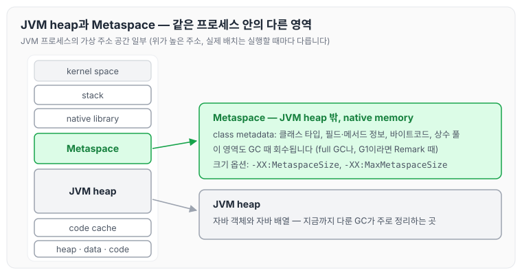
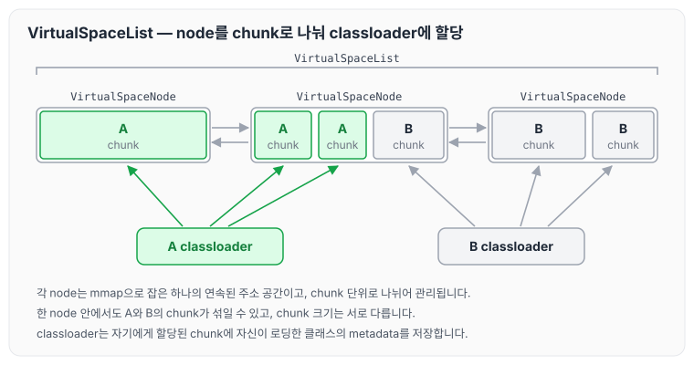
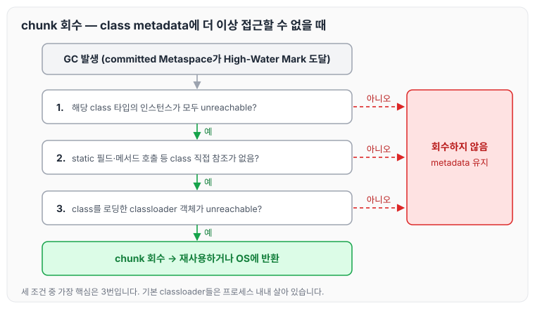
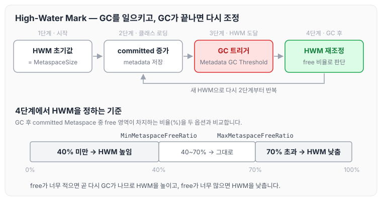
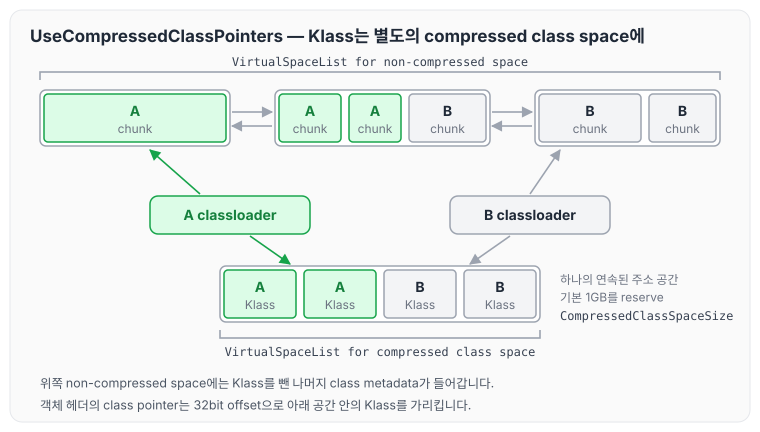
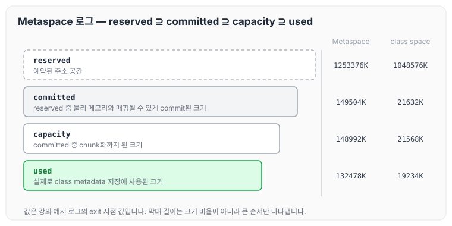
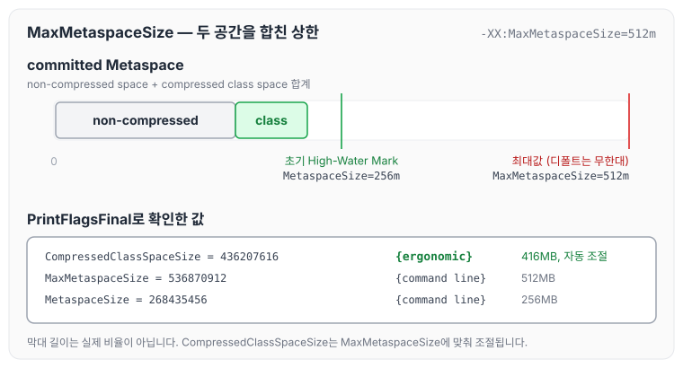
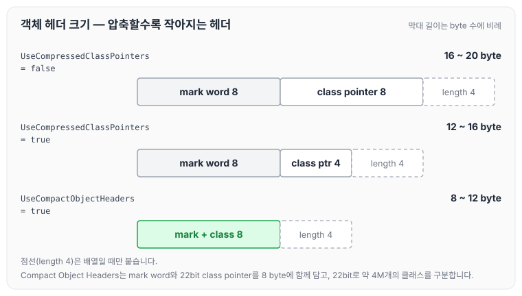

이전에 [ZGC 핵심 요약과 튜닝 옵션](../gc-zgc-summary/)에 대해 작성하였습니다. 지금까지는 자바 객체가 사는 JVM heap을 GC가 어떻게 정리하는지를 다뤘는데, 이번 글에서는 JVM heap 밖에 있으면서도 GC의 대상이 되는 Metaspace에 대해 정리하도록 하겠습니다. class metadata가 Metaspace에 어떻게 저장되고 회수되는지, GC를 일으키는 High-Water Mark와 관련 옵션, 압축 클래스 포인터와 Compact Object Headers까지 순서대로 살펴보겠습니다.

## JVM 프로세스 메모리 구조에서 Metaspace의 위치

JVM 프로세스의 가상 주소 공간에는 kernel space, stack, native library, Metaspace, JVM heap, code cache, 그리고 JVM 내부 로직(C++로 개발된 코드)이 사용하는 heap·data(+bss)·code(text)가 있습니다. 각 영역에 무엇이 있는지는 [GC의 역할과 튜닝 기준: Ergonomics와 JVM 기본 설정](../gc-tuning-criteria/)의 JVM 프로세스 메모리 구조 절에서, 영역 배치 그림은 [JVM은 어떻게 실행되고 클래스를 로딩하는가](../jvm-execution-classloading/)에서 정리하였습니다.

이번 글과 관련된 두 영역만 다시 짚으면 아래와 같습니다.

- JVM heap: 자바 객체와 자바 배열이 상주합니다. 지금까지 배운 GC는 이 영역에 대한 내용이었습니다.
- Metaspace (method area): klass 객체(필드, 메서드 정보, 상속 관계 같은 각종 클래스 메타 정보), 메서드 바이트코드, Runtime constant pool이 있습니다. 드물게 GC가 발생합니다(full GC나, G1이라면 Remark 때).



Metaspace는 JVM heap 영역 밖, 즉 native memory에 있습니다. 같은 JVM 프로세스 안에 있지만 JVM heap과는 다른 영역이라는 점을 기억해 두면 이후 내용을 따라가기 쉽습니다.

## Metaspace와 Class Metadata

Metaspace에는 Class Metadata가 저장됩니다. Class Metadata는 클래스 자체를 설명하는 데이터로, 아래 정보를 담고 있습니다.

- 클래스 타입(클래스 이름, 상위 클래스/인터페이스, 접근제어자)
- 필드 정보(필드 이름, 타입, 접근제어자)
- 메서드 정보(메서드 시그니처, 실제 바이트 코드)
- 상수 풀(Constant Pool)

Metaspace는 JVM heap 영역 밖에 저장되지만, Metaspace에 할당된 공간도 GC의 대상이 됩니다.

## Metaspace 메모리 영역은 어떻게 관리되는가?

Metaspace는 VirtualSpaceList로 관리됩니다.

- VirtualSpaceList는 VirtualSpaceNode들의 리스트입니다.
- 각 VirtualSpaceNode는 하나의 연속된 주소 공간입니다(mmap).
- 각 VirtualSpaceNode는 chunk 단위로 나뉘어서 관리됩니다.

이 chunk 단위로 classloader에게 공간이 할당됩니다.

- 하나의 VirtualSpaceNode 안에서도 일부 chunk는 A classloader에, 또 다른 일부 chunk는 B classloader에 할당될 수 있습니다.
- chunk들은 크기가 모두 같지 않으며, 클래스로더의 특성이나 메타데이터의 양에 따라 다른 크기의 chunk가 할당됩니다.
- classloader는 여러 종류가 있고, 프로세스가 실행되는 동안 기본 classloader들은 항상 살아 있습니다.

classloader는 자신에게 할당된 chunk에 자신이 로딩한 클래스의 metadata를 저장합니다. VirtualSpaceList와 chunk 할당을 그림으로 보면 아래와 같습니다.



chunk는 node 단위가 아니라 classloader 단위로 나뉘기 때문에, 가운데 node처럼 한 node 안에 A classloader와 B classloader의 chunk가 함께 있을 수 있습니다.

## classloader에 할당된 chunk는 언제 회수되는가?

chunk는 오직 GC 때만 회수됩니다.

- GC가 트리거되는 시점은 commit된 Metaspace 공간이 High-Water Mark에 도달했을 때입니다.
- 즉, JVM heap 밖에 있는 Metaspace 영역의 이슈 때문에 GC가 트리거될 수 있습니다.

classloader에 할당된 chunk는 그 chunk에 저장된 class metadata에 더 이상 접근할 수 없을 때 회수됩니다. 접근할 수 없다고 판단하는 기준은 아래와 같습니다.

1. 해당 class 타입의 인스턴스들이 모두 unreachable 해야 하고,
2. 해당 class의 static 필드나 메서드 호출 등 해당 class에 대한 직접 참조가 하나도 없어야 하며,
3. 가장 핵심적으로는 해당 class를 로딩한 classloader 객체가 unreachable 할 때

회수된 chunk는 재사용되거나 OS에 반환됩니다. GC가 일어났을 때 chunk가 회수되기까지의 흐름은 아래와 같습니다.



세 조건 중 하나라도 만족하지 않으면 class metadata는 그대로 남습니다. 앞에서 본 것처럼 기본 classloader들은 프로세스 내내 살아 있기 때문에, 3번 조건이 가장 핵심이 됩니다.

## GC를 트리거하는 High-Water Mark

commit된 Metaspace 공간이 High-Water Mark에 도달하면 GC가 트리거됩니다.

- 초기(initial) High-Water Mark 값은 `-XX:MetaspaceSize`와 같습니다.
  - `-XX:MetaspaceSize`의 디폴트 값은 플랫폼에 따라 다르며, Oracle 문서 기준 12MB ~ 약 20MB이고 OpenJDK 25 소스 기준 32bit 16MB, 64bit 21MB입니다.
- JVM 초반에 Metaspace 영역 이슈로 인한 GC가 자주 발생한다면 `-XX:MetaspaceSize` 값을 튜닝해 줄 필요가 있습니다.

초기 이후의 High-Water Mark 값은 `-XX:MaxMetaspaceFreeRatio`(70)와 `-XX:MinMetaspaceFreeRatio`(40)에 의해 조절됩니다.

- GC 후에 High-Water Mark 값이 재조정됩니다.
- commit된 Metaspace 영역 중 free 영역이 차지하는 퍼센트를 위 두 값과 비교해서
  - max 값보다 높으면 High-Water Mark 값을 낮춥니다.
  - min 값보다 낮으면 High-Water Mark 값을 높입니다.

High-Water Mark가 GC를 일으키고, GC가 끝난 뒤 다시 조정되는 흐름은 아래와 같습니다.



GC 후에 free 영역이 40% 미만이면 High-Water Mark를 높여서 곧바로 다시 GC가 일어나지 않게 하고, 70%를 넘으면 High-Water Mark를 낮춥니다. Oracle 문서에서도 High-Water Mark를 높이는 이유를 다음 GC가 너무 빨리 일어나지 않게 하기 위해서라고 설명합니다.

## -XX:+UseCompressedOops

`UseCompressedOops`의 디폴트 값은 true입니다.

- 64bit 환경에서도 객체를 가리키는 일반(ordinary) 객체 포인터를 32bit로 압축해서 표현하는 것입니다.
- 32bit offset 방식이기 때문에 끝에 3 bits(000)가 붙어서 최종 주소가 완성됩니다. 그래서 JVM heap size 32GB까지 커버할 수 있습니다.
- 객체의 멤버 참조 변수의 크기가 작아지기 때문에 메모리를 더 효율적으로 쓸 수 있어서 성능에 이득입니다.

강의에서는 아래 클래스를 예로 들었습니다. `name`과 `lock`처럼 다른 객체를 가리키는 멤버 참조 변수가 압축되는 대상입니다.

```java
public class TestClass {
    private String name;
    private Object lock;
    private int age;
}
```

## -XX:+UseCompressedClassPointers

`UseCompressedClassPointers`의 디폴트 값도 true입니다.

- 객체 헤더에서 class metadata를 가리키는 포인터를 32bit로 압축합니다.
- `UseCompressedOops`와 마찬가지로 32bit offset 방식으로 동작합니다.
- 헤더 크기는 아래와 같습니다(단위: byte).
  - false: 8(mark word) + 8(class pointer) [+ 4 if array] = 16 ~ 20
  - true: 8(mark word) + 4(class pointer) [+ 4 if array] = 12 ~ 16

true이면 Metaspace 안에서도 CompressedClassSpace라는 별도의 연속된 주소 공간에 Klass 구조체를 따로 관리합니다.

- `-XX:CompressedClassSpaceSize`: compressed class space의 최대값을 지정합니다.
  - 디폴트 크기는 1GB로, reserve 됩니다. 지정할 수 있는 최대값은 64bit 기준 JDK 22까지는 3GB, JDK 23부터는 4GB입니다.

`UseCompressedClassPointers` 옵션은 JDK 25에서 deprecated 되었습니다([JDK-8350753](https://bugs.openjdk.org/browse/JDK-8350753)). 무조건 compressed class pointer로 동작하게 하기 위함입니다.

Metaspace가 두 개의 VirtualSpaceList로 나뉘는 모습은 아래와 같습니다.



classloader는 두 공간 모두에서 chunk를 할당받습니다. Klass 구조체는 아래쪽 compressed class space에, 나머지 class metadata는 위쪽 non-compressed space에 저장됩니다.

## Metaspace 로그 분석

강의에서 본 GC 로그 예시는 아래와 같습니다. `Metadata GC Threshold`가 GC 원인으로 찍혀 있어서, Metaspace 때문에 GC가 일어났다는 것을 알 수 있습니다. 아래 로그는 강의 예시라 실제 JDK 출력과 형식이 조금 다릅니다(JDK 16부터 exit 로그에 capacity가 없습니다).

```text
[12.345s][info][gc,heap] GC(23) Pause Young (Metadata GC Threshold) 245M->89M(1024M) 45.67ms
[12.356s][info][gc,metaspace] Metaspace: 124856K->124856K(148288K), class space: 18456K->18456K(21504K)
[12.357s][info][gc] GC(23) Pause Full (Metadata GC Threshold) 312M->156M(2048M) 245.78ms
[12.358s][info][gc,heap,exit] Metaspace used 132478K, capacity 148992K, committed 149504K, reserved 1253376K
[12.358s][info][gc,heap,exit] class space used 19234K, capacity 21568K, committed 21632K, reserved 1048576K
```

로그에 나오는 크기 항목의 의미는 아래와 같습니다.

- used: 실제로 class metadata를 저장하기 위해 사용된 크기
- capacity: committed된 메모리 주소에서 chunk화까지 된 크기
- committed: reserved된 주소 공간 중에서 실제 물리 메모리와 매핑될 수 있게 commit된 크기
- reserved: 예약된 주소 공간 크기

네 값의 관계를 exit 시점 값과 함께 정리하면 아래와 같습니다.



reserved가 가장 크고, 그 안에서 commit된 만큼, 다시 그 안에서 chunk화된 만큼, 실제로 사용 중인 만큼으로 차례로 작아집니다. class space의 reserved 값 1048576K는 `CompressedClassSpaceSize`의 디폴트 1GB와 같습니다.

## -XX:MaxMetaspaceSize

`MetaspaceSize`는 High-Water Mark의 초기 값을 지정하는 용도이고, `MaxMetaspaceSize`는 non-compressed space와 compressed class space를 아우르는 값입니다.

- class metadata를 저장하는 Metaspace 공간의 최대값을 의미합니다.
- `MaxMetaspaceSize`의 디폴트 값은 무한대입니다.

강의에서는 이 값을 어느 정도 지정해 주는 것이 좋다고 하였습니다. 예를 들면 아래와 같습니다.

- `-XX:MaxMetaspaceSize=512m`
- `-XX:MetaspaceSize=256m`
- `-XX:CompressedClassSpaceSize`: 직접 지정하는 경우는 잘 없습니다. `MaxMetaspaceSize`에 따라 적절히 조절됩니다.

두 값을 지정하고 실제로 적용된 값을 확인하면 아래와 같습니다.

```bash
java -XX:MaxMetaspaceSize=512m -XX:MetaspaceSize=256m  -XX:+PrintFlagsFinal -version | grep -E "MaxMetaspaceSize|CompressedClassSpaceSize|MetaspaceSize"

    size_t CompressedClassSpaceSize                 = 436207616                                 {product} {ergonomic}
    size_t MaxMetaspaceSize                         = 536870912                                 {product} {command line}
    size_t MetaspaceSize                            = 268435456                                 {product} {command line}
```

`MaxMetaspaceSize`와 `MetaspaceSize`는 command line으로 지정한 512MB, 256MB가 그대로 적용되었고, `CompressedClassSpaceSize`는 ergonomic으로 436207616(416MB)이 잡혔습니다.



`MetaspaceSize`는 처음 GC가 일어나는 기준선이고, `MaxMetaspaceSize`는 두 공간을 합친 committed 크기가 넘을 수 없는 상한입니다.

## Compact Object Headers

기존 객체 헤더 크기는 8(mark word) + 4(class pointer) [+ 4 if array] = 12 ~ 16 byte입니다. JDK 25에서 정식 기능으로 들어간 Compact Object Headers를 사용하면 헤더 크기가 8 ~ 12 byte로 줄어듭니다.

- mark word와 class pointer를 따로 구분하지 않고 하나로 합쳐서 8byte(64bit)로 압축합니다.
- 압축되면서 class pointer도 22bit로 압축해서 표현합니다.
  - 4M개의 클래스를 커버합니다.
  - 주소 공간을 식별하는 offset 개념에서 클래스 자체를 구분하는 개념으로 바뀌었습니다.
- `-XX:+UseCompactObjectHeaders`로 활성화할 수 있습니다(디폴트 값은 false). 강의에서는 안 쓸 이유가 없다고 하였습니다.

객체의 헤더 크기가 더 작아지면 성능에도 좋습니다.

- 같은 메모리 크기에서도 더 많은 객체를 수용할 수 있으므로 GC 빈도 수가 줄어들어 애플리케이션 throughput에 도움이 됩니다.
- CPU cache hit percent도 올라갑니다.

지금까지 본 세 가지 헤더 구성을 나란히 놓으면 아래와 같습니다.



class pointer를 압축하지 않으면 16 ~ 20 byte, 압축하면 12 ~ 16 byte, Compact Object Headers를 사용하면 8 ~ 12 byte가 됩니다.

## System.gc()로 인한 full GC를 피하고 싶다면

`-XX:+DisableExplicitGC` 옵션을 켜서 `System.gc()` 호출을 무시하게 만들면 됩니다.

## 마무리

오늘은 class metadata가 저장되는 Metaspace가 VirtualSpaceList와 chunk로 관리되고 회수되는 방식, GC를 트리거하는 High-Water Mark와 `MetaspaceSize`·`MaxMetaspaceSize` 같은 옵션, 그리고 `UseCompressedOops`·`UseCompressedClassPointers`와 Compact Object Headers에 대해 정리하였습니다.

정리하면서 JVM heap에 여유가 있어도 Metaspace 때문에 GC가 일어날 수 있다는 것을 알 수 있었습니다. GC 로그에서 `Metadata GC Threshold`가 자주 보인다면 `MetaspaceSize`부터 확인해 보는 것이 좋을 것 같습니다.

참고 자료
- [GC 14부: GC Metaspace](https://youtube.com/live/2iGWgy3E88g?feature=share) (멤버십 전용 영상)
- [Other Considerations (Oracle HotSpot GC Tuning Guide, JDK 25)](https://docs.oracle.com/en/java/javase/25/gctuning/other-considerations.html)
- [Garbage-First (G1) Garbage Collector (Oracle HotSpot GC Tuning Guide, JDK 25)](https://docs.oracle.com/en/java/javase/25/gctuning/garbage-first-g1-garbage-collector1.html)
- [JEP 519: Compact Object Headers](https://openjdk.org/jeps/519)
- [JEP 450: Compact Object Headers (Experimental)](https://openjdk.org/jeps/450)
- [JDK-8350753: Deprecate UseCompressedClassPointers](https://bugs.openjdk.org/browse/JDK-8350753)
- [OpenJDK HotSpot 소스: globals.hpp (CompressedClassSpaceSize)](https://github.com/openjdk/jdk/blob/master/src/hotspot/share/runtime/globals.hpp)
