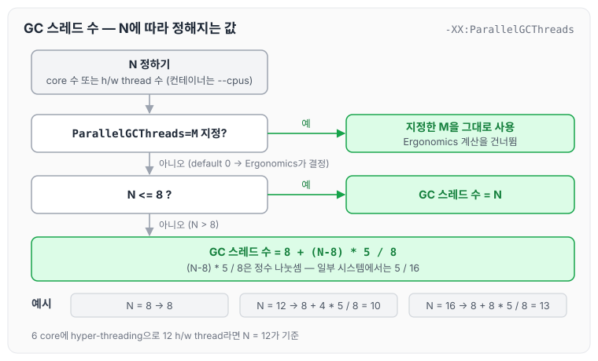
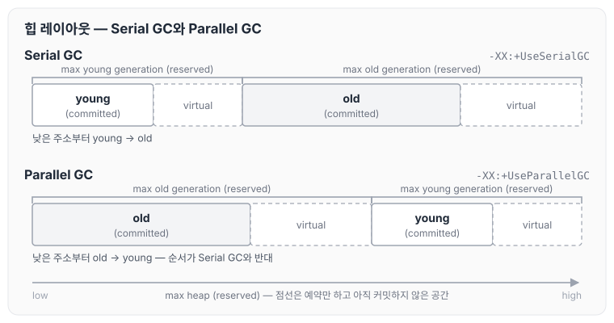
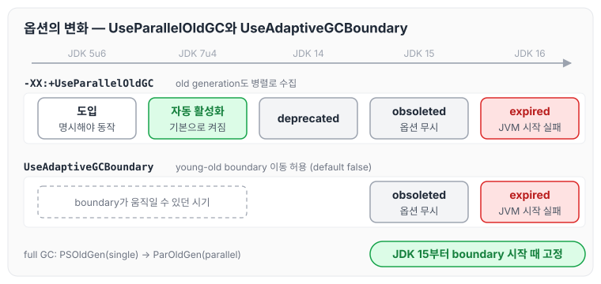
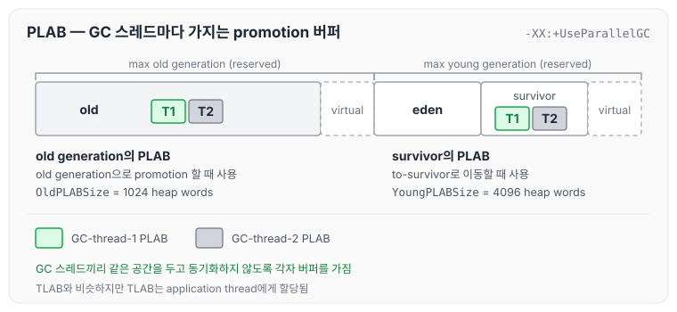
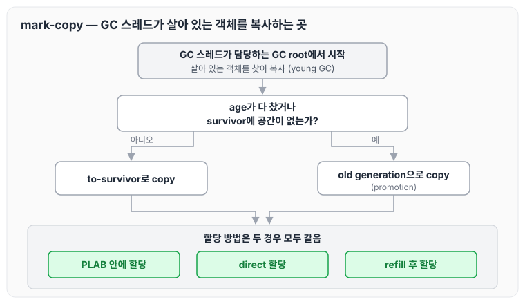
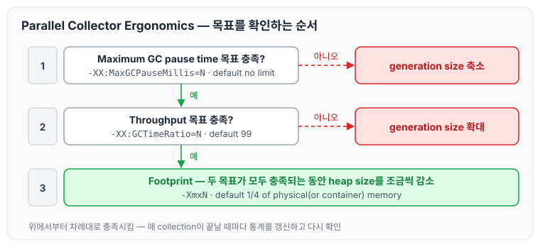
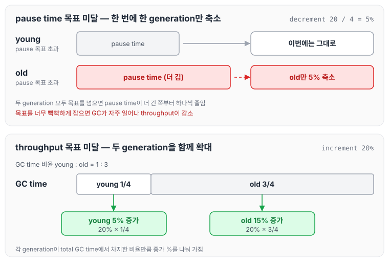
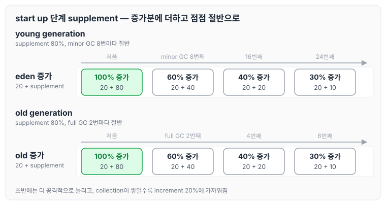
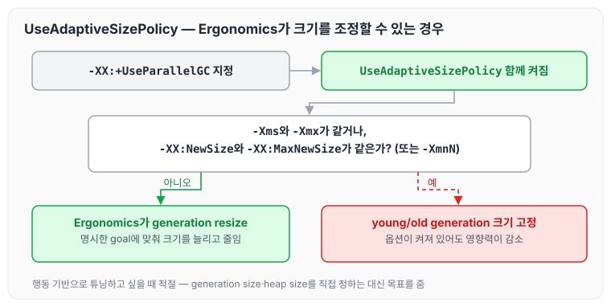

이전에 [GC 종류: Serial, Parallel, G1, ZGC와 CMS, Shenandoah](../gc-collector-types/)에 대해 작성하였습니다. 그 글에서는 Parallel GC를 collector 중 하나로 간단히 다뤘는데, 이번 글에서는 Parallel GC가 GC 스레드 수를 정하는 방식과 힙 배치, PLAB, 그리고 Parallel Collector Ergonomics가 generation 크기를 조정하는 방식에 대해 정리하도록 하겠습니다.

## Parallel GC 개요

Parallel GC의 특징을 요약하자면 아래와 같습니다.

- garbage collector 중에서 throughput이 가장 좋은 collector입니다.
- throughput collector 또는 throughput GC라고 불립니다. batch나 데이터 처리에 적절합니다.
- 행동(behavior) 기반으로 튜닝할 수 있는 옵션을 제공합니다. Ergonomics가 가장 효용성 있게 동작하는 collector입니다.
- `-XX:+UseParallelGC` 옵션을 명시하면 Parallel GC로 동작합니다. JDK 8까지는 server-class machine에서 default GC였습니다.
- Serial GC와 유사하지만 minor GC(=young GC)와 major GC(=full GC) 모두 병렬로 수행합니다. 즉, 여러 개의 GC 스레드가 GC를 수행합니다.

### -XX:+UseParallelOldGC

`-XX:+UseParallelOldGC`는 old generation도 병렬로 수집하도록 하는 옵션이었습니다.

- 초기의 Parallel GC는 young generation을 수집할 때만 병렬로 동작하고, old generation을 수집할 때는 serial 방식으로 동작했습니다.
- 그래서 old generation도 병렬로 수집하려면 `-XX:+UseParallelOldGC`를 추가로 명시해야 했습니다.
- JDK 7u4부터는 `-XX:+UseParallelGC` 옵션만 줘도 `-XX:+UseParallelOldGC` 옵션이 자동으로 활성화됩니다.
- JDK 14에서 deprecated 되었습니다.
- JDK 15에서 obsoleted 되었습니다(옵션을 넣어도 무시됩니다).
- JDK 16에서 expired 되었습니다(옵션을 넣으면 JVM 시작에 실패합니다).

옵션이 들어오고 사라지기까지의 흐름은 아래 레이아웃 절에서 그림으로 함께 정리하겠습니다.

## Parallel GC에서 사용되는 GC threads

디폴트 GC 스레드 수는 Ergonomics가 결정합니다.

- core 수, 또는 h/w thread를 사용 중이라면 h/w thread 수를 기준으로 GC 스레드 수가 정해집니다.
  - 예를 들어 물리적으로는 6 core이지만 hyper-threading(Intel의 h/w threading) 기능으로 12 h/w thread로 동작한다면, 12가 기준이 됩니다.
  - 컨테이너 환경에서는 컨테이너의 CPU 수에 종속됩니다(e.g. `--cpus`).
- core 수나 h/w thread 수를 N이라고 했을 때 GC 스레드 수는 다음과 같이 계산합니다.
  - N <= 8이면 GC 스레드 수 = N
  - N > 8이면 GC 스레드 수 = 8 + (N-8) * 5 / 8 (`(N-8) * 5 / 8`은 정수 나눗셈이므로 소수점 이하는 버립니다.)
  - 일부 시스템에서는 8 + (N-8) * 5 / 16으로 동작합니다. 오늘날의 시스템에서는 거의 해당 사항이 없습니다.

N에 따라 GC 스레드 수가 정해지는 흐름은 아래와 같습니다.



N이 8 이하일 때는 N을 그대로 쓰고, 8을 넘는 부분은 5/8만 더해집니다. 예를 들어 N이 12이면 8 + 4 * 5 / 8 = 10, N이 16이면 8 + 8 * 5 / 8 = 13입니다. `-XX:ParallelGCThreads`를 직접 지정하면 이 계산 대신 지정한 값을 사용합니다.

강의에서 확인한 환경은 physical CPU 4개, logical CPU 8개였고, N = 8이므로 `ParallelGCThreads`가 8로 잡혔습니다.

```bash
java -XX:+PrintFlagsFinal -version | fgrep --color "ParallelGCThreads"
    uint ParallelGCThreads                        = 8

sysctl hw.physicalcpu hw.logicalcpu
hw.physicalcpu: 4
hw.logicalcpu: 8
```

GC 스레드 수는 아래 옵션으로 직접 정할 수도 있습니다.

- `-XX:ParallelGCThreads=M`
  - 이 옵션을 명시하면 GC 스레드 수를 직접 정할 수 있습니다.
  - 하나의 machine에서 여러 개의 Java 프로세스를 띄우고 있다면, 이 옵션으로 GC 스레드가 적절히 분배되도록 하는 것이 필요합니다.
  - default 값은 0입니다. 즉, Ergonomics가 결정합니다.

## machine 스펙에 따른 parallel collector의 성능

parallel collector의 성능은 machine의 core 수에 따라 달라집니다.

- single-core processor
  - serial collector와 비교해서 GC 성능에 별다른 차이가 없거나, 오히려 좋지 않을 수 있습니다.
  - parallel collector는 여러 GC 스레드로 동작하는 것을 목적으로 했기 때문에 동기화 관련 오버헤드가 존재하기 때문입니다.
- dual-core processor
  - 중간 크기에서 큰 크기의 힙을 사용하는 애플리케이션을 실행한다면 serial collector에 비해 약간 더 나은 성능을 보입니다.
- multi-core processor
  - serial collector보다 훨씬 더 우수한 성능을 발휘합니다.

## serial GC와 parallel GC의 layout 차이

Serial GC와 Parallel GC는 힙에서 young generation과 old generation을 놓는 순서가 다릅니다. 강의 그림을 다시 그리면 아래와 같습니다.



Serial GC는 낮은 주소부터 young, old 순서로 놓지만, Parallel GC는 old가 먼저 오고 young이 뒤에 옵니다. 두 GC 모두 max heap 전체를 reserved로 잡아 두고, 그중 일부만 committed로 사용합니다.

이런 구조 차이는 Parallel GC가 발전해 온 과정과 관련이 있습니다.

- Parallel GC 초기
  - young GC만 parallel로 처리하였습니다(PS Scavenge, PSYoungGen).
  - full GC는 single로 동작하였습니다(기존 mark-sweep-compact, PSOldGen).
- 이후 full GC도 parallel로 동작할 수 있게 되었습니다(PS MarkSweep, ParOldGen).
  - JDK 5u6부터 가능했습니다(`-XX:+UseParallelOldGC` 사용 시).
  - JDK 7u4부터는 `-XX:+UseParallelGC`만 줘도 가능합니다.
- `UseAdaptiveGCBoundary`: 이 옵션 때문에 구조 차이가 발생했습니다.
  - young-old boundary가 유동적으로 움직이는 것을 가능하게 하는 옵션입니다(default 값 false).
  - JDK 15에서 obsoleted 되었습니다.
  - JDK 16에서 expired 되었습니다.
- JDK 15(강의에서는 16일 수도 있다고 하였습니다) 버전부터 young-old boundary가 시작할 때 고정됩니다.

두 옵션이 도입되고 사라진 흐름을 버전 순서로 놓으면 아래와 같습니다.



`UseParallelOldGC`는 JDK 7u4부터 기본으로 켜지면서 따로 명시할 필요가 없어졌고, JDK 14~16을 거쳐 사라졌습니다. `UseAdaptiveGCBoundary`도 JDK 15~16에 걸쳐 사라졌기 때문에, 지금은 young과 old 사이의 경계가 시작할 때 정해진 뒤 움직이지 않습니다.

강의에서는 HotSpot 소스의 주석에 있는 Parallel GC 레이아웃도 함께 보았습니다. generation boundary가 시작 후 고정된다(fixed after startup)고 적혀 있습니다.

```text
// low                                                              high
//
//                          +-- generation boundary (fixed after startup)
//                          |
// |<- old gen (reserved) ->|<-       young gen (reserved)             ->|
// +---------------+--------+-----------------+--------+--------+--------+
// |      old      |        |       eden      |  from  |   to   |        |
// |               |        |                 |  (to)  | (from) |        |
// +---------------+--------+-----------------+--------+--------+--------+
// |<- committed ->|        |<-          committed           ->|
//
```

## PLAB (promotion local allocation buffer)

Parallel GC의 GC 스레드는 각각 survivor와 old generation에 자신만의 PLAB를 가집니다.

- young GC 때 객체가 to-survivor로 이동하거나 old generation으로 promotion 될 때 사용합니다.
- GC 스레드 간의 동기화 이슈를 피하기 위한 것입니다. TLAB와 유사하지만, TLAB는 application thread에게 할당된다는 점이 다릅니다.

PLAB 크기와 관련된 옵션의 디폴트 값은 아래와 같습니다.

| VM option | default value |
|-----------|---------------|
| `OldPLABSize` | 1024 heap words |
| `YoungPLABSize` | 4096 heap words |

GC 스레드 두 개가 각자의 PLAB를 가지고 있는 모습을 그리면 아래와 같습니다.



GC-thread-1과 GC-thread-2가 old generation과 young generation(survivor)에 각자 PLAB를 가지고 있어서, 객체를 복사할 때 서로 같은 공간을 두고 동기화할 필요가 없습니다.

각 GC 스레드는 자신이 담당하는 GC root에서 시작해서 mark-copy 방식으로 동작합니다.

- to-survivor로 copy하는 경우: PLAB 안에 할당, direct 할당, 또는 refill 후 할당
- old generation으로 copy하는 경우: age가 다 찼거나 survivor에 공간이 없을 때이며, PLAB 안에 할당, direct 할당, 또는 refill 후 할당

GC 스레드 하나가 살아 있는 객체를 복사하는 흐름은 아래와 같습니다.



복사할 곳이 to-survivor든 old generation이든, 할당하는 방법은 PLAB 안에 할당, direct 할당, refill 후 할당 세 가지로 같습니다.

## serial GC 때 배웠던 옵션 복습

[TLAB과 Generation 크기 조정: Serial GC의 힙 크기 옵션](../gc-heap-generation-sizing/)에서 정리한 옵션들은 generation size를 low-level에서 튜닝하는 옵션들입니다.

- `-XX:NewRatio`
- `-XX:MaxHeapFreeRatio` & `-XX:MinHeapFreeRatio`
- `-XX:NewSize` & `-XX:MaxNewSize`
- `-XX:SurvivorRatio`

Parallel GC에서는 이 옵션들 외에도 행동 관점에서 튜닝할 수 있는 옵션을 제공합니다.

## Parallel Collector Ergonomics

Parallel GC에서는 행동(behavior) 기반으로 튜닝하는 것이 가능합니다. 이는 Ergonomics의 핵심 기능 중 하나입니다. Ergonomics는 아래 목표들을 충족하기 위해 generation size를 포함해서 여러 파라미터를 알아서 조정합니다. 각 목표는 [GC의 역할과 튜닝 기준: Ergonomics와 JVM 기본 설정](../gc-tuning-criteria/)에서도 정리하였습니다.

| 우선순위 | 항목 | 설명 | VM 옵션 | 디폴트 값 |
|---------|------|------|---------|----------|
| 1 | Maximum GC pause time | 희망하는 최대 STW time을 지정합니다. 항상 목표가 달성되는 것은 아닙니다. | `-XX:MaxGCPauseMillis=N` | no limit |
| 2 | Throughput | 전체 실행 시간 중 STW time과 application time의 비율을 설정합니다. | `-XX:GCTimeRatio=N` | 99 |
| 3 | Footprint | 최대 힙 사이즈를 설정합니다. 다른 goal이 충족되는 동안 heap size를 감소시킵니다. | `-XmxN` | 1/4 of physical(or container) memory |

세 목표는 위에서부터 차례대로 충족시킵니다.



pause time 목표가 충족되지 않으면 generation size를 줄이고, pause time 목표는 충족되었지만 throughput 목표가 충족되지 않으면 generation size를 늘립니다. 두 목표가 모두 충족되었을 때에만 footprint를 위해 heap size를 조금씩 줄입니다.

## Generation size 재조정

Ergonomics는 매 collection이 끝날 때마다 각종 통계를 갱신합니다. 이를 바탕으로 목표들이 달성되었는지 확인하고, 실패하면 generation size를 재조정합니다. 사이즈 재조정과 관련된 주요 옵션들은 아래와 같습니다.

| 항목 | 설명 | VM 옵션 | 디폴트 값 |
|------|------|---------|----------|
| young generation increment (%) | young generation이 확장할 때 한 번에 몇 % 증가할 것인지 | `-XX:YoungGenerationSizeIncrement=N` | 20% |
| old generation increment (%) | old generation이 확장할 때 한 번에 몇 % 증가할 것인지 | `-XX:TenuredGenerationSizeIncrement=N` | 20% |
| decrement scale factor | generation 확장 % 대비 축소 %를 결정할 scale을 얼마로 할 것인지 | `-XX:AdaptiveSizeDecrementScaleFactor=N` | 4 |
| young generation decrement (%) | young generation이 축소할 때 한 번에 몇 % 축소할 것인지 | 위 옵션들로 계산 | 5% |
| old generation decrement (%) | old generation이 축소할 때 한 번에 몇 % 축소할 것인지 | 위 옵션들로 계산 | 5% |

축소 비율은 확장 비율 20%를 decrement scale factor 4로 나눈 5%가 됩니다.

### Generation size를 감소시킬 때

max pause-time goal을 달성하지 못하면 Ergonomics가 generation size를 줄입니다.

- 두 generation을 동시에 줄이는 일은 없고, 한 번에 하나씩(young 또는 old generation)만 줄입니다. 강의에서는 throughput collector이기 때문에 신중하게 줄이는 것이 아닐까 하였습니다.
- young과 old generation 모두에서 max pause-time goal을 달성하지 못했다면, pause time이 더 길었던 generation부터 줄입니다.

그렇다면 max pause-time goal을 너무 빡빡하게 잡으면 어떻게 될까요? 강의에서 정리한 내용은 아래와 같습니다.

- GC가 더 자주 일어나서 Throughput이 감소합니다.
- GC가 너무 자주 일어나면 곧 죽을 객체도 살아 있는 상태로 수집되기 때문에, GC time이 오히려 더 길어질 수 있습니다.

### Generation size를 증가시킬 때

throughput goal을 달성하지 못하면 Ergonomics가 generation size를 늘립니다.

- 늘릴 때는 두 generation을 동시에 늘립니다. 강의에서는 throughput collector이기 때문에 늘릴 때는 더 적극적으로 늘리는 것이라고 하였습니다.
- total GC time 대비 각 generation을 수집하는 데 소비된 시간 비율에 따라 최종 증가될 %가 결정됩니다.

예를 들어 young generation time : old generation time = 1:3이고, `-XX:YoungGenerationSizeIncrement=20`, `-XX:TenuredGenerationSizeIncrement=20`일 때 throughput goal을 충족하지 못했다면 아래와 같이 늘어납니다.

- young generation은 5% 증가
- old generation은 15% 증가

감소할 때와 증가할 때를 나란히 놓으면 아래와 같습니다.



줄일 때는 pause time이 더 긴 generation 하나만 5%씩 줄이고, 늘릴 때는 두 generation을 GC 시간 비율에 맞춰 함께 늘립니다. 1:3 예시에서는 20%를 1/4과 3/4로 나눠 young은 5%, old는 15%가 증가합니다.

### 애플리케이션 시작(start up) 단계에서 Generation size를 증가시킬 때

애플리케이션 시작 직후에는 더 공격적으로 generation size를 늘립니다.

- 애플리케이션이 시작하고 얼마 되지 않아 generation size를 증가시켜야 한다면, 증가분(increment)에 supplement가 추가됩니다.
- supplement 되는 값은 collection 횟수가 늘어남에 따라 점점 그 영향력이 감쇠합니다(decay).

| 항목 | 설명 | VM 옵션 | 디폴트 값 |
|------|------|---------|----------|
| young generation supplement (%) | 초반에 young generation을 확장할 때 몇 %를 더 추가할 것인지 | `-XX:YoungGenerationSizeSupplement=N` | 80% |
| young generation supplement decay | M번의 Minor GC마다 young supplement 값을 절반으로 줄인다 | `-XX:YoungGenerationSizeSupplementDecay=M` | 8 |
| old generation supplement (%) | 초반에 old generation을 확장할 때 몇 %를 더 추가할 것인지 | `-XX:TenuredGenerationSizeSupplement=N` | 80% |
| old generation supplement decay | L번의 full GC마다 old supplement 값을 절반으로 줄인다 | `-XX:TenuredGenerationSizeSupplementDecay=L` | 2 |

강의에서는 이 동작을 HotSpot 소스에서 확인하였습니다. young generation supplement는 minor GC 횟수가 `YoungGenerationSizeSupplementDecay`의 배수가 될 때마다 절반으로 줄어들고, eden을 늘릴 때 `YoungGenerationSizeIncrement`에 더해집니다.

```cpp
if ((_avg_minor_pause->count() >= AdaptiveSizePolicyReadyThreshold) &&
    (_avg_minor_pause->count() % YoungGenerationSizeSupplementDecay) == 0) {
  _young_gen_size_increment_supplement =
    _young_gen_size_increment_supplement >> 1;
}
```

```cpp
size_t PSAdaptiveSizePolicy::eden_increment_with_supplement_aligned_up(
  size_t cur_eden) {
  size_t result = eden_increment(cur_eden,
    YoungGenerationSizeIncrement + _young_gen_size_increment_supplement);
  return align_up(result, _space_alignment);
}
```

old generation supplement는 full GC 횟수가 `TenuredGenerationSizeSupplementDecay`의 배수가 될 때마다 절반으로 줄어들고, old generation을 늘릴 때 `TenuredGenerationSizeIncrement`에 더해집니다.

```cpp
if (is_full_gc) {
  // Don't wait for the threshold value for the major collections.  If
  // here, the supplemental growth term was used and should decay.
  if ((_avg_major_pause->count() % TenuredGenerationSizeSupplementDecay)
      == 0) {
    _old_gen_size_increment_supplement =
      _old_gen_size_increment_supplement >> 1;
  }
} else {
```

```cpp
size_t PSAdaptiveSizePolicy::promo_increment_with_supplement_aligned_up(
  size_t cur_promo) {
  size_t result =  promo_increment(cur_promo,
    TenuredGenerationSizeIncrement + _old_gen_size_increment_supplement);
  return align_up(result, _space_alignment);
}
```

디폴트 값으로 young generation의 증가 비율이 어떻게 바뀌는지 따라가 보면 아래와 같습니다.



처음에는 increment 20%에 supplement 80%가 더해져 100%까지 늘릴 수 있지만, minor GC 8번마다 supplement가 절반으로 줄면서 증가 비율이 점점 20%에 가까워집니다. old generation은 full GC 2번마다 같은 방식으로 줄어듭니다.

## Ergonomics가 선택하는 heap size

initial heap size나 maximum heap size를 따로 명시하지 않으면 디폴트 값은 아래와 같이 결정됩니다.

- initial heap size = machine memory의 1/64 (`-XmsN`)
- maximum heap size = machine memory의 1/4 (`-XmxN`)
- maximum young generation size = maximum heap size의 1/3

또한 아래와 같이 동작합니다.

- max pause-time goal과 throughput goal이 모두 충족되는 동안에는 heap size를 조금씩 감소시킵니다.
- `-Xms`와 `-Xmx`가 같을 때는 young/old generation 크기가 고정됩니다.
- `-XX:MaxNewSize`와 `-XX:NewSize`가 같을 때는 young/old generation 크기가 고정됩니다(`-XmnN`을 지정해도 동일합니다).

## UseAdaptiveSizePolicy

`-XX:+UseParallelGC`를 지정하면 `UseAdaptiveSizePolicy` 옵션도 같이 켜집니다. `-XX:+UseAdaptiveSizePolicy`를 직접 지정한 것과 같은 효과입니다.

- `UseAdaptiveSizePolicy` 옵션을 켠다는 것은 목표에 맞는 최적화를 Ergonomics에게 맡기겠다는 의미입니다.
  - Ergonomics는 명시된 goal들을 충족하기 위해 generation resize 등을 시도합니다.
  - 개발자가 generation size나 heap size를 디테일하게 지정하기보다는, 행동 기반으로 튜닝하고 싶을 때 적절합니다.
- 아래의 경우에는 이 옵션을 켜더라도 young/old generation size가 고정되기 때문에 영향력이 감소합니다.
  - `-Xmx`와 `-Xms`를 같게 한다.
  - `-XX:MaxNewSize`와 `-XX:NewSize` 값을 같게 한다(또는 `-XmnN`을 지정한다).

옵션 조합에 따라 Ergonomics가 generation size를 조정할 수 있는지 정리하면 아래와 같습니다.



`UseAdaptiveSizePolicy`가 켜져 있어도 힙 크기나 young generation 크기를 고정하면 Ergonomics가 조정할 여지가 줄어듭니다.

## 생각해볼 부분

강의 마지막에는 아래 내용을 생각해 볼 부분으로 남겼습니다.

- `-XX:+UseParallelGC`를 지정하는 것, 즉 Parallel GC를 쓰는 것은 batch나 데이터 처리처럼 throughput이 중요한 작업을 위한 것입니다.
- 일반적인 백엔드 애플리케이션에서는 `-Xmx`와 `-Xms`를 똑같이 두는 것을 권장하지만, 대신 low-level의 튜닝이 필요할 수 있습니다.
- 만약 batch나 데이터 처리를 할 때 Parallel GC를 쓰면서 복잡한 GC 튜닝이 아니라 간단하게 행동 기반으로 튜닝하고 싶다면, `-Xmx`와 `-Xms`를 다르게 주는 것이 맞지 않을까?
- 그리고 이때 max pause-time goal과 throughput goal을 애매하게 잡으면, 오히려 heap이 늘었다가 줄었다가를 반복하면서 성능에 좋지 않은 영향을 주지 않을까?

## 마무리

오늘은 Parallel GC의 GC 스레드 수가 정해지는 방식과 Serial GC와 다른 힙 배치, PLAB, 그리고 Parallel Collector Ergonomics가 목표에 맞춰 generation size를 늘리고 줄이는 방식에 대해 정리하였습니다.

정리하면서 Parallel GC는 줄일 때는 한 generation씩 신중하게, 늘릴 때는 두 generation을 함께 적극적으로 조정한다는 것을 알 수 있었습니다. 행동 기반 튜닝을 쓰려면 `-Xms`와 `-Xmx`를 어떻게 줄지부터 함께 고민해야 할 것 같습니다. 다음 글에서는 [G1 GC 핵심 원리: region, mixed collection과 concurrent marking](../gc-g1-core/)에 대해 정리하도록 하겠습니다.

참고 자료
- [GC 7부: Parallel GC](https://youtube.com/live/8VHUdMecnfA?feature=share) (멤버십 전용 영상)
- [The Parallel Collector (Oracle HotSpot GC Tuning Guide, JDK 25)](https://docs.oracle.com/en/java/javase/25/gctuning/parallel-collector1.html)
- [Ergonomics (Oracle HotSpot GC Tuning Guide, JDK 25)](https://docs.oracle.com/en/java/javase/25/gctuning/ergonomics.html)
- [Available Collectors (Oracle HotSpot GC Tuning Guide, JDK 25)](https://docs.oracle.com/en/java/javase/25/gctuning/available-collectors.html)
