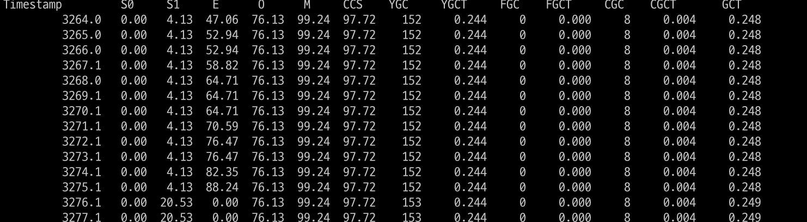
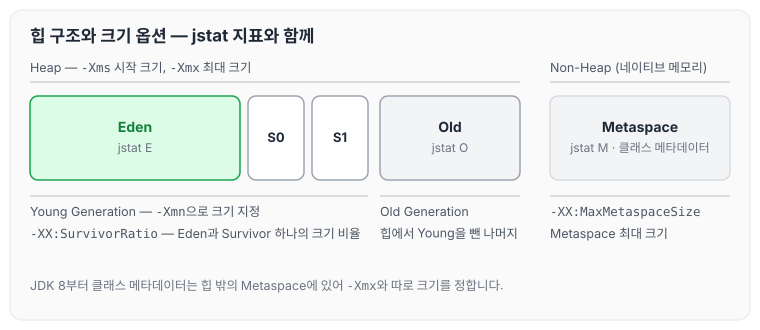
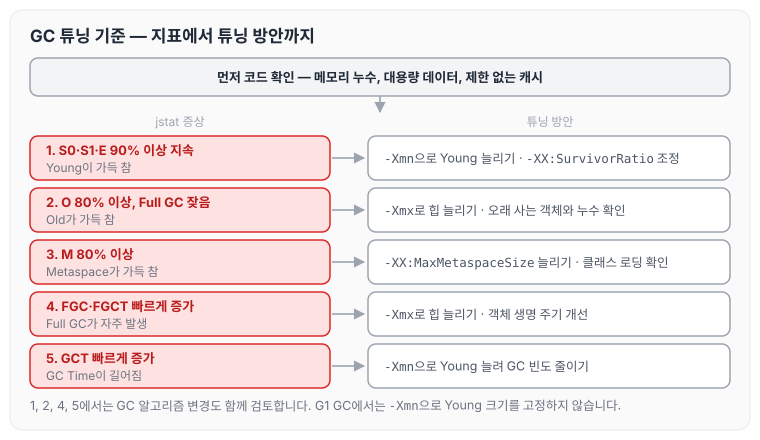

이전에 [Garbage Collection(GC)](../garbage-collection/)에 대해 작성하였습니다. 그 글에서는 JVM 메모리 구조와 GC의 동작 원리, 주요 GC 알고리즘을 정리하였습니다. 오늘은 GC 튜닝을 할 때의 주의점과 jstat으로 GC 상태를 확인하는 방법, 그리고 증상에 따른 GC 튜닝 기준에 대해 정리하도록 하겠습니다.

## GC 요약

앞 글의 내용을 요약하자면 아래와 같습니다.

- GC는 힙 영역에서 동작하며, 객체는 Young → Old 영역 순서로 옮겨집니다.
- Young 영역의 GC가 동작하면 STW가 빠르게 끝나고, Old 영역의 GC가 동작하면 메모리 크기가 Young 영역보다 크기 때문에 STW가 더 오래 걸립니다. 따라서 개발자는 객체가 메모리를 어떻게 사용하는지 알아야 할 필요가 있습니다.
- GC의 동작 순서는 아래와 같습니다.
    - Mark
    - Sweep
    - Compaction
- GC의 알고리즘은 다양하며, 애플리케이션의 활용 용도에 따라 GC 알고리즘을 다르게 지정할 수 있습니다.

| GC 알고리즘 | JVM 옵션 | 적용 상황 | Java 버전별 기본 GC |
| --- | --- | --- | --- |
| Serial GC | `-XX:+UseSerialGC` | 작은 애플리케이션이나 리소스가 제한된 시스템 | 서버급이 아닌 환경(단일 CPU 등)에서 기본 |
| Parallel GC | `-XX:+UseParallelGC` | 대규모 애플리케이션, 처리량을 극대화하고자 할 때 | Java 8까지 서버급 환경에서 기본, Java 9부터 옵션 선택 |
| CMS GC | `-XX:+UseConcMarkSweepGC` | 빠른 응답 시간과 낮은 지연 시간을 중요시하는 애플리케이션 (Deprecated) | Java 9에서 deprecated, Java 14에서 제거 |
| G1 GC | `-XX:+UseG1GC` | 대규모 힙을 사용하는 시스템에서 성능을 최적화할 때 | Java 9부터 기본 GC |
| ZGC | `-XX:+UseZGC` | 매우 큰 힙을 사용하는 애플리케이션에서 짧은 Stop-The-World 시간을 필요로 할 때 | Java 11에서 실험 기능, Java 15부터 정식 기능 |

## GC 튜닝의 주의점

JVM은 기본 GC 알고리즘과 설정이 대부분의 애플리케이션에 맞게 최적화되어 있습니다. 특히 최신 JVM은 메모리 관리와 가비지 컬렉션을 환경에 맞게 스스로 조정하기 때문에, 많은 상황에서 별도의 튜닝 없이도 좋은 성능을 냅니다. 따라서 심각한 문제가 발생하지 않는 이상 기본 설정을 유지하는 것이 일반적으로 권장됩니다. JVM이 기본값을 어떻게 고르고 조정하는지는 [GC의 역할과 튜닝 기준: Ergonomics와 JVM 기본 설정](../gc-tuning-criteria/)에서 정리하였습니다.

1. GC 튜닝을 잘못하면 오히려 성능이 나빠질 수 있습니다. GC는 메모리 관리, 힙 크기, 애플리케이션의 워크로드에 따라 다르게 동작합니다.
    - 더 자주 발생하는 Full GC: 잘못된 힙 크기 설정으로 Full GC가 더 자주 발생해 성능이 떨어질 수 있습니다.
    - 메모리 부족 또는 메모리 누수: 부적절한 GC 옵션으로 메모리 부족 문제나 메모리 누수 문제가 발생할 수 있습니다.
    - 애플리케이션 지연 시간 증가: GC 중단 시간을 줄이기 위한 잘못된 튜닝이 오히려 애플리케이션의 응답성을 떨어뜨릴 수 있습니다.
2. GC 튜닝은 유지보수가 어렵고 환경에 민감합니다.
    - 애플리케이션이 업데이트되거나 워크로드가 변하면 GC 동작도 함께 달라질 수 있습니다. 따라서 지금은 최적화되어 있더라도 나중에는 비효율적으로 동작할 수 있습니다.

성능 문제의 원인은 메모리 관리나 GC가 아닌 경우가 많습니다. 먼저 코드를 살펴보고, 객체를 비효율적으로 생성하고 사용하고 있다면 코드를 리팩토링하는 것을 권장합니다.

현재 사용하는 소스 코드에 아래와 같은 문제가 있는지 먼저 확인하는 것이 좋습니다.

1. 메모리 누수: 사용하지 않는 객체가 계속 참조되어 메모리에서 해제되지 않는 경우
2. 대용량 데이터 처리: 매우 큰 컬렉션이나 배열을 사용해 메모리를 다 써 버리는 경우
3. 메모리 캐싱: 캐시 전략이 적절하지 않거나 제한 없이 데이터를 캐시에 저장하는 경우
4. 잘못된 GC 튜닝: 비효율적인 GC 설정으로 메모리 회수가 늦어지는 경우

## GC 튜닝을 통해 얻고자 하는 것

1. GC Pause Time 최소화
    - GC가 메모리를 정리하는 동안 애플리케이션의 실행이 일시적으로 멈추는 시간을 줄이는 것이 핵심 목표입니다. 이를 통해 응답 지연을 줄이고, 애플리케이션이 더 매끄럽게 동작하도록 만듭니다.
2. Full GC 빈도 감소
    - GC가 너무 자주 발생하면 CPU 리소스가 낭비되고 성능이 떨어집니다. GC가 효율적으로 발생하도록 조정하는 것이 중요합니다.

## GC 모니터링으로 문제점 확인하기

`jps` 명령어로 실행 중인 Spring Boot 애플리케이션의 PID를 확인한 뒤, `jstat`으로 GC 상태를 1초(1000ms)마다 출력합니다. 형식은 `jstat -gcutil -t <PID> <출력 간격> <횟수>`입니다.

```bash
jps
jstat -gcutil -t 6554 1000 00
```

출력 결과는 아래와 같습니다.



- S0 / S1 (Survivor 0, 1): Eden에서 살아남은 객체들이 이동하는 Survivor 영역의 사용률을 나타냅니다.
- E (Eden): 객체가 처음 할당되는 Eden 영역의 사용률을 나타냅니다.
- O (Old): Old Generation(Tenured 영역)의 사용률을 나타냅니다. 이 영역은 오랫동안 살아남은 객체들이 위치하며, 이 영역이 꽉 차면 Full GC가 발생합니다.
- M (Metaspace): Metaspace 사용률을 나타냅니다. Metaspace는 클래스 메타데이터가 저장되는 공간으로, 일반적으로 메모리 누수가 없다면 큰 변화가 없습니다.
- CCS (Compressed Class Space): 압축된 클래스 공간의 사용률입니다.
- YGC (Young GC): Young Generation에서 발생한 GC의 총 횟수입니다.
- YGCT (Young GC Time): Young GC에 소요된 총 시간입니다.
- FGC (Full GC): Old Generation을 포함한 전체 힙 영역을 청소하는 Full GC의 총 횟수입니다.
- FGCT (Full GC Time): Full GC에 소요된 총 시간입니다.
- GCT (Total GC Time): 모든 GC에 소요된 총 시간입니다.

캡처에서 3275.1초에 88.24%까지 찼던 E가 다음 줄에서 0.00이 되고, YGC가 152에서 153으로 늘었습니다. 이 사이에 Young GC가 한 번 일어나 Eden이 비워졌고, 같은 시점에 S1의 사용률도 4.13에서 20.53으로 바뀐 것을 확인할 수 있습니다.

## GC 상태 분석 및 튜닝 기준

jstat의 각 지표가 힙의 어느 영역을 가리키는지, 그리고 그 영역의 크기를 어떤 옵션으로 조정하는지 그리면 다음과 같습니다.



아래 튜닝 기준에서 나오는 옵션은 모두 이 그림의 영역 중 하나의 크기를 바꾸는 옵션입니다.

### 1. Young Generation 영역(Survivor, Eden)이 가득 참

- 증상: `S0`, `S1`, `E` 값이 90% 이상으로 계속 유지되는 경우
- 원인: Young Generation에서 많은 객체가 생성되지만 빠르게 수거되지 않거나, Survivor로 이동하는 객체가 너무 많음

튜닝 방안은 아래와 같습니다.

- Eden 영역 크기 조정: `-Xmn` 옵션을 사용해 Young Generation의 크기를 늘립니다.
- GC 알고리즘 변경: 적절한 알고리즘을 선택합니다.
- Survivor 영역 크기 조정: `-XX:SurvivorRatio` 옵션으로 Survivor 영역의 비율을 조정해 볼 수 있습니다.

### 2. Old Generation 영역이 가득 참

- 증상: `O`(Old Generation) 값이 80% 이상으로 계속 유지되고, Full GC가 자주 발생함
- 원인: Young Generation에서 살아남은 객체들이 계속해서 Old Generation으로 이동하고, Old Generation의 객체가 GC로 회수되지 않음

튜닝 방안은 아래와 같습니다.

- 힙 크기 증가: `-Xmx` 옵션으로 최대 힙 크기를 늘려 Old Generation이 사용할 수 있는 공간을 늘립니다.
- Full GC 방지: 적절한 알고리즘을 선택합니다.
- 객체 생명주기 최적화: 코드를 분석해 불필요하게 오래 살아남는 객체를 줄이고, 메모리 누수가 없는지 확인합니다.

### 3. Metaspace가 가득 참

- 증상: `M`(Metaspace) 값이 80% 이상이면 메타데이터를 너무 많이 사용하고 있다는 신호입니다.
- 원인: 클래스 로더나 동적 클래스 로드 관련 이슈, 메모리 누수

튜닝 방안은 아래와 같습니다.

- Metaspace 크기 증가: `-XX:MaxMetaspaceSize`로 Metaspace의 최대 크기를 늘립니다.
- 클래스 로딩 관련 문제 해결: 동적 클래스를 너무 많이 로드하고 있는지 확인하고, 필요하면 클래스 로더를 적절히 관리합니다.

### 4. Full GC가 자주 발생함

- 증상: `FGC`(Full GC 횟수) 값이 빠르게 증가하고, `FGCT`(Full GC Time)도 증가하는 경우
- 원인: Old Generation이 가득 차 Full GC가 자주 발생함

튜닝 방안은 아래와 같습니다.

- GC 알고리즘 변경: 적절한 GC 알고리즘으로 변경합니다.
- 힙 크기 조정: 힙 크기(`-Xmx`)를 늘려 Old Generation이 가득 차는 상황을 방지합니다.
- 객체 생명 주기 개선: 애플리케이션에서 오래 살아남는 객체를 줄이고, 메모리 누수 문제가 없는지 확인합니다.

### 5. GC Time이 길어짐

- 증상: `GCT`(Total GC Time) 값이 빠르게 증가하고, 애플리케이션이 느려짐
- 원인: GC가 너무 자주 발생해 CPU 자원이 GC에 소모되고 있는 상태

튜닝 방안은 아래와 같습니다.

- GC 알고리즘 변경: 적절한 GC 알고리즘으로 변경합니다.
- Young Generation 크기 조정: `-Xmn` 옵션으로 Young Generation 크기를 늘려 GC 발생 빈도를 줄입니다.

다만 G1 GC를 사용한다면 `-Xmn`으로 Young Generation 크기를 고정하는 것은 피하는 것이 좋습니다. Oracle의 G1 튜닝 문서에서는 G1이 Young Generation의 크기를 조절해 pause time 목표를 맞추기 때문에, `-Xmn`이나 `-XX:NewRatio`로 크기를 하나의 값으로 고정하면 pause time 제어가 사실상 동작하지 않는다고 안내합니다.

다섯 가지 기준을 지표에서 튜닝 방안까지 이어 정리하면 다음과 같습니다.



어느 경우든 옵션을 바꾸기 전에 코드에서 메모리 누수나 불필요하게 오래 살아남는 객체가 없는지 먼저 확인하는 것이 순서입니다.

## 마무리

오늘은 GC 튜닝의 주의점과 jstat으로 GC 상태를 확인하는 방법, 그리고 영역별 증상에 따른 GC 튜닝 기준에 대해 정리하였습니다. GC 튜닝은 성능을 확인한 뒤 가장 마지막에 하는 작업이며, 개발자는 메모리를 적절하게 사용해 GC가 원활하게 동작하도록 개발해야 할 것 같습니다. 또한 GC에 문제가 생겼을 때 당황하지 않고 어떤 문제인지 유추할 수 있으면 좋을 것 같아 정리하게 되었습니다. VisualVM으로 확인하는 방법도 추가로 정리해 보려고 합니다.

참조 : [JVM과 GC 그리고 GC튜닝 연습까지](https://velog.io/@akfls221/JVM으로-시작해-GC-그리고-GC-튜닝까지), [Understanding Heap Memory - PERFORMANCESTACK](https://performancestack.in/understanding-heap/), [jstat (Oracle JDK 17 Tool Specifications)](https://docs.oracle.com/en/java/javase/17/docs/specs/man/jstat.html), [Garbage-First Garbage Collector Tuning (Oracle HotSpot GC Tuning Guide, JDK 21)](https://docs.oracle.com/en/java/javase/21/gctuning/garbage-first-garbage-collector-tuning.html)
