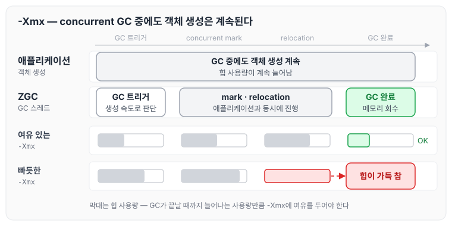
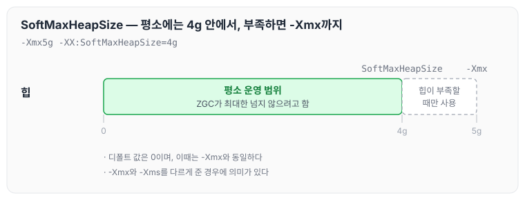
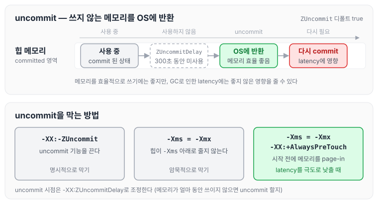
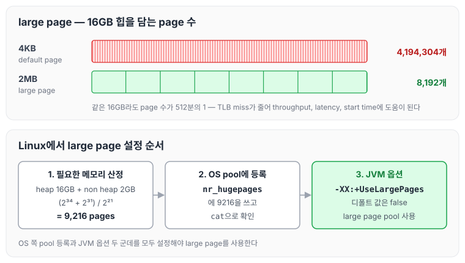

이전에 [G1 GC 튜닝: young generation 크기, mixed GC, IHOP](../gc-g1-tuning/)에 대해 작성하였습니다. 이번 글에서는 ZGC의 핵심 특징을 짧게 다시 짚고, ZGC를 쓸 때 살펴볼 튜닝 옵션인 max heap size, uncommit, OS large page, 그리고 `-XX:ConcGCThreads`에 대해 정리하도록 하겠습니다.

## ZGC 핵심 요약

ZGC의 특징을 요약하자면 아래와 같습니다.

- latency를 최소화하는 것에 최적화된 GC입니다.
- heap size에 상관없이 STW(pause)가 항상 1ms 이하인 GC입니다.
  - 힙 사이즈 수백 MB부터 16TB까지 커버합니다.
- marking뿐만 아니라 relocation 또한 대부분 concurrent하게 진행합니다.
- ZGC는 애플리케이션의 동작 부하에 따라 스스로 설정을 변경합니다.
  - generation 크기 조정
  - GC threads 수 조정
  - 언제 old generation으로 승격시킬지 판단하는 tenuring threshold 조정
- `-XX:+UseZGC` 옵션을 통해 실행합니다.

다른 collector와 비교한 ZGC의 위치는 [GC 종류: Serial, Parallel, G1, ZGC와 CMS, Shenandoah](../gc-collector-types/)에서 정리하였습니다.

## ZGC 발전 과정과 generational ZGC

ZGC가 버전별로 바뀐 흐름은 아래와 같습니다.

- JDK 11: 실험(experimental) 기능으로 처음 추가되었습니다(non-generational ZGC).
- JDK 15: production ready로 선언되었습니다.
- JDK 21: generational ZGC가 포함되었습니다.
  - 그전까지는 generation 구분 없이 수집하였습니다.
  - generational ZGC에서는 young generation을 더 자주 수집합니다.
  - `-XX:+UseZGC -XX:+ZGenerational`을 함께 명시해야 generational ZGC를 사용할 수 있었습니다.
- JDK 23: generational ZGC 모드가 디폴트 모드가 되고, non-generational ZGC는 deprecated 되었습니다.
- JDK 24: non-generational ZGC 모드가 제거되었습니다.
  - `ZGenerational` 옵션도 obsolete 되어, 넣더라도 경고만 출력되고 무시됩니다. `-XX:+UseZGC`만 주면 자동으로 generational ZGC 모드로 동작합니다.

JDK 21부터 23까지는 두 모드를 모두 고를 수 있었고, JDK 24부터는 generational ZGC만 남았습니다. 버전별 흐름을 그린 그림은 [GC 종류: Serial, Parallel, G1, ZGC와 CMS, Shenandoah](../gc-collector-types/) 글의 ZGC 절에 있습니다.

## ZGC max heap size 튜닝 옵션

### -Xmx

ZGC 튜닝에서 가장 중요한 옵션은 `-Xmx`입니다.

- ZGC는 현재 객체의 생성 속도를 고려해서 언제 GC를 트리거할지 결정합니다.
- concurrent GC이기 때문에 GC 중에도 객체가 계속 생성된다는 점을 고려해서 `-Xmx`를 여유 있게 잡는 것이 중요합니다.
- heap size가 클수록 ZGC 성능에는 좋습니다. 하지만 메모리 낭비 또한 무시할 수는 없습니다.

GC가 동시에 도는 동안에도 애플리케이션이 객체를 계속 만드는 흐름을 그리면 아래와 같습니다.



GC가 트리거된 뒤 수집을 마칠 때까지도 힙 사용량은 계속 늘어납니다. `-Xmx`가 빠듯하면 GC가 끝나기 전에 힙이 가득 찰 수 있기 때문에, 그 사이에 생성될 객체만큼 여유를 두어야 합니다.

### -XX:SoftMaxHeapSize

`-XX:SoftMaxHeapSize`는 max heap size의 soft 상한선입니다.

- ZGC는 최대한 `SoftMaxHeapSize`를 넘지 않는 선 안에서 운영하려고 하지만, heap이 부족하면 `SoftMaxHeapSize`를 넘어서 `-Xmx`까지도 힙을 사용할 수 있습니다.
- 디폴트 값은 0이고, 이때는 `-Xmx`와 같은 값으로 잡힙니다. 다만 `-Xmx`(또는 `MaxRAMPercentage`)를 지정하지 않으면 ZGC는 `SoftMaxHeapSize`를 max heap size의 90%로 잡습니다(OpenJDK 25 zArguments.cpp 기준).
- `-Xmx`와 `-Xms`를 다르게 준 경우에 의미가 있습니다.
- 예: `-Xmx5g -XX:SoftMaxHeapSize=4g`

위 예시처럼 설정했을 때 힙을 쓰는 범위는 아래와 같습니다.



평소에는 4g 안에서 운영하고, 힙이 부족할 때만 4g에서 5g 사이를 사용합니다.

## ZGC uncommit 튜닝 옵션

ZGC는 기본적으로 쓰지 않는 메모리를 uncommit 해서 OS에 반환합니다.

- 메모리를 효율적으로 사용하기에는 좋지만, GC로 인한 latency에는 좋지 않은 영향을 끼칠 수 있습니다.

관련 옵션은 아래와 같습니다.

- `-XX:-ZUncommit`: uncommit 기능을 끌 수 있습니다. 디폴트 값은 true입니다.
- 암묵적으로 uncommit을 막는 방법도 있습니다.
  - `-Xmx`와 `-Xms`를 동일하게 설정합니다.
- `-XX:ZUncommitDelay`: 언제 uncommit 할지 타이밍을 설정합니다. 디폴트 값은 300초입니다.
  - 해당 메모리가 얼마 동안 사용되지 않을 때 uncommit 되게 할지 설정합니다.
- latency를 극도로 낮추기를 원한다면 아래처럼 설정합니다.
  - `-Xmx` = `-Xms` & `-XX:+AlwaysPreTouch`

Oracle 문서에 따르면 `-XX:+AlwaysPreTouch`는 애플리케이션이 시작하기 전에 힙 메모리를 미리 page-in 해 두는 옵션입니다. uncommit이 일어나는 흐름과 이를 막는 방법을 그리면 아래와 같습니다.



uncommit 된 메모리를 다시 쓰려면 OS에서 다시 commit 해야 하므로, latency가 중요한 서비스라면 `-Xmx`와 `-Xms`를 같게 두는 것부터 고려할 수 있습니다.

## OS large page

OS가 large page를 사용하도록 하면 ZGC의 throughput, latency, start time에 도움이 됩니다.

- large page로 동작하게 되면 TLB miss를 줄일 수 있습니다.
- 강의에서는 튜닝이 약간 복잡하다는 것 빼고는 단점이 없다고 하였습니다.
- 이 튜닝은 G1 GC에도 도움이 됩니다.

heap size가 16GB일 때 필요한 page 수는 아래와 같습니다.

| | default page(4KB) | large page(2MB) |
|---|---|---|
| heap size 16GB일 때 # of pages | 4,194,304 | 8,192 |

튜닝 방법(Linux 기준)은 아래와 같습니다.

1. 필요한 메모리를 산정합니다: heap 16GB + non heap 2GB → (2³⁴ + 2³¹) / 2²¹ = 9,216 large pages
2. OS의 large page pool에 등록합니다.
3. `-XX:+UseLargePages`(디폴트 값 false)를 통해 자바 애플리케이션이 large page pool을 사용하도록 설정합니다.

2번의 등록과 확인 명령은 아래와 같습니다.

```bash
# OS에 등록
echo 9216 > /sys/kernel/mm/hugepages/hugepages-2048kB/nr_hugepages
# 잘 실행됐는지 확인
cat /sys/kernel/mm/hugepages/hugepages-2048kB/nr_hugepages
```

page 수 차이와 설정 순서를 함께 그리면 아래와 같습니다.



같은 16GB 힙이라도 2MB page를 쓰면 관리할 page 수가 512분의 1로 줄어듭니다. 설정은 OS 쪽 pool 등록과 JVM 옵션 두 군데에서 해야 합니다.

## -XX:ConcGCThreads

`-XX:ConcGCThreads`는 concurrent GC 스레드 수를 수동으로 조정할 수 있는 옵션입니다.

- JDK 17부터 ZGC는 concurrent GC threads 수를 동적으로 조정할 수 있게 되었습니다.
  - 그래서 이 버전부터는 ZGC를 쓸 때 `-XX:ConcGCThreads`로 수동 조정할 이유가 더 줄어들었습니다.
- generational ZGC 모드에서는 이 옵션을 직접 쓸 일이 거의 없습니다.
  - generational ZGC는 non-generational ZGC에 비해 더 유연한 구현 방식을 가지고 있기 때문입니다.

## 마무리

오늘은 ZGC의 핵심 특징과 generational ZGC로 바뀐 과정, 그리고 `-Xmx`·`-XX:SoftMaxHeapSize`, uncommit 관련 옵션, OS large page, `-XX:ConcGCThreads` 같은 ZGC 튜닝 옵션에 대해 정리하였습니다.

정리하면서 ZGC는 스스로 조정하는 부분이 많아 직접 손댈 옵션이 많지 않고, 결국 `-Xmx`를 얼마나 여유 있게 잡을지와 uncommit을 허용할지가 중요한 판단이 되는 것 같습니다.

다음 글에서는 [Metaspace: class metadata와 High-Water Mark, 압축 클래스 포인터](../gc-metaspace/)에 대해 정리하도록 하겠습니다.

참고 자료
- [GC 13부: ZGC 핵심 요약](https://youtube.com/live/hVVgBKLGCSw?feature=share) (멤버십 전용 영상)
- [The Z Garbage Collector (Oracle HotSpot GC Tuning Guide, JDK 25)](https://docs.oracle.com/en/java/javase/25/gctuning/z-garbage-collector1.html)
- [JEP 333: ZGC: A Scalable Low-Latency Garbage Collector (Experimental)](https://openjdk.org/jeps/333)
- [JEP 377: ZGC: A Scalable Low-Latency Garbage Collector (Production)](https://openjdk.org/jeps/377)
- [JEP 439: Generational ZGC](https://openjdk.org/jeps/439)
- [JEP 474: ZGC: Generational Mode by Default](https://openjdk.org/jeps/474)
- [JEP 490: ZGC: Remove the Non-Generational Mode](https://openjdk.org/jeps/490)
