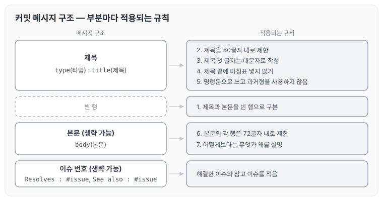

nextstep에서 다른 개발자들이 커밋한 메시지를 보다가, 메시지를 작성하는 규칙이 있다는 것을 알게 되었습니다. 저도 이 규칙을 지키고 적용하는 습관을 들이고 싶어서, 보기 쉬운 곳에 정리해 두려고 합니다. 오늘은 Git 커밋 메시지 규칙 7가지와 메시지 구조, 타입에 대해 정리하도록 하겠습니다.

## Commit Message 규칙 7가지

커밋 메시지를 작성할 때 지키는 규칙은 아래와 같습니다.

1. 제목과 본문을 빈 행으로 구분한다
2. 제목을 50글자 내로 제한
3. 제목 첫 글자는 대문자로 작성
4. 제목 끝에 마침표 넣지 않기
5. 제목은 명령문으로 사용하며 과거형을 사용하지 않는다
6. 본문의 각 행은 72글자 내로 제한
7. 어떻게보다는 무엇과 왜를 설명한다

## Commit Message 구조

커밋 메시지는 타입과 제목, 본문, 이슈 번호로 구성하며 형식은 아래와 같습니다.

```text
type(타입) : title(제목)

body(본문, 생략 가능)

Resolves : #issue, ...(해결한 이슈 , 생략 가능)

See also : #issue, ...(참고 이슈, 생략 가능)
```

위 구조의 각 부분에 7가지 규칙이 어떻게 적용되는지 정리하면 아래와 같습니다.



제목에는 2~5번 규칙이, 본문에는 6~7번 규칙이 적용되고, 제목과 본문 사이는 1번 규칙대로 빈 행으로 구분합니다.

## Commit Message 타입(type)

제목 앞에 붙이는 타입은 아래와 같이 구분합니다.

1. feat : 새로운 기능 추가
2. fix : 버그 수정
3. docs : 문서 수정
4. style : 스타일 관련 코드
5. refactor : 코드 리팩토링
6. test : 테스트코드, 리팩토링 테스트 코드 추가
7. chore : 빌드, 패키지 매니저 수정

## 마무리

오늘은 Git 커밋 메시지를 작성할 때 지키는 7가지 규칙과 메시지 구조, 타입에 대해 정리하였습니다. 규칙을 알고 있는 것보다 매번 커밋할 때 지키는 것이 더 중요할 것 같아서, 앞으로 커밋할 때마다 이 글을 보면서 습관을 들여 보려고 합니다.

참조 : [Git Commit Message 규칙](https://jason-api.tistory.com/89)
