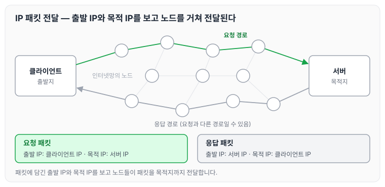
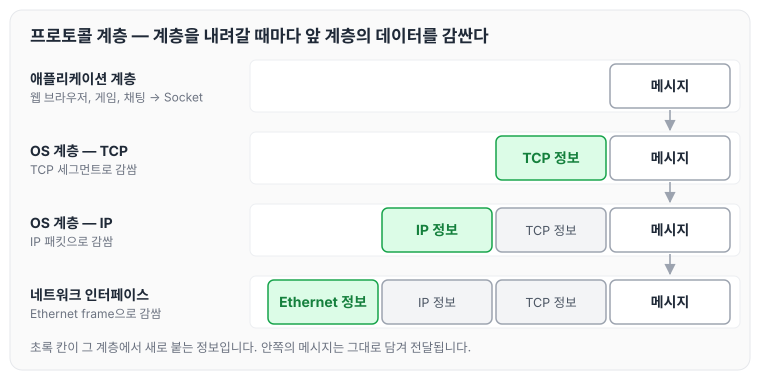
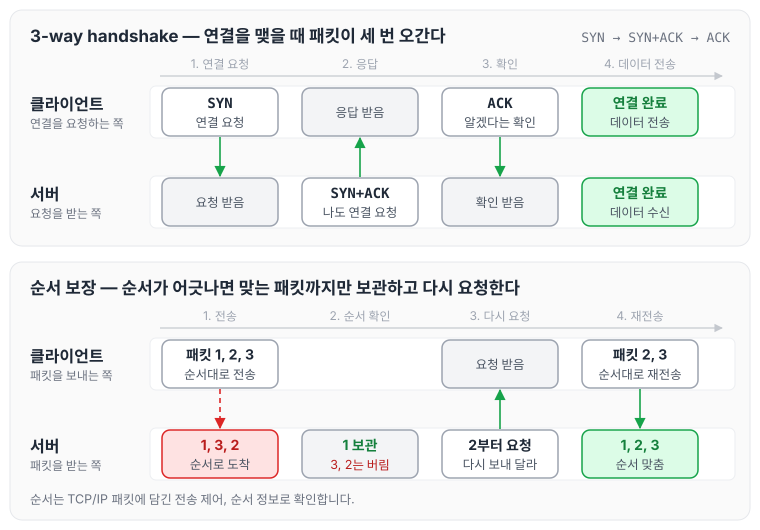
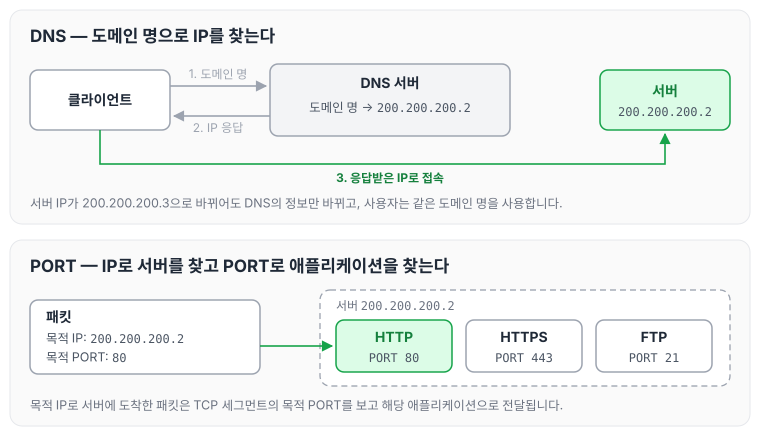

오늘은 HTTP를 공부하기 전에 알아야 할 인터넷 네트워크의 기본 구조에 대해 정리하도록 하겠습니다. IP가 데이터를 전달하는 방식과 한계, 이를 보완하는 TCP와 UDP, 같은 IP 안에서 애플리케이션을 구분하는 PORT, 그리고 IP 대신 도메인 명을 사용하게 해 주는 DNS 순서로 정리합니다.

## IP(인터넷 프로토콜)

### 인터넷 프로토콜 역할

- 지정한 IP 주소(IP Address)에 데이터를 전달합니다.
- 패킷(Packet)이라는 통신 단위로 데이터를 전달합니다.

### IP 패킷 정보

- 출발 IP
- 목적 IP
- 그 밖에도 많은 정보를 담고 있습니다.

### 클라이언트 패킷 전달

클라이언트가 보낸 패킷은 IP 프로토콜의 규약에 따라 출발지 IP Address에서 목적지 IP Address까지 여러 노드를 거치면서 전달되고, 최종적으로 목적지(IP Address)에 도착합니다.

### 서버 패킷 전달

패킷이 목적지에 잘 전달되면, 서버는 응답 패킷을 클라이언트의 IP Address로 전달합니다.

> 참고: 클라이언트 → 서버, 서버 → 클라이언트로 패킷이 전송될 때는 인터넷망이 복잡하기 때문에 서로 다른 경로로 전달될 수 있습니다.

요청 패킷과 응답 패킷이 전달되는 과정을 그리면 다음과 같습니다.

패킷에는 출발 IP와 목적 IP가 담겨 있어서 노드들이 이를 보고 목적지까지 전달합니다. 응답 패킷은 요청 패킷과 다른 경로로 돌아올 수 있습니다.

### IP 프로토콜의 한계

- 비연결성
    - 패킷을 받을 대상이 없거나 서비스 불능 상태여도 패킷을 전송합니다.
- 비신뢰성
    - 중간에 패킷이 사라질 수 있습니다.
    - 패킷이 순서대로 도착하지 않을 수 있습니다.
- 프로그램 구분
    - 같은 IP를 사용하는 서버에서 통신하는 애플리케이션이 둘 이상이면 이를 구분할 수 없습니다.

이러한 문제를 해결하기 위해 나온 방식이 TCP, UDP입니다.

## TCP, UDP

### 프로토콜 계층

인터넷 프로토콜 스택은 4계층으로 구성되며, 메시지는 아래 순서로 감싸져서 전송됩니다.

1. 애플리케이션 계층: 웹 브라우저, 네트워크 게임, 채팅 프로그램에서 메시지를 Socket 라이브러리를 통해 OS 계층으로 전달합니다.
2. OS 계층의 TCP에서 메시지를 TCP 세그먼트로 감싸줍니다.
3. IP에서 IP 패킷을 생성한 후 TCP 세그먼트를 감싸줍니다.
4. 네트워크 인터페이스에서 Ethernet frame으로 감싸줍니다(랜카드의 맥 주소 등).

계층마다 앞 계층의 데이터를 감싸는 모습을 그리면 다음과 같습니다.

안쪽에서부터 메시지, TCP 세그먼트, IP 패킷, Ethernet frame 순서로 감싸지기 때문에, IP 패킷 안에는 TCP 세그먼트가, TCP 세그먼트 안에는 애플리케이션의 메시지가 들어 있습니다.

### TCP 특징

TCP는 전송 제어 프로토콜(Transmission Control Protocol)의 약자이며, 아래와 같은 특징이 있습니다.

- 연결지향 - TCP 3-way handshake(가상 연결)
    1. 클라이언트가 서버로 `SYN` 연결 요청을 전송합니다.
    2. 서버가 클라이언트로 `SYN + ACK`로 응답합니다(나도 연결해 달라는 의미).
    3. 클라이언트가 서버로 알겠다는 의미로 `ACK`를 전송합니다.

    이 과정을 거치면 클라이언트와 서버가 신뢰할 수 있는 연결을 맺고, 이후 데이터를 전송합니다.

    > 참고: 실제로 물리적으로 연결되는 것이 아니라 개념적으로 연결되는 것입니다.

- 데이터 전달 보증
    - 클라이언트에서 서버로 데이터를 전송할 때, 서버가 잘 받았다고 응답하는지에 따라 데이터가 전달되었는지 확인할 수 있습니다.
- 순서 보장
    1. 클라이언트가 서버로 패킷을 전송하면, 서버는 패킷 순서를 확인합니다.
    2. 패킷 순서가 맞지 않으면 순서가 맞는 패킷까지 보관하고, 나머지 영역은 버립니다.
    3. 버린 영역을 순서에 맞게 다시 보내 달라고 클라이언트에게 요청합니다.

    > 참고: 순서 등은 TCP/IP 패킷 정보의 전송 제어, 순서 정보 등으로 확인합니다.

- 신뢰할 수 있는 프로토콜입니다.
- 현재는 대부분 TCP를 사용합니다.

3-way handshake로 연결을 맺는 과정과, 패킷 순서가 맞지 않을 때 다시 요청하는 과정을 그리면 다음과 같습니다.

연결을 맺을 때 패킷이 세 번 오가고, 순서가 어긋난 패킷은 다시 받아서 순서를 맞춥니다. 3-way handshake는 [DBCP](../dbcp/)에서 DB 연결 비용을 다룰 때도 정리하였습니다.

### UDP 특징

UDP는 사용자 데이터그램 프로토콜(User Datagram Protocol)의 약자입니다. 기능이 거의 없어서 하얀 도화지에 비유하기도 합니다.

- 연결지향(TCP 3-way handshake)이 없습니다.
- 데이터 전달을 보증하지 않습니다.
- 순서를 보장하지 않습니다.
- 데이터 전달 및 순서가 보장되지 않지만, 단순하고 빠릅니다.
- 정리
    - IP와 거의 같고, PORT와 체크섬 정도만 추가됩니다.
    - 애플리케이션에서 추가 작업이 필요합니다.

> 참고: 요즘에는 웹 브라우저에서 HTTP 통신을 할 때 최대한 간편하게 동작하는 것을 원하기 때문에, 3-way handshake도 줄여서 속도를 빠르게 하려는 취지에서 UDP가 많이 각광받고 있습니다.

## PORT — 같은 IP 내에서 프로세스 구분

현재 PC에서 게임, 영상통화, 웹 브라우징을 동시에 사용하고 있다면 여러 개의 패킷을 동시에 전달받게 됩니다. 이때 포트를 통해서 각 패킷을 해당하는 애플리케이션으로 전달합니다.

포트를 구분할 수 있는 이유는 TCP/IP 영역에서 TCP 세그먼트 안에 출발지 PORT와 목적지 PORT 정보가 들어 있기 때문입니다.

정리하면, IP는 목적지를 찾고 PORT는 서버 안에서 돌아가는 애플리케이션을 찾습니다.

### PORT 번호

- 0 ~ 65535까지 할당 가능합니다.
- 0 ~ 1023: 잘 알려진 포트로, 사용하지 않는 것이 좋습니다.
    - FTP - 20, 21
    - TELNET - 23
    - HTTP - 80
    - HTTPS - 443

## DNS

IP는 기억하기 어렵고 변경될 수 있습니다. 기존 서버의 IP가 200.200.200.2에서 200.200.200.3으로 변경되면 클라이언트는 바뀐 IP를 알기 어렵습니다. 이를 해결하는 방법이 DNS 서버입니다.

- DNS 서버를 사용해서 도메인 명으로 해당하는 IP를 찾을 수 있습니다.
- IP가 변경되어도 도메인 명이 유지되므로 사용자는 헷갈릴 일이 없습니다.

DNS로 IP를 찾은 뒤 PORT로 애플리케이션을 찾아가는 과정을 함께 그리면 다음과 같습니다.

클라이언트는 도메인 명만 알고 있으면 DNS 서버에서 현재 IP를 받아 올 수 있고, 같은 IP 안에서는 PORT로 통신할 애플리케이션을 구분합니다.

## 마무리

오늘은 IP가 패킷을 전달하는 방식과 한계, 이를 보완하는 TCP와 UDP, 같은 IP 안에서 애플리케이션을 구분하는 PORT, 그리고 도메인 명으로 IP를 찾는 DNS에 대해 정리하였습니다. HTTP도 결국 이 위에서 동작하기 때문에, 이후 내용을 이해하는 데 바탕이 될 것 같습니다. 다음 글에서는 [URI와 웹 브라우저 요청 흐름](../http-uri-flow/)에 대해 정리하도록 하겠습니다.

> 이 글은 인프런 김영한 님의 [모든 개발자를 위한 HTTP 웹 기본 지식](https://www.inflearn.com/course/http-웹-네트워크)을 들으며 정리한 노트입니다.
