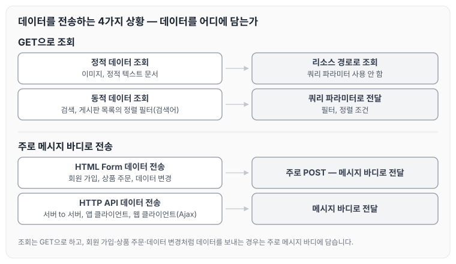

이전에 [HTTP 메서드](../http-methods/)에 대해 작성하였습니다. 이번 글에서는 클라이언트에서 서버로 데이터를 전송하는 두 가지 방식과, 정적 데이터 조회·동적 데이터 조회·HTML Form·HTTP API 네 가지 상황에서 HTTP 메서드를 어떻게 활용하는지 정리하도록 하겠습니다.

## 데이터 전달 방식

클라이언트에서 서버로 데이터를 전달하는 방식은 크게 2가지입니다.

- 쿼리 파라미터를 통한 데이터 전송
    - GET
    - 주로 정렬 필터(검색어)
- 메시지 바디를 통한 데이터 전송
    - POST, PUT, PATCH
    - 회원 가입, 상품 주문, 리소스 등록, 리소스 변경

## 데이터를 전송하는 4가지 상황

데이터를 전송하는 상황은 아래 4가지로 나눌 수 있습니다.

- 정적 데이터 조회
    - 이미지, 정적 텍스트 문서
- 동적 데이터 조회
    - 주로 검색, 게시판 목록에서 정렬 필터(검색어)
- HTML Form을 통한 데이터 전송
    - 회원 가입, 상품 주문, 데이터 변경
- HTTP API를 통한 데이터 전송
    - 회원 가입, 상품 주문, 데이터 변경
    - 서버 to 서버, 앱 클라이언트, 웹 클라이언트(Ajax)

네 가지 상황이 앞의 두 가지 전달 방식 중 어디에 해당하는지 정리하면 아래와 같습니다.

조회는 정적·동적 모두 GET을 사용하고, 동적 데이터 조회일 때만 쿼리 파라미터로 조건을 전달합니다. 회원 가입, 상품 주문, 데이터 변경처럼 데이터를 등록하거나 바꾸는 경우는 주로 메시지 바디로 전달하며, HTML Form에서는 주로 POST 전송으로 메시지 바디에 담습니다.

## 정적 데이터 조회

정적 데이터 조회는 쿼리 파라미터를 사용하지 않습니다. 정리하면 아래와 같습니다.

- 이미지, 정적 텍스트 문서
- 조회는 GET 사용
- 정적 데이터는 일반적으로 쿼리 파라미터 없이 리소스 경로로 단순하게 조회 가능

## 동적 데이터 조회

동적 데이터 조회는 쿼리 파라미터를 사용합니다. 정리하면 아래와 같습니다.

- 주로 검색, 게시판 목록에서 정렬 필터(검색어)
- 조회 조건을 줄여 주는 필터, 조회 결과를 정렬하는 정렬 조건에 주로 사용
- 조회는 GET 사용
- GET은 쿼리 파라미터를 사용해서 데이터를 전달

## HTML Form 데이터 전송

HTML Form으로 데이터를 전송하는 경우는 아래와 같이 나누어 볼 수 있습니다.

- POST 전송 - 저장
- GET 전송 - 저장
- multipart/form-data

## 마무리

오늘은 클라이언트에서 서버로 데이터를 전송하는 쿼리 파라미터와 메시지 바디 두 가지 방식, 그리고 정적 데이터 조회·동적 데이터 조회·HTML Form·HTTP API 네 가지 상황에서 HTTP 메서드를 활용하는 방법에 대해 정리하였습니다.

> 이 글은 인프런 김영한 님의 [모든 개발자를 위한 HTTP 웹 기본 지식](https://www.inflearn.com/course/http-웹-네트워크)을 들으며 정리한 노트입니다.
