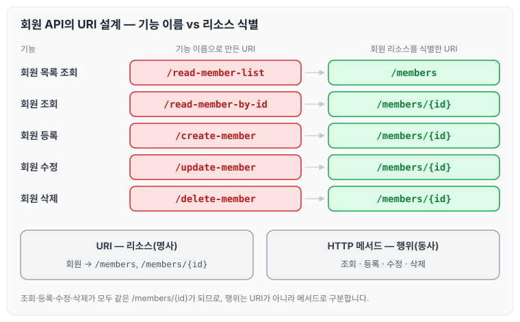
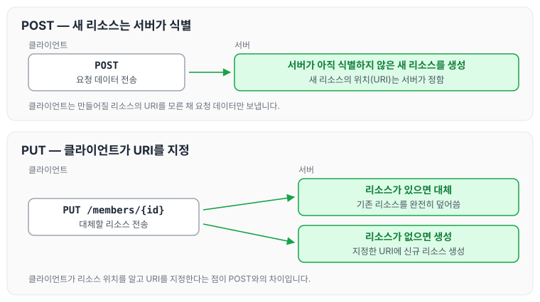
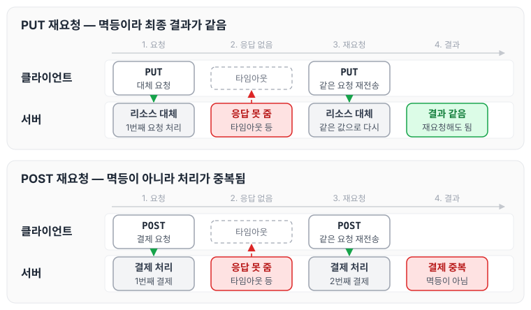

이전에 [HTTP 기본](../http-basics/)에 대해 작성하였습니다. 이번 글에서는 회원 정보 관리 API를 설계하는 예제로 URI가 무엇을 식별해야 하는지 살펴보고, HTTP 메서드 GET, POST, PUT, PATCH, DELETE의 의미와 안전·멱등·캐시 가능 속성에 대해 정리하도록 하겠습니다.

## HTTP API 설계

### 요구사항

회원 정보를 관리하는 API를 만든다고 가정합니다. 필요한 기능은 아래와 같습니다.

- 회원 목록 조회
- 회원 조회
- 회원 등록
- 회원 수정
- 회원 삭제

### 기능 이름으로 만든 URI

URI(Uniform Resource Identifier)를 기능 이름대로 설계하면 아래와 같습니다.

- 회원 목록 조회 /read-member-list
- 회원 조회 /read-member-by-id
- 회원 등록 /create-member
- 회원 수정 /update-member
- 회원 삭제 /delete-member

이 설계가 좋은 URI 설계인지 판단할 때 가장 중요한 기준은 리소스 식별입니다.

### 리소스의 의미와 식별

URI에서 리소스가 무엇을 뜻하는지부터 정리하면 아래와 같습니다.

- 리소스의 의미
    - 회원을 등록하고 수정하고 조회하는 것이 리소스가 아닙니다.
    - 예를 들어 "미네랄을 캐라"에서는 미네랄이 리소스입니다.
    - 회원이라는 개념 자체가 바로 리소스입니다.
- 리소스를 식별하는 방법
    - 회원을 등록하고 수정하고 조회하는 것은 모두 배제합니다.
    - 회원이라는 리소스만 식별하면 됩니다. → 회원 리소스를 URI에 매핑합니다.

### 리소스 식별과 URI 계층 구조

요구사항을 다시 보면 다섯 기능이 모두 회원을 대상으로 합니다.

- 회원 목록 조회
- 회원 조회
- 회원 등록
- 회원 수정
- 회원 삭제

회원 리소스를 식별하고 URI 계층 구조를 활용하면 아래와 같이 설계할 수 있습니다.

- 회원 목록 조회 /members
- 회원 조회 /members/{id}
- 회원 등록 /members/{id}
- 회원 수정 /members/{id}
- 회원 삭제 /members/{id}

다만 이렇게 하면 회원 조회, 등록, 수정, 삭제가 모두 같은 URI가 되므로, 어떤 기능인지 구분할 방법이 필요합니다.

### 리소스와 행위의 분리

가장 중요한 것은 리소스를 식별하는 것입니다.

- URI는 리소스만 식별합니다.
- 리소스와 해당 리소스를 대상으로 하는 행위를 분리합니다.
    - 리소스: 회원
    - 행위: 조회, 등록, 삭제, 변경
- 리소스는 명사, 행위는 동사입니다(미네랄을 캐라).

URI가 리소스를 맡으면, 행위는 HTTP 메서드로 구분합니다. 두 설계를 비교하면 아래와 같습니다.

그림의 아래쪽처럼 URI에는 `/members`, `/members/{id}`만 남고, 조회·등록·수정·삭제는 다음에 정리할 HTTP 메서드가 맡습니다.

## HTTP 메서드 — GET, POST

### 주요 메서드

주요 메서드는 아래와 같습니다.

- GET: 리소스 조회
- POST: 요청 데이터 처리, 주로 등록에 사용
- PUT: 리소스를 대체, 해당 리소스가 없으면 생성
- PATCH: 리소스 부분 변경
- DELETE: 리소스 삭제

### GET

- 리소스를 조회합니다.
- 서버에 전달하고 싶은 데이터는 query(쿼리 파라미터, 쿼리 스트링)를 통해서 전달합니다.
- 메시지 바디를 사용해서 데이터를 전달할 수도 있지만, 지원하지 않는 곳이 많아서 권장하지 않습니다.

### POST

- 요청 데이터를 처리합니다.
- 메시지 바디를 통해 서버로 요청 데이터를 전달합니다.
- 서버는 요청 데이터를 처리합니다.
    - 메시지 바디를 통해 들어온 데이터를 처리하는 모든 기능을 수행합니다.
- 주로 전달된 데이터로 신규 리소스 등록, 프로세스 처리에 사용합니다.

### POST의 요청 데이터 처리

POST가 요청 데이터를 처리한다는 것이 무엇인지 스펙과 예시로 정리하면 아래와 같습니다.

- 스펙: POST 메서드는 대상 리소스가 리소스의 고유한 의미 체계에 따라 요청에 포함된 표현을 처리하도록 요청합니다.
- 예를 들어 POST는 다음과 같은 기능에 사용됩니다.
    - HTML 양식에 입력된 필드와 같은 데이터 블록을 데이터 처리 프로세스에 제공합니다.
        - 예: HTML FORM에 입력한 정보로 회원 가입, 주문 등에서 사용
    - 게시판, 뉴스 그룹, 메일링 리스트, 블로그 또는 유사한 기사 그룹에 메시지를 게시합니다.
        - 예: 게시판 글쓰기, 댓글 달기
    - 서버가 아직 식별하지 않은 새 리소스를 생성합니다.
        - 예: 신규 주문 생성
    - 기존 자원에 데이터를 추가합니다.
        - 예: 한 문서 끝에 내용 추가하기

이 리소스 URI에 POST 요청이 오면 요청 데이터를 어떻게 처리할지 리소스마다 따로 정해야 하며, 정해진 규칙은 없습니다.

### POST를 사용하는 경우

POST를 사용하는 경우를 정리하면 아래와 같습니다.

1. 새 리소스 생성(등록)
    - 서버가 아직 식별하지 않은 새 리소스를 생성합니다.
2. 요청 데이터 처리
    - 단순히 데이터를 생성하거나 변경하는 것을 넘어서 프로세스를 처리해야 하는 경우입니다.
        - 예: 주문에서 결제완료 → 배달시작 → 배달완료처럼, 단순히 값 변경을 넘어서 프로세스의 상태가 변경되는 경우
    - POST의 결과로 새로운 리소스가 생성되지 않을 수도 있습니다.
        - 예: POST /orders/{orderId}/start-delivery (컨트롤 URI)
3. 다른 메서드로 처리하기 애매한 경우
    - 예: JSON으로 조회 데이터를 넘겨야 하는데 GET 메서드를 사용하기 어려운 경우
    - 애매하면 POST를 사용합니다.

## HTTP 메서드 — PUT, PATCH, DELETE

### PUT

- 리소스를 대체합니다.
    - 리소스가 있으면 대체합니다.
    - 리소스가 없으면 생성합니다.
    - 쉽게 말해 덮어씁니다.
- 클라이언트가 리소스를 식별한다는 점이 중요합니다.
    - 클라이언트가 리소스 위치를 알고 URI를 지정합니다.
    - 이 점이 POST와의 차이점입니다.
- 리소스가 있는 경우에는 리소스를 대체합니다.
- 리소스가 없는 경우에는 신규 리소스를 생성합니다.
- PUT은 리소스를 완전히 대체합니다.

POST와 PUT에서 리소스를 식별하는 쪽이 어떻게 다른지, 그리고 PUT이 리소스가 있을 때와 없을 때 어떻게 동작하는지 정리하면 아래와 같습니다.

POST는 `/members`처럼 컬렉션에 요청을 보내고 새 리소스의 위치는 서버가 정합니다. PUT은 클라이언트가 `/members/{id}`까지 지정해서 보내고, 그 위치에 리소스가 있는지에 따라 대체 또는 생성이 일어납니다.

### PATCH

리소스를 부분 변경합니다.

### DELETE

리소스를 제거합니다.

## HTTP 메서드의 속성

HTTP 메서드는 아래 세 가지 속성으로 구분할 수 있습니다.

- 안전(Safe Methods)
- 멱등(Idempotent Methods)
- 캐시 가능(Cacheable Methods)

### 안전

안전(safe)은 호출해도 리소스를 변경하지 않는 성질입니다.

계속 호출해서 로그 같은 것이 쌓여 장애가 발생하는 경우도 생각해 볼 수 있지만, 안전은 해당 리소스만 고려합니다.

### 멱등

멱등(idempotent)은 f(f(x)) = f(x)처럼 한 번 호출하든 두 번 호출하든 100번 호출하든 결과가 똑같은 성질입니다.

- 멱등 메서드
    - GET: 한 번 조회하든 두 번 조회하든 같은 결과가 조회됩니다.
    - PUT: 결과를 대체합니다. 따라서 같은 요청을 여러 번 해도 최종 결과는 같습니다.
    - DELETE: 결과를 삭제합니다. 같은 요청을 여러 번 해도 삭제된 결과는 똑같습니다.
    - POST: 멱등이 아닙니다. 두 번 호출하면 같은 결제가 중복해서 발생할 수 있습니다.
- 활용
    - 자동 복구 메커니즘
    - 서버가 타임아웃 등으로 정상 응답을 못 주었을 때, 클라이언트가 같은 요청을 다시 해도 되는지 판단하는 근거가 됩니다.

타임아웃 뒤에 같은 요청을 다시 보내는 경우를 PUT과 POST로 비교하면 아래와 같습니다.

PUT은 몇 번을 다시 보내도 리소스가 같은 값으로 대체될 뿐이므로 다시 요청해도 됩니다. POST는 요청마다 처리가 새로 일어나므로, 응답을 받지 못했다고 그대로 다시 보내면 결제가 두 번 될 수 있습니다.

재요청 중간에 다른 곳에서 리소스를 변경하는 경우도 있습니다.

- 사용자1: GET → username:A, age:20
- 사용자2: PUT → username:A, age:30
- 사용자1: GET → username:A, age:30 → 사용자2의 영향으로 바뀐 데이터가 조회됩니다.

멱등은 이처럼 외부 요인으로 중간에 리소스가 변경되는 것까지는 고려하지 않습니다.

### 캐시 가능

캐시 가능(cacheable)은 응답 결과 리소스를 캐시해서 사용해도 되는지를 나타냅니다.

- GET, HEAD, POST, PATCH는 캐시 가능합니다.
- 실제로는 GET, HEAD 정도만 캐시로 사용합니다.
    - POST, PATCH는 본문 내용까지 캐시 키로 고려해야 하는데, 구현이 쉽지 않습니다.

## 마무리

오늘은 회원 API 설계 예제로 URI가 리소스만 식별하고 행위는 HTTP 메서드로 구분하는 방법, GET·POST·PUT·PATCH·DELETE의 의미, 그리고 안전·멱등·캐시 가능 속성에 대해 정리하였습니다. 특히 멱등은 타임아웃 뒤에 같은 요청을 다시 보내도 되는지 판단하는 기준이 되므로 API를 설계할 때 함께 고려하면 좋을 것 같습니다.

다음 글에서는 [HTTP 메서드 활용](../http-method-usage/)에 대해 정리하도록 하겠습니다.

> 이 글은 인프런 김영한 님의 [모든 개발자를 위한 HTTP 웹 기본 지식](https://www.inflearn.com/course/http-웹-네트워크)을 들으며 정리한 노트입니다.
