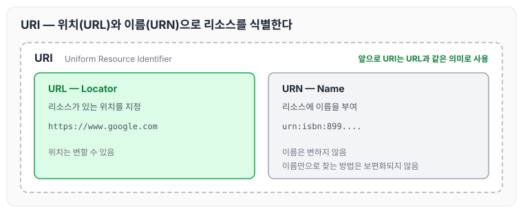
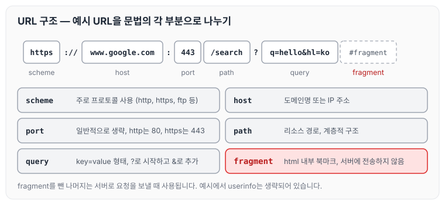
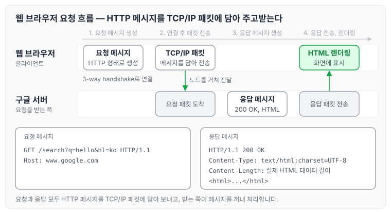

이전에 [인터넷 네트워크](../http-internet-network/)에 대해 작성하였습니다. 그 글에서는 IP, TCP/UDP, PORT, DNS가 데이터를 주고받는 방식을 정리하였습니다. 오늘은 자원을 식별하는 URI와 URL 문법, 그리고 웹 브라우저가 서버에 요청을 보내고 응답을 받아 화면에 보여 주기까지의 흐름에 대해 정리하도록 하겠습니다.

## URI(Uniform Resource Identifier)

URI는 로케이터(Locator), 이름(Name), 또는 둘 다로 추가 분류될 수 있습니다.

### URI

- Uniform: 리소스를 식별하는 통일된 방식
- Resource: 자원, URI로 식별할 수 있는 모든 것(제한 없음)
- Identifier: 다른 항목과 구분하는 데 필요한 정보

URI는 다시 아래 두 가지로 나뉩니다.

- URL: Uniform Resource Locator
- URN: Uniform Resource Name

### URL, URN

- URL - Locator: 리소스가 있는 위치를 지정
- URN - Name: 리소스에 이름을 부여
- 위치는 변할 수 있지만, 이름은 변하지 않습니다.
- urn:isbn:899....
- URN 이름만으로 실제 리소스를 찾을 수 있는 방법이 보편화되지 않았습니다.

URI와 URL, URN의 관계를 그리면 다음과 같습니다.



URN은 이름만으로 리소스를 찾는 방법이 보편화되지 않았기 때문에, 앞으로는 URI를 URL과 같은 의미로 이야기하겠습니다.

### URL 전체 문법

URL의 전체 문법과 예시는 아래와 같습니다.

```text
scheme://[userinfo@]host[:port][/path][?query][#fragment]
https://www.google.com:443/search?q=hello&hl=ko
```

- scheme(https)
    - 주로 프로토콜을 사용합니다.
    - 프로토콜: 어떤 방식으로 자원에 접근할 것인가 하는 약속 규칙
        - 예) http, https, ftp 등
- 호스트명(www.google.com)
    - 도메인명 또는 IP 주소를 직접 사용할 수 있습니다.
- 포트(443)
    - 접속 포트
    - 일반적으로 생략하며, 생략하면 http는 80, https는 443을 사용합니다.
- 패스(/search)
    - 리소스 경로이며, 계층적 구조입니다.
- 쿼리 파라미터(q=hello&hl=ko)
    - key=value 형태
    - ?로 시작하고, &로 추가할 수 있습니다.
    - query parameter, query string 등으로 불리며, 웹서버에 제공하는 파라미터로 문자 형태입니다.
- 프래그먼트(#fragment)
    - html 내부 북마크 등에 사용합니다.
    - 서버에 전송하는 정보가 아닙니다.

예시 URL을 문법의 각 부분으로 나누면 다음과 같습니다.



scheme부터 query까지는 서버에 요청을 보낼 때 사용하고, fragment는 브라우저 안에서만 사용합니다.

## 웹 브라우저 요청 흐름

웹 브라우저에 URL을 입력했을 때 요청이 전달되고 응답을 받기까지의 과정은 아래와 같습니다.

1. 사용자가 URL을 통해서 서버에 요청을 합니다.
    - 사용자 요청 메시지를 생성합니다.
    - HTTP 요청 메시지 형태로 만듭니다.
2. HTTP 메시지를 전송하기 위한 준비를 합니다.
    - TCP/IP 패킷 생성 과정을 거칩니다.
    - SOCKET 라이브러리에서 3-way handshake를 통해 서버와 연결합니다.
3. 패킷을 생성한 후 전송 데이터에 HTTP 메시지를 넣어 줍니다.
    - 전송 데이터를 생성합니다.
4. 요청 패킷을 노드를 통해서 서버로 전송합니다.
    - 요청 패킷을 서버에 전달합니다.
5. 구글 서버에 요청 패킷이 전달되면 응답 메시지를 만듭니다.
    - 응답 메시지를 생성합니다.
    - HTTP 버전과 정상 응답인 200 OK를 담습니다.
    - 응답하는 데이터가 텍스트로 된 HTML 형식이며, 인코딩은 UTF-8입니다.
    - 실제 HTML 데이터의 길이도 포함됩니다.
6. 만든 응답 메시지를 클라이언트로 다시 전송합니다.
    - 응답 메시지를 클라이언트에 전송합니다.
7. 클라이언트에서 웹 브라우저가 HTML을 렌더링해서 정보를 보여 줍니다.
    - HTML을 렌더링합니다.

웹 브라우저와 구글 서버 사이에서 일어나는 일을 순서대로 그리면 다음과 같습니다.



요청과 응답 모두 HTTP 메시지를 TCP/IP 패킷에 담아 전송하고, 받는 쪽에서 패킷 안의 HTTP 메시지를 꺼내 처리합니다. HTTP 메시지의 구조는 다음 글에서 자세히 정리하겠습니다.

## 마무리

오늘은 URI, URL, URN의 개념과 URL 문법, 그리고 웹 브라우저가 서버에 요청을 보내고 응답을 받아 HTML을 렌더링하기까지의 흐름에 대해 정리하였습니다. 앞 글에서 정리한 TCP/IP 패킷 위에 HTTP 메시지가 실려 오간다는 점을 흐름으로 확인할 수 있었습니다. 다음 글에서는 [HTTP 기본](../http-basics/)에 대해 정리하도록 하겠습니다.

> 이 글은 인프런 김영한 님의 [모든 개발자를 위한 HTTP 웹 기본 지식](https://www.inflearn.com/course/http-웹-네트워크)을 들으며 정리한 노트입니다.
