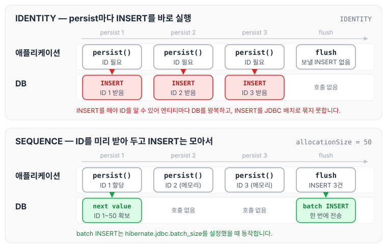
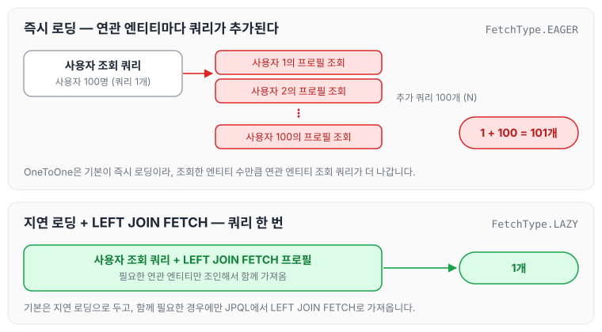
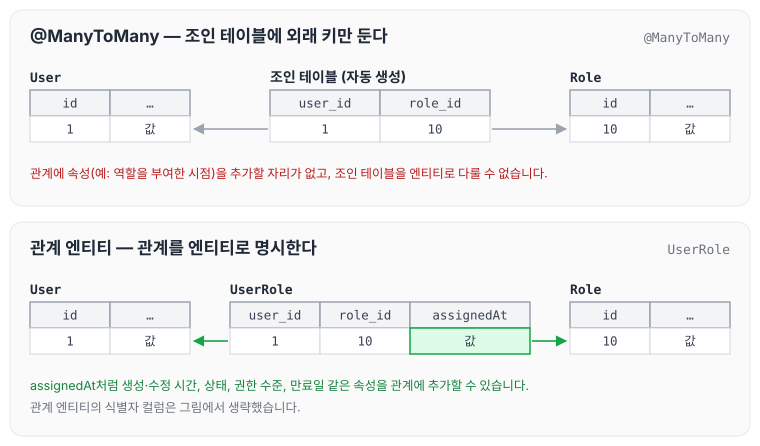

이전에 [데이터 액세스 스택](../data-access-stack/)에 대해 작성하였습니다. 오늘은 같은 강의에서 다룬 식별자(ID 생성 전략)와 연관관계 매핑을 성능 관점에서 정리하도록 하겠습니다.

## 식별자 (Identifiers)

### 영속화할 때 필요한 ID

JPA 엔티티는 영속성 컨텍스트에서 고유하게 식별되기 위해 반드시 ID를 가져야 합니다. ID는 엔티티의 생명주기 관리(예: persist, merge, remove)와 데이터베이스 매핑의 핵심입니다. `@Id`가 없는 엔티티는 Hibernate가 시작할 때 `AnnotationException`으로 거부하고, 생성 전략 없이 ID 값을 넣지 않은 채 저장하면 `IdentifierGenerationException`이 발생합니다.

### 오토 인크리먼트의 문제점

- 데이터베이스 오토 인크리먼트(`@GeneratedValue(strategy = GenerationType.IDENTITY)`)는 INSERT를 실행해야 ID 값을 알 수 있습니다. 그래서 엔티티마다 개별 `INSERT` 문을 바로 실행하고, Hibernate는 IDENTITY 전략을 쓰는 엔티티의 INSERT를 JDBC 배치로 묶지 않습니다. 이 때문에 트랜잭션당 여러 번의 SQL 호출이 생기고, 대량 데이터를 처리할 때 성능 병목이 됩니다.
- 특히 JDBC 드라이버와 데이터베이스 사이의 왕복 시간(round-trip time)이 늘어나서 배치 작업에서 비효율적입니다.

IDENTITY 전략이 `persist()` 시점에 INSERT를 바로 실행하는 이유는 [엔티티 매핑](../jpa-entity-mapping/)에서 정리하였습니다.

### 대안 ID 생성 전략

- UUID: 애플리케이션에서 UUID를 생성해서 사용(`@GeneratedValue(strategy = GenerationType.UUID)`)하면 DB 의존성을 줄이고 병렬 처리가 가능합니다. 다만 UUID는 128비트(16바이트) 값이라 BIGINT보다 크고, 문자열로 저장하면 36자가 되기 때문에 인덱스 크기가 커질 수 있습니다.
- 시퀀스 기반 ID: `@GeneratedValue(strategy = GenerationType.SEQUENCE)`와 함께 `allocationSize`를 설정해서 ID를 미리 할당받습니다. 예를 들어 `allocationSize=50`이면 50개의 ID를 메모리에 캐싱해서 DB 호출을 줄입니다.
- 애플리케이션 수준 ID 생성: 고유 ID 생성 로직을 애플리케이션에서 직접 관리해서 DB 의존성을 완전히 제거합니다. 예를 들면 고유 키 생성 라이브러리나 타임스탬프 기반 ID를 사용합니다.

IDENTITY와 SEQUENCE(`allocationSize=50`)로 엔티티 세 개를 저장할 때 DB를 호출하는 시점을 비교하면 다음과 같습니다.



IDENTITY는 persist할 때마다 DB를 왕복하지만, SEQUENCE는 처음 한 번 시퀀스를 호출해 ID를 확보한 뒤 메모리에서 ID를 부여하고, `hibernate.jdbc.batch_size`를 설정하면 flush할 때 INSERT를 모아서 보냅니다. `allocationSize` 최적화는 [엔티티 매핑](../jpa-entity-mapping/)의 SEQUENCE 전략과 최적화에서도 정리하였습니다.

### 대규모 배치 처리

- 영속성 컨텍스트 오버헤드: JPA의 영속성 컨텍스트는 엔티티 상태를 추적하므로, 대량 데이터를 처리할 때 메모리 사용량이 늘고 성능이 떨어집니다. 예를 들어 수십만 개의 엔티티를 한 트랜잭션에서 관리하면 `OutOfMemoryError`가 발생할 위험이 있습니다. 영속성 컨텍스트의 동작은 [영속성 컨텍스트](../jpa-persistence-context/)에서 정리하였습니다.
- 비영속 처리: 영속화가 필요 없는 경우에는 JPA 네이티브 쿼리(`entityManager.createNativeQuery`)나 SQL 매퍼(예: MyBatis, jOOQ)를 사용해서 SQL을 직접 실행합니다. 이렇게 하면 영속성 컨텍스트를 우회하기 때문에 메모리 사용량과 성능을 최적화할 수 있습니다.
- 배치 최적화: JPA를 사용한다면 `hibernate.jdbc.batch_size`를 설정(예: 50)해서 배치 `INSERT`/`UPDATE`를 활성화하고, `hibernate.order_inserts=true`와 `hibernate.order_updates=true`로 SQL 실행 순서를 최적화합니다.
- 실무 예시: 대량 데이터 마이그레이션에서는 JPA의 `persist` 대신 네이티브 `INSERT` 쿼리를 사용해서 처리 속도를 10배 이상 높일 수 있습니다. 예를 들어 100만 건을 삽입할 때 배치 크기를 100으로 설정하면, 단일 트랜잭션 안에서 DB로 보내는 호출 횟수가 크게 줄어듭니다.

### 식별자 권장사항

- 오토 인크리먼트 지양: 고속 처리 시스템에서는 오토 인크리먼트를 피하고 시퀀스나 UUID를 선호합니다.
- 배치 처리 최적화: 대규모 데이터 작업에서는 영속성 컨텍스트를 최소화하고, 배치 크기와 트랜잭션 단위를 적절히 설정합니다(예: 1000건 단위로 커밋).
- 모니터링: Hypersistence Optimizer 같은 도구로 ID 생성 전략의 성능을 분석하고 최적화합니다.
- 테스트: 배치 작업 전에 소규모 데이터로 네이티브 쿼리와 JPA 배치 처리의 성능을 비교 테스트해서 최적의 전략을 선택합니다.

## 관계 (Relationships)

연관관계 매핑의 기본 개념과 다중성별 매핑 방법은 [연관관계 매핑 기초](../jpa-association-basics/)와 [다양한 연관관계 매핑](../jpa-association-types/)에서 정리하였습니다. 여기서는 성능 관점에서 주의할 점을 정리하겠습니다.

### OneToMany

`@OrderColumn`은 `OneToMany` 관계에서 컬렉션의 순서를 데이터베이스에 저장할 때 사용합니다. 예를 들어 `@OrderColumn(name = "order_idx")`는 컬렉션의 인덱스를 별도 컬럼에 저장합니다. 다만 순서를 유지하기 위해 추가 `UPDATE` 쿼리가 발생하고, 데이터베이스 정렬은 CPU와 I/O 비용을 증가시킬 수 있습니다.

정렬은 아래와 같은 방법으로 대신할 수 있습니다.

- 프레젠테이션 계층: 소규모 데이터(예: 100건 이하)라면 UI나 API 응답에서 클라이언트 측 정렬(예: Java의 `Collections.sort`)을 수행해서 DB 부하를 줄입니다.
- 비즈니스 계층: 애플리케이션이나 도메인 로직에서 정렬(예: `List.sort` 또는 Stream API)을 처리합니다. 데이터 크기가 크지 않다면(예: 1000건 이하) 성능 영향은 미미합니다.
- 쿼리 기반 정렬: 필요한 경우 JPQL이나 Criteria API에서 `ORDER BY`로 정렬합니다. 예: `SELECT o FROM Order o JOIN o.items i ORDER BY i.createdAt`

실무에서는 순서가 비즈니스 요구사항에 꼭 필요한 경우에만 `@OrderColumn`을 사용하고, 그렇지 않으면 애플리케이션 계층에서 정렬을 처리해서 DB 오버헤드를 줄입니다.

### OneToOne

`OneToOne` 관계는 기본이 즉시 로딩(`FetchType.EAGER`)이기 때문에, 연관 엔티티를 조회할 때 추가 쿼리가 발생합니다(N+1 문제). 예를 들어 100개의 엔티티를 조회하면 101개의 쿼리가 실행될 수 있습니다. 즉시 로딩이 N+1 문제를 일으키는 과정은 [즉시 로딩과 지연 로딩](../jpa-lazy-eager-loading/)에서 정리하였습니다.

이를 해결하는 방법은 아래와 같습니다.

- 지연 로딩 설정: `@OneToOne(fetch = FetchType.LAZY)`를 명시하고, `hibernate.enable_lazy_load_no_trans`를 `false`(기본값)로 두어 예기치 않은 프록시 초기화를 방지합니다.
- 바이트코드 향상 없이 지연 로딩: Hibernate의 바이트코드 향상(예: `@LazyToOne(LazyToOneOption.NO_PROXY)`)을 사용하지 않고, 명시적인 JPQL 쿼리(예: `SELECT e FROM Entity e LEFT JOIN FETCH e.related`)로 필요한 데이터만 로드합니다.
- 대안 모델링: `OneToOne`을 `OneToMany`로 선언하고, 컬렉션 크기를 1로 제한합니다. 예를 들어 `List<RelatedEntity>`를 사용하고 `getFirstRelated()` 메서드로 첫 번째 요소만 반환합니다.

대안 모델링을 쓸 때는 엔티티에서 컬렉션(`List`, `Set`)에 직접 접근하지 못하게 막고, 단일 요소에 접근하는 메서드를 제공합니다. 예시 코드는 아래와 같습니다.

```java
public class ParentEntity {
    @OneToMany
    private List<RelatedEntity> related = new ArrayList<>();

    public RelatedEntity getRelated() {
        return related.isEmpty() ? null : related.get(0);
    }
}
```

이 방법은 `OneToOne`의 단순성을 유지하면서 `OneToMany`의 유연성을 활용합니다.

실무 예시로 사용자와 프로필이 `OneToOne` 관계일 때, 지연 로딩과 `LEFT JOIN FETCH`를 사용해서 N+1 문제를 해결하면 쿼리 수가 101개에서 1개로 줄어듭니다. 사용자 100명을 조회할 때 두 방식의 쿼리 수를 비교하면 다음과 같습니다.



기본은 지연 로딩으로 두고, 프로필이 함께 필요한 경우에만 JPQL에서 `LEFT JOIN FETCH`로 가져옵니다.

### ManyToMany

`@ManyToMany`는 조인 테이블을 자동으로 생성하지만, 복잡한 쿼리와 성능 저하를 일으킬 수 있습니다. 대신 중간 관계 엔티티를 명시적으로 정의하는 것이 좋습니다. 관계 엔티티를 두면 아래와 같은 이점이 있습니다.

- 성능: 조인 테이블의 복잡성을 줄이고, 명시적인 쿼리로 최적화할 수 있습니다.
- 감사(Audit): 생성·수정 시간, 상태 등 추가 메타데이터를 저장할 수 있습니다.
- 확장성: 관계에 새로운 속성(예: 권한 수준, 만료일)을 추가하기 쉽습니다.

`@ManyToMany`는 간단한 관계에는 적합하지만, 실무에서는 감사 로그나 추가 속성이 필요한 경우가 많으므로 관계 엔티티를 기본으로 고려합니다. 예를 들어 사용자-역할 관계에서는 `assignedAt` 필드로 역할을 부여한 시점을 추적할 수 있습니다.

사용자-역할 관계를 `@ManyToMany`로 매핑할 때와 관계 엔티티로 매핑할 때의 테이블을 비교하면 다음과 같습니다.



자동으로 만들어지는 조인 테이블에는 두 외래 키만 들어가지만, 관계 엔티티로 만들면 `assignedAt` 같은 속성을 관계에 둘 수 있습니다. 실무에서는 다대다 매핑을 쓰지 않는 것이 좋다는 점은 [다양한 연관관계 매핑](../jpa-association-types/)에서도 언급하였습니다.

### 관계 권장사항

- 지연 로딩 기본 사용: `OneToOne`과 `OneToMany`는 `FetchType.LAZY`로 설정해서 불필요한 데이터 조회를 방지합니다.
- 명시적 관계 엔티티: `ManyToMany`는 관계 엔티티로 관리해서 성능과 유연성을 확보합니다.
- 성능 모니터링: Hypersistence Optimizer로 관계 매핑의 비효율성을 진단하고, 쿼리 실행 계획을 분석합니다(예: `EXPLAIN` 사용).
- 테스트: 단위 테스트와 통합 테스트로 관계 설정과 쿼리 성능을 검증합니다. 예를 들어 Testcontainers나 H2 DB를 사용한 테스트로 N+1 문제를 재현하고 해결합니다.

## 마무리

오늘은 JPA의 ID 생성 전략과 대규모 배치 처리, 그리고 OneToMany·OneToOne·ManyToMany 연관관계 매핑에서 성능을 고려해 선택하는 기준에 대해 정리하였습니다. 다음 글에서는 [상속 매핑 전략](../inheritance-mapping/)에 대해 정리하도록 하겠습니다.

참조 : [세계 자바 챔피언, Vlad Mihalcea 강의 로드맵 - 인프런](https://www.inflearn.com/roadmaps/9183)
