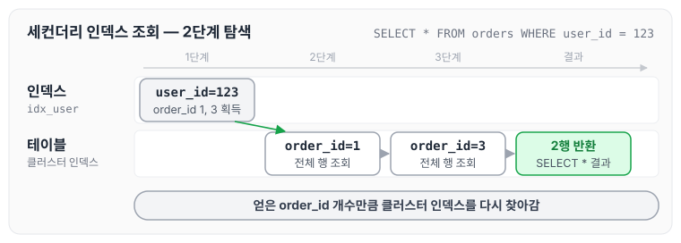
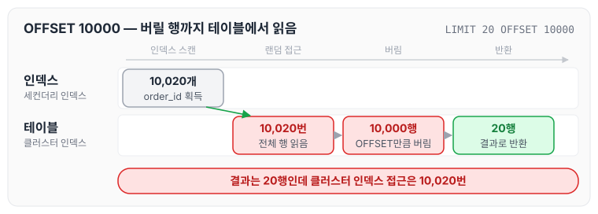
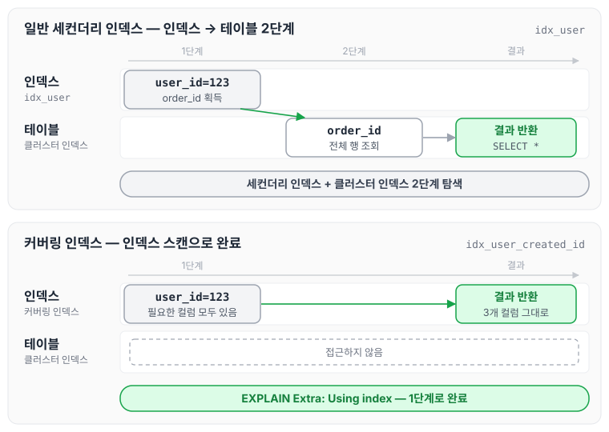
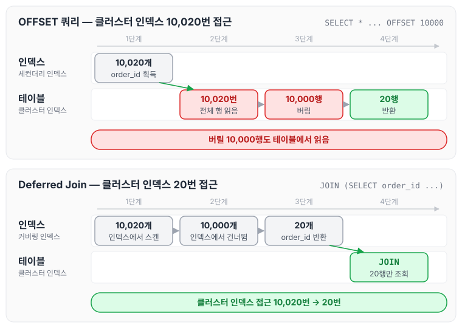
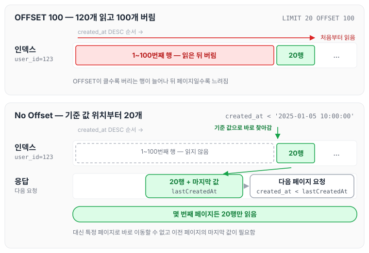
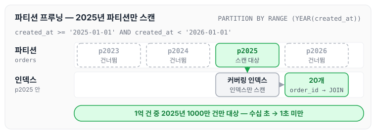

이전에 [MySQL 인덱스 정리](../mysql-index/)에 대해 작성하였습니다. 그 글 마지막에 클러스터드 인덱스와 커버링 인덱스를 짧게 소개했는데, 이번 글에서는 클러스터·세컨더리·커버링 인덱스의 구조를 조금 더 자세히 보고, 이 구조 때문에 OFFSET 페이지네이션이 느려지는 이유와 최적화하는 방법을 정리하도록 하겠습니다.

## 인덱스 종류

### 클러스터 인덱스 (Clustered Index)

클러스터 인덱스는 테이블 데이터 자체가 정렬되어 저장되는 인덱스입니다. 특징은 아래와 같습니다.

- 테이블당 1개만 존재
- InnoDB에서는 PK가 곧 클러스터 인덱스
- 리프 노드에 실제 데이터 전체가 저장됨
- 데이터가 물리적으로 정렬됨
- 책의 본문 자체가 페이지 순서대로 정렬된 것과 비슷합니다

```sql
CREATE TABLE orders (
    order_id BIGINT PRIMARY KEY,  -- 클러스터 인덱스
    user_id BIGINT,
    product_name VARCHAR(255),
    amount INT,
    created_at DATETIME
);

```

구조는 다음과 같습니다.

```text
[Root Node]
    ↓
[Branch Nodes: order_id 범위]
    ↓
[Leaf Nodes]
  order_id=1 → [전체 행: 1, 123, '상품A', 10000, '2025-01-01']
  order_id=2 → [전체 행: 2, 456, '상품B', 20000, '2025-01-02']
  order_id=3 → [전체 행: 3, 123, '상품C', 30000, '2025-01-03']
```

---

### 세컨더리 인덱스 (Secondary Index)

세컨더리 인덱스는 클러스터 인덱스가 아닌 모든 일반 인덱스를 말합니다. 특징은 아래와 같습니다.

- 테이블당 여러 개 생성 가능
- 리프 노드에 인덱스 컬럼 값과 PK 값(클러스터 키) 저장
- 데이터 조회 시 2단계 탐색: 세컨더리 인덱스 → 클러스터 인덱스
- 책의 색인(목차)과 같음

```sql
-- 세컨더리 인덱스 생성
CREATE INDEX idx_user ON orders(user_id);
CREATE INDEX idx_created ON orders(created_at);

```

구조는 다음과 같습니다.

```text
[Secondary Index: idx_user]
    ↓
[Leaf Nodes]
  user_id=123 → order_id=1 ─┐
  user_id=123 → order_id=3 ─┤
  user_id=456 → order_id=2  │
                             ↓
                    [Clustered Index로 이동]
                    order_id=1 → 전체 데이터 조회
                    order_id=3 → 전체 데이터 조회

```

`user_id = 123`으로 조회하면 아래 순서로 실행됩니다.

```sql
SELECT * FROM orders WHERE user_id = 123;

-- 실행 단계:
-- 1. idx_user 스캔 → order_id=1, order_id=3 획득
-- 2. 클러스터 인덱스에서 order_id=1 조회 → 전체 데이터
-- 3. 클러스터 인덱스에서 order_id=3 조회 → 전체 데이터

```

두 인덱스를 차례로 거치는 흐름을 그리면 다음과 같습니다.



세컨더리 인덱스에서 얻은 order_id 개수만큼 클러스터 인덱스를 다시 찾아간다는 점이 핵심입니다. 이 때문에 세컨더리 인덱스로 조회해도 느린 경우가 생깁니다. 아래 쿼리가 그 예입니다. 이 예시는 앞의 두 인덱스와 별도로 user_id와 created_at을 묶은 세컨더리 인덱스 `idx_user_created (user_id, created_at)`가 있다고 가정합니다.

```sql
SELECT * FROM orders WHERE user_id = 123 ORDER BY created_at DESC LIMIT 20 OFFSET 10000;

```

실행 과정은 아래와 같습니다.

1. idx_user_created (user_id, created_at) 세컨더리 인덱스 스캔 → 10,020개의 order_id 획득
2. 각 order_id로 클러스터 인덱스 접근 (10,020번)
3. 10,000개는 버리고 20개만 반환
4. 데이터가 많을수록 세컨더리 인덱스 스캔 자체는 큰 차이가 없지만, 클러스터 인덱스로 10,020번 랜덤 접근하는 것이 병목이 됩니다



그림에서 빨간 부분이 실제로 버려지는 작업입니다. 결과로 쓰는 것은 20행뿐인데, 버릴 10,000행까지 클러스터 인덱스에서 전체 행을 읽어 옵니다.

---

### 커버링 인덱스 (Covering Index)

커버링 인덱스는 쿼리에 필요한 모든 컬럼이 인덱스에 포함되어 테이블 접근 없이 처리되는 상태를 말합니다. 핵심 개념은 아래와 같습니다.

- 인덱스 종류가 아니라 쿼리 실행 최적화 상태
- SELECT, WHERE, ORDER BY의 모든 컬럼이 인덱스에 포함
- 세컨더리 인덱스만으로 쿼리 완료 (클러스터 인덱스 접근 불필요)
- EXPLAIN의 Extra에서 `Using index` 확인

```sql
-- 일반 세컨더리 인덱스
CREATE INDEX idx_user ON orders(user_id);

SELECT * FROM orders WHERE user_id = 123;
-- 2단계 탐색 필요 (인덱스 → 테이블)

-- 커버링 인덱스로 설계
CREATE INDEX idx_user_created_id
ON orders(user_id, created_at, order_id);

SELECT user_id, created_at, order_id
FROM orders
WHERE user_id = 123
ORDER BY created_at DESC;
-- 1단계만 (인덱스 스캔으로 완료) - 커버링 인덱스!

```

구조는 다음과 같습니다.

```text
[Covering Index: idx_user_created_id]
    ↓
[Leaf Nodes에 필요한 모든 데이터 포함]
  (user_id=123, created_at='2025-01-03', order_id=3)
  (user_id=123, created_at='2025-01-01', order_id=1)
  ↓
  테이블 접근 없이 바로 결과 반환!

```

위 두 쿼리를 나란히 놓으면 다음과 같습니다.



같은 `user_id = 123` 조건이라도 SELECT 하는 컬럼이 인덱스 안에 모두 있으면 클러스터 인덱스로 가는 단계가 사라집니다.

---

### 인덱스 비교표

| 구분 | 클러스터 인덱스 | 세컨더리 인덱스 | 커버링 인덱스 |
| --- | --- | --- | --- |
| 정의 | 데이터 저장 방식 | 일반 인덱스 | 쿼리 최적화 상태 |
| 개수 | 테이블당 1개 | 여러 개 가능 | 쿼리마다 다름 |
| 리프노드 | 전체 행 데이터 | 인덱스 컬럼 값 + PK 값 | 인덱스 컬럼들 |
| 테이블 접근 | 불필요 (자체가 테이블) | 필요 (2단계) | 불필요 |
| 생성 | PK 지정 시 자동 | CREATE INDEX | 쿼리에 맞게 설계 |
| EXPLAIN Extra | - | - | "Using index" |

---

## 페이지네이션 최적화

### 문제 상황: OFFSET의 성능 저하

```sql
-- 느린 쿼리
SELECT *
FROM orders
WHERE user_id = 123
ORDER BY created_at DESC
LIMIT 20 OFFSET 10000;

```

이 쿼리의 문제점은 아래와 같습니다.

- 10,020개 행을 읽어야 함
- 세컨더리 인덱스 → 10,020번 클러스터 인덱스 접근
- OFFSET에 비례해서 읽고 버리는 행이 늘어나므로, 뒤 페이지일수록 느려짐

---

### 최적화 방법 1: 커버링 인덱스 + Deferred Join

커버링 인덱스로 PK만 빠르게 추출한 다음 메인 테이블과 JOIN하는 방식입니다. 인덱스는 다음과 같이 설계합니다.

```sql
CREATE INDEX idx_user_created_id
ON orders(user_id, created_at DESC, order_id);

```

최적화한 쿼리는 아래와 같습니다.

```sql
SELECT o.*
FROM orders o
INNER JOIN (
    -- 이 서브쿼리가 커버링 인덱스로 동작
    SELECT order_id
    FROM orders
    WHERE user_id = 123
    ORDER BY created_at DESC
    LIMIT 20 OFFSET 10000
) sub ON o.order_id = sub.order_id
ORDER BY o.created_at DESC;

```

동작 과정은 다음과 같습니다.

1. 서브쿼리: idx_user_created_id 스캔 (커버링 인덱스)
    - 10,020개 행을 인덱스에서만 처리
    - 인덱스는 테이블보다 훨씬 작고 빠름
    - 최종 20개의 order_id만 반환
2. JOIN: 클러스터 인덱스 접근
    - 20개 order_id로 테이블 조회
    - 10,020개가 아닌 20개만 테이블 접근

앞의 OFFSET 쿼리와 비교해서 그리면 다음과 같습니다.



건너뛰는 10,000개를 인덱스 안에서 처리하기 때문에, 클러스터 인덱스 접근이 10,020번에서 20번으로 줄어듭니다.

성능 개선 결과는 아래와 같습니다.

- Before: 5-10초
- After: 0.1-0.5초

EXPLAIN으로 확인할 때는 다음 쿼리를 사용합니다.

```sql
EXPLAIN
SELECT o.*
FROM orders o
INNER JOIN (
    SELECT order_id
    FROM orders
    WHERE user_id = 123
    ORDER BY created_at DESC
    LIMIT 20 OFFSET 10000
) sub ON o.order_id = sub.order_id;

```

확인할 점은 아래와 같습니다.

- 서브쿼리 Extra: `Using index` ← 커버링 인덱스 동작
- 서브쿼리 type: `ref` 또는 `range`
- JOIN type: `eq_ref` ← PK 조인으로 최적
- rows: 최소화

---

### 최적화 방법 2: No Offset (Seek Method)

OFFSET 대신 이전 페이지의 마지막 값을 기준으로 다음 페이지를 조회하는 방식입니다.

```sql
-- 기존 방식
SELECT *
FROM orders
WHERE user_id = 123
ORDER BY created_at DESC
LIMIT 20 OFFSET 100;  -- 120개 읽고 100개 버림

-- No Offset 방식
SELECT *
FROM orders
WHERE user_id = 123
  AND created_at < '2025-01-05 10:00:00'  -- 이전 페이지의 마지막 값
ORDER BY created_at DESC
LIMIT 20;  -- 20개만 읽음!

```

두 방식이 인덱스를 읽는 범위를 비교하면 다음과 같습니다.



No Offset 방식은 몇 번째 페이지든 기준 값 위치에서 20개만 읽기 때문에, 뒤 페이지로 갈수록 느려지지 않습니다.

created_at이 같은 행이 여러 개일 수 있으므로, 동일 시간은 order_id로 한 번 더 구분합니다.

```sql
SELECT *
FROM orders
WHERE user_id = 123
  AND (created_at < '2025-01-05'
       OR (created_at = '2025-01-05' AND order_id < 1000))
ORDER BY created_at DESC, order_id DESC
LIMIT 20;

```

장점은 아래와 같습니다.

- OFFSET 없이 항상 일정한 성능
- 첫 페이지나 마지막 페이지나 속도 동일
- 커버링 인덱스와 함께 사용하면 최고 성능

인덱스는 다음과 같이 설계합니다.

```sql
CREATE INDEX idx_user_created_id
ON orders(user_id, created_at DESC, order_id DESC);

```

Spring Boot에서는 다음과 같이 구현할 수 있습니다.

```java
@Service
public class OrderService {

    // 첫 페이지
    public PageResponse getFirstPage(Long userId, int size) {
        List<Order> orders = orderRepository
            .findByUserIdOrderByCreatedAtDesc(userId, PageRequest.of(0, size));

        LocalDateTime lastCreatedAt = orders.isEmpty() ? null
            : orders.get(orders.size() - 1).getCreatedAt();

        return new PageResponse(orders, lastCreatedAt, null);
    }

    // 다음 페이지 (No Offset)
    public PageResponse getNextPage(Long userId, LocalDateTime lastCreatedAt, int size) {
        List<Order> orders = orderRepository
            .findByUserIdAndCreatedAtLessThanOrderByCreatedAtDesc(
                userId, lastCreatedAt, PageRequest.of(0, size));

        LocalDateTime newLastCreatedAt = orders.isEmpty() ? null
            : orders.get(orders.size() - 1).getCreatedAt();

        return new PageResponse(orders, newLastCreatedAt, lastCreatedAt);
    }
}

// Repository
public interface OrderRepository extends JpaRepository<Order, Long> {

    @Query(value = """
        SELECT o.*
        FROM orders o
        INNER JOIN (
            SELECT order_id
            FROM orders
            WHERE user_id = :userId
              AND created_at < :lastCreatedAt
            ORDER BY created_at DESC
            LIMIT :size
        ) sub ON o.order_id = sub.order_id
        ORDER BY o.created_at DESC
        """, nativeQuery = true)
    List<Order> findNextPageOptimized(
        @Param("userId") Long userId,
        @Param("lastCreatedAt") LocalDateTime lastCreatedAt,
        @Param("size") int size);
}

```

---

### 최적화 방법 3: 파티셔닝 + 커버링 인덱스

대용량 데이터에서 파티션 프루닝과 커버링 인덱스를 함께 활용하는 방법입니다. 테이블은 다음과 같이 생성합니다.

```sql
CREATE TABLE orders (
    order_id BIGINT AUTO_INCREMENT,
    user_id BIGINT,
    created_at DATETIME,
    amount INT,
    PRIMARY KEY (order_id, created_at),  -- 파티션 키 포함 필수
    INDEX idx_user_created_id (user_id, created_at DESC, order_id)
) PARTITION BY RANGE (YEAR(created_at)) (
    PARTITION p2023 VALUES LESS THAN (2024),
    PARTITION p2024 VALUES LESS THAN (2025),
    PARTITION p2025 VALUES LESS THAN (2026),
    PARTITION p2026 VALUES LESS THAN (2027)
);

```

최적화한 쿼리는 아래와 같습니다.

```sql
SELECT o.*
FROM orders o
INNER JOIN (
    SELECT order_id
    FROM orders
    WHERE user_id = 123
      AND created_at >= '2025-01-01'  -- 파티션 p2025만 스캔
      AND created_at < '2026-01-01'
    ORDER BY created_at DESC
    LIMIT 20 OFFSET 5000
) sub ON o.order_id = sub.order_id
ORDER BY o.created_at DESC;

```

created_at 조건이 2025년 범위이므로, 옵티마이저는 나머지 파티션을 아예 읽지 않습니다.



효과는 아래와 같습니다.

- 전체 데이터: 1억 건
- 파티션 프루닝: 2025년 데이터만 (1000만 건)
- 커버링 인덱스: 인덱스만 스캔
- 결과: 수십 초 → 1초 미만

---

### 최적화 방법 4: 페이지 번호 제한

실용적인 접근으로, 무한 스크롤이나 페이지 제한을 두는 방법입니다.

```sql
-- 처음 1000페이지까지만 허용
SELECT o.*
FROM orders o
INNER JOIN (
    SELECT order_id
    FROM orders
    WHERE user_id = 123
    ORDER BY created_at DESC
    LIMIT 20 OFFSET :offset
) sub ON o.order_id = sub.order_id
WHERE :offset < 20000  -- 1000페이지 * 20개
ORDER BY o.created_at DESC;

```

또는 "다음 페이지" 버튼만 제공하는 방식(No Offset 방식)으로 구현할 수도 있습니다.

---

## 성능 비교

테스트 환경은 아래와 같습니다.

- 데이터: 500만 건
- 조건: user_id = 123 (10만 건)
- 페이지: OFFSET 10000, LIMIT 20

| 방법 | 실행시간 | 테이블 접근 행 |
| --- | --- | --- |
| 일반 쿼리 (OFFSET) | 8-12초 | 10,020행 |
| 커버링 인덱스 + JOIN | 0.3-0.8초 | 20행 |
| No Offset | 0.1-0.3초 | 20행 |
| 파티셔닝 + 커버링 | 0.05-0.2초 | 20행 |

표의 행 수는 테이블(클러스터 인덱스)에 접근한 행 수입니다. 커버링 인덱스 + JOIN과 파티셔닝 + 커버링도 인덱스 안에서는 OFFSET + LIMIT만큼(10,020개) 항목을 읽고, No Offset만 인덱스에서도 20개만 읽습니다.

---

## 실전 체크리스트

### 1단계: 현재 상태 파악

```sql
EXPLAIN SELECT * FROM orders
WHERE user_id = 123
ORDER BY created_at DESC
LIMIT 20 OFFSET 10000;

```

확인할 사항은 아래와 같습니다.

- type이 `ALL`이면 인덱스 없음
- Extra에 `Using filesort`면 정렬 느림
- rows가 10,020보다 크면 비효율

### 2단계: 커버링 인덱스 추가

```sql
CREATE INDEX idx_user_created_id
ON orders(user_id, created_at DESC, order_id);

```

### 3단계: Deferred Join 적용

```sql
SELECT o.* FROM orders o
INNER JOIN (
    SELECT order_id FROM orders
    WHERE user_id = 123
    ORDER BY created_at DESC
    LIMIT 20 OFFSET 10000
) sub ON o.order_id = sub.order_id;

```

### 4단계: 측정 및 개선

- 실행 시간 측정
- EXPLAIN으로 `Using index` 확인
- 필요하면 No Offset 방식으로 전환

---

## 주의사항

### 커버링 인덱스 설계 시

- SELECT 절의 모든 컬럼이 인덱스에 포함되어야 함
- WHERE, ORDER BY 조건도 인덱스 순서와 일치해야 함
- 인덱스가 너무 크면 메모리 효율성 저하

### No Offset 방식 사용 시

- 특정 페이지로 직접 이동 불가 (순차 탐색만 가능)
- 무한 스크롤, 다음/이전 버튼 UI에 적합
- API 응답에 다음 페이지 커서(마지막 값) 포함 필요

### 파티셔닝 사용 시

- 파티션 키가 WHERE 조건에 포함되어야 프루닝 효과
- PK에 파티션 키 포함 필수
- 파티션 개수가 너무 많으면 오히려 성능 저하

오늘은 클러스터·세컨더리·커버링 인덱스의 구조와, 이를 이용해 OFFSET 페이지네이션을 최적화하는 방법에 대해 정리하였습니다. 결국 느린 원인은 버릴 행까지 테이블에서 읽어 오는 데 있었기 때문에, 화면 요구사항에 맞춰 Deferred Join이나 No Offset 중 무엇을 쓸지 먼저 정하는 것이 좋을 것 같습니다.
