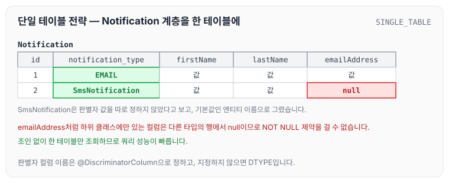
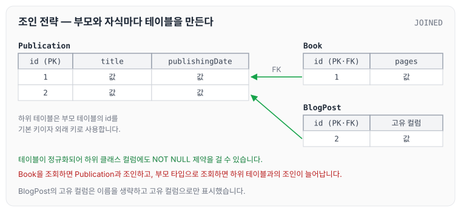
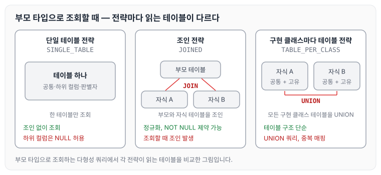
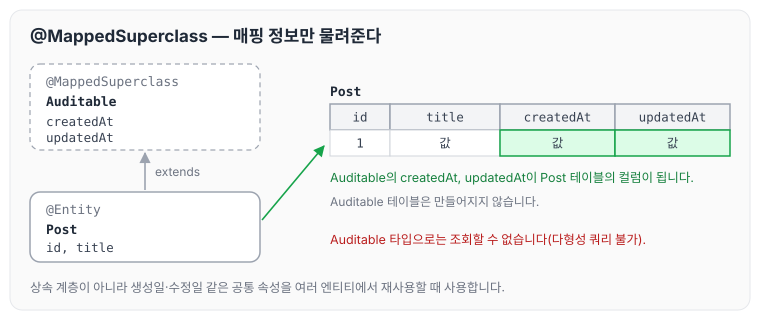

이전에 [식별자 (Identifiers), 관계 (Relationships)](../identifiers-relationships/)에 대해 작성하였습니다. 오늘은 같은 강의에서 다룬 JPA의 상속 매핑 전략을 성능 관점에서 정리하도록 하겠습니다. 각 전략의 기본 구조와 어노테이션은 [상속관계 매핑과 @MappedSuperclass](../jpa-advanced-mapping/)에서 정리하였습니다.

JPA의 상속 매핑은 객체지향의 계층 구조를 관계형 데이터베이스에 매핑하는 방법을 제공합니다. 각 전략은 성능, 데이터 무결성, 유지보수성 측면에서 장단점이 있으며, 어떤 전략을 선택하는지가 성능에 큰 영향을 미칩니다.

## 단일 테이블 전략 (SINGLE_TABLE)

단일 테이블 전략은 모든 상위 및 하위 클래스 엔티티를 하나의 테이블에 저장합니다. 클래스를 구분하기 위해 판별자 컬럼(`@DiscriminatorColumn`, 기본값 `DTYPE`)을 사용합니다.

장점은 아래와 같습니다.

- 테이블이 하나라서 조인이 필요 없고, 쿼리 성능이 빠릅니다.
- 간단한 계층 구조에 적합합니다.

단점은 아래와 같습니다.

- 하위 클래스별 고유 속성은 NULL을 허용하는 컬럼으로 저장되므로, 데이터 무결성 제약(NOT NULL)을 사용할 수 없습니다.
- 테이블 크기가 커질수록 관리가 복잡해집니다.

실무에서는 소규모 상속 계층(예: Notification → EmailNotification, SmsNotification)에서 사용합니다. 예시 코드는 아래와 같습니다.

```java
@Entity
@Inheritance(strategy = InheritanceType.SINGLE_TABLE)
@DiscriminatorColumn(name = "notification_type")
public abstract class Notification {
    @Id @GeneratedValue
    private Long id;
    private String firstName;
    private String lastName;
}

@Entity
@DiscriminatorValue("EMAIL")
public class EmailNotification extends Notification {
    private String emailAddress;
}
```

이 매핑으로 만들어지는 테이블에 EmailNotification과 SmsNotification을 한 건씩 저장하면 다음과 같습니다.



`emailAddress`처럼 하위 클래스에만 있는 컬럼은 다른 타입의 행에서 null이 되므로 NOT NULL 제약을 걸 수 없습니다. 성능 측면에서는 쿼리 성능은 우수하지만, 테이블 크기가 커지면 인덱스 효율성이 떨어질 수 있습니다.

## 조인 전략 (JOINED)

조인 전략은 상위 클래스와 각 하위 클래스마다 별도의 테이블을 만들고, 조인으로 데이터를 결합합니다. `@Inheritance(strategy = InheritanceType.JOINED)`를 사용합니다.

장점은 아래와 같습니다.

- 데이터가 정규화되어 무결성을 유지할 수 있습니다(NOT NULL 제약 가능).
- `@ManyToOne` 다형성 쿼리에 적합합니다.

단점은 아래와 같습니다.

- 조회할 때 조인 쿼리가 실행되어 성능이 떨어질 수 있습니다.
- 다형성 쿼리(예: `SELECT n FROM Notification n`)를 실행하면 복잡한 조인이 발생합니다.

실무에서는 데이터 무결성이 중요한 경우(예: Publication → Book, BlogPost)에 사용합니다.

```java
@Entity
@Inheritance(strategy = InheritanceType.JOINED)
public abstract class Publication {
    @Id @GeneratedValue
    private Long id;
    private String title;
    private LocalDate publishingDate;
}

@Entity
public class Book extends Publication {
    private int pages;
}
```

Publication, Book, BlogPost가 테이블로 어떻게 나뉘는지 그리면 다음과 같습니다.



하위 테이블은 부모 테이블의 id를 기본 키이자 외래 키로 사용하기 때문에, Book을 조회하려면 Publication과 조인해야 합니다. 성능 측면에서는 `@ManyToOne` 관계에서 Strategy 패턴과 결합하면 다형성을 효율적으로 처리할 수 있습니다. 다만 조인 쿼리 최적화(예: 인덱스, JOIN FETCH)가 필요합니다.

## 구현 클래스마다 테이블 전략 (TABLE_PER_CLASS)

구현 클래스마다 테이블 전략은 각 구체 클래스마다 독립된 테이블을 만듭니다. `@Inheritance(strategy = InheritanceType.TABLE_PER_CLASS)`를 사용합니다.

- 장점: 테이블 구조가 단순하고, 정규화가 필요 없습니다.
- 단점
    - 다형성 쿼리를 실행하면 모든 테이블에 대해 UNION 쿼리가 발생해 성능이 떨어집니다.
    - 속성 매핑이 테이블마다 중복되어 유지보수가 복잡합니다.
- 실무에서는 드물게 사용합니다. 다형성 쿼리가 필요 없는 경우에만 제한적으로 고려합니다.
- 성능 측면에서는 UNION 쿼리 때문에 대규모 데이터를 처리할 때 비효율적이므로, 사용을 지양하는 것을 권장합니다.

세 전략에서 부모 타입으로 조회할 때 읽는 테이블을 비교하면 다음과 같습니다.



단일 테이블 전략은 조인이 없고, 조인 전략은 하위 테이블이 늘어날수록 조인이 늘어나며, 구현 클래스마다 테이블 전략은 모든 구현 클래스 테이블을 UNION으로 합칩니다.

## 매핑된 슈퍼클래스 (@MappedSuperclass)

`@MappedSuperclass`는 상속 계층을 만드는 것이 아니라, 공통 속성을 재사용하기 위해 사용합니다. 데이터베이스 테이블에 직접 매핑되지 않습니다.

- 장점: 공통 속성(예: 생성일, 수정일)을 여러 엔티티에서 재사용할 수 있습니다.
- 단점: 다형성 쿼리를 지원하지 않습니다.
- 실무에서는 감사 로그 속성을 공유할 때 사용합니다. 예시 코드는 아래와 같습니다.

```java
@MappedSuperclass
public abstract class Auditable {
    private LocalDateTime createdAt;
    private LocalDateTime updatedAt;
}

@Entity
public class Post extends Auditable {
    @Id @GeneratedValue
    private Long id;
    private String title;
}
```

Auditable의 매핑 정보가 Post 테이블에 어떻게 들어가는지 그리면 다음과 같습니다.



Auditable 테이블은 만들어지지 않고, `createdAt`과 `updatedAt`이 Post 테이블의 컬럼이 됩니다. 성능 측면에서는 다형성이 필요 없는 경우에 간단하고 효율적입니다.

## 실무 적용

전략을 선택하는 기준은 아래와 같습니다.

- 데이터 접근 패턴: 조회 빈도가 높으면 SINGLE_TABLE, 무결성이 우선이면 JOINED를 선택합니다.
- 성능 요구사항: 다형성 쿼리가 많으면 JOINED 또는 SINGLE_TABLE을 선호합니다.
- 유지보수성: 복잡한 계층 구조는 JOINED로 정규화합니다.

성능을 최적화하는 방법은 아래와 같습니다.

- 다형성 쿼리 최적화: JOIN FETCH 또는 `@NamedEntityGraph`로 N+1 문제를 방지합니다.
- 판별자 컬럼 인덱싱: SINGLE_TABLE에서는 DTYPE 컬럼에 인덱스를 추가합니다.
- Hypersistence Optimizer로 상속 매핑 문제(예: 비효율적인 조인)를 진단합니다.

실무 팁은 아래와 같습니다.

- 상속은 주로 행동 패턴(Strategy, Visitor)을 구현할 때 적합합니다. 데이터 구조를 재사용할 때는 컴포지션을 선호합니다.
- SINGLE_TABLE은 소규모 계층, JOINED는 복잡한 계층에 적합합니다. TABLE_PER_CLASS는 피하는 것이 좋습니다.

## 권장사항

- 상속 계층은 최소화해서 쿼리 복잡성을 줄입니다.
- SINGLE_TABLE은 간단한 계층, JOINED는 무결성이 우선인 시스템에 사용합니다.
- 다형성 쿼리를 최적화하기 위해 `@NamedEntityGraph` 또는 JOIN FETCH를 활용합니다.
- Hypersistence Optimizer로 상속 매핑의 성능 문제를 분석합니다.

## 마무리

오늘은 JPA의 상속 매핑 전략인 SINGLE_TABLE, JOINED, TABLE_PER_CLASS와 `@MappedSuperclass`를 성능 관점에서 비교하고, 실무에서 전략을 고르는 기준과 최적화 방법에 대해 정리하였습니다.

참조 : [세계 자바 챔피언, Vlad Mihalcea 강의 로드맵 - 인프런](https://www.inflearn.com/roadmaps/9183)
