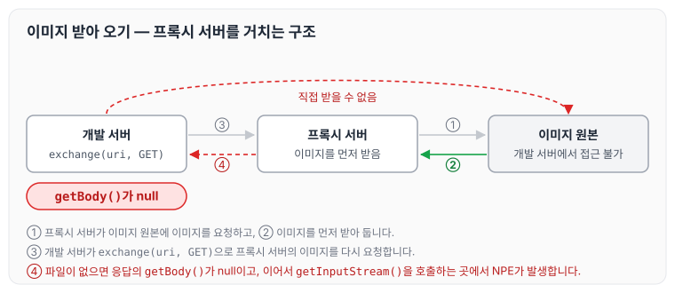
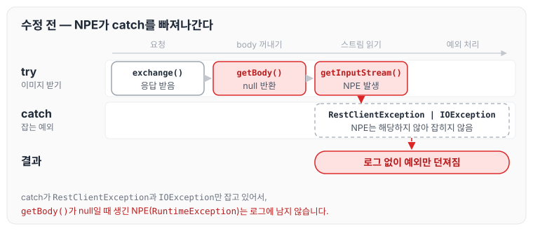
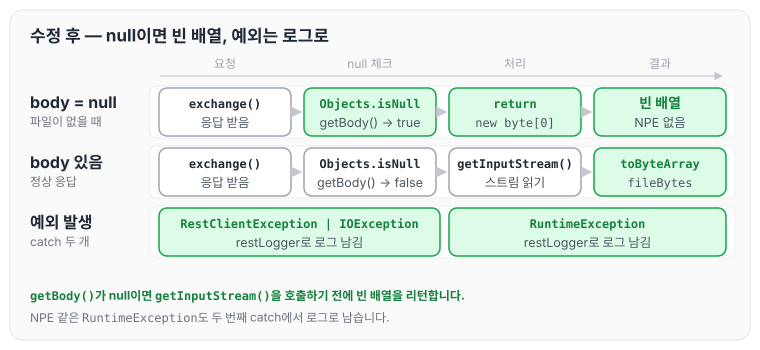

오늘은 프록시 서버를 거쳐 이미지를 받아 오는 기능을 작업하면서 발생한 NPE에 대해 정리하도록 하겠습니다.

## 문제 상황

개발 서버에서는 이미지를 직접 받을 수 없어서, 프록시 서버에서 이미지를 먼저 받은 후 개발 서버에서 프록시 서버의 이미지를 다시 받는 구조로 되어 있었습니다.



이 과정에서 방어 코드와 `try-catch`가 잘못 작성되어 있어서 계속 에러가 발생했고, 이를 해결하려면 방어 코드와 `try-catch`를 제대로 작성해야 했습니다.

또한 작업을 하면서 로그를 잘 남겨야 한다는 점도 한 가지 더 확인하였습니다. 에러는 발생했지만 잘못된 `try-catch` 때문에 어느 부분에서 문제가 발생하는지 찾기가 어려웠습니다.

문제가 있던 코드는 아래와 같습니다.

```java
try {
	ResponseEntity<Resource> responseEntity = new RestTemplate(new SimpleClientHttpRequestFactory()).exchange(uri, HttpMethod.GET, null, Resource.class);
	InputStream in = responseEntity.getBody().getInputStream();
	fileBytes = IOUtils.toByteArray(in);
} catch (RestClientException | IOException rce) {
	log.error("fail. tracking info {}", new InternalLogger(CrudType.READ, uri.getPath(), rce));
}

```

## 원인 분석

원인은 크게 두 가지였습니다.

1. `responseEntity.getBody()`를 호출할 때 값이 있는지 체크해야 했습니다. 값이 무조건 있다고 생각하고 호출하다 보니, 파일이 없을 때 null인 `getBody()`에 `getInputStream()`을 호출하게 되었습니다.
2. `catch`에서 `RestClientException`과 `IOException`은 잡았지만 `RuntimeException`은 잡지 않았습니다. 그래서 값이 null로 왔을 때 발생한 NPE(`RuntimeException`)가 로그에 찍히지 않고 예외로만 던져졌습니다.

null이 생긴 지점과 예외가 빠져나간 경로를 그림으로 보면 아래와 같습니다.



## 해결 방법

해결 방법도 두 가지로, 1) 방어 코드 추가, 2) catch 추가였습니다.

```java
try {
    ResponseEntity<Resource> responseEntity = new RestTemplate(new SimpleClientHttpRequestFactory()).exchange(uri, HttpMethod.GET, null, Resource.class);
    if (Objects.isNull(responseEntity.getBody())) {
        return new byte[0];
    }
    InputStream in = responseEntity.getBody().getInputStream();
    fileBytes = IOUtils.toByteArray(in);
} catch(RestClientException | IOException rce) {
	log.error("fail. tracking info {}", new restLogger(DataType.READ, uri.getPath(), rce));
} catch (RuntimeException runtimeException) {
	log.error("fail. tracking info {}", new restLogger(DataType.READ, uri.getPath(), runtimeException));
}
```

`getBody()`가 null이면 `getInputStream()`을 호출하기 전에 빈 바이트 배열을 리턴하고, 그 밖의 `RuntimeException`도 별도의 `catch`에서 로그를 남기도록 하였습니다. 방어 코드를 적용한 뒤의 흐름은 아래와 같습니다.



## 마무리

오늘은 프록시 서버를 거쳐 이미지를 받아 오면서 발생한 NPE와, 방어 코드와 `catch`를 추가해 해결한 과정에 대해 정리하였습니다.

이번 작업에서 배운 점은 `RestClientException`과 `IOException` 같은 경우 `restLogger` 객체를 생성해서 안에 명시해 주고 `toString`을 적어, 어떤 로그가 발생하는지 명확하게 해 두었다는 점입니다. 오류를 막는 것도 중요하지만, 정확하게 남긴 로그는 나중에 문제를 찾을 때 큰 도움이 될 것 같습니다.

이후 NPE를 막기 위해 자주 사용한 함수들은 [NPE를 막는 자바 방어 코드 모음](../java-null-safe-functions/)에 따로 정리하였습니다.
