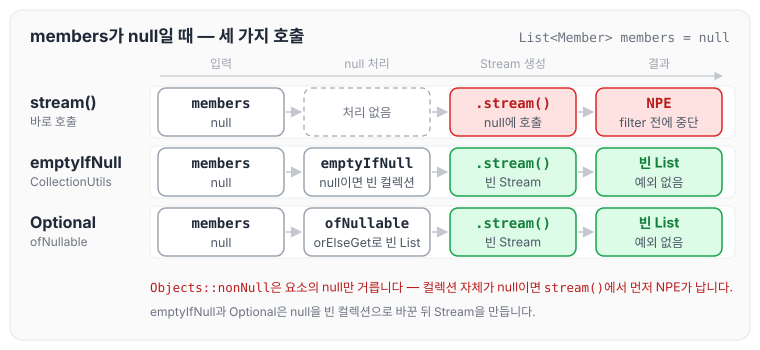
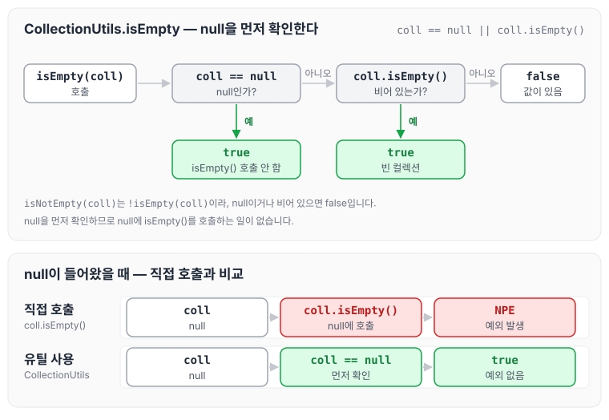
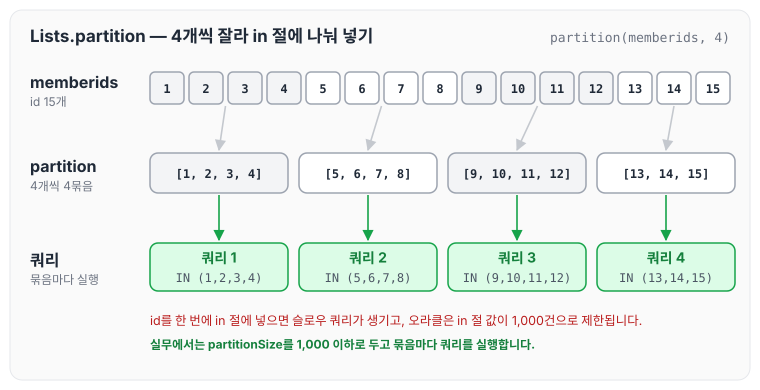

프로젝트를 진행하면서 NPE가 발생할 만한 곳에 방어 코드를 작성할 때가 많이 있었습니다. 이전에 정리한 [이미지 다운로드에서 터진 NPE와 방어 코드](../java-npe-defensive-code/)도 응답 값에 null 체크가 빠져 있어서 생긴 문제였습니다.

오늘은 이렇게 방어 코드를 작성하면서 사용했던 함수들을 기억해 두기 위해 정리하도록 하겠습니다.

## Stream Null Check

컬렉션을 Stream으로 처리할 때는 아래 세 가지를 확인합니다.

1. 컬렉션 자체가 null인 상태에서 Stream을 만들면 NPE가 발생합니다.
2. `CollectionUtils.emptyIfNull`은 null일 경우 빈 컬렉션(emptyCollection)을 리턴합니다.
3. `Optional.ofNullable(...).orElseGet(Collections::emptyList)`는 null일 경우 빈 리스트(emptyList)를 리턴합니다.

```java
List<Member> members = null;

//error
members.stream().filter(Objects::nonNull).forEach(
							member -> System.out.println(member.getUsername()));

//ok
CollectionUtils.emptyIfNull(members).stream()
				.filter(member -> "coby".equals(member.getUsername())).collect(Collectors.toList());

//ok
Optional.ofNullable(members)
        .orElseGet(Collections::emptyList).stream()
        .filter(member -> "coby".equals(member.getUsername())).collect(Collectors.toList());
```

`members`가 null일 때 세 코드가 어떻게 흘러가는지 그림으로 보면 아래와 같습니다.



`members.stream()`은 null에 메서드를 호출하는 것이라 `filter(Objects::nonNull)`까지 가기 전에 NPE가 발생합니다. `Objects::nonNull`은 컬렉션 안의 null 요소를 걸러 줄 뿐, 컬렉션 자체가 null인 경우는 막아 주지 못합니다. 나머지 두 방법은 null을 빈 컬렉션으로 바꾼 뒤 Stream을 만들기 때문에, 예외 없이 빈 결과가 나옵니다.

`emptyIfNull` 함수는 값이 null일 때 emptyCollection을 리턴하도록 설계되어 있습니다.

```java
// CollectionUtils 클래스
public static <T> Collection<T> emptyIfNull(Collection<T> collection) {
        return collection == null ? emptyCollection() : collection;
    }
```

컬렉션의 값을 체크할 때는 Apache Commons Collections의 CollectionUtils 클래스를 애용합니다. `isEmpty`는 null과 빈 컬렉션을 함께 확인합니다.

```java
// CollectionUtils 클래스
// 널과 함께, 값을 체크한다.
public static boolean isEmpty(Collection coll) {
        return coll == null || coll.isEmpty();
    }

public static boolean isNotEmpty(Collection coll) {
    return !isEmpty(coll);
}
```

`isEmpty`가 값을 판단하는 순서는 아래와 같습니다.



`coll == null`을 먼저 확인하기 때문에 null이면 `coll.isEmpty()`를 호출하지 않고 바로 true를 리턴합니다. 그래서 `coll.isEmpty()`를 직접 호출할 때와 달리 NPE가 발생하지 않습니다.

## partition 메소드

```java
public List divided(List<Long> memberids) {
        // memberids = [1, 2, 3, 4, 5, 6, 7, 8, 9, 10, 11, 12, 13, 14, 15]
        int partitionSize = 4;

        List<List<Long>> partition = Lists.partition(memberids, partitionSize);
        return partition;
    }
 // 결과값 [[1, 2, 3, 4], [5, 6, 7, 8], [9, 10, 11, 12], [13, 14, 15]]
```

partition 메소드는 큰 리스트를 정해진 크기의 리스트 그룹으로 잘라 주는 역할을 합니다. 위 예제에서는 15개의 id를 4개씩 잘라서, 마지막 그룹에는 남은 3개만 들어갑니다.

실무에서 partition을 사용한 이유는 where 절의 in 조건을 잘라서 넣기 위해서입니다. 너무 많은 데이터를 한 번에 넣어서 작업을 진행하면 슬로우 쿼리가 발생할 뿐만 아니라, 오라클 같은 경우 in 절에 넣을 수 있는 값이 1,000건으로 제한되어 있습니다. 이를 해결하기 위해 partition으로 1,000건 이하씩 끊어서 처리하는 경우가 있습니다.



그림에서는 예제와 같이 4개씩 잘랐지만, 오라클의 in 절 제한을 피하려면 partitionSize를 1,000 이하로 두고 그룹마다 쿼리를 한 번씩 실행합니다.

## Function.identity()로 Map 만들기

Stream을 사용해서 Map을 만들 때는 `Function.identity()` 함수를 사용합니다.

```java
Map<Long, Object> memberMapData = new HashMap<>();
List<Member> members = MemberRepository.getMemberList();

if (CollectionUtils.isNotEmpty(members)) {
	memberMapData = members.stream()
                    .collect(Collectors.toMap(Member::getMemberId, Function.identity()));
}
```

List를 Stream으로 Map으로 변경할 때, key는 id로 받고 value는 해당하는 객체를 그대로 쓰기 위해 `Function.identity()`를 사용합니다. `Function.identity()`는 입력받은 값을 그대로 리턴하는 함수입니다. 또한 위 코드처럼 `CollectionUtils.isNotEmpty`로 먼저 확인해 두면, `members`가 null이어도 NPE 없이 빈 Map이 남습니다.

`toMap`은 key가 중복되면 예외가 발생하므로, 중복될 수 있는 값을 key로 쓸 때는 [Collectors.toMap에서 만난 Duplicate Key 예외](../java-stream-duplicate-key/)에서 정리한 Merge Function을 함께 사용합니다.

## 마무리

오늘은 NPE를 막기 위해 사용했던 컬렉션 null 체크와 partition, `Function.identity()`로 Map을 만드는 방법에 대해 정리하였습니다. null이 들어올 수 있는 컬렉션은 Stream을 만들기 전에 빈 컬렉션으로 바꿔 두는 습관을 들이면, 같은 NPE를 반복하지 않는 데 도움이 될 것 같습니다.
