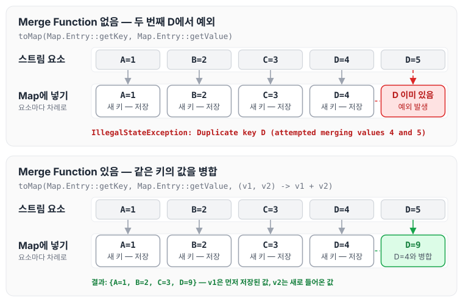

Stream의 `Collectors.toMap()`으로 컬렉션을 Map으로 변환하면서 발생한 Duplicate Key 예외에 대해 정리하도록 하겠습니다.

## 발생 원인

Java 8에서 제공하는 Stream API의 `Collectors` 클래스의 `toMap()` 메서드는 스트림의 요소를 모아 Map을 반환합니다.

다만 이 메서드는 스트림에서 처리하는 요소 중에 키가 중복되는 경우 Duplicate Key Error(`IllegalStateException`)를 발생시킵니다.

```java
Map<String, Integer> map = new HashMap<>();
map.put("A", 1);
map.put("B", 2);
map.put("C", 3);
map.put("D", 4);
map.put("D", 5);

// Duplicate key error: java.lang.IllegalStateException: Duplicate key 4
//Map<String, Integer> result = map.entrySet().stream().collect(Collectors.toMap(Map.Entry::getKey, Map.Entry::getValue));
```

위 예제는 키 `D`에 값 4와 5를 넣어 중복 키를 표현한 코드입니다. 다만 `HashMap`은 같은 키로 `put`을 하면 이전 값을 새 값으로 덮어쓰기 때문에, 실제로 `map`에는 `D=5` 하나만 남고 `entrySet()`의 스트림에서는 키가 중복되지 않습니다. 중복 키를 직접 확인하려면 아래처럼 같은 키를 가진 요소가 스트림에 두 번 들어오도록 만들어야 합니다.

```java
// Java 9 이상 (Map.entry)
Map<String, Integer> result = Stream.of(
                Map.entry("A", 1), Map.entry("B", 2), Map.entry("C", 3),
                Map.entry("D", 4), Map.entry("D", 5))
        .collect(Collectors.toMap(Map.Entry::getKey, Map.Entry::getValue));

// java.lang.IllegalStateException: Duplicate key D (attempted merging values 4 and 5)
```

예외 메시지는 Java 버전에 따라 다릅니다. Java 8에서는 원래 예제의 주석처럼 `Duplicate key 4`로 키 대신 먼저 들어간 값이 출력되고, Java 9부터는 키와 병합하려던 두 값이 함께 출력됩니다.

toMap이 요소를 하나씩 Map에 넣다가 같은 키를 만났을 때 어떻게 되는지 그리면 아래와 같습니다.



Merge Function이 없으면 두 번째 `D`에서 예외가 발생하고, Merge Function이 있으면 두 값을 병합한 결과가 저장되는 것을 확인할 수 있습니다.

## 해결 방법

이러한 오류가 발생하는 경우에는 `toMap()` 메서드의 세 번째 매개변수로 Merge Function을 전달하여 해결합니다. 첫 번째와 두 번째 매개변수는 키와 값을 만드는 함수입니다.

Merge Function은 중복 키가 발생할 때 값을 병합하는 방법을 정의합니다.

아래는 `toMap()` 메서드에서 Merge Function을 사용하여 중복 키 오류를 해결하는 방법입니다.

```java
Map<String, Integer> result = map.entrySet().stream()
        .collect(Collectors.toMap(Map.Entry::getKey, Map.Entry::getValue, (v1, v2) -> v1 + v2));

System.out.println(result); // {A=1, B=2, C=3, D=9}
```

`(v1, v2) -> v1 + v2`는 먼저 들어간 값(`v1`)과 새로 들어온 값(`v2`)을 더하는 함수입니다. 키 `D`에 4와 5가 차례로 들어오면 9가 저장됩니다. 다만 위 코드처럼 `HashMap`의 `entrySet()`을 스트림으로 만들면 앞에서 설명한 것처럼 `D=5`만 남아 있으므로, 실제 출력은 `{A=1, B=2, C=3, D=5}`입니다. `D=9`는 앞의 `Stream.of(...)` 예제처럼 중복 키가 스트림에 들어올 때의 결과입니다.

## 마무리

오늘은 컬렉션 중에 toMap을 할 때 자주 발생할 수 있는 Duplicate Key Error에 대하여 정리하였습니다. 컬렉션이 맵으로 변경되기 쉬운 만큼 조건을 잘 걸어줘야 하며, 추가로 null도 filter로 걸러주는 게 좀 더 안정적인 방법이지 않을까 싶습니다.
