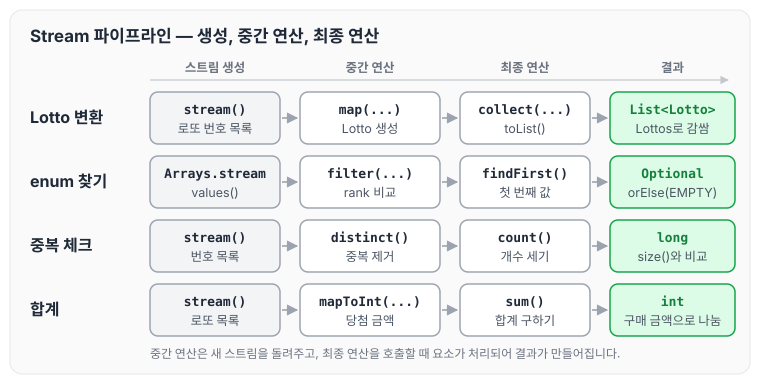

자바를 다시 사용하면서 for문에 너무 익숙해져 있다는 것을 느꼈습니다. 그래서 자주 사용하는 Stream 예제를 적어 두고 활용하려고 합니다. 오늘은 Stream을 활용한 예제들을 정리하도록 하겠습니다.

## Stream 파이프라인

아래 예제들은 모두 스트림을 만들고, 중간 연산으로 요소를 바꾸거나 거른 뒤, 최종 연산으로 결과를 만드는 순서로 작성되어 있습니다. `map`, `filter`, `distinct` 같은 중간 연산은 새 스트림을 돌려주고, `collect`, `findFirst`, `count`, `sum` 같은 최종 연산을 호출해야 실제로 요소가 처리됩니다.

이 글의 예제 몇 개를 이 순서에 맞춰 그리면 아래와 같습니다.



예제마다 중간 연산은 달라도, 최종 연산 하나로 List·Optional·개수·합계 같은 결과를 얻는 것을 확인할 수 있습니다.

## stream을 사용해서 번호 리스트를 Lotto 리스트로 변경

`List<List<Integer>>`를 `List<Lotto>`로 변경하는 예제입니다. for문으로 `Lotto`를 하나씩 만들어 리스트에 담던 코드를 `map`과 `collect`로 바꾸었습니다.

```java
// 변경 전
public static Lottos fromManualLottos(List<List<Integer>>  manualLottos) {
        List<Lotto> lottos = new ArrayList<>();
        for (int i = 0; i < manualLottos.size(); i++) {
            lottos.add(Lotto.fromManualLotto(new LottoPolicyStrategy(), manualLottos.get(i)));
        }
        return new Lottos(lottos);
}

// 변경 후
public static Lottos fromManualLottos(ManualLottoParam manualLotto) {
    List<Lotto> lottos = manualLotto.getManualLottos()
            .stream()
            .map(numbers -> Lotto.fromManualLotto(new LottoPolicyStrategy(), numbers.getLottoNumbers()))
            .collect(Collectors.toList());

    return new Lottos(lottos);
}
```

## stream을 사용해서 List를 Map으로 변경

`Collectors.toMap`에 키를 만드는 함수와 값을 만드는 함수를 넘겨 List를 Map으로 변경합니다.

```java
private Map<Integer, Integer> convertLottoNumbersToMap(Lotto winningLotto) {
    return winningLotto.getNumbers()
            .stream()
            .collect(Collectors.toMap(LottoNumber::getNumber, LottoNumber::getNumber));
}
```

요소 객체를 그대로 값으로 사용할 때는 `Function.identity()` 함수를 사용합니다.

```java
Map<Long, Object> memberMapData = new HashMap<>();
List<Member> members = MemberRepository.getMemberList();

if (CollectionUtils.isNotEmpty(members)) {
	memberMapData = members.stream()
                    .collect(Collectors.toMap(Member::getMemberId, Function.identity()));
}
```

List를 스트림을 사용해 Map으로 변경할 때, key는 id로 받고 해당하는 객체를 그대로 사용하기 위해 `Function.identity()`를 사용합니다. `Function.identity()`는 입력받은 값을 그대로 돌려주는 함수라서 키 중복과는 관계가 없습니다. 같은 키가 두 번 나오면 `IllegalStateException`이 발생하므로, 키가 중복될 수 있다면 [Collectors.toMap에서 만난 Duplicate Key 예외](../java-stream-duplicate-key/)에서 정리한 것처럼 세 번째 인자로 Merge Function을 넘겨야 합니다.

## stream을 사용해서 enum 값 찾기

`values()`로 enum 상수를 스트림으로 만들고, `rank`가 같은 첫 번째 값을 찾습니다. 찾는 값이 없으면 `EMPTY`를 돌려줍니다.

```java
return Arrays.stream(values())
                .filter(value -> rank == value.rank)
                .findFirst()
                .orElse(WinningAmountByRank.EMPTY);
```

## stream을 사용해서 list 값 합치기

로또마다 당첨 금액을 `mapToInt`로 숫자로 바꾼 뒤 `sum`으로 합계를 구하고, 구매 금액으로 나누어 수익률을 계산합니다.

```java
public double calculatorProfit(Lottos lottos, int purchaseAmount) {
    double sum = lottos.getLottos()
            .stream()
            .mapToInt(lotto -> WinningAmountByRank.from(getWinningResult(lotto)).getAmount()).sum();

    return sum / purchaseAmount;
}
```

## stream을 사용해 중복값 체크

`distinct`로 중복을 제거한 개수와 원래 리스트의 크기가 다르면 중복 값이 있다고 판단합니다.

```java
if(manualLottoNumbers.size() != manualLottoNumbers.stream()
        .distinct()
        .count()){
    throw new IllegalArgumentException("중복 값이 있습니다.");
}
```

## stream의 null check

이 내용은 [NPE를 막는 자바 방어 코드 모음](../java-null-safe-functions/)에서도 정리하였습니다. 아래 코드의 세 가지 경우는 다음과 같습니다.

1. null인 리스트에서 바로 스트림을 만들면 NPE가 발생합니다.
2. null인 경우 emptyCollection을 리턴합니다.
3. null인 경우 emptyList를 리턴합니다.

```java
List<Member> members = null;

//error
members.stream().filter(Objects::nonNull).forEach(
							member -> System.out.println(member.getUsername()));

//ok
CollectionUtils.emptyIfNull(members).stream()
				.filter(member -> "coby".equals(member.getUsername())).collect(Collectors.toList());

//ok
Optional.ofNullable(members)
        .orElseGet(Collections::emptyList).stream()
        .filter(member -> "coby".equals(member.getUsername())).collect(Collectors.toList());
```

`emptyIfNull` 함수는 값이 null일 때 emptyCollection을 리턴하도록 설계되어 있습니다.

```java
// CollectionUtils 클래스
public static <T> Collection<T> emptyIfNull(Collection<T> collection) {
        return collection == null ? emptyCollection() : collection;
    }
```

컬렉션의 값을 체크할 때는 `CollectionUtils` 클래스를 사용하면 null 체크와 빈 값 체크를 함께 할 수 있습니다.

```java
// CollectionUtils 클래스
// 널과 함께, 값을 체크한다.
public static boolean isEmpty(Collection coll) {
        return coll == null || coll.isEmpty();
    }

public static boolean isNotEmpty(Collection coll) {
    return !isEmpty(coll);
}
```

## stream으로 List 값을 String으로 합치기

`map`으로 이름을 문자열로 바꾼 뒤 `Collectors.joining`으로 구분자를 넣어 하나의 문자열로 합칩니다.

```java
String victoryMessage = winners.stream().map(n -> String.valueOf(n.getName()))
                .collect(Collectors.joining(", "));
```

## reduce 사용법

`reduce`로 List에 담긴 모든 숫자의 합을 구합니다. 초기값 0에서 시작해 요소를 하나씩 더합니다.

```java
// nextstep.fp.StreamStudy 클래스의 sumAll method 참고

List<Integer> numbers = Arrays.asList(1, 2, 3, 4, 5, 6);

public int sumAll(List<Integer> numbers) {
    return numbers.stream().reduce(0, (x, y) -> x + y);
}
```

## 마무리

오늘은 for문 대신 Stream으로 리스트·맵 변환, enum 값 찾기, 합계, 중복 체크, null 처리, 문자열 합치기, reduce를 작성하는 예제를 정리하였습니다. 자주 쓰는 형태를 적어 두고 for문 대신 먼저 떠올릴 수 있도록 활용해 보려고 합니다. reduce는 잘 설명한 블로그가 있어 참조를 남겨 둡니다.

참조 : [Java - Stream.reduce() 사용 방법 및 예제](https://codechacha.com/ko/java8-stream-reduction/#4-병렬-처리에서-reduce는-순차적으로-처리)
