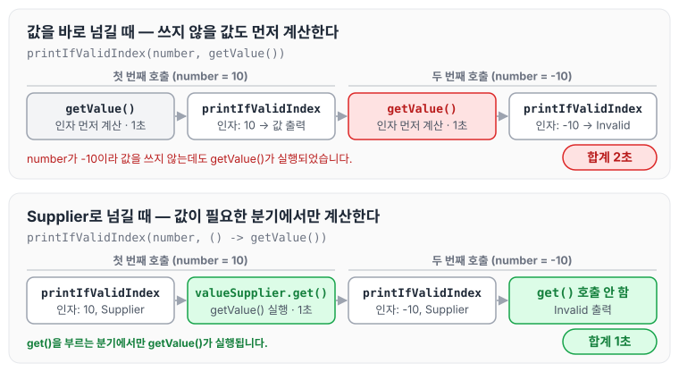

오늘은 Java의 함수형 인터페이스 중 하나인 공급자 Supplier에 대해 정리하도록 하겠습니다.

## Supplier

공급자 Supplier 인터페이스는 Java의 함수형 프로그래밍을 지원하는 인터페이스 중 하나로, 인자를 받지 않고 값을 하나 돌려주는 `get` 메서드만 가지고 있습니다. 인터페이스 정의는 아래와 같습니다.

```java
public interface Supplier<T> {

    /**
     * Gets a result.
     *
     * @return a result
     */
    T get();
}
```

## 사용 방법

`Supplier` 인터페이스는 `get` 메서드를 정의하며, 이 메서드를 구현하여 객체를 생성하고 반환합니다.

### 기본 사용 방법

람다식으로 문자열을 돌려주는 Supplier를 만들고, `get` 메서드를 호출해 값을 받는 예제입니다.

```java
import java.util.function.Supplier;

public class SupplierExample {
    public static void main(String[] args) {
        // Supplier를 사용하여 문자열을 생성하는 팩토리 함수
        Supplier<String> stringSupplier = () -> "Hello, World!";

        // Supplier의 get 메서드를 호출하여 객체 생성
        String message = stringSupplier.get();

        System.out.println(message); // "Hello, World!"
    }
}
```

### Custom 클래스와 함께 사용하는 Supplier

직접 정의한 클래스의 객체도 같은 방식으로 생성할 수 있습니다. 아래는 `Person` 객체를 생성하는 Supplier입니다.

```java
import java.util.function.Supplier;

class Person {
    private String name;
    private int age;

    public Person(String name, int age) {
        this.name = name;
        this.age = age;
    }

    public String getName() {
        return name;
    }

    public int getAge() {
        return age;
    }

    @Override
    public String toString() {
        return "Person{name='" + name + "', age=" + age + '}';
    }
}

public class SupplierWithCustomClass {
    public static void main(String[] args) {
        // 사용자 정의 클래스 Person을 생성하는 Supplier
        Supplier<Person> personSupplier = () -> new Person("Alice", 30);

        // Supplier의 get 메서드를 호출하여 Person 객체 생성
        Person person = personSupplier.get();

        // Person 객체 출력
        System.out.println(person);  // 출력: Person{name='Alice', age=30}
    }
}
```

### Primitive 타입에 대한 Supplier

int, double, long 같은 기본 타입을 돌려줄 때는 `IntSupplier`, `DoubleSupplier`, `LongSupplier`를 사용합니다. 메서드 이름도 `getAsInt`, `getAsDouble`, `getAsLong`으로 다릅니다.

```java
import java.util.function.IntSupplier;
import java.util.function.DoubleSupplier;
import java.util.function.LongSupplier;

public class PrimitiveSupplierExample {
    public static void main(String[] args) {
        // IntSupplier를 사용하여 int 값을 생성
        IntSupplier intSupplier = () -> 42;
        int intValue = intSupplier.getAsInt();
        System.out.println("Int Value: " + intValue);  // 출력: Int Value: 42

        // DoubleSupplier를 사용하여 double 값을 생성
        DoubleSupplier doubleSupplier = () -> 3.14;
        double doubleValue = doubleSupplier.getAsDouble();
        System.out.println("Double Value: " + doubleValue);  // 출력: Double Value: 3.14

        // LongSupplier를 사용하여 long 값을 생성
        LongSupplier longSupplier = () -> 123456789L;
        long longValue = longSupplier.getAsLong();
        System.out.println("Long Value: " + longValue);  // 출력: Long Value: 123456789
    }
}
```

## 왜 사용하는가

### 지연 초기화(Lazy Initialization)

Supplier를 사용하면 객체 생성을 필요한 순간까지 미룰 수 있습니다. 값을 만드는 데 시간이 오래 걸리거나 자원이 많이 드는 경우, 실제로 쓰일 때만 만들 수 있어 성능 향상과 자원 절약에 도움이 됩니다.

먼저 Supplier 없이 값을 바로 넘기는 예제입니다. `getValue`는 1초를 기다린 뒤 값을 돌려주는 메서드입니다.

```java
public class LazyEvaluation {
		public static void main(String[] args) {
				long start = System.currentTimeMillis();
				printIfValidIndex(10, getValue());
				printIfValidIndex(-10, getValue());
				System.out.println("It took" + ((System.currentTimeMillis() - start) / 1000) + " Second");
		}

		private static String getValue() {
				try {
						TimeUnit.SECONDS.sleep(1);
				} catch (InterruptedException e) {
						e.printStackTrace();
				}
		}
		
		private static void printIfValidIndex(int number, String value) {
				if (number > 0) {
						System.out.println(value);
						return;
				}
				System.out.println("Invalid");
		}
}
```

위 예제는 `printIfValidIndex` 함수가 호출되기 전에 인자인 `getValue`가 먼저 호출되기 때문에, 값을 사용하지 않는 `-10`의 경우에도 `getValue`가 실행되어 총 2초의 지연이 발생합니다.

다음은 같은 코드를 Supplier로 바꾼 예제입니다.

```java
public class LazyEvaluation {
		public static void main(String[] args) {
				long start = System.currentTimeMillis();
				printIfValidIndex(10, () -> getValue());
				printIfValidIndex(-10, () -> getValue());
				System.out.println("It took" + ((System.currentTimeMillis() - start) / 1000) + " Second");
		}

		private static String getValue() {
				try {
						TimeUnit.SECONDS.sleep(1);
				} catch (InterruptedException e) {
						e.printStackTrace();
				}
		}
		
		private static void printIfValidIndex(int number, Supplier<String> valueSupplier) {
				if (number > 0) {
						System.out.println(valueSupplier.get());
						return;
				}
				System.out.println("Invalid");
		}
}
```

위 예제는 람다식 `() -> getValue()`를 Supplier로 넘기고, `printIfValidIndex` 안에서 값이 필요할 때 `valueSupplier.get()`으로 호출합니다. 조건이 맞는 경우에만 `getValue`가 호출되므로 지연은 1초만 발생합니다.

두 예제에서 `getValue`가 언제 호출되는지 비교하면 아래와 같습니다.



값을 바로 넘기면 조건과 관계없이 호출할 때마다 `getValue`가 실행되지만, Supplier로 넘기면 `get()`을 부르는 분기에서만 실행되는 것을 확인할 수 있습니다.

## 마무리

오늘은 함수형 인터페이스 Supplier의 정의와 사용 방법, 그리고 값이 필요한 순간까지 호출을 미루는 지연 초기화에 대해 정리하였습니다. 만드는 비용이 큰 값을 조건에 따라 사용할 때 Supplier로 넘기는 방법을 활용하면 좋을 것 같습니다.

참조 : [[Java] 공급자 `Supplier<T>`](https://hwan33.tistory.com/17)
